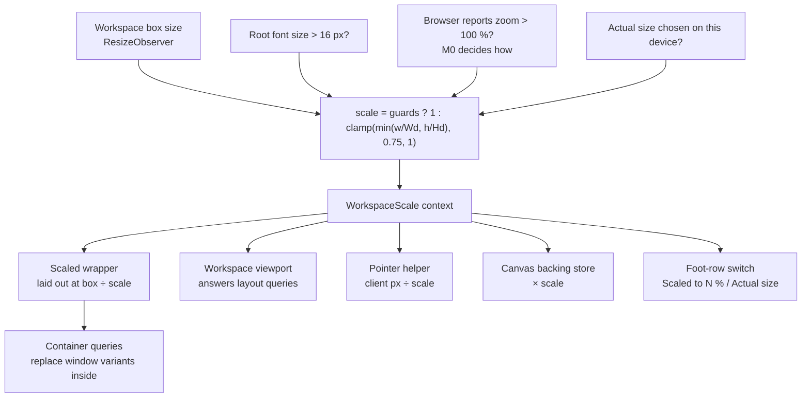

# Feature Spec: The plan workspace scales to fit below 1280 × 800

- **Status:** Draft — 2026-11-15, waiting for the product owner's approval.
- **ADR:** [ADR-0222](adr-0222-draft.md)
- **Plan:** [`implementation-plan.md`](implementation-plan.md)
- **Why a spec** (ADR-0105): it adds a control (the actual-size switch), changes shared gates (the designed
  sweep moves) and changes how shared components answer layout questions.

## 1. Business understanding

### Problem

The workspace has been made to fit a 1024 × 600 window by rearranging itself, one short-window rule at a time
(ADR-0180, -0183, -0185, -0213, -0219, #1382). Each fix exposed the next limit; at 1024 × 600 the diagram with a
selection is still under its 350 px floor, and with touch the toolbar takes about 0.43 of the height
(`docs/HANDOFF.md`). The owner wants to stop designing for small windows and instead shrink the workspace to fit.

### Users

Planners and Contributors working in the plan workspace on laptops and tablets smaller than 1280 × 800 (as a
browser window). The owner's own devices (about 1912 × 948 on the Dell, 1912 × 1114 on the Surface) are above it
and see no change.

### Primary use cases

1. A planner on a small laptop opens a plan and sees the full designed workspace, smaller, with nothing
   rearranged or hidden.
2. A reader who zooms the browser or enlarges text gets bigger text, exactly as today; the app never shrinks it
   back.
3. A reader whose browser cannot report zoom switches the workspace to actual size once, and it stays that way
   on that device.

### User journeys

- **Small laptop.** Window 1366 × 636. The workspace's box is smaller than designed; the scale is about 0.80. The
  toolbar, diagram, panel and foot row appear as they do at 1280 × 800, at 80 %. The foot row shows "Scaled to
  80 %". Clicking a bar selects that bar.
- **Zoomed reader, Chromium.** A 1280 × 800 window at 150 % zoom. The browser reports the zoom, so the scale is 1
  and the workspace looks as it does today at 853 × 533 (short-window rules and scrolling included).
- **Zoomed reader, a browser that cannot report zoom.** The workspace scales. The reader presses "Scaled to
  80 %"; it switches to actual size and reads "Actual size". The choice is remembered on that device.
- **Larger text.** The browser's text setting is 200 %. The root font size is 32 px, so the scale is 1.

### Expected outcomes

- From 1024 × 600 to 1280 × 800 the workspace shows the designed layout, scaled, instead of a rearranged one.
- No reader's own zoom or text size is cancelled.

### Success criteria

- **SC-1** At 1024 × 600, 1152 × 720 and 1366 × 636 the workspace fills its box, the layout inside it matches the
  1280 × 800 layout (same rows, same controls on the toolbar), and nothing scrolls inside the workspace that does
  not scroll at 1280 × 800.
- **SC-2** A click or tap on a bar at any scale selects the bar under the pointer; a drag moves it by the distance
  the pointer moved on screen.
- **SC-3** No pressable control in a scaled workspace renders under 24 × 24 px (axe `target-size` passes at 0.75).
- **SC-4** The scale is 1 under a 200 % browser text setting and under a user style sheet that doubles the root
  size, at every window size.
- **SC-5** Where M0 shows Chromium reports browser zoom, the scale is 1 whenever zoom is above 100 %.
- **SC-6** The actual-size choice turns scaling off at once, is remembered across reloads and tabs, and is
  reachable by keyboard and named for screen readers.
- **SC-7** Diagram text and lines are as sharp at 0.8 as at 1 (the canvas backing store matches its drawn size).
- **SC-8** At 1280 × 800 and above nothing visible changes.

### Open questions

- **Q1 — Is 1280 × 800 the browser window or the screen?** Recommended: **the window**. A 1280 × 800 screen leaves
  a window of about 1280 × 668 after the browser and taskbar (132 px, the owner's measured overhead), so treating
  it as the screen would mean a smaller designed size. Consequence of the recommendation: a common 1920 × 1080
  laptop at Windows' 125 % setting (window about 1536 × 730) scales to about 0.91.
- **Q2 — The smallest scale.** Recommended: **0.75**, so every window that met the old 1024 × 600 floor gets the
  designed layout; the 28 px buttons grow to 32 px while scaled so they render at 24 px; 12 px text renders at
  9 px. Alternative: **0.86**, where no button has to grow and text renders at 10 px or more, but windows under
  about 1100 × 690 keep today's short-window layouts.
- **Q3 — When the app cannot tell whether the reader has zoomed.** Recommended: **scale, and show the "Scaled to
  N %" switch**, remembered per device. Alternative: **do not scale unless the browser confirms it is not
  zoomed**, which is safest for zoomed readers but means browsers that cannot report zoom (probably Firefox)
  never scale.

## 2. Functional requirements

### User stories & acceptance criteria

1. **As a planner on a small window, I see the designed workspace, smaller.**
   - Given a window under 1280 × 800 and at least 1024 × 600, when a plan opens, the workspace is laid out at its
     designed size and drawn at the scale that fits its box (SC-1).
   - Given the window is resized, when the pointer is not held down, the scale follows within one frame of the
     resize settling; during a drag the scale waits until release.
2. **As a reader who zooms or enlarges text, the app does not undo it.** (SC-4, SC-5)
3. **As a reader whose browser hides its zoom, I can choose actual size.** (SC-6)
   - The switch sits at the trailing end of the foot row, only while the scale is under 1 or the reader has chosen
     actual size in a window that would otherwise scale.
   - It is a toggle button: name "Workspace scale", pressed state reflecting actual size, visible text "Scaled to
     N %" or "Actual size". Tooltip: "Shrinks the plan view to fit this window. Choose actual size if you have
     zoomed the browser."
   - Stored under `schedulepoint:workspace-actual-size = '1'` with the same storage fallback and cross-tab sharing
     as the viewport notice's acknowledgement (ADR-0179 D5). Not cleared at sign-out (per device).
4. **As any reader, dialogs, menus and tooltips stay at full size.** (ADR-0222 D7)

### Workflows

See the user journeys above. There is no server workflow.

### Edge cases

- **Window under 1024 × 600:** the scale stays at 0.75 and the workspace scrolls and uses the short-window rules,
  as today below the floor. The viewport notice still appears below 1024 wide.
- **Very wide, short window (e.g. 1600 × 640):** the height decides (0.8); the workspace is laid out wider than
  1280, so the toolbar may promote more commands, as it would in a 2000 × 800 window.
- **The Explorer is resized or collapsed:** the workspace's box changes, so the scale changes.
- **Moving the window between screens with different scaling:** the box in CSS px changes only if the browser
  says so; the scale follows the box.
- **Printing and image export:** unaffected. They draw from the diagram's own model at their own size
  (ADR-0103), not from the scaled screen; M1 confirms with the existing export journeys.
- **Guest share view (`/share`):** not part of this change; it keeps its current layout. (It can follow later as
  its own decision.)
- **The Gantt's sticky columns and scroll positions:** they live inside the scaled box and keep working; M0
  measures scroll position and sticky placement under the chosen mechanism.

### Permissions

None. The scale is a display choice available to everyone who can open a plan, including Viewers.

### Validation rules

The stored value is read against exactly `'1'`; anything else means "scale when needed".

### Error scenarios

- Storage unavailable: the choice lasts for the visit (module memory), as for the viewport notice.
- A browser without the chosen mechanism: the scale is 1 (feature detection at start-up), so the workspace
  behaves as today.

## 3. Technical analysis

- **Where layout asks the window today.** 13 files call `matchMedia` or a media-query hook outside tests
  (`grep -rln "matchMedia\|useMediaQuery" apps/web/src`, excluding tests), four of them in
  `components/ui/toolbar`. In `features/tsld`, `features/gantt`, `components/layout/workspace` and
  `features/plan-actions` the window variants appear about 20 times (`short:` 6, `sm:` 7, `xs:` 3, `wide:` 3,
  `lg:` 1). All of these must answer to the workspace's box (ADR-0222 D5).
- **Pointer maths.** `TsldCanvas.tsx` (3,190 lines) converts pointer positions with `e.clientX - rect.left` in
  several places (`:2445`, `:2599`, `:2900`, and the drag deltas at `:3103`). Under a transform, client coordinates
  are on-screen pixels and the canvas's own size is in layout pixels, so each needs dividing by the scale. The
  minimap, resource strip and swimlane gutter are separate canvases with their own handlers.
- **Canvas sharpness.** `getDpr()` caps the backing ratio at 2 (`TsldCanvas.tsx:533`). A scaled canvas must size its
  backing store to layout size × ratio × scale.
- **Small controls.** `icon-sm` and `icon-row` are 28 px (`button.tsx:71`, `:91`).
- **Detecting enlarged text.** The root font size is already read by `designedMinWidthPx()` (`breakpoints.ts`).
- **Detecting zoom.** Unmeasured. Candidate in Chromium: `outerWidth / innerWidth`. Headless Chromium has a
  text-size setting (CDP `Page.setFontSizes`, used by ADR-0213's M0) but no page zoom, so M0 also checks whether
  zoom can be simulated at all (for example a headed run with keyboard zoom, or a device-scale flag) before
  trusting any signal.
- **Not testable here:** Firefox, WebKit, real touch hardware (only Chromium is installed in `/opt/pw-browsers`).

### Dependencies

None new. CSS transforms and container queries are in every supported browser (`docs/PROJECT_BRIEF.md` §16,
the latest two versions of Chrome, Edge, Firefox and Safari; ADR-0213 already relies on size container queries).

## 4. Solution design

### Architecture overview

### Data flow

1. A `ResizeObserver` on the workspace's outer box reports its size in CSS px.
2. `useWorkspaceScale` combines it with the three guards (ADR-0222 D4) and the floor (D3), and holds the value
   while a pointer is down.
3. The inner wrapper is sized to `box ÷ scale` and drawn at `scale`; it is a named size container
   (`workspace`), so the converted variants answer in layout px.
4. Components that call `matchMedia` inside the workspace call `useWorkspaceMedia(query)` instead, which answers
   from the wrapper's layout size and falls back to `matchMedia` outside a workspace.
5. Canvas components read the scale for hit-testing and backing-store size.

### User flow

Open a plan → the workspace appears scaled (if needed) → work as usual → optionally press the switch for actual
size.

### Database changes

None.

### API changes

None.

### Component changes

- **New:** `components/layout/workspace/workspace-scale.tsx` (context, hook, wrapper), `workspace-media.ts`
  (layout queries inside the workspace), `workspace-scale-switch.tsx` (the foot-row toggle),
  `workspace-scale-pref.ts` (storage, mirroring `viewport-notice-ack.ts`).
- **Changed:** `plan-workspace.tsx` (mounts the wrapper); the toolbar and deck components that call `matchMedia`;
  `TsldCanvas.tsx` and the other workspace canvases (pointer helper, backing store); `button.tsx` (`icon-sm` and
  `icon-row` take 32 px inside a scaled workspace, through a data attribute on the wrapper); `globals.css`
  (container variants for the workspace); the viewport notice copy.
- **Shared-primitive keyboard contracts:** unchanged. The switch is an ordinary toggle button.

### Implementation approach & alternatives

See ADR-0222's alternatives. The mechanism (transform or `zoom`) is chosen at M0 by measurement, with a stop rule:
if neither keeps pointer positions, menus and canvas sharpness correct in Chromium without per-site hacks beyond
the one helper, the work stops and the owner is asked.

## 5. Links

- ADR-0222, ADR-0179, ADR-0213, ADR-0118, ADR-0173, ADR-0105.
- `docs/HANDOFF.md`, "What is next", item 1.
