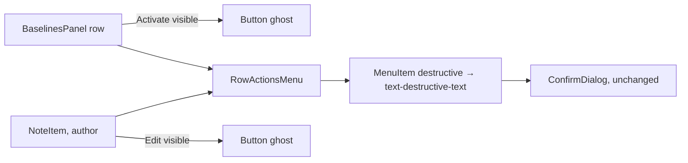
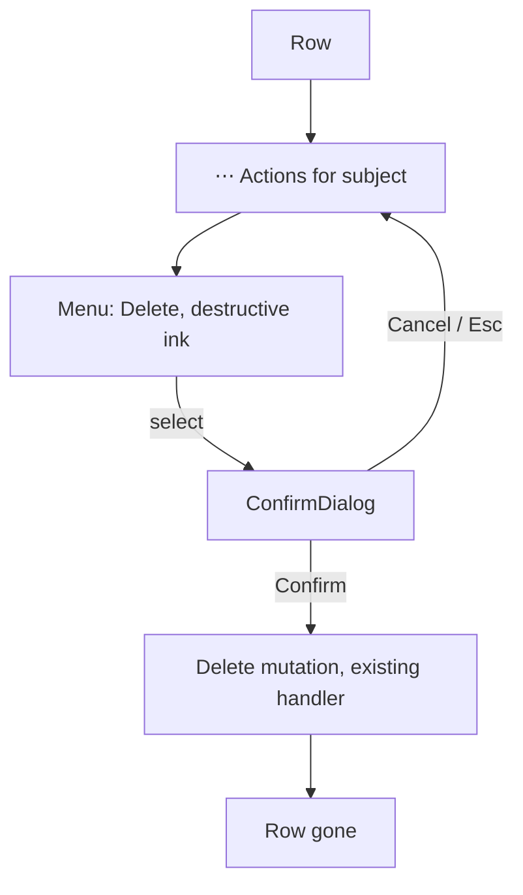

# Feature Spec: Screen tidy — the three open items of `docs/TECH_DEBT.md` #165

- **Status:** Approved — by the product owner, 2026-10-21, with all defaults
- **Author(s):** feature-analyst
- **Date:** 2026-10-21
- **Tracking issue / epic:** `docs/TECH_DEBT.md` #165 (b), (d), (e)
- **Roadmap link:** none (debt)
- **Related ADR(s):** ADR-0145 D2 (row-action shape), ADR-0146 M3 (segmented track), ADR-0143 M0
  (staff shot), ADR-0082, ADR-0105. **No new ADR**: nothing here is architecturally new.

## 1. Business understanding

### Problem — re-verified against the code, not the row (CLAUDE.md §19.11)

The brief (and `docs/HANDOFF.md:137`) describes three live items. **Two of the three are already
fixed in code and the third is two-thirds fixed**; the row was never updated. This is the
already-fixed-and-unclosed shape the row's own header (`TECH_DEBT.md:3551-3553`) records once already.

| Item | Brief says                                                | Code says                                                                                                                                                                                                                                                                                                                                                                                                                                                                                                                                                                          |
| ---- | --------------------------------------------------------- | ---------------------------------------------------------------------------------------------------------------------------------------------------------------------------------------------------------------------------------------------------------------------------------------------------------------------------------------------------------------------------------------------------------------------------------------------------------------------------------------------------------------------------------------------------------------------------------- |
| (b)  | `SegmentedControl` unselected options have no border/fill | **Fixed 2026-09-17** (page-composition M3, `docs/specs/page-composition/m3-m4-record.md:4,110`). The group is a track: `bg-muted border-input … rounded-md border p-1` (`segmented-control.tsx:156-159`); selected option `ring-1 ring-input` (`:191-193`). Gated: `--muted`/`--input` and `--background`/`--input` at 3:1 in every scope (`token-contrast.test.ts:112,158`); presence asserted at rest, nothing selected, in a real browser (`e2e-page-composition/composition.spec.ts:599-649`). `/me/activity` renders the same `AuditFilterBar` (`routes/my-activity.tsx:92`). |
| (b)  | Other consumer is the plan workspace mode row (ADR-0119)  | **False.** Consumers are `AuditFilterBar.tsx:93`, `RecentlyDeletedTable.tsx:413`, `ResourceCollisionResolver.tsx:63` only. The mode row is toolbar segments (`features/tsld/toolbar/plan-mode-segments.structural.test.ts`), not this primitive.                                                                                                                                                                                                                                                                                                                                   |
| (d)  | All six row Deletes are `variant="ghost"`                 | **Four of six fixed** by ADR-0145 D2 (`docs/adr/0145-…md:56-65`): `ProjectsTable.tsx:104-113`, `PlansTable.tsx:102-108`, `ClientsTable.tsx:181-187`, `ResourcesTable.tsx:433-443` put Delete in `RowActionsMenu` as `<MenuItem destructive>`, which paints `text-destructive-text` (`menu.tsx:503`). **Two survive**: `BaselinesPanel.tsx:111-121` and `NoteItem.tsx:200-210`, both a ghost `Delete` beside a ghost sibling. Both are on plan surfaces, which that epic excluded by scope (`docs/specs/page-consistency/feature-spec.md:714`), not by decision.                    |
| (e)  | `/staff` unphotographed; needs a staff onboarding path    | **Fixed** by staff-console-design M0 (ADR-0143; `docs/specs/staff-console-design/m0-measurement.md:70-93`, closing #319). `shoot.mjs:124-166` (`onboardStaff`) signs up the allow-listed address, runs the journeys' `SmtpSink` (`:37,1251`), follows the verify link and presses Confirm; shots `staff` and `staff-unhealthy` (`:880,893`). Opt-in via `SHOOT_STAFF=1` and skips loudly with the full recipe (`:1229-1237`). Shape (1) of the row is what was built.                                                                                                              |

So the remaining **product** defect is two buttons. The rest is a register that says otherwise.

### Users

Org Admin and Planner (baseline delete needs `canManage`, `BaselinesPanel.tsx:94`); any note author
(`NoteItem.tsx:186`, `isAuthor`). Contributor/Viewer/External Guest see neither control — unchanged.

### Expected outcome / success criteria

- Every row-level Delete in `apps/web/src/features` carries destructive treatment by one convention.
  Measured by: `grep -rn '>\s*Delete' apps/web/src/features` finds no `Button variant="ghost"` Delete.
- #165 closes with each item citing the commit/record that closed it; no item is left reading live.

### Open questions

- **Q1 (owner's, not blocking M1):** deleting a **note** or a **baseline** becomes two presses
  (`⋯` → Delete), the cost the owner accepted for clients/projects/plans (ADR-0145 D2, `:63-65`).
  **Default: yes, same rule everywhere.** Alternative: keep one press and add a `ghost-destructive`
  Button variant for these two only — a second convention, which is what (d) complains about.

## 2. Functional requirements

> **US-1** — As a Planner/Org Admin in a plan's Baselines dialog, I want Delete to look destructive.
>
> - **Given** a baseline row **when** I look at its actions **then** I see `Activate` (or the shaded
>   `Active`) and a `⋯` named `Actions for <baseline name>`; Delete is inside, tinted destructive.
> - **When** I choose Delete **then** the existing `ConfirmDialog` opens unchanged; cancelling returns
>   focus to the `⋯` (`row-actions-menu.tsx:103`, `restoreFocusRef`).

> **US-2** — As a note's author, I want Delete to look destructive.
>
> - **Given** my note **then** `Edit` stays visible and a `⋯` named `Actions for note N by …`
>   (built from `noteLabel`, `NoteItem.tsx:33-35`) holds a destructive `Delete`.
> - Non-authors see no trigger (ADR-0082 omit clause: the action does not apply to them).

**Edge cases.** A baseline row whose only action would be Delete does not exist (Activate/Active is
always rendered, `BaselinesPanel.tsx:102-110`), so the UX_STANDARDS "one action → no menu" rule
(`UX_STANDARDS.md:220-221`) is not reached. The menu inside a modal portals into the open `<dialog>`
(`overlay-position.ts:175-178`), so it is not swallowed by the top layer. Deleting the last note
unmounts the trigger: focus handling after confirm is the existing `ConfirmDialog` path, unchanged.

**Permissions / validation / API / errors.** Unchanged — same handlers, same guards, same
`ConfirmDialog`. No new write, nothing structural, no pen change (ADR-0028).

## 3. Technical analysis

| Area                  | Impact | Notes                                                                                                                              |
| --------------------- | ------ | ---------------------------------------------------------------------------------------------------------------------------------- |
| Frontend              | low    | Two call sites adopt `RowActionsMenu`; no primitive changes, no new variant, no token                                              |
| Backend / DB / API    | none   | No schema change, so no database-architect run                                                                                     |
| Security              | none   | Same handlers and gates                                                                                                            |
| Performance           | none   | One `Menu` per row, mounted only when open (`menu.tsx` portal)                                                                     |
| Infra / observability | none   | —                                                                                                                                  |
| Testing               | low    | `BaselinesPanel.test.tsx`, `NoteItem.test.tsx`, `NoteThread.test.tsx` (10 `Delete` locators); journey `e2e-notes/notes.spec.ts:97` |

**Recalc parity:** not a scheduling input; `computeSchedule` untouched. **Flag:** none (ADR-0088 D1);
rollback is the commit. **Entry point:** the existing `Delete` actions, moved one press deeper.

## 4. Solution design

**Chosen: extend the shape the product already decided** (ADR-0145 D2; `UX_STANDARDS.md:215-233`)
to its two holdouts. The destructive treatment _is_ the menu item's tint plus the confirm — no new
CVA variant.

**Alternative rejected: `ghost-destructive` Button variant** (`text-destructive-text`, ghost hover).
Contrast would pass (`--background`/`--destructive-text` is a text pair, `token-contrast.test.ts:37`;
`--accent`/`--destructive-text` is gated only in `page` scope, `:1026-1033`). Rejected because it
creates a second destructive-row convention beside the menu one — the "three shapes for one
question" ADR-0145 removed. Kept as Q1's alternative.

**(b) and (e): closed by record, no code.** Nothing remains to build; the honest change is to close
the items with their citations and correct the false consumer claim.

### Documentation corrections folded in (each verified)

- `docs/UX_STANDARDS.md:232` cites "ADR-0145 **D3**" for Delete-behind-`⋯`; it is **D2**
  (`0145-…md:56`; D3 is metric naming, `:67`).
- `docs/DESIGN_SYSTEM.md:898-899` lists Button variants `primary … link` and sizes `sm | md | lg |
icon | icon-sm`; `button.tsx:24-92` has `default|secondary|outline|ghost|destructive` and
  `default|sm|lg|icon|icon-row|icon-sm` — no `primary`, no `link`, no `md`.
- `row-actions-menu.tsx:57-60` ("the five menus") and `command-surface.spec.ts:3024` ("six tables")
  — recount after M2.

## 5. Links

- Implementation plan: [`./implementation-plan.md`](./implementation-plan.md)
- Docs updated: `docs/TECH_DEBT.md` #165, `docs/UX_STANDARDS.md`, `docs/DESIGN_SYSTEM.md`, `docs/HANDOFF.md:137`.
