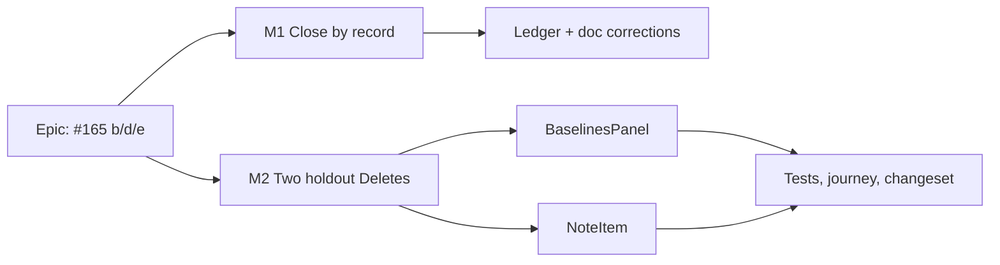

# Implementation Plan: Screen tidy — the three open items of `docs/TECH_DEBT.md` #165

- **Feature spec:** [`./feature-spec.md`](./feature-spec.md) — Approved — by the product owner, 2026-10-21, with all defaults
- **Status:** Approved — by the product owner, 2026-10-21, with all defaults
- **Owner:** builder (Sonnet), after approval

## Breakdown

### Milestone M1 — close (b) and (e), narrow (d) (docs only, no changeset)

**Outcome:** #165 says what the code says. **Entry point:** `Ships dark: documentation only.`
**Journey:** none owed — no capability claimed; (b)'s journey already exists
(`e2e-page-composition/composition.spec.ts:599`).

##### Task M1-T1 — Correct the register (≈ one PR, S)

- **Description:** close (b) citing page-composition M3 (`m3-m4-record.md:4,110`,
  `segmented-control.tsx:156-159`, `token-contrast.test.ts:112,158`, `composition.spec.ts:599-649`);
  record that the "mode row (ADR-0119)" consumer claim is false (consumers: `AuditFilterBar.tsx:93`,
  `RecentlyDeletedTable.tsx:413`, `ResourceCollisionResolver.tsx:63`). Close (e) citing ADR-0143 M0
  and `shoot.mjs:124-166,880,893,1229-1237`, with the decision that the catalogue (shape 1) is the
  mechanism and shape 2 is not needed. Narrow (d) to `BaselinesPanel` + `NoteItem`, citing ADR-0145 D2
  for the other four. Update the header letter list, `**Verified:**`, and `docs/HANDOFF.md:137`.
  Add a `docs/DECISIONS.md` line: a briefed row repeated two fixed items into a handoff (§19.11).
- **Also:** `UX_STANDARDS.md:232` D3 → D2; `DESIGN_SYSTEM.md:898-899` variant/size list to match
  `button.tsx:24-92`.
- **Risks:** a gate parses the register (ADR-0124: `#165a`-style item closure in the heading,
  `TECH_DEBT.md:141`) → use the heading form `**b. … (CLOSED 2026-10-21, <ref>.)**`.
- **Testing:** `pnpm prepush` (runs every `check:*`, incl. `check:spec-status`, `check:playbook`).

### Milestone M2 — the two holdout Deletes go behind the `⋯` (web, minor changeset)

**Outcome:** every row-level Delete in the product is a destructive menu item.
**Entry point:** Plan → Baselines dialog (`plan-chrome-dialogs.tsx:123`) → `Actions for <baseline>`;
activity editor Notes tab / plan notes → `Actions for note N by …`.
**Journey:** `e2e-notes/notes.spec.ts:97` re-pointed to open the `⋯` and choose `Delete` (drives the
real product). Baselines has **no** delete journey today (no `Delete` in `e2e/baselines.spec.ts`) —
add one step there: open the dialog, `⋯`, Delete, confirm, row gone.

##### Task M2-T1 — `BaselinesPanel` (S)

- **Steps:** 1. replace `BaselinesPanel.tsx:111-121` with `<RowActionsMenu subject={b.name}>` holding
  `<MenuItem destructive>`; keep Activate visible (primary). No `context` — no other surface names
  baselines. 2. update the 4 locators in `BaselinesPanel.test.tsx`; add: menu item has destructive
  ink, Cancel returns focus to the trigger. 3. journey step in `e2e/baselines.spec.ts`.
- **Risks:** menu inside the modal `<dialog>` → portals into it (`overlay-position.ts:175-178`); the
  journey proves it in a real browser.

##### Task M2-T2 — `NoteItem` (S)

- **Steps:** 1. replace `NoteItem.tsx:200-210` with `<RowActionsMenu subject={noteLabel(note, position)}>`;
  `Edit` stays visible. 2. update locators in `NoteItem.test.tsx` (4) and `NoteThread.test.tsx` (2). 3. `notes.spec.ts:97`. 4. recount comments: `row-actions-menu.tsx:57-60`, `command-surface.spec.ts:3024`.
- **Risks:** `noteLabel` includes a timestamp, so the trigger name is long — acceptable (it is the
  existing Delete's name, `NoteItem.tsx:207`); check the unsaved-work census entry
  (`unsaved-work-census.structural.test.ts:38`) still holds.

##### Task M2-T3 — Changeset + reviews

- `.changeset/*.md`: `@repo/web` minor — "Deleting a baseline or a note is now in the row's ⋯ menu,
  marked as destructive, like every other list."
- Reviewers: **component-reviewer**, **accessibility-reviewer** (focus path through menu → confirm →
  return, inside a modal; §19.13 spirit), **ux-reviewer** (two presses for note delete; Q1).

## Sequencing & slices

M1 first (no code, independent); M2-T1 and M2-T2 can be one PR. No flag (ADR-0088 D1); rollback is the
commit. No schema change → no database-architect run.

## Affected e2e suites (grepped `apps/web/e2e*/`)

| Suite                                                | Why                                      | Change                |
| ---------------------------------------------------- | ---------------------------------------- | --------------------- |
| `e2e-notes` (`notes.spec.ts:97`)                     | drives `Delete note …` button            | **must change**       |
| `e2e` (`baselines.spec.ts`)                          | baselines dialog; no delete step today   | add step              |
| `e2e-workspace-fit` (`command-surface.spec.ts:3024`) | sweeps `RowActionsMenu` at coarse widths | comment count; run it |
| `e2e-page-composition` (`composition.spec.ts:599`)   | (b)'s gate                               | unchanged; run it     |
| `e2e-forced-colors` (`focus-ring.spec.ts:43`)        | names `BaselinesPanel` focus target      | unchanged; run it     |

## Definition of Done

Per `docs/PROCESS.md`; `pnpm prepush` plus `scripts/e2e-local.sh web:<suite>` for each suite above.
Nothing requires the owner to test, measure or check anything on a server or device.

## Risks & assumptions

| Risk / assumption                                                                                     | Likelihood | Impact | Mitigation                                                                     |
| ----------------------------------------------------------------------------------------------------- | ---------- | ------ | ------------------------------------------------------------------------------ |
| Owner prefers one-press delete for notes (Q1)                                                         | med        | low    | Alternative (`ghost-destructive` variant) is costed in spec §4                 |
| Focus lost after deleting the last note                                                               | low        | med    | a11y review + unit case; existing `ConfirmDialog` path                         |
| `--accent`/`--destructive-text` hover gated only in `page` scope (`token-contrast.test.ts:1026-1033`) | low        | low    | Menu already ships this ink on four tables; reviewer confirms the dialog scope |
