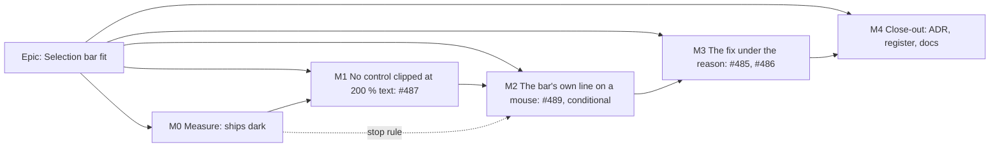

# Implementation Plan: Selection bar fit (register group 1: #482, #484 to #489)

- **Feature spec:** [`./spec.md`](./spec.md)
- **Status:** Draft — awaiting approval before implementation.
- **Owner:** web. Planning on Opus. Building on the **builder** agent (Sonnet), never `general-purpose` (`CLAUDE.md` §19.14)

## Breakdown

### Epic

**Selection bar fit.** Resolve register group 1 (selection bar and toolbar layout): build #487, #485 and,
if measured worthwhile, #489. Close #482, #484, #486 and #488 with reasons. Follow-on from ADR-0185 and
ADR-0186. **No schema change, no API change, no `VITE_` flag** (ADR-0088 D1). The rollback is the commit.

---

### Milestone M0: Measure the problem and the candidates (ships dark)

**Outcome:** a measurement record (`docs/specs/selection-bar-fit/m0-measurement.md`) that settles the open
hypotheses before anything is built (ADR-0113, ADR-0142).
**Entry point:** `Ships dark: a harness and a record; nothing user-facing changes. M1 surfaces the first change.`
**Journey:** none (a harness is not a gate, ADR-0081 §3).

#### Feature: selection-bar fit harness

> **Description:** one Playwright harness that reads the shipped bar and the outlet in every cell and state, on
> today's tree and with each candidate applied as a temporary local patch.
> **Complexity:** M
> **Dependencies:** none
> **Risks:** container fonts differ from CI and from the owner's machines (`docs/HANDOFF.md:115-119`), so
> figures near a threshold are reported with that caveat and not hidden. Text zoom has two mechanisms
> (spec §0.2, H2), so both are read.
> **Testing requirements:** the harness is run, not merged into CI. Its numbers are the evidence later
> milestones cite.

##### Task M0-T1: the harness (≈ one PR, with the record)

- **Description:** `apps/web/measure-toolbar/selection-bar-fit-m0.spec.ts` under the existing
  `playwright.measure-toolbar.config.ts`. Reuse the fixture and helpers from `conflict-reason-m1.spec.ts`.
- **Complexity:** M
- **Dependencies:** none
- **Risks:** a seeded fixture that misses a state. Mitigation: assert that each state's precondition holds
  (the conflict key and placement read back from the bar's DOM) before reading.
- **Testing:** none beyond running it.
- **Development steps:**
  1. Cells: 1024 × 600, 1280 × 800, 1440 × 900, 1646 × 1097, **1912 × 948 fine**, **1912 × 1114 coarse with
     `deviceScaleFactor: 1.5`**, on both pointers, plus 200 % text-only at 1024 × 600 on both pointers by
     **both** routes: CDP `Page.setFontSizes` (as `narrow-shell.spec.ts` does) and root `font-size: 200%`.
  2. States (spec §2 Edge cases): unflagged unplaced, unflagged placed, constraint (route), earlier than logic
     (`barAction`), two flags, WBS summary, zero-duration task, pen not held. Diagram **and** Gantt dock.
  3. Per reading: control lines, toolbar height, caption height, foot row height, canvas and stage height,
     whole rows at the 60 px pitch, outlet width and its **computed** `min-width`, root font size and
     whether `sm` matches, the remedy's line index and whether it is under the caption, triangle count inside
     the bar, the clipped-control count and **the first control clipped**, and the first Tab stop.
  4. Candidates, each as a local patch read and then discarded: **C1** cap (`min(…, 100%)`) on both floors;
     **C2** the `data-dock-wide` floor on fine pointers at 30, 36 and 40 rem; **C3** `groupOrder` object then
     find.
  5. Photographs: Gantt dock at 1912 × 948 fine and 1024 × 600 coarse, flagged and plain, before and after C3
     (for #486's second half). The 200 % clipped bar before C1.
  6. Re-read `viewport-cluster.spec.ts:515`'s stage for every candidate (SC-4).

##### Task M0-T2: the record and the stop rules

- **Description:** `m0-measurement.md` with a result table first and the full readings after, in the shape of
  `conflict-reason-on-object/m1-measurement.md`.
- **Complexity:** S
- **Dependencies:** M0-T1
- **Risks:** a reading that contradicts the spec. Mitigation: the spec's §0 is corrected in the same PR.
  The problem is re-verified, not only the design (`CLAUDE.md` §19).
- **Testing:** n/a
- **Development steps:**
  1. **#487 verdict:** is the clip reproduced? Under which text route? Which floor is in force? Does C1 alone
     remove it? If it does not reproduce under either route, M1 becomes a regression journey only, and the
     row is closed with the readings.
  2. **#489 stop rule:** M2 proceeds only if some C2 value makes the plain selection at 1024 fine **at least
     one control line shorter**, **and** loses canvas in **no** measured state or width, **and** leaves 1646
     and 1912 unchanged. Otherwise M2 is cancelled and #489 closes with the table.
  3. **#485 check:** C3 leaves line counts unchanged in every cell (SC-3), and the remedy is on line 1 in every
     route state. If any cell gains a line, stop and bring it to the owner before M3.
  4. **#486:** record the triangle counts (expected at most 2) and the Gantt photographs.
  5. Stop for the owner's answers to spec Q1 and Q2, with these numbers in front of him.

---

### Milestone M1: No selection-bar control is clipped at 200 % text (#487)

**Outcome:** at 200 % text on a 1024 × 600 window, every selection-bar control is on screen and pressable.
**Entry point:** Diagram, select an activity (the canvas listbox or a click). The bar is "Actions for ‹name›"
in the foot row. Gantt: select a row; same bar.
**Journey:** `e2e-workspace-fit/conflict-reason.spec.ts` (existing config `playwright.workspace-fit.config.ts`)
gains one test: 200 % text (the `setDefaultFontSize` helper from `narrow-shell.spec.ts`), coarse 1024 × 600,
flagged and placed selection, every `[data-toolbar-item]` in the bar passes an `elementFromPoint` hit-test. A
Gantt variant goes into `e2e-gantt-editing/object-actions-reach.spec.ts`. **Verified red on the pre-M1 tree.**

#### Feature: capped dock floors

> **Description:** the outlet's floors never exceed the foot row.
> **Complexity:** S
> **Dependencies:** M0 (which floor, which text route)
> **Risks:** (1) an arbitrary value meets the sizing ratchet. Mitigation: a named utility or token in
> `globals.css`. (2) The cap changes a 100 % layout. Mitigation: the harness re-reads every M0 cell at 100 %,
> and every reading must be identical. (3) The narrow-shell 320 and 640 readings move. Mitigation: run
> `e2e-narrow-shell`.
> **Testing requirements:** the journey above. `canvas-dock.test.tsx`'s class assertions updated (`:149-157`).
> The harness re-run.

##### Task M1-T1: cap the floors

- **Description:** `canvas-dock.tsx:127`. Both `min-w-72` and the dock-wide `min-w-144` become
  `min(<rem>, 100%)`. Docblock gains the 200 % reason and the M0 citation.
- **Complexity:** S
- **Dependencies:** M0-T2
- **Risks:** as above.
- **Testing:** unit class assertion, M1 journeys (verified red first), `e2e-narrow-shell`, `e2e-minimap`
  (stage ≥ 120 px), `e2e-workspace-chrome/dock.spec.ts` (equality).
- **Development steps:**
  1. Write the journey and watch it fail on the current tree (ADR-0110).
  2. Apply the cap. Re-run the journey, then the harness at 100 % (no change) and at 200 %.
  3. Changeset (web, patch). `pnpm prepush`. `scripts/e2e-local.sh web:workspace-fit`, `web:gantt-editing`,
     `web:narrow-shell`, `web:minimap`.
  4. accessibility-reviewer (1.4.4 / 1.4.10) on the diff and the 200 % photographs.

---

### Milestone M2: The bar takes its own line on a mouse when it cannot fit beside the facts (#489, conditional)

**Built only if M0-T2's stop rule passes and the owner answers Q2 "yes".** Otherwise this milestone is
cancelled, and M4 closes #489 with the M0 table.

**Outcome:** a plain selection at 1024 to about 1440 on a mouse costs about one line less of diagram.
**Entry point:** Diagram at 1024 × 600, mouse, select a plain activity. The bar "Actions for ‹name›" spans the
foot row's first line, with the plan's facts below it.
**Journey:** `e2e-workspace-fit/floor-states.spec.ts` gains a fine 1024 × 600 plain-selection reading:
foot row ≤ the M0 figure minus one line. `e2e-workspace-chrome/dock.spec.ts`'s equality at 1646 and 1912
stays green unchanged.

#### Feature: the dock-wide floor on both pointers

> **Description:** drop `pointer-coarse:` from the `data-dock-wide` floor at the rem value M0 chose, keeping
> `sm:` and M1's cap.
> **Complexity:** S
> **Dependencies:** M1-T1
> **Risks:** a width between the measured cells where the facts drop a line and the bar does not shorten.
> Mitigation: the harness sweeps 1024 to 1912 in 16 px steps on fine for the plain and placed states before
> merge, and any loss of canvas stops the task.
> **Testing requirements:** journey above, `dock.spec.ts`, harness sweep, `canvas-dock.test.tsx`.

##### Task M2-T1: extend the floor

- **Description:** one class in `canvas-dock.tsx:127`, plus the docblock at `:112-123` (which says
  "finger-sized window" today).
- **Complexity:** S
- **Dependencies:** M1-T1
- **Risks:** as above.
- **Testing:** as above.
- **Development steps:**
  1. Journey first, red.
  2. Change the class. Sweep with the harness. Record the result in `m0-measurement.md` §M2 (or `m2-measurement.md`).
  3. Changeset (web, patch). `pnpm prepush`. `e2e-local.sh web:workspace-fit`, `web:workspace-chrome`, `web:minimap`.
  4. ux-reviewer with the before and after photographs at 1024, 1280 and 1440, fine.

---

### Milestone M3: The fix sits under the reason (#485, with #486's second half)

**Outcome:** on every flagged selection with a route remedy, the remedy is the first control, directly under
the caption, in both views. Zoom to selection, Isolate and Float paths follow the Activity actions.
**Entry point:** Diagram, press **Next conflict** on the deck (or click a flagged bar). The bar "Actions for
‹name›" shows the caption, then **Review the constraint…** first on the line beneath it. Gantt: select a
flagged row; same.
**Journey:** `e2e-workspace-chrome/conflict-review.spec.ts` gains: after Next conflict, the remedy's top
equals the first control line's top and is below the caption; Tab into the bar lands on the remedy; ArrowRight
order equals the visual left-to-right, top-to-bottom order. The Gantt variant is in
`e2e-gantt-editing/object-actions.spec.ts`, where the existing Float-paths Tab loop at `:195-212` is updated.

#### Feature: an optional group order on `Toolbar`

> **Description:** `groupOrder?: readonly ToolbarGroupId[]`, a permutation of the groups present, defaulting
> to `TOOLBAR_GROUPS`.
> **Complexity:** S
> **Dependencies:** none in code. Lands after M1 and M2 so SC-3's line counts are taken against the final
> outlet rule.
> **Risks:** (1) It is a shared primitive's public contract (ADR-0105) and changes a consumer's roving order
> (ADR-0111). Mitigation: accessibility-reviewer **and** component-reviewer **before** release, executing the
> component. (2) A second consumer uses it to break the taxonomy everywhere. Mitigation: the docblock and the
> ADR say "a surface whose subject is one object"; `Deck` does not take it.
> **Testing requirements:** `Toolbar.test.tsx`: default order byte-identical (snapshot of group order),
> a permutation reorders groups **and** the arrow sequence, a non-permutation throws in dev, the roving-stop
> fallback lands on the new first control.

##### Task M3-T1: the prop and the selection bar's order

- **Description:** `Toolbar.tsx:249-262` sorts by the given order. `selection-actions.tsx` passes
  `['object', 'find']` and corrects the comments at `:575-577` and `:970-1003`.
- **Complexity:** S
- **Dependencies:** M0-T2 (C3 line counts), owner's Q1 answer
- **Risks:** positional assertions elsewhere. Mitigation: grep the 34 files that reference the bar's items
  (spec §3 Dependencies), and list and update every one that asserts a position or first Tab stop in this
  task's PR description.
- **Testing:** unit tests above, the M3 journeys (verified red first), `e2e-float-paths`, `e2e-narrow-shell`,
  `e2e-workspace-chrome/peer-unmount-focus.spec.ts` (the handoff's fallback target changes).
- **Development steps:**
  1. Journeys first, red against the current order.
  2. Add the prop with tests. Wire the selection bar.
  3. Re-run the harness: line counts equal to M0 in every cell (SC-3). Stop if not.
  4. accessibility-reviewer and component-reviewer (ADR-0111). Fold the findings in.
  5. Changeset (web, minor: a visible order change). `pnpm prepush`. `e2e-local.sh` for `workspace-chrome`,
     `gantt-editing`, `float-paths`, `narrow-shell`, `workspace-fit`.

##### Task M3-T2: pin the triangle count (#486)

- **Description:** a structural or unit test rendering the bar for every `ConflictKey` × `hasPlacement`,
  asserting at most two `TriangleAlert` glyphs (identified by the lucide class or a test hook).
- **Complexity:** S
- **Dependencies:** none
- **Risks:** identifying the icon brittly. Mitigation: count `svg.lucide-triangle-alert` if lucide emits it;
  otherwise a `data-` hook on the three sites.
- **Testing:** verified red by forcing Clear visual start's triangle unconditionally.
- **Development steps:**
  1. Write the test. Make it red once, then restore.
  2. Same PR as M3-T1, or its own. Either is fine.

##### Task M3-T3: the Gantt dock's leading icon (#486, second half)

- **Description:** compare M0's Gantt photographs with the post-M3 ones. If Float paths still reads as
  orphaned at the trailing edge, bring the photograph to the owner (label it in the Gantt, or leave it).
  No code by default.
- **Complexity:** S
- **Dependencies:** M3-T1
- **Risks:** none.
- **Testing:** n/a. Check `docs/specs/gantt-coarse-pointer/device-checklist.md` for a step that names the bar's
  order and update it in the same PR if one exists (HANDOFF "Surface sheet rule").
- **Development steps:**
  1. Photograph the Gantt dock at 1912 × 948 fine and 1912 × 1114 coarse (DPR 1.5), and at 1024 × 600.
  2. Record the result in the measurement record.

---

### Milestone M4: Close-out

**Outcome:** the ADR is filed, the register is reconciled, and the docs say what shipped.
**Entry point:** `Ships dark: documentation only.`
**Journey:** n/a.

#### Feature: record and reconcile

> **Description:** the ADR from spec §4.8, the register rows, and the docs.
> **Complexity:** S
> **Dependencies:** M1 to M3 (and M2's outcome)
> **Risks:** number collisions with parallel branches. Mitigation: rebase onto `origin/main`, then
> `pnpm check:counts`, `check:adr-coverage`, `check:debt-status` and `check:spec-status` (`docs/HANDOFF.md:125-127`).
> **Testing requirements:** `pnpm prepush` (all `check:*`).

##### Task M4-T1: ADR and docs

- **Description:** ADR-0187 (or the next free number), "A selection bar leads with its subject, and a floor
  never exceeds its row". One line in `CLAUDE.md` §16. `DESIGN_SYSTEM.md` and `COMPONENT_LIBRARY.md` (the
  prop and the floor). `UX_STANDARDS.md` if it states the bar's order. This spec's and plan's status set to
  `Accepted — shipped (ADR-0187)`.
- **Complexity:** S
- **Dependencies:** M3-T1
- **Risks:** an ADR citing a Draft spec fails `check:spec-status` S3 (`docs/HANDOFF.md:155-156`). Set the
  spec's status in the same commit.
- **Testing:** `pnpm prepush`.
- **Development steps:**
  1. Write the ADR with the M0 and post-milestone readings as evidence (ADR-0076).
  2. Update the docs. Bump the counts.

##### Task M4-T2: the register

- **Description:** in `docs/TECH_DEBT.md`: close #485 and #487 (built). Close #489 (built, or measured with
  no remedy). Close #486 (triangle half not-a-defect with the code evidence from spec §0.2; Gantt half answered
  by M3 or by the owner). Close #488 (margin, guard in place, with the final SC-4 reading). Close #484 (OD-2,
  remedies void, owner's Q3 answer). Close #482 (owner's Q4 answer, re-open trigger).
- **Complexity:** S
- **Dependencies:** M4-T1, owner's Q3 and Q4 answers
- **Risks:** `check:debt-status` format. Mitigation: copy the shape of the rows closed by ADR-0186.
- **Testing:** `pnpm check:debt-status`.
- **Development steps:**
  1. Close each row with its evidence line.
  2. Write `docs/HANDOFF.md` at the epic boundary (`CLAUDE.md` §19.14).

---

### Optional task (only if the owner answers Q3 "take it"): left-aligned wrapped trailing group (#484)

- **Description:** in `Deck.tsx`, replace the trailing group's `ml-auto` with an `aria-hidden` zero-basis
  `flex-grow` spacer before it, so a wrapped Plan group starts at the row's left edge.
- **Complexity:** S
- **Dependencies:** none
- **Risks:** (1) `Deck.test.tsx`'s "at most one auto margin per row" assertion changes meaning. Mitigation:
  restate it as "at most one growing spacer per row". (2) Below 1024 the deck is one nowrap scrolling line.
  Mitigation: the spacer has zero basis, so the scroll width is unchanged; assert it. (3) `deck-seams` and
  `scrollWidth > clientWidth` logic (ADR-0185's "hanging pill" lesson). Mitigation: run
  `deck-seams.structural.test.tsx` and `e2e-narrow-shell`.
- **Testing:** promotion journey (SC-17 and SC-18 unaffected), `command-surface.spec.ts`, a photograph at
  coarse 1024 × 600.
- **Development steps:** journey or photograph first, then the change, then the ux-reviewer.

## Sequencing & slices

1. **M0** (record only). **Stop here for Q1 and Q2**, with the numbers.
2. **M1** (#487): a WCAG fix, independently valuable, and it caps the floor M2 changes.
3. **M2** (#489): only if the stop rule passed and Q2 is yes.
4. **M3** (#485, #486): the visible change on the owner's screens. ADR-0111 review before release.
5. **M4**: ADR, register and docs. Hand-off.

Each slice keeps `main` releasable. **No feature flag** (ADR-0088 D1). Each user-facing milestone names its
entry point and lands with its journey (ADR-0081). No new Playwright config or CI step: the journeys extend
existing suites, and the harness is under the existing measure config, which is not in CI. **The web e2e total
is already over ADR-0138's trigger (#491)**, so new journey steps are added to existing tests where possible,
and the duration delta is reported in each PR.

## Definition of Done (per task)

Each task's PR must satisfy the Feature Completion Criteria in [`docs/PROCESS.md`](../../PROCESS.md) (code,
tests, docs, security, performance, accessibility, Docker build, CI, changelog, version impact). Specifically:

- `pnpm prepush`, plus `scripts/e2e-local.sh web:<suite>` for every suite named in the task (no `apps/api`
  change, so the API e2e half does not apply).
- Security review: **N/A with reason** (no auth, input or data path). Performance: CSS and a static sort only.
  Accessibility: accessibility-reviewer on M1 and M3. component-reviewer on M3. ux-reviewer on M2 and M3.
- **No database-architect run**, because there is no schema change. If any task finds it needs one, it stops
  (`CLAUDE.md` §19.3).

## Recommended agents

- **builder** (Sonnet): every task.
- **accessibility-reviewer**: M1 (1.4.4, 1.4.10) and M3 (**ADR-0111**: roving order and first Tab stop).
- **component-reviewer**: M3 (the `Toolbar` public contract, ADR-0111 when a rule spans primitives).
- **ux-reviewer**: M2 and M3 photographs, and the optional #484 task.
- **test-engineer**: optional, for the M0 harness fixture states.
- Not needed: database-architect (no schema), api-reviewer, security-reviewer, backend-performance-reviewer
  (no backend).

## Risks & assumptions (rollup)

| Risk / assumption                                                                                           | Likelihood | Impact | Mitigation                                                                                                     |
| ----------------------------------------------------------------------------------------------------------- | ---------- | ------ | -------------------------------------------------------------------------------------------------------------- |
| #487 does not reproduce, or reproduces only under one text-zoom route                                       | med        | low    | M0 reads both. If neither reproduces, M1 ships the regression journey only and the row closes with readings  |
| The #489 gain is smaller than estimated, or costs canvas in some state                                      | med        | low    | M0 stop rule. M2 is cancelled rather than tuned                                                                |
| R1 surprises planners used to Zoom to selection on the left                                                 | med        | low    | Owner decides (Q1) with the photographs. The rollback is one prop                                             |
| Positional tests and journeys break in M3                                                                   | high       | low    | M3-T1 enumerates them. Journeys are run locally before push                                                   |
| A second consumer uses `groupOrder` to bypass the taxonomy                                                   | low        | med    | The ADR scopes it. component-reviewer checks the docblock                                                      |
| The 120 px stage floor (2 px margin) is consumed by a change here                                           | low        | med    | SC-4 re-read after every milestone. R2 rejected partly on this ground                                         |
| Readings in the container differ from CI and from the owner's hardware                                      | high       | low    | Report near-threshold figures with the caveat (ADR-0128). The owner's Surface reading is the real one        |
| The spec's estimates (widths read off a photograph) are wrong                                               | med        | low    | They are labelled estimates. M0 replaces them, and the spec's §0 is corrected in M0's PR                      |
| Parallel branches collide on the ADR number, register rows or banner counts                                 | med        | low    | Rebase onto `origin/main` before opening each PR, then re-run `check:*`                                        |
