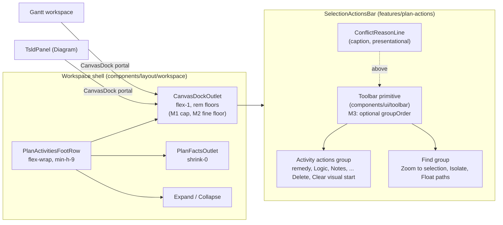
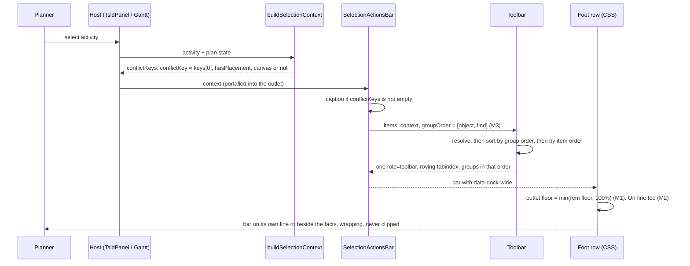
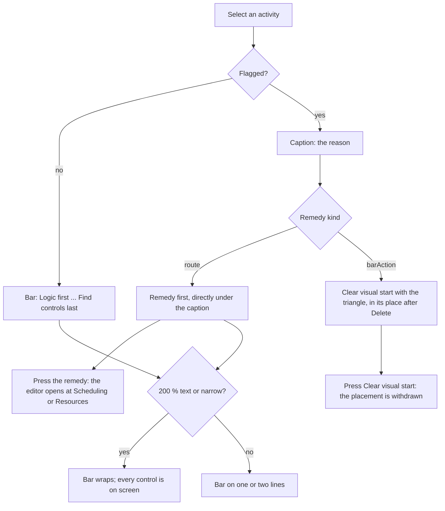

# Feature Spec: Selection bar fit (register group 1: #482, #484 to #489)

- **Status:** Accepted — shipped (ADR-0187). Approved by the product owner 2026-10-11; M0 to M4 built (M2 cancelled on M0's stop rule).
- **Author(s):** Claude Code (feature-analyst), for James Ewbank (product owner)
- **Date:** 2026-10-11
- **Tracking issue / epic:** `docs/TECH_DEBT.md` #482, #484, #485, #486, #487, #488, #489 (register rows, not GitHub issues)
- **Roadmap link:** none. This is follow-on debt from the toolbar epic (ADR-0185) and the conflict reason (ADR-0186), named in `docs/HANDOFF.md` "Suggested next" item 2
- **Related ADR(s):** ADR-0185, ADR-0186, ADR-0133, ADR-0111, ADR-0179, ADR-0118, ADR-0183, ADR-0031, ADR-0094, ADR-0088 D1, ADR-0105, ADR-0113. **A new ADR is needed** (outline in §4.8).
- **Implementation plan:** [`implementation-plan.md`](./implementation-plan.md)

## 0. What was re-verified, and the recommendation per row

`CLAUDE.md` §19 says a problem statement goes stale in the direction nobody checks, and that a brief is not
evidence. So every row's problem was re-read against the tree before anything was designed.

**What "verified" means here, and its limit.** This session had no shell: nothing was run, measured or
rendered. Every finding below comes from reading source on branch `docs/outstanding-items-specs` at
`addfc7b0` (the same SHA as `refs/remotes/origin/main` in this clone), the measurement records, and the two
photographs the rows cite. Where a claim needs a browser to settle it, it is marked **hypothesis** and goes
to M0. No number below was taken by me unless a file and line is given for it.

### 0.1 Summary

| Row  | What the row says                                                                        | What I found                                                                                                                                                             | Recommendation                                                                                              |
| ---- | ---------------------------------------------------------------------------------------- | ------------------------------------------------------------------------------------------------------------------------------------------------------------------------ | ----------------------------------------------------------------------------------------------------------- |
| #485 | The remedy sits two lines below the reason on a wrapped bar                              | **True, and the cause is simpler than the row says**: group order beats `order: -1`                                                                                      | **Build** (M3), with an ADR and an ADR-0111 review                                                          |
| #486 | The triangle repeats up to 3 times; a stray icon-only canvas control in the Gantt dock   | **Triangle half is false**: two at most, by construction. **Gantt half is mis-described** and has no evidence behind it                                                  | **Close the triangle half as not-a-defect**; re-photograph the Gantt half in M0, then close or fold into M3 |
| #487 | 200 % text on touch 1024 × 600 clips the bar's tail                                      | **Plausible, cause not yet known**. The likeliest cause is the outlet's rem-sized floor, which doubles with text. A WCAG 1.4.4 failure if true                           | **Build** (M1), cause measured first                                                                        |
| #489 | The foot row grows to 167 px because the outlet is 0 to 113 px wide                      | **Symptom true (167 px, 4 lines), mechanism stale**: the outlet already has an 18 rem floor and is about 347 px wide. My arithmetic predicts the gain is state-dependent | **Build only if M0 shows a gain** (M2), with a stop rule                                                    |
| #488 | The 120 px stage floor has 2 px of margin                                                | **True** (122 px). It is a margin, not a failure, and the guard that would catch it is already in place                                                                  | **Close as not-a-defect** at close-out, after the epic re-reads the guard                                   |
| #484 | On touch at 1024 the DO row's Plan group wraps onto its own line with an empty left side | **True**, and **both of the row's remedies are void**: nothing is promoted below 1280, and moving one icon cannot recover 135.7 px                                       | **Close as accepted (OD-2)**. Optional CSS-only polish if the owner wants it (Q3)                           |
| #482 | Zoom presets not in the diagram corner; search does not grow at 2560                     | **True as stated**, and deliberately not built for measured reasons. Neither of the owner's screens reaches the 2160 or 2560 stages                                      | **Close as won't-build** (Q4), with a re-open trigger                                                       |

### 0.2 Evidence per row

**#485: the remedy far from its reason.**

- `selection-actions.tsx:585-601` registers `conflict-remedy` in group `object` at `order: -1`. The comment at
  `:575-577` says it is meant to come **first** ("it is the reason a planner is looking at this bar at all").
- `Toolbar.tsx:249-262` sorts by `groupRank(group)` **before** `order`, and `toolbar-registry.ts:20-33` ranks
  `find` (3) ahead of `object` (5). Zoom to selection (`:1022`, order 7), Isolate logic path (`:1041`, order 8)
  and Float paths (`:1076`, order 9) are all in `find`. So `order: -1` only sorts within the second group, and
  on the Diagram the remedy is the **fourth** control: behind Zoom to selection, Isolate and Float paths.
- `photos/m1-1024x600-Frame.png` (read): caption on line 1, the Find group on line 2, "Review the constraint…"
  at the start of line 3. `photos/m1-1912x1080-Frame.png` (read): the bar is two lines even at 1912. The Find
  group sits alone on line 1 with about 1,000 px empty to its right, and the remedy starts line 2.
- So the row's problem is real at **every** width where the bar wraps, including the owner's monitor, not only
  "touch, or 1024". The intent in the code comment and the behaviour disagree. Nothing tests the position.
- ADR-0186 Consequences ("The first Tab stop is Zoom to selection in the Diagram and Float paths in the Gantt")
  describes the same ordering from the keyboard side.

**#486: the triangle three times, and a stray Gantt control.**

- The three candidates are the caption (`selection-actions.tsx:448`), the route remedy (`:508`) and Clear
  visual start, which shows the triangle only when it **is** the remedy (`:931-947`).
- The route remedy renders only when `CONFLICT_REMEDIES[conflictKey].kind === 'openEditorAt'` (`:597-598`).
  Clear visual start wears the triangle only when that same entry is `barAction` (`:942-943`). `conflictKey`
  is one key, `conflictKeys[0]` (`build-selection-context.ts:131`), and `CONFLICT_REMEDIES`
  (`conflict-remedy.ts:53-99`) gives each key exactly one kind. So the two remedy triangles are **mutually
  exclusive**, and the bar shows **at most two**: the caption plus one remedy. The 1912 photo agrees (two
  triangles; Clear visual start shows the Eraser).
- The row's "Next" ("keep the triangle on the caption and the remedy and use a neutral icon on Clear visual
  start") **already describes the code**, except when Clear visual start _is_ the remedy. In that case a
  neutral icon would remove the only signal that it answers the conflict, which the ADR-0094 UX gate asked for
  as a blocking finding (`selection-actions.tsx:917-929`).
- Across the whole screen at 1912 there are four triangles: Next conflict and the count chip on the deck, plus
  caption and remedy on the bar. That is four meanings (command, count, reason, fix) on two surfaces. ADR-0186 D6
  gives the read-out one look on purpose. I do not count it as a defect.
- **The Gantt half.** The row cites `m1-1912x1080-Frame.png`, which is a **Diagram** photograph. No Gantt
  photograph exists under `docs/specs/**/photos/` (glob for `*antt*`: none). From the code: with `canvas: null`
  (`plan-workspace-toolbar.tsx:1860`), Zoom to selection and Isolate are hidden (`:1033`, `:1051`), so the
  Gantt bar's `find` group holds **Float paths alone**: icon-only (`labelVisibility: 'never'`, `:1082`), named
  by `aria-label` and an ADR-0117 tooltip, and **view-agnostic by design** (`:1067-1072`). It is not
  "canvas-only" and it is not unlabelled. What can be true is the visual: one glyph alone at the bar's leading
  edge, then a hairline (`Toolbar.tsx:367`), then the Activity actions. Make milestone… (`:807`) is the only
  other icon-only item, and only for a zero-duration task. M0 photographs the Gantt dock to settle it. If M3's
  reorder is taken, Float paths moves to the trailing edge, which probably answers it anyway.

**#487: 200 % text on touch 1024 × 600 clips the bar.**

- The row's "Verified" field cites only the review; there is no file reading. Its stated mechanism ("the
  toolbar inside is not shrinking") is partly stale: the bar's wrapper is `min-w-0`, not `shrink-0`, since the
  foot-row C1b fix (`selection-actions.tsx:1268-1291`).
- Also, the foot row itself is not `overflow-hidden` (`activity-bottom-panel.tsx:511`). The clip, if present,
  is an ancestor's, as the C1b comment records (`selection-actions.tsx:1272-1274`).
- **Hypothesis H1 (leading):** the outlet's floors are rem-sized. `canvas-dock.tsx:127` has
  `not-empty:min-w-72` (18 rem) and `sm:pointer-coarse:has-[[data-dock-wide]]:min-w-144` (36 rem). At a 32 px
  root these are 576 px and 1,152 px. The foot row at 1024 is about 732 px wide with the Explorer open (the
  1024 photo: foot row 277 to 1024), so either floor can exceed the row, and the overflow is clipped.
- **H2:** whether `sm:` (40 rem) still matches depends on **how** text was enlarged. A changed browser default
  (the CDP `Page.setFontSizes` route the narrow-shell journey uses) moves media-query rems too, which makes
  `sm` 1,280 px and leaves only the 18 rem floor. Setting `font-size: 200%` on the root does not move them.
  The two give different floors, and I could not tell which one the reviewer used.
- Both hypotheses point at the same remedy: cap each floor at the row's width. M0 confirms which control
  is clipped first and which floor is in force before anything is built.
- If true, this is a WCAG 2.2 §1.4.4 failure (controls lost at 200 % text). That is a merge requirement
  (`CLAUDE.md` §13) and still applies below the floor (ADR-0179).

**#489: the foot-row outlet.**

- Symptom confirmed by the most recent reading: `conflict-reason-on-object/m1-measurement.md` §2 (2026-10-10),
  fine 1024 × 600, unflagged selection, **4 control lines, toolbar 156 px, foot row 167 px, canvas 246 px**.
- Mechanism stale: the row says the outlet is "left 0-113 px wide" and the facts block is 582 px and
  `shrink-0`. Today the outlet has an 18 rem floor (`canvas-dock.tsx:127`). The 1024 photo shows the bar
  column about 347 px wide (caption 347.5 px in m1 §2), with the facts wrapped to two lines about 310 px wide
  beside it. The "0-113 px" figure is #471's reading from before the floor existed.
- **What the row predicts and what the arithmetic says.** Giving the bar the full row does not simply return
  116 px. `Toolbar` wraps **group boxes** (`Toolbar.tsx:355-396`): the Find group (about 285 px in the 1912
  photo) and the Activity-actions group (about 950 px with both remedy and Clear visual start, about 635 px
  without them) each wrap as units. On a 732 px row my estimate is:
  - **plain selection:** 2 lines instead of 4, minus one line for the facts, so a **gain of about 40 px**;
  - **placed or flagged selection:** 3 lines plus the facts' line, so a gain of about **0**.
    At 1646 and 1912 an unconditional own row would **lose** a line (the facts would leave the bar's line). So
    the rule must stay conditional: "own row only when the row cannot give the bar N rem beside the facts".
    That is exactly the mechanism coarse pointers already use (`min-w-144`). These widths are read off a
    photograph and are **estimates**; M0 measures them.

**#488: 2 px of margin.**

- Confirmed: `e2e-minimap/viewport-cluster.spec.ts:515-529` asserts `stage.h >= 120` with a placed, flagged
  activity on touch 1024 × 600. `m1-measurement.md` §1b records 122 px.
- A margin is not a defect. The row's own "Next" depends on #489, which (above) may not change the coarse
  layout at all, because coarse already has the own-row floor. The guard is a computed observer that fails
  loudly (ADR-0120). The HANDOFF note that CI fonts are narrower (103.7 px against 106.2) points towards
  **more** stage on CI, not less. **Recommend close**, after this epic's milestones re-read the guard (SC-4).

**#484: the touch DO row at 1024.**

- Confirmed by `toolbar-redesign/m6-measurement.md:107` (coarse, 1024 × 600, pen held: DO free gap
  −135.7 px, 2 lines) and `photos/m6-after-coarse-1024x600-pen.png`.
- Remedy (a) "promote less at the coarse 1024 floor" is **void**: the lowest promotion stage is
  `PROMOTE_80` = 80 rem = 1,280 px (`lib/breakpoints.ts:66-67`), so nothing is promoted at 1024.
- Remedy (b) "move the Plan group's trailing slot to LOOK's free ~46 px" is **insufficient**: one 44 px icon
  against a 135.7 px deficit.
- The line count is what the owner accepted as **OD-2** (`toolbar-redesign/feature-spec.md:70-71`: "touch at
  exactly 1024 accepts 4 deck lines"). What is left is cosmetic. The Plan group is the row's `trailing` group,
  pushed right by one `ml-auto` (`Deck.tsx:123-129`), so when it wraps it lands at the right with nothing to
  its left.
- A CSS-only alternative does exist and needs no measuring of the row (so ADR-0109/0185's "nothing measures
  itself" holds): replace the trailing group's `ml-auto` with a zero-basis `flex-grow` spacer before it. On one
  line the spacer pushes the group right; on a wrap the spacer stays on the first line and the group starts at
  the left. This is offered as Q3, not recommended by default: the deck reached its current shape through
  seven reviewed milestones, and this is a look, not a loss.

**#482: zoom presets and search growth at 2560.**

- True as stated (`toolbar-redesign/m5-measurement.md` §0.5-0.6, cited by the row). ADR-0185 lists C1 among
  the alternatives it did not build, with the reason.
- The row's trigger is "a product-owner call after seeing the 2560 deck". The owner's screens are 1912 × 948
  and 1912 × 1114 (`docs/HANDOFF.md:18-19`), which reach `PROMOTE_119_5` and no higher. The presets stay one
  menu away (View ▾ ▸ Zoom), and the corner keeps Zoom out, Zoom in, Fit and the Minimap.
- **Recommend close as won't-build.** Re-open trigger: a user working at 2160 px or wider asks for presets in
  the corner or a wider search.

## 1. Business understanding

### Problem

The selection bar is where a planner acts on one activity. Since the conflict reason landed (ADR-0186) it also
says what is wrong with the activity. Three things still get in the way:

1. **The fix is not next to the reason** (#485). A planner reads "Constraint not met" on the caption line and
   finds "Review the constraint…" one or two lines further down, after three viewing controls. This happens on
   the owner's monitor as well as at the 1024 floor.
2. **At 200 % text on a tablet-sized window, part of the bar can be off-screen** (#487). If confirmed, that is
   a WCAG 2.2 AA failure (1.4.4), which this project treats as a merge requirement.
3. **At 1024 to about 1440 on a mouse, selecting a plain activity costs a line of diagram that may not be
   needed** (#489), because the bar is squeezed into a column beside the plan's facts.

The other four rows are either already answered by the code, accepted decisions, or out of reach of the
owner's screens, and this spec closes them with reasons.

### Users

Every role that can select an activity sees the selection bar: Org Admin, Planner, Contributor and Viewer.
I did not check whether the External Guest share view (ADR-0051, ADR-0163) mounts the bar. It does not
matter for this spec, because nothing here changes what any role may do. It changes where controls sit and
whether they are reachable, for whoever sees the bar.

- **Planner (mouse, 1912 × 948):** reads the reason and wants the fix beside it.
- **Planner on a Surface (1912 × 1114, DPR 1.5, finger and stylus, 44 px targets):** same, at touch sizes.
- **Anyone at 200 % text on a small window:** must be able to reach every control.
- **Planner on a 1024 to 1440 laptop with a mouse:** wants the diagram height back when a plain activity is
  selected.

### Primary use cases

1. Select a flagged activity, read the reason, and press the fix directly beneath it.
2. Select any activity at 200 % text on a 1024 × 600 window and reach every control by pointer and keyboard.
3. Select a plain activity at 1024 to 1440 on a mouse and lose as little diagram as the layout allows.

### User journeys

- **Next conflict, Diagram, monitor:** press Next conflict. The activity is selected, the caption reads
  "Constraint not met". Directly beneath its first word is "Review the constraint…". Press it, and the editor
  opens on Scheduling.
- **Clicked bar, Gantt, Surface:** tap a flagged row. The docked bar shows the caption with the remedy first
  beneath it. Float paths is at the trailing end with its tooltip on long press.
- **200 % text, 1024 × 600, touch:** select an activity. The bar wraps onto as many lines as it needs. Notes,
  Progress and Delete are all on screen and can be tapped.
- **Keyboard:** Tab into the bar. The first stop is the remedy when the activity is flagged, otherwise Logic.
  The arrow keys walk the controls in the order they appear on screen.

See the user-flow diagram in §4.3.

### Expected outcomes

- The reason and its fix read as one unit at every width.
- No selection-bar control is ever clipped at 200 % text.
- If M0 confirms the gain, a plain selection on a mouse at the floor gives back about one line of diagram.
- Seven register rows are resolved: three built, four closed with reasons.

### Success criteria

All are measured in a real browser by the M0 harness and then held by journeys. "Today" figures come from
`m1-measurement.md`.

- **SC-1 (#487):** at 200 % text-only on 1024 × 600, fine and coarse, in the Diagram and the Gantt, with a
  flagged placed selection, **0 controls are clipped** and every control passes a hit-test at its centre.
  The test is verified red on the tree before M1.
- **SC-2 (#489, only if M2 is built):** on a fine pointer at 1024 × 600 with a plain selection, the foot row
  is **at least one control line shorter** than M0's baseline (167 px today). In **no measured state or width**
  (§2 Edge cases) does the canvas lose height. At 1646 and 1912 the foot row is byte-identical in height to the
  baseline.
- **SC-3 (#485):** in every flagged state with a route remedy, at every M0 cell, the remedy's top equals the
  top of the first control line, the line directly under the caption. For the `barAction` state (Clear visual
  start is the remedy) it is recorded but not asserted, because that control stays where it is (see §4.7).
  **The number of control lines is unchanged** from the baseline in every cell.
- **SC-4 (#488):** `viewport-cluster.spec.ts:515` still passes, and the stage reading is recorded after every
  milestone (122 px today).
- **SC-5 (#486):** a unit test asserts that **at most two** `TriangleAlert` glyphs render in the bar for every
  conflict key and every placement state. This pins the existing behaviour so it cannot drift to three.
- **SC-6 (keyboard):** the first Tab stop in the bar is its first visible control, and the ArrowRight sequence
  equals the visual reading order, both checked in a journey. The accessibility-reviewer and
  component-reviewer sign off before M3 ships (ADR-0111).

### Open questions

**Critical (the answer changes the design or scope):**

- **Q1 (#485): may the selection bar lead with the activity's own actions, on every selection, in both
  views?** The recommended fix (R1, §4.7) puts the Activity-actions group first and moves Zoom to selection,
  Isolate and Float paths to the end. That puts the remedy right under the reason at every width. The cost: for
  **every** selection, flagged or not, the first control (and first Tab stop) changes from Zoom to selection
  (Diagram) or Float paths (Gantt) to the remedy or Logic, and a planner used to Zoom to selection on the left
  finds it on the right. On your monitor (1912 × 948) the flagged bar is two lines today with the remedy at the
  start of line 2, and after R1 it would be at the start of line 1. The alternative R2 puts the remedy on the
  caption line itself, leaving everything else where it is, but it adds a separate Tab stop and costs about 16
  to 28 px of height whenever a flagged activity is selected. **Default: R1.**
- **Q2 (#489): at 1024 to about 1440 on a mouse, may the plan's facts drop to their own line below the bar
  when both will not fit side by side?** That is the price of the bar getting the full width. It already
  happens on touch. My estimate is about 40 px more diagram for a plain selection and no change for a placed or
  flagged one. M0 measures it, and M2 only proceeds if no state loses canvas. **Default: yes, if M0 shows the
  gain.**

**Decisions with a default (say if you disagree):**

- **Q3 (#484):** close as accepted under OD-2. Or, if you want it, take the CSS spacer (§0.2) so that a wrapped
  Plan group starts at the left edge on touch at 1024. **Default: close.**
- **Q4 (#482):** close as won't-build, because neither of your screens reaches the stages where it applies.
  **Default: close.**
- **#486 and #488:** close as described in §0.2 once M0 and M4 have the photographs and readings.
- **No `VITE_` flag** (ADR-0088 D1). The rollback is the commit.

## 2. Functional requirements

### User stories & acceptance criteria

> **US-1 (#485)** — As a Planner looking at a flagged activity, I want the control that fixes it directly
> under the sentence that explains it, so that I do not have to search the bar.
>
> **Acceptance criteria**
>
> - **Given** a selected activity with a route remedy (`constraintViolated`, `visualLaterThanBound`,
>   `levelingWindowExceeded`) **when** the bar renders at any M0 cell, either pointer, Diagram or Gantt,
>   **then** the remedy is the first control and sits on the first control line under the caption.
> - **Given** an unflagged activity **when** the bar renders **then** the first control is Logic, and Zoom to
>   selection, Isolate logic path and Float paths follow the Activity actions.
> - **Given** the bar has focus **when** the reader presses Tab into it **then** focus lands on the first
>   visible control, and ArrowRight walks the controls in visual order.
> - **Given** any selection **when** the bar renders **then** its number of control lines equals M0's baseline
>   for the same cell and state.

> **US-2 (#487)** — As anyone using 200 % text on a small window, I want every selection-bar control on
> screen, so that I can use all of them.
>
> **Acceptance criteria**
>
> - **Given** text-only 200 % on 1024 × 600, coarse or fine, Diagram or Gantt, **when** a flagged, placed
>   activity is selected **then** no bar control lies outside the viewport or under an ancestor's clip, and
>   each passes `elementFromPoint` at its centre.
> - **Given** the same conditions at 100 % text **then** the foot row's height is unchanged from the
>   baseline. The cap only binds when the floor would exceed the row.

> **US-3 (#489, conditional on M0)** — As a Planner on a laptop with a mouse, I want a plain selection to
> cost as little diagram as possible, so that I can keep working on the picture.
>
> **Acceptance criteria**
>
> - **Given** a fine pointer at 1024 × 600 and a plain selection **when** the bar docks **then** the foot row
>   is at least one control line shorter than the baseline.
> - **Given** any measured width or state **then** the canvas is never shorter than the baseline.
> - **Given** 1646 × 1097 or 1912 × 948 **then** the foot row's height equals the baseline (the `dock.spec.ts`
>   equality still holds).

> **US-4 (#486)** — As a Planner, I want the warning glyph to mean "reason" and "fix" and nothing else on the
> bar, so that it stays a signal.
>
> **Acceptance criteria**
>
> - **Given** any conflict key and either placement state **then** at most two triangles render inside the
>   selection bar (caption, and the one remedy).
> - **Given** the Gantt dock **then** a photograph at 1912 × 948 and 1024 × 600 shows whether Float paths reads
>   as part of the bar. If it does not after M3, the owner decides (label it in the Gantt, or leave it).

### Workflows

1. **Select** (click, tap, Next conflict, filter, Gantt row): the bar renders the caption if the activity is
   flagged, then one toolbar. Group order is Activity actions, then Find (after M3).
2. **Text at 200 %**: the outlet's floor is the smaller of its rem floor and the row's width (after M1), so it
   never forces the row wider than the window. The bar wraps.
3. **Window narrows on a mouse** (after M2, if built): when the row cannot give the bar its floor beside the
   facts, the bar takes the first line and the facts and the panel toggle move to a second line. This is
   exactly what touch does today.

### Edge cases

- **Measured states** (M0 and every later milestone): unflagged unplaced, unflagged placed, flagged route
  (constraint), flagged `barAction` (earlier than logic), two flags, WBS summary, zero-duration task (Make
  milestone… shown), pen not held (shaded controls), peer holds the pen.
- **Widths:** 1024 × 600, 1280 × 800, 1440 × 900, 1646 × 1097, **1912 × 948 fine** (the owner's monitor),
  **1912 × 1114 coarse at DPR 1.5** (the owner's Surface), plus 200 % text at 1024 × 600 on both pointers.
- **The Gantt dock** has no Zoom to selection, Isolate or Clear selection (`onClear` is not passed,
  `plan-workspace-toolbar.tsx:1860`). After M3 its Find group is Float paths alone, at the trailing end.
- **A conflict appearing or resolving while focus is on the bar.** The remedy appears or leaves at the first
  position. Its `lostReason` handoff (`selection-actions.tsx:599`) still applies. The roving stop repair
  (`Toolbar.tsx:206-207`) falls back to the first control, which is now Logic.
- **Below 1024** (unsupported, still reflows, ADR-0179): the outlet already takes its own line there
  (`canvas-dock.tsx:120-123`). M1's cap must not change the 320 and 640 readings the narrow-shell journey takes.
- **Bulk selection** (ADR-0080) replaces the singular bar, so it is out of scope. The plural bar is not
  reordered.

### Permissions

No change. The bar's items keep their gates: pen-gated Edit, Duplicate, Make milestone…, Dissolve, Delete and
Clear visual start (ADR-0028). Notes and Progress are role-gated. The remedy, Logic, Resources and the Find
controls are ungated reads. Nothing here is a write, so the pen question does not arise. No RBAC permission,
organisation scope, endpoint or guard is touched.

### Validation rules

None. There is no input.

### Error scenarios

| Scenario                                                      | Detection                               | User-facing result                                        | Status |
| ------------------------------------------------------------- | --------------------------------------- | --------------------------------------------------------- | ------ |
| A control clipped at 200 % text                               | M1 journey hit-test                     | none after M1; before, a control the reader cannot press  | n/a    |
| The remedy disappears under focus (a peer fixes the conflict) | existing ADR-0135 handoff, `lostReason` | focus moves within the bar, and the sentence is announced | n/a    |
| M2's floor costs canvas in some state                         | M0 and M2 harness (stop rule)           | M2 is not built; #489 closes with the readings            | n/a    |

## 3. Technical analysis

| Area           | Impact | Notes                                                                                                                                                                                                                                                                        |
| -------------- | ------ | ---------------------------------------------------------------------------------------------------------------------------------------------------------------------------------------------------------------------------------------------------------------------------- |
| Frontend       | med    | `canvas-dock.tsx` (outlet floors: M1, M2), `Toolbar.tsx` (an optional group-order prop: M3), `selection-actions.tsx` (passes it, docblocks), tests. No route, state or form changes                                                                                          |
| Backend        | none   |                                                                                                                                                                                                                                                                              |
| Database       | none   | **No schema change.** database-architect is not engaged                                                                                                                                                                                                                      |
| API            | none   |                                                                                                                                                                                                                                                                              |
| Security       | none   | No authN/Z, input or data path. security-reviewer is N/A, with this as the reason                                                                                                                                                                                            |
| Performance    | low    | CSS and a static sort order. No new measurement in JS (ADR-0109 D1, ADR-0185 D1(b))                                                                                                                                                                                          |
| Infrastructure | low    | **No new Playwright config and no new CI step.** The harness goes in `measure-toolbar/` (`playwright.measure-toolbar.config.ts`, not in CI). Journeys go into existing `e2e-workspace-fit` and `e2e-gantt-editing` files, which adds seconds to a budget already over (#491) |
| Observability  | none   |                                                                                                                                                                                                                                                                              |
| Testing        | med    | Harness (M0), journeys at 200 % text (M1), foot-row equality and floor (M2), order and Tab (M3), a structural triangle test (SC-5), and journey updates where the first Tab stop is asserted                                                                                 |

**The recalc parity gate:** `computeSchedule` is not touched. No scheduling input is added.
**The pen:** no write is added or moved.
**Flag:** none (ADR-0088 D1). Each milestone names its entry point and lands with a journey (ADR-0081).
**ADR-0105 triggers crossed** (which is why this is a spec and not three register fixes): a shared primitive's
public contract (`Toolbar` gains an optional prop), a shell layout rule (the outlet's floors), and a changed
keyboard sequence on a shared primitive's consumer.

### Dependencies

- **M0 before everything.** M1's cause, M2's go/no-go and M3's line-count claim all rest on its readings.
- **M1 before M2.** Both edit the same class string in `canvas-dock.tsx:127`, and M2's floor must already be
  capped.
- **M3 is independent** of M1 and M2 in code, but its line-count assertion is taken against whichever outlet
  rule has shipped, so it lands last.
- **Tests that assert the current order** need updating in M3. At least
  `e2e-gantt-editing/object-actions.spec.ts:195-212` Tabs until Float paths is focused. 34 files reference the
  bar's items (grep for `selectionActionItems` and `data-toolbar-item="zoom-to-selection"`). Most assert by
  name, not position. M3-T1 lists the positional ones.
- **ADR-0186's Consequences** state the current Tab order. The new ADR amends that sentence.
- **`docs/specs/gantt-coarse-pointer/device-checklist.md`** must change in the same PR if a touch-sheet step
  covers the bar's order (HANDOFF "Surface sheet rule"). M3-T3 checks.
- Neighbours, out of scope: #483 (the breadcrumb at 200 %), #480 (the cluster under a dock), #481 (the
  unmount handoff hook), #491 (CI budget).

## 4. Solution design

### 4.1 Architecture overview

Everything is in the web app's workspace shell and the selection bar. No module, endpoint or package changes.

### 4.2 Data flow

No server data changes. The only flow is how the bar decides its order and how the row decides its lines.

### 4.3 User flow

### 4.4 Database changes

**None.**

### 4.5 API changes

**None.**

### 4.6 Component changes

| Component                                                             | Change                                                                                                                                                                                                                                                                                                                                                                                          | Milestone |
| --------------------------------------------------------------------- | ----------------------------------------------------------------------------------------------------------------------------------------------------------------------------------------------------------------------------------------------------------------------------------------------------------------------------------------------------------------------------------------------- | --------- |
| `CanvasDockOutlet` (`components/layout/workspace/canvas-dock.tsx`)    | Each rem floor is capped at the row: `min(18rem, 100%)` and `min(36rem, 100%)`. Expressed as a named token or utility in `globals.css` if an arbitrary value meets the sizing ratchet. Docblock gains the 200 % reasoning                                                                                                                                                                       | M1        |
| `CanvasDockOutlet`                                                    | The `data-dock-wide` floor applies on **fine** pointers too, at the rem value M0 picks (36 rem is the starting candidate), still `sm:` and up and still capped                                                                                                                                                                                                                                  | M2        |
| `Toolbar` (`components/ui/toolbar/Toolbar.tsx`)                       | **Optional** `groupOrder?: readonly ToolbarGroupId[]`. It must be a permutation of the groups present (it throws in dev, like `defineToolbar`'s checks) and defaults to `TOOLBAR_GROUPS`. It changes render order and therefore roving order. Key set, Tab-stop count and handoff are unchanged. Unit tests cover the default (byte-identical), a permutation, and refusal of a non-permutation | M3        |
| `SelectionActionsBar` (`features/plan-actions/selection-actions.tsx`) | Passes `groupOrder={['object', 'find']}`. The comments at `:575-577` (remedy "FIRST") and `:970-1003` (find group) are corrected to the new truth. `ClearSelectionButton` stays after the toolbar                                                                                                                                                                                               | M3        |
| `selection-actions` tests                                             | A structural test pins **at most two triangles** across every `ConflictKey` × placement (SC-5)                                                                                                                                                                                                                                                                                                  | M3        |

Loading, empty and error states: none apply. The bar renders only for a selection.

### 4.7 Implementation approach & alternatives

**#487: cap the floors (chosen, subject to M0).** A floor that can be wider than its container is a defect
whatever its size. `min()` keeps today's behaviour wherever the row is wider than the floor, which is every
cell at 100 % text, and binds only at large text. Alternatives: (a) drop the floors under a text-size media
query. Rejected, because there is no reliable media feature for text zoom and it would split one rule in two.
(b) Make the floors px. Rejected, because that changes the 100 % layouts the toolbar epic measured.

**#489: extend the coarse own-row floor to fine pointers (chosen, if M0 shows the gain).** It reuses the
mechanism toolbar-redesign M4 shipped for touch (`canvas-dock.tsx:112-123`), so there is no new layout
concept. Alternatives: (a) the row's "a content basis for the outlet". Rejected, because a wrapping toolbar's
content basis is its max-content width, which forces the own row at widths where the bar fits beside the facts
(1646, 1912), the regression `dock.spec.ts` exists to stop. (b) Measure the bar in JS and move the facts.
Rejected under ADR-0109 D1 and ADR-0185 D1(b). (c) Do nothing. This is the stop rule's outcome if M0 shows
no gain.

**#485: R1, lead with the Activity actions (recommended).**

- **What:** the selection bar renders its `object` group before its `find` group. A static order for every
  selection, so ADR-0094's refusal of a **per-context** order is not engaged (the code itself draws this
  distinction at `conflict-remedy.ts:139-144`).
- **Why it is the smallest correct change:** the remedy is already first **within** its group (`order: -1`)
  and the code comment says that was the intent. Only the group order defeats it. Swapping the two group boxes
  does not change the line count, because the same two boxes wrap the same way.
- **What else it fixes:** the Tab order becomes what ADR-0186's spec first expected and had to correct ("Tab
  lands on the remedy or on Logic"). The Gantt bar no longer starts with a lone icon (#486's second half).
- **Cost:** a shared primitive gains an optional prop (ADR-0105 trigger, ADR-0111 review). For the selection
  bar only, it departs from ADR-0031's canonical left-to-right group order (new ADR). Planners lose Zoom to
  selection as the bar's leading control.

**R2: the remedy on the caption line (alternative).** Render the remedy beside the caption, outside the
toolbar, as its own Tab stop (the `ClearSelectionButton` precedent, `selection-actions.tsx:1103-1107`).
Adjacency is closest. But the caption line becomes control-height (36 or 44 px) instead of 20 or 16 px, which
costs 16 to 28 px whenever a flagged activity is selected. That re-opens #488's 2 px margin on touch (122 − 28
< 120). It also adds a Tab stop outside the roving set, and it splits the remedy from the bar's
`lostReason` handoff. **Not recommended.**

**R3: a "Fix:" cue only** (the row's second candidate). Moves nothing, so the eye still travels two lines.
Rejected as insufficient.

**R4: reorder per context** (remedy first only when flagged). Rejected by ADR-0094: controls move under the
cursor as the selection changes.

**Why the `barAction` case is left alone.** When Clear visual start is the remedy, it is an ordinary bar
action available to every placed activity (`selection-actions.tsx:857-872`). Moving it to the front only when
it is the remedy is R4. It keeps the triangle as its signal (ADR-0094's UX gate). SC-3 records its position
but does not assert it.

### 4.8 ADR required: outline

**ADR-0187 (the next free number at the time of writing; check before filing, because parallel branches
collide on numbers, `docs/HANDOFF.md:125-127`): "A selection bar leads with its subject, and a floor never
exceeds its row."**

- **Context:** #485, #487, #489, with this spec's §0 readings and M0's numbers.
- **D1:** the selection bar's group order is Activity actions, then Find. The new `Toolbar.groupOrder` prop
  is optional, a permutation, and the default is unchanged. **Amends** ADR-0031 (the canonical left-to-right
  order is the default, not a rule for every toolbar) and ADR-0186 Consequences (the stated first Tab stop).
- **D2:** a dock floor is `min(<rem>, 100%)`, so text zoom cannot push a strip past its row (WCAG 1.4.4).
- **D3 (if M2 ships):** the `data-dock-wide` own-row floor applies on both pointers, at the M0 value.
- **Alternatives:** R2, R3, R4. A content basis and JS measurement for #489. Px floors for #487.
- **Consequences:** the first Tab stop changes. Journeys updated. The register rows closed. No flag.
- **ADR-0111:** engaged for D1. Record the review findings.
- `CLAUDE.md` §16 gains one line (`check:adr-coverage`), and the ADR count in the stage banner moves
  (`check:counts`).

## 5. Links

- Implementation plan: [`./implementation-plan.md`](./implementation-plan.md)
- Evidence read: `docs/TECH_DEBT.md` #482 to #489 (lines 11784-11845), `docs/HANDOFF.md`,
  `docs/adr/0185-…`, `docs/adr/0186-…`, `docs/adr/0111-…`, `docs/specs/conflict-reason-on-object/m1-measurement.md`,
  `docs/specs/toolbar-redesign/m3-measurement.md` §4, `m6-measurement.md` §1, `feature-spec.md` OD-2,
  `photos/m1-1024x600-Frame.png`, `photos/m1-1912x1080-Frame.png`
- Code read: `apps/web/src/features/plan-actions/selection-actions.tsx`, `conflict-remedy.ts`,
  `build-selection-context.ts:131`, `apps/web/src/components/ui/toolbar/Toolbar.tsx`, `toolbar-registry.ts`,
  `Deck.tsx:114-136`, `apps/web/src/components/layout/workspace/canvas-dock.tsx`, `activity-bottom-panel.tsx:409-528`,
  `plan-slot-host.tsx:129-131`, `plan-workspace-toolbar.tsx:1847-1860`, `TsldPanel.tsx:3082-3095`,
  `lib/breakpoints.ts:66-76`, `e2e-minimap/viewport-cluster.spec.ts:515-529`
- Docs this change will update: the new ADR, `CLAUDE.md` §16 (one line), `docs/TECH_DEBT.md` (seven rows),
  `docs/DESIGN_SYSTEM.md` and `docs/COMPONENT_LIBRARY.md` (the `groupOrder` prop and the outlet floor),
  `docs/UX_STANDARDS.md` if it states the bar's order, ADR-0186's spec only by citation (it is Accepted)
