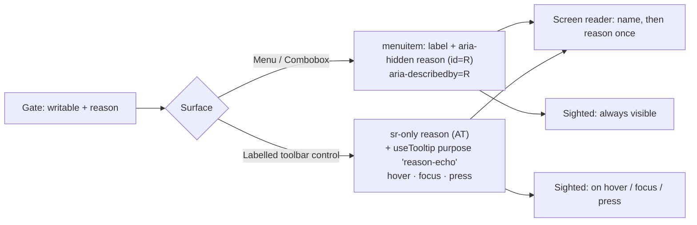

# Feature Spec: A shaded control's reason is visible to every input

- **Status:** Approved — by the product owner, 2026-10-21, with all defaults
- **Author(s):** feature-analyst
- **Date:** 2026-10-21
- **Tracking issue / epic:** `docs/TECH_DEBT.md` #116 item 3 (`docs/TECH_DEBT.md:2356-2366`, `:2399-2403`)
- **Roadmap link:** design-system consistency (ADR-0082 / ADR-0117 follow-on)
- **Related ADR(s):** new **ADR-0204** (amends ADR-0082 §2; touches ADR-0117's `purpose` vocabulary).
  Builds on ADR-0028, ADR-0081, ADR-0083, ADR-0088, ADR-0111, ADR-0177, ADR-0179, ADR-0183.

## 1. Business understanding

**Problem (re-verified against the code, 2026-10-21).** A shaded menu item's reason exists only for
assistive technology: `MenuItem` renders it as an `sr-only` sibling span referenced by
`aria-describedby` (`apps/web/src/components/ui/menu.tsx:440-448`, `:511-518`). A sighted mouse or
touch user sees a muted "Edit" and nothing else. The canvas's plural bar prints the same kind of
sentence as visible text (`features/tsld/components/BulkSelectionBar.tsx:170-179`), so one operation
still teaches two models — ADR-0082's own premise. The original blocker (no Tooltip primitive) has
lapsed: `useTooltip` exists (`components/ui/tooltip.tsx`, ADR-0117). **The product owner has decided
the reason becomes visible**; this spec is the how.

**Users.** Anyone who meets a shaded control: a Planner without the pen (ADR-0028), a Contributor or
Viewer refused by role, an Org Admin before taking the pen. External Guests see what they already see.
Primary pain: sighted mouse-only and touch users, for whom the reason is unreachable today.

**Outcome / success criteria.** Every shaded labelled control that carries a reason shows it to a
mouse, a keyboard and a finger without the AT announcement changing (same name, same description,
announced once). Measured by unit + journey assertions (§3), not by anyone on the owner's host.

## 2. Functional requirements

### 2.1 Survey — every shaded labelled control with an `sr-only` reason

| #   | Surface                                                                                                                                                                  | AT channel                             | Visible channel today         | In scope                                                                                                   |
| --- | ------------------------------------------------------------------------------------------------------------------------------------------------------------------------ | -------------------------------------- | ----------------------------- | ---------------------------------------------------------------------------------------------------------- |
| S1  | `MenuItem` (`menu.tsx:514-518`) — consumers `ActivitiesTable.tsx:1204-1210`, `GanttRowMenu.tsx:227-230,261-264`, `CalendarRowMenu.tsx:46-52`, `plan-actions-menu.tsx:72` | sr-only sibling                        | **none**                      | **M1**                                                                                                     |
| S2  | `ComboboxOption.disabledReason` (`combobox.tsx:448`, `:495`) — no production caller sets it (ADR-0082 Amendment "Ships dark")                                            | sr-only in option                      | none                          | **M1** (parity, dark)                                                                                      |
| S3  | `ToolbarButton`, label visible (`ToolbarButton.tsx:143-149`, `:199`, `:230-234`)                                                                                         | sr-only in button                      | native `title` — hover only   | **M2**                                                                                                     |
| S4  | `ToolbarPopover`, labelled (`ToolbarPopover.tsx:211-217`, `:256-260`)                                                                                                    | sr-only                                | native `title`                | **M2**                                                                                                     |
| S5  | `ToolbarSplitButton` both halves (`ToolbarSplitButton.tsx:194`, `:239-247`, `:258`, `:276`)                                                                              | sr-only                                | native `title`                | **M2**                                                                                                     |
| S6  | Status-bar **Recalculate** (`layout/status/plan-facts.tsx:348-361`)                                                                                                      | sr-only                                | native `title`                | **M2**                                                                                                     |
| S7  | Selection-bar **Isolate** split (`features/plan-actions/selection-actions.tsx:306`)                                                                                      | via `api.itemProps` (confirm in M2-T1) | native `title`                | **M2**                                                                                                     |
| —   | Icon-only / `'roomy'` toolbar controls (`ToolbarButton.tsx:143-147`, `:164-170`)                                                                                         | sr-only                                | `useTooltip` `label — reason` | already visible; unchanged                                                                                 |
| —   | `*Field` gates (`field-gate.tsx:31`, `:54-60`, ADR-0083 D4)                                                                                                              | visible `
`                          | visible paragraph             | already visible; unchanged                                                                                 |
| —   | `RadioCardGroup` (`radio-card-group.tsx:149-150`), `BulkSelectionBar`                                                                                                    | visible text                           | visible                       | unchanged                                                                                                  |
| —   | Gantt read-only cell (`features/gantt/components/GanttCell.tsx:211-214`)                                                                                                 | describedby                            | native `title`                | **excluded** — a grid cell, not a command; a tip on every arrowed cell is noise. Filed as a follow-on row. |

### 2.2 User stories and acceptance criteria

- **US-1 (menu).** As a planner on any input, when a row-menu item is shaded I can read why in the menu.
  - AC-1.1 The reason renders as visible secondary text inside the item, under its label.
  - AC-1.2 Accessible **name** unchanged ("Edit", not "Edit Holder is editing…"); description unchanged
    and announced once; `aria-describedby` still absent on a live item (`pen-handoff.spec.ts:210`).
  - AC-1.3 Roving focus, Home/End, Escape, typeahead-free behaviour unchanged (ADR-0082 §1).
- **US-2 (toolbar).** As a sighted keyboard or touch user, a shaded labelled toolbar control shows
  its reason on hover (400 ms), on focus (immediately), and on a **press** of the shaded control.
  - AC-2.1 Native `title` removed from S3–S7's shaded branch (no two tips on one hover).
  - AC-2.2 A press on a shaded control fires nothing (today) **and opens the tip** — the press did
    nothing, so showing why is not ADR-0117's "tap that does both" noise (`tooltip.tsx:31-35`).
  - AC-2.3 Escape closes the tip and still reaches the canvas ladder (`tooltip.tsx:293-305`).

**Edge cases.** Same reason on several items (ActivitiesTable shades Edit, Duplicate, Make milestone
and Dissolve/Delete from one `shut` — `ActivitiesTable.tsx:599-636`): printed per item (CQ-1). A
reason that flips while the menu is open (pen hand-off): text re-renders with the gate. Long
sentences wrap; the menu never exceeds the viewport (existing clamp + `overflow-y-auto`, `menu.tsx:286`).
At 1024 × 600 (ADR-0179) a taller item means the menu scrolls sooner — accepted. Coarse pointer:
the item already grows (`pointer-coarse:min-h-(--control-h)`, `menu.tsx:488`; ADR-0183).

**Permissions / validation / errors.** No change: gating objects and reason strings are untouched.

## 3. Technical analysis

- **Frontend only.** No API, no schema, no migration, no `@repo/types` change. `computeSchedule`
  is not imported — recalc parity holds by construction. No structural write, so the pen is irrelevant.
- **No feature flag** (ADR-0088 D1). Rollback is the commit boundary.
- **Entry points (ADR-0081):** existing — "Actions for <activity>" row menu, Gantt row `⋯`, calendar
  row menu, plan actions menu, the command deck and selection bar. Nothing new to reach.
- **Why not `purpose: 'description'`.** That purpose links the tip only **while open**
  (`tooltip.tsx:428`), and focus opens it in the same tick a screen reader announces the control —
  while the permanent sr-only description already carries the sentence. Both together read it twice;
  `ToolbarButton.tsx:157-162` records exactly that reasoning. The visible tip must be `aria-hidden`.
  `'name-echo'` is mechanically that, but its name would lie, so ADR-0204 adds a third value
  **`'reason-echo'`** (aria-hidden, no describedby) — keeping ADR-0117's "caller states the case" rule.
- **Menu markup.** Move the reason **inside** the `menuitem` as `aria-hidden` visible text with the
  existing `id`, still referenced by `aria-describedby`. Name-from-content skips `aria-hidden`
  children; a **directly referenced** hidden node still yields the description (accname 1.2,
  step 2A). This also retires the sibling span, which is the non-permitted `role="menu"` child shape
  the file itself calls an `aria-required-children` violation (`menu.tsx:300-302`). The `srDescription`
  sibling (`:519-523`) is a different fact with its own visible carrier and is left as is.
  Verify-first: M1-T1 step 1 proves the jsdom + Chromium description holds before anything else moves.
- **Styling.** Existing tokens only — `text-muted-foreground text-xs`, the same pair the tip panel uses
  (`tooltip.tsx:445`); the item becomes a two-line flex column; the panel gains a max width from the
  spacing scale (default `max-w-72`) so sentences wrap rather than widening the menu. No one-off classes.
- **Contrast** of muted `text-xs` on `bg-popover` is not asserted here; accessibility-reviewer measures it.

## 4. Solution design

**Alternatives.** (a) Tooltip on menu items: needs a gesture on touch, pops on every arrow stop, and
a tip over a portalled menu competes with it — rejected as default, offered in CQ-1. (b) Inline text
on the toolbar: breaks the deck's row budget (ADR-0109/0185) — rejected. (c) One shared reason row in
the menu: ADR-0082 already rejected it (per-item reasons differ). (d) Fold into the name: ADR-0082
rejected.

**ADR-0204 outline — "A shaded control says why, to every input".** Context: #116(3), the survey
above. D1 a shaded labelled control's reason is visible to every input; D2 in a list (menu, listbox)
it is inline secondary text inside the item, `aria-hidden`, referenced by `aria-describedby`; D3 on
a toolbar it is `useTooltip({ purpose: 'reason-echo' })`, opened by hover, focus and a press on the
shaded control; native `title` is withdrawn for shaded reasons; D4 the sr-only AT channel is
unchanged, the description is announced once. Amends ADR-0082 §2 and its Amendment's "sr-only by
design" bullet; extends ADR-0117's purpose set. §16 line:
`- **ADR-0204** _(Accepted; amends ADR-0082 §2)_ — A shaded control says why, to every input → [...]`.
Docs: `UX_STANDARDS.md:204-214` (add "visible to every input"), `COMPONENT_LIBRARY.md:865-872`
(the `title` discriminator gains a "shaded reason → `'reason-echo'`" row), ADR-0082 status line.

## 5. Critical questions (defaults stated)

- **CQ-1 — Menu items: inline text, tooltip, or both?** Default **inline only**. Visible to every
  input with no gesture; the cost is repetition when several items share a reason (up to five in the
  activities row menu). "Both" adds nothing a reader cannot already see.
- **CQ-2 — Scope: menus only, or menus + labelled toolbar controls (S3–S7)?** Default **both**
  (two milestones). Menus-only closes #116(3) literally but leaves a hover-only `title` on the
  toolbar, which is the same defect and would be filed as a new row the day this ships.

Everything else is a stated default above.
