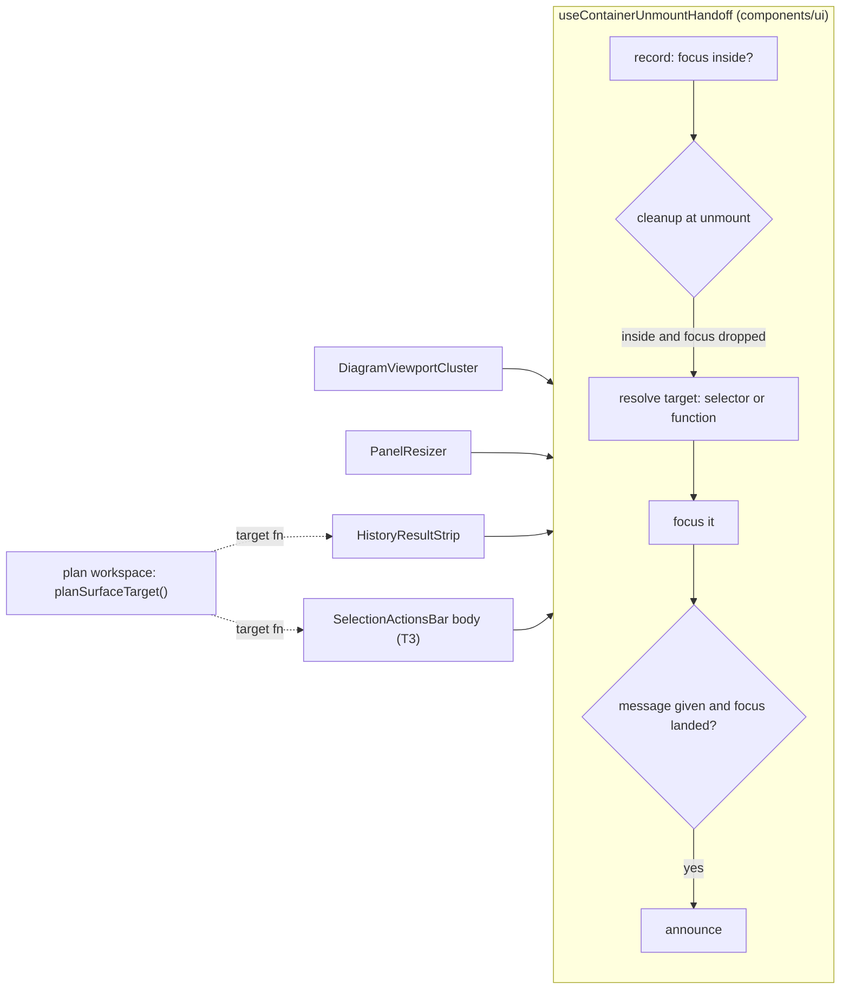
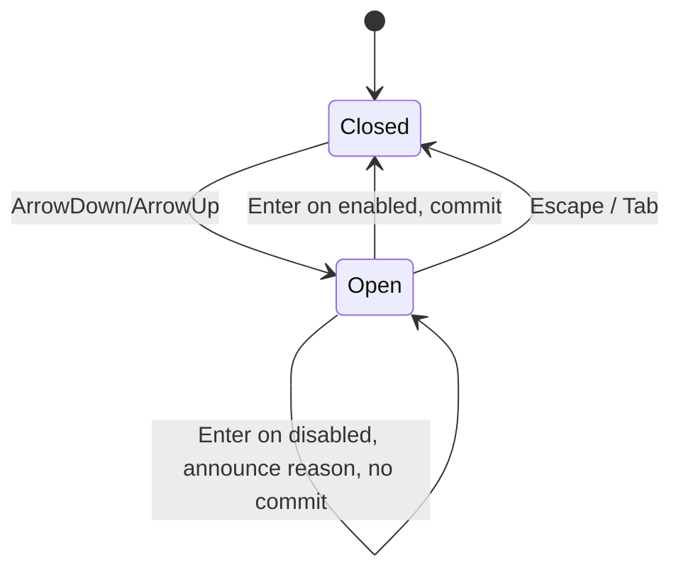

# Feature Spec + Plan: Shared-primitive tidy (four debt rows)

- **Status:** Approved — by the product owner, 2026-10-16: all four sections, with the defaults (question 1: the shared look everywhere, no boxed option; question 2: ship the combobox change now)
- **Author(s):** feature-analyst (Claude), for the product owner
- **Date:** 2026-10-16
- **Tracking:** `docs/TECH_DEBT.md` #481, #335, #325, #229 (combobox half only)
- **Roadmap link:** none — maintenance of shared primitives
- **Related ADR(s):** [ADR-0082](../../adr/0082-disabled-menu-items-stay-reachable.md), [ADR-0105](../../adr/0105-a-register-row-is-not-a-spec.md), [ADR-0111](../../adr/0111-a-primitives-keyboard-contract-is-reviewed-before-release.md), [ADR-0135](../../adr/0135-a-container-hands-focus-back-when-somebody-else-removes-the-control-you-were-on.md), [ADR-0145](../../adr/0145-a-screen-is-assembled-from-the-archetypes.md)

## 0. How to read this

Each of the four rows changes a shared component's public contract, which is an ADR-0105 trigger, so
each needs a spec before code. They share nothing except that trigger, so they are written as four
sections, **A–D**, each with its own design and its own short plan, and **each can be approved,
rejected or reordered alone**. Nothing here touches `apps/api`, the schema, the CPM engine or a
plan write.

Common to all four, stated once:

- **Users and roles.** Every role that can see these surfaces today (Org Admin, Planner,
  Contributor, Viewer; External Guest for the guest header in C). No permission changes. No plan
  write is added, so **the pen (ADR-0028) is not involved** and no write is structural.
- **Recalc parity.** No scheduling input is added; `computeSchedule` is not imported by any file
  touched here.
- **No `VITE_*` flag** (ADR-0088 D1). The rollback is the commit boundary; each section lands as its
  own PR.
- **Version impact.** `@repo/web` patch per section, one changeset each. No API, OpenAPI or DB change.
- **Line numbers in the rows are stale.** Everything below was re-read on 2026-10-16 and is cited by
  symbol and file. Where a row's claim was found false, §X.1 says so.
- **Spec-status gate.** When a section amends an ADR that cites this directory, this header must
  move off `Draft` in the same PR (`check:spec-status` S3).

### Critical questions for the owner

Only these two change what gets built. Everything else has a stated default.

1. **(C, how it looks)** Two panels show their figures as bordered boxes: Earned value and the
   import review. Converting them to the shared headline style removes the boxes and makes the
   labels a little larger. The guest header and the Summary popover would switch to the shared quiet
   style, which uses small capital-letter labels. **(a)** Accept the shared look everywhere
   _(default)_. **(b)** Keep the boxes, which means adding a "boxed" option to the shared component.
2. **(D, when it ships)** No picker in the product shows an unavailable option today, so the
   combobox change would ship without any screen using it yet. **(a)** Ship it now, so the first
   picker that needs it gets the right behaviour with no extra work _(default)_. **(b)** Wait until
   a screen actually needs it.

---

## A. One container-unmount hand-off (#481)

### A.1 Problem, re-verified

ADR-0135's rule for a container that leaves while it holds focus is: hand focus somewhere stable, and
announce it only if focus actually landed. That rule lives in one hook,
`useContainerUnmountHandoff` (`components/ui/use-container-unmount-handoff.ts`), plus two copies
written by hand.

- **The row and the hook's docblock are both stale.** Both say only the diagram viewport cluster
  uses the hook. It has **two** users: `features/tsld/toolbar/diagram-viewport-cluster.tsx` and
  `components/ui/panel-resizer.tsx` (`PanelResizer`, target `#main`, message
  `` `${sizeLabel} box closed.` ``).
- **Copy 1: `HistoryResultStrip`** (`features/tsld/components/HistoryResultStrip.tsx`). Its
  `onBlur` clears `focusInside` whenever `relatedTarget` is not inside the strip. That includes
  `null`, because `contains(null)` is false. It keeps two hand-offs:
  - an unmount cleanup that calls `restoreFocus` when `focusInside` is set;
  - a `hasAction` layout effect for the follow-up button disappearing while the strip stays mounted.
    That is the ADR-0135 per-item case, not the container case.
- **Copy 2: `SelectionActionsBar`** (`features/plan-actions/selection-actions.tsx`, not the
  `features/tsld/toolbar/` file of the same name). Its `onBlur` keeps `heldFocusRef` on a `null`
  related target, on purpose. Its cleanup is keyed on `[context, restoreFocus]`, because "removed"
  here means a re-render with `context === null`, not an unmount.
- **The hook** keeps the record on a `null` blur and re-reads it one frame later.
- **New finding (read, not run).** The bar's cleanup sets `heldFocusRef.current = false` on **every**
  `context` change, including one where the bar stays and focus stays inside it. Possible sequence:
  focus a bar command, a refetch rebuilds `context`, then deselect. The record is already false, so
  focus would drop to `<body>`. This is a hypothesis. T3 must prove it red before anything claims it.
- **Not established, and jsdom cannot establish it (ADR-0111, ADR-0135 Consequences).** Does
  Chromium dispatch `blur`/`focusout` with `relatedTarget === null` when a focused node is removed,
  and does that happen before React's layout cleanup? If it does, the strip's `hasAction` branch
  never fires in a real browser, because its blur handler has already cleared `focusInside`. The
  unit test passes only because jsdom dispatches no blur on removal.

### A.2 Outcome and acceptance criteria

All three components follow **one** rule, so a fix to it reaches all of them.

- **Given** focus on the strip's `Redo` **when** `Ctrl+Z` replaces the strip **then** focus is on
  the plan surface (the Gantt row or the canvas listbox, never `<body>`) and nothing extra is
  announced (ADR-0132: the workspace already said it).
- **Given** focus on the strip's follow-up button **when** that button goes because undo or redo
  stops being live **then** focus moves to the plan surface.
- **Given** the reader clicked blank, non-focusable space **when** the strip later times out **then**
  focus is not pulled anywhere.
- The cluster and the resizer behave byte-for-byte as before: same target, same sentence.
- The strip's existing focus-inside unit cases pass **unchanged**, which is what the row requires.

### A.3 Design

**Hook contract (public, additive).**

- `target: string | (() => HTMLElement | null)`. A function is resolved at cleanup time, like the
  selector is today.
- `message?: string`. If it is absent, focus still moves and nothing is announced.
- The returned object gains `focusWasInside(): boolean`, which reads the **same** record. The strip's
  per-item `hasAction` branch uses it instead of keeping a second record.

**Destination.** `focusOutsideInert` (`components/layout/workspace/focus-reachable.ts`) is split into
`reachableTarget(target): HTMLElement | null`, which applies the inert fallback and returns the
element, plus the existing focus call on top of it. The workspace adds `planSurfaceTarget()`. That
is `focusPlanSurface`'s Gantt-grid-then-listbox resolution, run through `reachableTarget`.
`focusPlanSurface` becomes `planSurfaceTarget()?.focus()`, so `LayoutResolvedStrip` and every other
current caller stay unchanged.

**Strip contract.** `HistoryResultStrip.restoreFocus: () => void` becomes
`restoreTarget: () => HTMLElement | null`. Its own buttons call `restoreTarget()?.focus()` before
they act, as today. Its local `focused` state stays, because pausing the WCAG 2.2.1 timer asks
"is focus inside right now", which is a different question. It should still clear on a click on
blank space.

**Selection bar decision: the same rule with a different trigger.** Both say "record on focus, keep
on a null blur, act only if focus was dropped". The bar differs in two ways. Its removal is a
re-render to `null`, and its record resets on every context change. **Default:** T3 moves the bar's
DOM into an inner `SelectionActionsBarBody` that mounts only while `context !== null`. Removal then
becomes an unmount, and the hook applies. One behaviour changes, and the reviewer must accept it:
after a click on blank space, a later deselect leaves focus on `<body>` (hook semantics). Today it
pulls focus to the canvas listbox. If T1 or T3's red-first test shows the hook is worse here, the
fallback is to write the bar into the hook's docblock as a declared variant and close #481 with that
recorded.

**Alternatives rejected.** (1) A second hook for callback destinations. That makes a fourth copy of
one rule. (2) Folding `use-withdrawn-column-handoff.ts` in. Its container is hidden, not unmounted,
and the hook's own docblock says it cannot serve that.

### A.4 Plan — size M, three PRs

**Milestone A — one hand-off rule.** Entry point: the existing dock strip after **Undo** (toolbar)
in both views, and the selection bar. Journey: `e2e-undo/undo.spec.ts` (new test, T1).

- **T1. Measure first (S).** Add a Playwright test to `apps/web/e2e-undo/undo.spec.ts`. It focuses
  the strip's `Redo` (testid `canvas-history-result`), presses `Ctrl+Z`, and asserts focus is on the
  plan surface in both the diagram and the Gantt. A document `focusout` capture listener records
  `relatedTarget` and ordering, and the reading goes in the PR description. The test must run
  against **today's** strip first, and the result decides T2's risk. **Risk:** the hand-off is
  timing-sensitive. **Mitigation:** assert the outcome, never the event order.
- **T2. Widen the hook and move the strip onto it (S).** Make the contract change, add
  `reachableTarget` and `planSurfaceTarget`, and fix the stale docblock. Unit cases in
  `use-container-unmount-handoff.test.tsx`: a function target, no message means no announcement, and
  `focusWasInside`. `HistoryResultStrip.test.tsx` passes unchanged apart from the prop rename.
  Update `focus-reachable` tests if any exist.
- **T3. Selection bar (S–M), after T2.** First write a red-first test for the context-change
  stranding hypothesis in `apps/web/e2e-multi-select/multi-select.spec.ts`. Then split the bar's body
  and adopt the hook. If the test cannot be made red, say so in the PR and adopt only for the
  dedupe. **Risk:** the bar's `onMakeMilestone` pre-focus path. Keep it exactly as it is.
- **E2E to run:** `scripts/e2e-local.sh web:undo`, `web:minimap` (`viewport-cluster.spec.ts`),
  `web:workspace-fit` (`dividers.spec.ts`, the resizer box), `web:multi-select`, and
  `web:workspace-chrome` (`peer-unmount-focus.spec.ts`).
- **Reviewers:** **accessibility-reviewer before release** (ADR-0111: this changes where focus goes
  on unmount) and **component-reviewer** (one rule across three components).
- **Docs:** the hook's docblock; a `docs/DECISIONS.md` entry that says the null-related-target rule
  is now one rule; close #481 or narrow it to the bar variant.

---

## B. `DataTable` class overrides merge instead of replace (#335)

### B.1 Problem, re-verified

`components/ui/data-table.tsx` writes the default four times as `??`: `headClassesOf`,
`cellClassesOf` and both branches of `skeletonClassesOf`. They are
`column.headClassName ?? 'py-2 pr-4 font-medium'` and `column.cellClassName ?? 'py-2 pr-4'`. A
caller adding one class silently loses the padding, and on a header the weight too.

**Two recorded claims are wrong against today's code:**

- **The row says "every caller restates the default". That is false.** Measured by grepping
  `(head|cell)ClassName:` across `apps/web/src`, tests excluded:
  - **14 actions columns drop `pr-4` deliberately.** Cells are written
    `'py-2 text-right whitespace-nowrap'` and heads `'py-2 font-medium'`. Files: `PlansTable`,
    `ProjectsTable`, `ClientsTable`, `RecentlyDeletedTable`, `CalendarsTable`,
    `ProjectCalendarsSection`, `ResourcesTable`, `MembersTable`, `InvitationsSection`,
    `BaselinesPanel`, `ActivitiesTable`, `ShareLinksDialog`, `DependencyTable` and
    `CrossPlanLinksSection`. The last three set no head override, so their empty `srHeader` head
    keeps `pr-4`.
  - **5 columns drop all padding, and none of them has a comment saying why:**
    - `DependencyTable` Lag (`'whitespace-nowrap'`)
    - `CrossPlanLinksSection` Lag (`'whitespace-nowrap'`)
    - `BaselinesPanel` Activities (`'tabular-nums'`)
    - `ActivitiesTable` Duration (`'whitespace-nowrap tabular-nums'`)
    - `ActivitiesTable` Progress (`'tabular-nums'`)

    In every one the head keeps the default, so head and cells disagree.

  - **9 column definitions (14 rendered columns) restate the default.** They are in `ActivitiesTable` (`scheduleColumn`, Constraint,
    Calendar, WBS, Float left, Critical path and `varianceColumn`), `ResourcesTable` (the
    `md:table-cell` column) and `staff/ui/security-panel.tsx`. One more column uses `pr-3` on
    purpose: the bulk-select column in `ActivitiesTable`.
- **ADR-0145 M4 and `page-consistency/m4-measurement.md` declined the merge because "seven
  `cellClassName` sites deliberately omit `py-2`".** Today there are **five**, and nothing in the
  code records that they are deliberate. The two missing ones may be the staff `break-all` columns
  that `wrap: 'anywhere'` later replaced, but that has not been verified. The decline rested on
  intent the code does not show.
- `EarnedValuePanel` builds its own `<table>` and is not a `DataTable` consumer. It is out of scope.

### B.2 Outcome and acceptance criteria

- A caller's class **adds to** the default. Removing part of the default is written explicitly
  (`pr-0`, which `tailwind-merge` resolves over `pr-4`).
- The 14 actions columns, the restating columns and the `pr-3` column render **pixel-identical**.
- The skeleton's classes still equal the settled classes minus `width` (the existing skeleton
  docblock rule).
- **The 5 unpadded columns regain `py-2 pr-4` (default: these were accidents).** Expected visible
  effect: none vertically, because a row's height is already set by its siblings' `py-2`. That is
  reasoned and T1 measures it. Horizontally, 16 px is added only where a cell is wider than its head
  plus 16 px.

### B.3 Design

- Declare `HEAD_DEFAULT` and `CELL_DEFAULT` once. All four sites become
  `cn(DEFAULT, column.xClassName, WIDTH_CLASSES[...], wrap)`, and the skeleton becomes
  `cn(DEFAULT, column.xClassName)`. The `width` preset still composes **last**, so the precedence
  in `DESIGN_SYSTEM.md` ("The width preset composes LAST") is unchanged.
- Callers:
  - The 14 actions columns become `'pr-0 text-right whitespace-nowrap'` with head `'pr-0'`.
  - Restating columns drop the restated `py-2 pr-4` and `font-medium`.
  - The bulk-select column becomes `'pr-3'`.
- `Column.headClassName` and `cellClassName` keep their type. Only the meaning changes from replace
  to extend, which is why this is a contract change. The JSDoc says so, and the `width` and `wrap`
  docblocks lose the sentence saying the merge was "deliberately not taken".
- **Alternative rejected: the table owns `last:pr-0`.** It would change Viewer-mode tables whose
  last column is data rather than actions (Baselines without `canManage`, the Logic tables without
  edit rights). It would also misfire when the last column in the DOM is `hidden` below a breakpoint
  (ActivitiesTable's variance columns).
- **Alternative rejected: an opt-out prop (`padding: 'none'`).** That is more surface than an
  explicit `pr-0` merged by `cn`.

### B.4 Plan — size S–M, one PR (two commits)

**Ships with no new entry point.** The tables are existing screens; the journeys below are the gate.

- **T1. Primitive and measurement (S).** Make the merge change and add the constants. Unit cases in
  `data-table.test.tsx`:
  - an override merges and keeps the padding;
  - `pr-0` removes it;
  - `hidden … lg:table-cell` survives;
  - the skeleton equals the settled classes minus `width`.

  Before converting callers, measure the 5 accidental sites at 1280 and 1646 (cell box height and
  column width, before and after) and record the figures in the PR.

- **T2. Callers (S).** Convert the sites listed in B.3. `SCREEN_WEIGHT_CEILING` in
  `styles/token-architecture.test.ts` comes **down** by the measured number of `font-medium` strings
  removed, with a dated comment, as is house practice.
- **Risk:** a caller that relied on the default being absent silently gets it back. **Mitigation:**
  the grep above is the complete list, and T2 converts every entry. Re-run the grep in the PR to
  show nothing was missed.
- **E2E to run:** `web:page-composition` (its wrap scan reads every table), `web:library`
  (calendars, resources), `web:recently-deleted`, `web:overview` (`members.spec.ts`), `web:share`
  (share-links dialog), `web:workspace-chrome` (`activities-panel-scroll.spec.ts`), `web:staff`
  (security panel), and the base suite `web` (`baselines.spec.ts`, `navigator-crud.spec.ts`).
- **Reviewers:** **component-reviewer** (contract), **ux-reviewer** (the 5 sites that visibly
  change). accessibility-reviewer is not required: there is no keyboard or focus change.
- **Docs:** `DESIGN_SYSTEM.md` (the `DataTable` paragraph); a dated amendment note on ADR-0145 M4,
  plus its §16 line, re-taking the decline on this measurement; close #335.

---

## C. Four hand-rolled metric tiles converge on `StatGrid` / `ContextStrip` (#325)

### C.1 Problem, re-verified

Two promoted primitives exist:

- `StatGrid` (`components/ui/page/stat-grid.tsx`) is for headline figures. Its labels are
  `text-sm`, its figures are `text-xl font-semibold`, it has an optional `sub` line, and it uses a
  container-query grid.
- `ContextStrip` (`components/ui/form-layout.tsx`) is for quiet facts. Its labels are
  `text-micro uppercase`, its values are `text-sm font-semibold`, and it sits in a framed muted box.

Four sites still hand-roll the same `<dl>`, each with its own sizes:

- `EarnedValuePanel` local `KpiTile`: figures `text-lg`, with a `sub`, inside bordered cards.
- `InterchangeReportTable` local `Count`: figures `text-xl`, inside bordered muted tiles, with
  `aria-label="Mapped"` on the `<dl>`.
- `GuestPlanView` local `Stat`: `text-sm`, in the guest header.
- `ScheduleSummaryStrip` local `Stat`: `text-sm`. It has a `qualifier` inside the `<dd>` and an
  `aria-describedby` pointing at a footnote hint. It is rendered inside the toolbar's Summary
  popover (`plan-summary-panel.tsx`).

**Gaps found in the primitives:**

- `StatGrid` has **no accessible-name prop**, so the import review's `aria-label="Mapped"` would be
  lost.
- `StatGrid` has **no unit test**. No `stat-grid*.test.tsx` exists.
- `ContextStrip` cannot carry the summary strip's per-fact hint or qualifier.
- `ContextStrip` always draws its own box, which would make the guest header taller and draw a box
  inside the summary strip's box.

### C.2 Per-site decision (the judgement the row asks for)

- **EarnedValuePanel → `StatGrid columns={3}`, using `sub`.** These figures are the subject of the
  Earned value dialog. They are what the reader opened it for.
- **InterchangeReportTable → `StatGrid columns={3}` with `label="Mapped"`.** The mapped counts are
  what a dry-run review exists to check before the import is committed.
- **GuestPlanView → `ContextStrip` with `label="Plan dates"` and `framed={false}`.** Two dates beside
  the plan's name in a header. That is background, not the subject.
- **ScheduleSummaryStrip → `ContextStrip` with `label="Computed schedule"` and `framed={false}`,
  using the new `note` and `describedBy`.** This is a dozen counts in a popover at least 240 px wide
  (`min-w-60`). At `text-xl` it would be the loudest thing on the workspace. That label is the
  example `ContextStrip`'s own JSDoc gives.

### C.3 Design

All of these are additive and optional:

- `StatGridProps.label?: string`, rendered as `aria-label` on the `<dl>`.
- `ContextStripProps.framed?: boolean`, default `true`. When `false` it drops
  `bg-muted border rounded-md px-4 py-3` and keeps the type.
- `ContextFact.note?: string`, rendered as an inline muted span **inside** the same `<dd>`, so a
  screen reader hears it with the value. This preserves `ScheduleSummaryStrip`'s qualifier rule.
- `ContextFact.describedBy?: string`, rendered as `aria-describedby` on the `<dd>`.

Both docblocks restate the discriminator, widened from "beside the edit" to "beside other content:
an edit, a header, a popover".

**Visible changes:**

- EV and import: the tile borders go, and labels change from `text-xs` to `text-sm`.
- EV figures change from `text-lg` to `text-xl`.
- The guest header and Summary popover: labels change to small capitals, and values change from
  `font-medium` to `font-semibold`.

These are what critical question 1 asks about. Screens place four fewer weights, so
`SCREEN_WEIGHT_CEILING` comes down.

### C.4 Plan — size M, two PRs

**Entry points (existing):**

- The workspace's **Earned value…** command opens the EV dialog (`plan-chrome-dialogs.tsx`).
- The **Import schedule from file** dialog shows the dry-run review in its step "2 · Review what
  will be imported".
- A share link opens the guest view.
- The toolbar's **Summary** popover.

**Journeys:**

- `apps/web/e2e/baselines.spec.ts` (Earned value dialog)
- `e2e-interchange/interchange.spec.ts`
- `e2e-share/share.spec.ts`
- `e2e-toolbar/toolbar.spec.ts`

Each gains an assertion that the `<dl>` is named and an axe run scoped to it.

- **T1. Primitive contracts (S).**
  - New `components/ui/page/stat-grid.test.tsx`: `label` becomes the accessible name; `sub` is a
    second `<dd>`; the axe `definition-list` rule passes.
  - Extend `form-layout.test.tsx`: `framed`, `note` inside the `<dd>`, `describedBy`.
- **T2. Convert the four sites (S–M), after T1.** Delete `KpiTile`, `Count` and both `Stat`
  helpers. Existing site tests (`EarnedValuePanel`, `InterchangeReportTable`, `GuestPlanView` and
  `ScheduleSummaryStrip` suites) must pass. Any test that queried a removed class is rewritten to
  query the role or name instead. Lower the weight ratchet by the measured count.
- **Risks:**
  - `toolbar.spec.ts` reads `summary.getByText('Data date')`. Playwright matches DOM text, not the
    CSS uppercase, so it should hold. Run it to confirm.
  - At 1024 × 600 (ADR-0179) the EV dialog's container query must give 3 columns. Measure in T2.
- **E2E to run:** `web` (the base suite: `baselines.spec.ts`), `web:interchange`, `web:share`, `web:toolbar`,
  `web:narrow-shell` (Data date label).
- **Reviewers:** **ux-reviewer** (the visual change, before release) and **component-reviewer** (two
  primitive contracts). accessibility-reviewer is advisory only: this is `<dl>` semantics, with no
  keyboard or focus change.
- **Docs:** both docblocks; `docs/COMPONENT_LIBRARY.md` (if it lists the two primitives); close
  #325.

---

## D. Combobox: disabled options are reachable and say why (#229, combobox half)

### D.1 Problem, re-verified

In `components/ui/combobox.tsx`:

- The `toRow` mapper inside the `rows/groups/selectableCount` memo gives a disabled option
  `activeIndex: -1`.
- `selectable` filters `>= 0`.
- Arrow keys, Home and End therefore skip the option, and its reason, if one existed, cannot be
  reached by keyboard. ADR-0082 §1 reversed exactly this for `Menu`. Its Consequences filed
  `Combobox` as "knowingly left inconsistent", citing the same APG list ("Options in a Listbox").

The counter does double duty. The same number drives:

- `selectableCount`, the "N results available." announcement;
- `loadMoreIndex`, Load more's position;
- the empty-state test.

So the fix separates **navigable** from **selectable**, as the row says. **Latency holds.** The only
`disabled` in the five consumers (`PlanCalendarPicker`, `ActivityCombobox`, `ActivityCalendarField`,
`ActivityResourcesPanel`, `ResourceFormDialog`) is the control-level prop. `lib/calendar-tiers.ts`
sets none. No production caller sets `ComboboxOption.disabled`.

### D.2 Acceptance criteria

- **Given** a disabled option **when** the user arrows to it **then** it becomes the active
  descendant, shows the focus ring (WCAG 2.4.7), and is exposed with `aria-disabled="true"` and its
  reason as a description.
- **Given** a disabled active option **when** Enter is pressed **then** nothing is committed, the
  popup stays open, and the reason (or "Unavailable.") is announced politely. Pointer presses stay
  ignored.
- Home and End reach the first and last option, disabled ones included. Opening upward lands on the
  last option, never on Load more.
- With M disabled options and M > 0, the count reads "N results available, M unavailable.". With
  none it reads exactly as today.
- **With no disabled options, the behaviour is byte-identical.** All existing `combobox.test.tsx`
  cases pass except the one that asserts skipping, which is rewritten as a posture change citing the
  APG (the ADR-0082 precedent).

### D.3 Design

- Each row carries a `navIndex` covering every real option, plus Load more at the end.
  `selectableCount` still counts enabled options only, for the announcement and the empty state.
- A new optional `ComboboxOption.disabledReason?: string` is expressed exactly as `MenuItem` does
  it (ADR-0082 §2): an `sr-only` span plus `aria-describedby`. The accessible name stays pinned to
  `optionText(option)`.
- Announcing on Enter is the dependable path. Whether a screen reader speaks an
  activedescendant's description varies, and that has not been established here.
- **The Menu half stays deferred.** It is a different defect: `menu.tsx`'s outside-`pointerdown`
  listener closes the menu when its own trigger is pressed. Fixing it needs a **new opener prop on
  `Menu`**, because `restoreFocusRef` is not always the opener. Split buttons pass `mainButtonRef`
  (`selection-actions.tsx`, `tsld-toolbar-items.tsx` twice). That is a second contract, on a
  primitive with about ten consumers, which the owner has not selected. It stays open in #229.

### D.4 Plan — size S–M, one PR

**Ships dark.** No caller sets `ComboboxOption.disabled`, so no screen can reach the new behaviour
(ADR-0081 §1). The first caller that shades an option owes the journey.

- **T1. Separate navigable from selectable (S–M).**
  - Rework the index model, add `disabledReason`, add the Enter announcement and the ring on
    disabled active rows.
  - Rewrite the skip case in `combobox.test.tsx`. New cases: arrows, Home and End reach disabled
    rows; Enter does not commit and announces; the count wording; Load more stays last; no disabled
    options means unchanged output.
  - Update the docblock bullet "skipped by keyboard navigation" and the `disabled` JSDoc.
- **Risk:** the index split breaks Load more or the empty state. **Mitigation:** the existing Load
  more and empty-state cases are the oracle and must pass unchanged.
- **E2E to run (regression only):** `web:activity-editor` (`activity-editor.spec.ts`, Resource
  combobox), `web:library` (`library.spec.ts`, assign dialog), `web:calendar-shifts`.
- **Reviewers:**
  - **accessibility-reviewer before release (ADR-0111, mandatory).** It must execute the component
    in real Chromium. A throwaway harness is fine; the gap is that no shipped screen can reach this
    state.
  - **component-reviewer**, because ADR-0082's rule is now implemented by two primitives.
- **Docs:** a dated amendment to ADR-0082 (Consequences: Combobox now follows §1–§2) and its §16
  line; leave #229 open with the Menu half only.

---

## Sequencing and risks (roll-up)

Suggested order is **B → C → A → D**. Every slice is independent and keeps `main` releasable.

- B is the lowest risk and pixel-checked.
- C is visual, so it waits on question 1.
- A needs its browser measurement first.
- D waits on question 2 and on a real-browser review.

Risks:

- **A: the hand-off behaves differently in Chromium than reasoned.** Likelihood medium, impact
  medium. Mitigation: T1 measures before T2 changes anything, and an a11y review comes before
  release.
- **B: an unlisted caller relied on replace semantics.** Likelihood low, impact low. Mitigation: the
  grep is exhaustive and is re-run in the PR.
- **C: the owner dislikes the converged look.** Likelihood medium, impact low. Mitigation: question
  1 is asked before build, and ux-reviewer runs.
- **D: the change ships unused and drifts.** Likelihood low, impact low. Mitigation: unit cases pin
  it, and the first caller owes the journey.

Each PR meets the Feature Completion Criteria in [`docs/PROCESS.md`](../../PROCESS.md), runs
`pnpm prepush` plus the listed `scripts/e2e-local.sh web:<suite>` runs, and adds a `@repo/web`
patch changeset.

**Awaiting approval before implementation.** Approve, reject or reorder per section.
