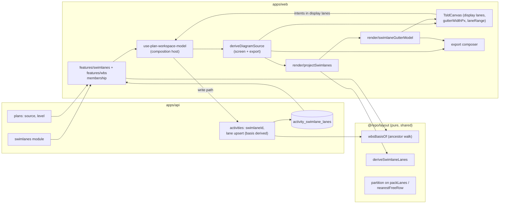
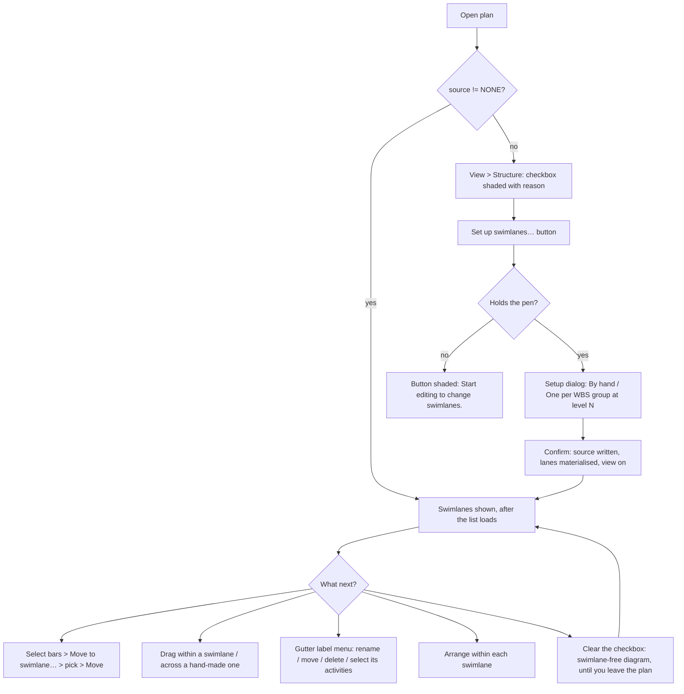

# Feature Spec: Labelled swimlanes on the TSLD diagram

- **Status:** Approved — by the product owner, 2026-10-22: SQ-1 to SQ-6 with their defaults, SQ-7 **yes** (M1-T1b is in scope)
- **Author(s):** Feature Analyst (Claude Code), for James Ewbank (product owner)
- **Date:** 2026-10-22 (revised the same day to fold in two reviews: §7)
- **Tracking issue / epic:** none yet; `docs/BACKLOG.md:251-255` ("Labelled swimlanes on the
  diagram")
- **Roadmap link:** `docs/ROADMAP.md` — diagram authoring (the TSLD as the primary surface)
- **Companion documents** (read with this one; they are not repeated here):
  - [`schema-design.md`](./schema-design.md): the schema (database-architect). It is the
    authority for every table, column, index, constraint, lock order and migration step.
  - [`ui-architecture.md`](./ui-architecture.md): the frontend architecture review (ui-architect),
    changes C1–C13.
- **Related ADR(s):** one new ADR is required (outline in §4.14). Amends or extends ADR-0026,
  ADR-0031/0090, ADR-0063, ADR-0069, ADR-0100, ADR-0103/0200, ADR-0152/0203, ADR-0153 and
  ADR-0156; ADR-0051 §4 only if SQ-4 is "yes". Builds on ADR-0028, ADR-0048/0176, ADR-0073,
  ADR-0080, ADR-0081, ADR-0088 D1, ADR-0091, ADR-0096, ADR-0106, ADR-0111, ADR-0122, ADR-0127,
  ADR-0139, ADR-0157, ADR-0172 and ADR-0201.
- **Base:** `origin/main` 9788f1f. Every `file:line` below was read on that tree.

> **This request commissions the work.** `docs/DECISIONS.md:13-20` (2026-10-22) records that,
> offered a swimlane spec, the owner chose "regroup the WBS by system" and that "a
> labelled-swimlane diagram is not commissioned". Later the same day the owner asked for
> horizontal labelled bands that can be turned on or off and that activities are assigned to.
> **That request supersedes the entry's "not commissioned".** Decision-log entries are never
> edited (`docs/DECISIONS.md:8`), so approval adds a new entry rather than changing that one. It
> also closes the open question in `docs/PROJECT_BRIEF.md:283` ("Default: no in v1") and the
> deferral in `docs/adr/0026-tsld-canvas-rendering-and-architecture.md:566`.

---

## 0. Vocabulary — read this first

The codebase already says **lane** for the packer's rows, and so does the product's copy:

- `activities.lane_index` is "Graphical y-lane / vertical offset for the TSLD canvas"
  (`apps/api/prisma/schema.prisma:1158-1160`).
- `packLanes` packs "into the fewest non-overlapping-in-time lanes"
  (`packages/layout/src/pack-lanes.ts:27-58`).
- The user sees "lane" for a row: "Choose how to rearrange the lanes"
  (`apps/web/src/features/tsld/components/ArrangeDialog.tsx:114`), "Already in the top lane."
  (`TsldPanel.editing.test.tsx:432`), "Lane overlap" (`TsldLegend.tsx:74`), the toolbar's
  "Auto-arrange lanes" (`tsld-toolbar-items.tsx:3356`).
- A SchedulePoint XER carries `SchedulePoint layout v1: lane`, and ADR-0156 records that "a
  label can never change once a file carries one" (`docs/adr/0156-…-inert-field.md:46-48`,
  `packages/interchange/src/xer-layout-fields.ts:27`).

So "lane" keeps its meaning (one row of the diagram), and renaming it is out of scope: the XER
label is permanent, and ADR-0156 chose "lane" so that the file and the screen say the same word.

**The new band is a _swimlane_, always the whole word, in copy and in code.** A swimlane is a
labelled, contiguous run of lanes. It contains lanes, as a swimming pool's lane system contains
lanes. Four rules keep the terms apart:

1. **Copy never shortens "swimlane" to "lane".** A lane inside a swimlane reads "lane 2 of
   Mechanical". A structural test over the swimlane strings refuses a bare `\blane\b` that
   refers to a swimlane (plan M2-T10).
2. **Identifiers are `swimlane*`** (`swimlaneId`, `SwimlaneLayout`, `activity_swimlane_lanes`),
   never `lane*`. A word-boundary search for the packer's `lane` or `laneIndex` never returns a
   swimlane identifier, and the reverse also holds.
3. **"Display lane"** is the lane a bar is drawn in once swimlanes are projected (§4.1). It is
   derived and never stored.
4. **"Lane basis"** is the swimlane a stored in-swimlane lane was written against (§4.4).

Each alternative word already means something shipped:

- **band**: "WBS band" (`tsld-toolbar-items.tsx:659`), "Month bands" (`:656`), and the "canvas
  band model" (ADR-0063).
- **zone**: hit zones (`gesture-machine.ts:10`), rail zones (`org-destinations.tsx:23`), and a
  site zone in construction.
- **track**: link tracks (`render/link-tracks.ts`).
- **group**: WBS groups (`features/wbs/model/wbs-groups.ts`).
- **strip**: the resource strip (ADR-0049).
- **row**: the packer's other name (`nearestFreeRow`, ADR-0151).

"Swimlane" is also the owner's word. SQ-1 asks the owner to confirm it.

---

## 1. Business understanding

### Problem

On 2026-10-22, while turning a NetPoint programme into an XER, the owner asked "is there a way
to put the systems in swimlanes?" (`docs/BACKLOG.md:251-253`). They regrouped the WBS by system
as a stopgap (`docs/DECISIONS.md:18-20`). **That stopgap groups the Gantt and leaves the diagram
as it was.** Re-verified on this tree (CLAUDE.md §19.11):

- The Gantt groups rows by WBS: `wbs-groups.ts:8-10` is "consumed by the Gantt row model and the
  TSLD WBS band".
- The diagram groups by nothing. `packLanes(items, predecessorsOf?)` (`pack-lanes.ts:55-58`) takes
  spans, lanes and predecessors. Tidy and Re-layout have no grouping input
  (`render/optimise-layout.ts:13-39`). After Arrange, a Mechanical activity and an Electrical one
  share a lane whenever their dates allow it.
- The WBS band (ADR-0063) draws summaries at depths 0–2 across the top
  (`docs/adr/0063-…md:69-72`). It says **when** each system runs, not **which** bars below belong
  to it. It is off by default (`render/view-toggles.ts:88-93`).
- The owner had already named this case. When they turned month-band striping off, they named
  swimlanes as where striping would help (`render/view-toggles.ts:126-133`).

No surface in the product draws a system's activities together, under its name, on the diagram.

### Users

- **Planner / Org Admin**: set up swimlanes, assign activities, arrange inside them. Writing
  needs the pen (ADR-0028).
- **Contributor / Viewer**: see swimlanes and turn them on or off for their own view. No writes.
- **External Guest**: sees swimlanes if SQ-4 is "yes" (the default), with the same on/off control.

### Primary use cases

1. Show a programme by system or trade: one labelled swimlane per system.
2. Switch swimlanes off to see the ordinary diagram, then back on. Nothing is lost.
3. Get swimlanes from the WBS with no assignment work, when the WBS is by system (the owner's plan).
4. Assign by hand when swimlanes are not the WBS (for example WBS by area, swimlanes by trade).
5. Tidy or Re-layout without breaking the swimlanes.
6. Export, print or share the diagram as it appears with swimlanes.

### User journeys

**Happy path, by hand.**

1. A Planner holding the pen opens `View ▾ ▸ Structure` and presses **Set up swimlanes…** (a
   command button under the toggle, §4.9). They choose "By hand" and type "Civil",
   "Mechanical" and "Electrical".
2. The diagram shows three empty swimlanes, plus a "No swimlane" swimlane at the bottom holding
   every activity as it was laid out.
3. They marquee-select eight bars (ADR-0080) and choose **Move to swimlane…**, pick Mechanical
   and press Move.
4. The eight bars move into Mechanical. They keep their left-to-right positions and stack without
   overlapping.
5. Arrange ▸ Re-layout packs within each swimlane.
6. They clear the Swimlanes checkbox. The diagram is exactly what it was before they started.

**Happy path, by WBS.** In the setup dialog they choose "One per WBS group", at the suggested
level. Each summary at that level gets a swimlane named after it. Renaming the summary renames
its swimlane. Moving an activity to another summary moves it to that summary's swimlane.

**Alternates.** A Viewer clears the toggle for their own view. A guest opens a share link and
sees the swimlanes. A Planner exports a PDF, and the swimlanes and their names are in it.

### Expected outcomes

The diagram answers "what is Mechanical doing, and what does it hand to Electrical?" at a glance.
The owner's WBS regrouping stops being a Gantt-only workaround.

### Success criteria

Each criterion maps to a named test in the plan's Definition of Done. **None needs the owner to
test, measure or check anything on their server or devices.**

- **SC-1, off is lossless.** Turning swimlanes on, editing in them, and turning them off leaves
  every activity's `laneIndex` unchanged, except where ADR-0153 moved a bar that an edit made
  overlap (§4.5). Covered by a unit test and a journey.
- **SC-2, the recalc parity gate.** `computeSchedule` input is byte-identical with or without
  swimlanes. Every new field is `NOT_INPUT` and absent from `ENGINE_ACTIVITY_SELECT` (§3).
- **SC-3, off paints byte-for-byte.** With the view off, or nothing set up (`gutterWidthPx = 0`,
  no `swimlanes` scene input), the golden paint log is unchanged.
- **SC-4, no overlap introduced.** No client write (setup, assign, lane move, WBS move, Arrange,
  auto-resolve) leaves two bars in one display lane at overlapping spans. For stale stored lanes
  from server-side arrivals, the projection's collision rule (§4.4) guarantees the same. The
  property test covers projections over stale rows, not only writes.
- **SC-5, one derivation, and what the gates actually check.** The screen and the export both
  call one `deriveDiagramSource` and one `swimlaneGutterModel` (§4.1). The existing gates see
  only `<canvas data-layer>` elements and `TsldScene` keys. They "cannot see … DOM chrome"
  (`features/tsld/export/scene-parity.structural.test.ts:209`), so on their own they cover the
  rules and grounds and not the gutter labels. This epic closes that gap by adding a
  `data-chrome` roster for DOM chrome to the ADR-0200 gate, covering the ruler and the gutter
  (§4.8). Until that roster lands, only the rules and grounds are gated.
- **SC-6, Arrange stays inside swimlanes.** Tidy and Re-layout never change an activity's
  swimlane. With no partition, they are byte-identical to today (the ADR-0203 FC-R8 form).
- **SC-7, the cost is bounded.** Partitioned Tidy and Re-layout are measured in node on the
  reference plan, the torture fixture and `scale-500` (plan M0). Paint is O(swimlanes in view),
  shown by a counting stub. The M1 migration and expiry costs are measured on seeded and fixture
  databases (`schema-design.md` §8.3).
- **SC-8, reachable without sight.** A screen-reader user can find every swimlane, its name,
  order and members, and can do everything a pointer user can (WCAG 2.2 AA, ADR-0122).

### Open questions

The owner's questions are in **§6 (SQ-1 to SQ-7)**, each with a default. Everything else has a
default stated in the body.

---

## 2. Functional requirements

### User stories & acceptance criteria

> **US-1, on and off.** As any reader, I want to switch swimlanes on and off.
>
> - **Given** a plan with swimlanes set up **when** I open it **then** they are shown (SQ-3).
> - **Given** swimlanes are on **when** I clear `View ▾ ▸ Structure ▸ Swimlanes` **then** I see
>   the swimlane-free diagram, with every bar at its stored `laneIndex` and no gutter, rules or
>   grounds (SC-3).
> - **Given** I turned them off **when** I turn them on again **then** every bar is back in the
>   lane it had in its swimlane, with nothing recomputed or rewritten.
> - **Given** nothing is set up **then** the checkbox is shaded with "No swimlanes have been set up
>   for this plan." It stays focusable (ADR-0082, ADR-0204). **Checking it never opens a dialog**
>   (WCAG 3.2.2; ADR-0091).
> - Turning the view on or off **never writes**. The choice lasts **until you leave the plan**.
>   View state is `useState`, and it resets on every mount and plan switch
>   (`view-toggles.ts:32-36`, `toolbar/use-tsld-canvas-ui-state.ts:209-233`).
> - **Given** the plan has swimlanes and their list is still loading **then** the diagram stays in
>   its loading state (ADR-0202). It never paints the swimlane-free layout first and then jumps.

> **US-2, set up and manage by hand.** As a Planner with the pen, I want to create, rename,
> reorder and delete swimlanes.
>
> - `View ▾ ▸ Structure` holds a button under the toggle: **Set up swimlanes…** when none exist,
>   **Swimlanes…** when some do. Without the pen it is shaded with "Take the pen to set up
>   swimlanes." (As built: the house pen sentence, `scheduleRefusal` — "Start editing to change swimlanes.", or "Request control to …" when a peer holds the pen.) The gutter's corner cell carries the same **Swimlanes…** command (ADR-0093).
> - **When** I add "Mechanical" **then** it appears as an empty swimlane one lane tall, above
>   "No swimlane".
> - **When** I rename it, move it up, or move it down (from its gutter menu or the manage
>   dialog) **then** the change applies at once, as one undo step.
> - **When** I delete a swimlane that holds 12 activities **then** a confirmation reads "12
>   activities will show under No swimlane. Undo brings them back." After deletion they show
>   under "No swimlane". Undo restores the swimlane, and every member returns to its remembered
>   lane in it (§4.4, §4.7).

> **US-3, assign.** As a Planner with the pen, I want to put activities in a swimlane.
>
> - From the **selection bar** (one or many, ADR-0080): **Move to swimlane…** opens a small
>   popover with a `SelectField` and a Move button. This is the control `WbsBulkAssignBar`
>   already uses (`features/wbs/components/WbsBulkAssignBar.tsx:111-131`). The `Menu` primitive
>   has no submenus and no typeahead (`components/ui/menu.tsx:38`), and a flat menu of up to 100
>   swimlanes would be unusable.
> - From the **activity editor**: a "Swimlane" `SelectField` beside Breakdown, saved with its
>   scope (ADR-0060).
> - By **dragging** one bar into another hand-made swimlane. A WBS swimlane is covered by SQ-5.
> - From the **Activities table** bulk bar and the **Gantt** "Swimlane" column (M4). Both use the
>   same `SelectField`.
> - **Then** each moved activity keeps its drawn dates. It takes its **remembered lane** in the
>   target swimlane when that lane is free, and otherwise the nearest free lane at its span
>   (`nearestFreeRow`, ADR-0153 D3). The whole move is one write and one undo step. `laneIndex`
>   does not change.

> **US-4, from the WBS.** As a Planner, I want one swimlane per WBS group at a level I choose.
>
> - The swimlanes are the active `WBS_SUMMARY` activities at that level (1–3), in WBS order,
>   named after their summaries.
> - An activity under one of them, at any depth, is in that swimlane. Every other activity is in
>   "No swimlane".
> - Renaming, adding, moving, dissolving or deleting a summary updates the swimlanes with no
>   further action (§4.6).
> - The editor's Swimlane field is read-only, with the reason "Swimlanes follow the WBS in this
>   plan." (ADR-0083).

> **US-5, arrange.** **Given** swimlanes are on, Tidy and Re-layout work within each swimlane,
> including "No swimlane". No activity changes swimlane, and the dialog says so. **Given** they
> are off, Arrange is today's Arrange (SC-6).

> **US-6, everywhere the diagram goes.** Export (PNG and PDF), print and, if SQ-4 is "yes", the
> guest view show swimlanes as the screen does. A SchedulePoint XER brings them back on import.
> The minimap reports swimlanes in its readout (§4.8).

> **US-7, accessible.** A keyboard or screen-reader user can reach every swimlane, hear its name,
> position and size, open its actions, and find each activity inside its swimlane's group
> (§4.10).

### Workflows

- **Toggle**: a lens checkbox in `View ▾ ▸ Structure`, with shut reasons (§4.8). It flips view
  state and nothing else.
- **Setup and manage** go through the command button, never through the checkbox.
  - Setup writes the plan's source (`MANUAL`, or `WBS` and a level) and any names typed.
  - On confirm, it writes the in-swimlane lanes for the activities placed by derivation (§4.4),
    in batches of at most 2,000 (`update-positions.dto.ts:45`). The view then turns on.
- **Gutter label menu** (APG `Menu`): Rename…, Move up, Move down, Add swimlane below, Select its
  activities, Zoom to swimlane, Delete…. "Select its activities" uses the plural selection, so
  every bulk action works on a whole swimlane.
- **Lane moves inside a swimlane.**
  - A vertical drag or `Alt+↑/↓` moves the bar within its own swimlane.
  - `Alt+↓` on the swimlane's bottom lane adds a lane: the swimlane grows.
  - `Alt+↑` on the top lane announces "Already in the top lane of Mechanical." and writes nothing.
    This is the existing boundary rule (`TsldPanel.editing.test.tsx:429-432`), reworded.
  - A plural vertical move keeps each bar in its own swimlane, so the "would change the
    selection's shape" refusal (`TsldPanel.bulk-operations.test.tsx:581`) still means what it
    says.
  - A drag in a WBS swimlane is **clamped while it is in progress** at the swimlane's edge,
    through `laneRange`, rather than refused after the ghost has crossed (§4.1, SQ-5).
- **Create on the canvas** in swimlane S. The new activity joins S: by hand, `swimlaneId = S`; by
  WBS, it is filed under S's summary (SQ-5). It takes a lane in S and a `laneIndex` in the
  swimlane-free layout, each the nearest free lane at its span.

### Edge cases

- **Nothing set up**: today's diagram exactly. The checkbox is shaded, and the button offers
  setup.
- **Everything unassigned**: one "No swimlane" swimlane holds the plan, compacted from the
  swimlane-free layout (§4.4).
- **Empty "No swimlane"**: hidden. An empty bucket is noise (`wbs-groups.ts:61-62`).
- **Empty hand-made swimlane, or a WBS summary with no members**: shown, one lane tall.
- **WBS band on together with WBS swimlanes**: summaries lifted into the band (ADR-0063 §4) stay
  out of the projection, and their stored lanes are untouched.
- **An activity not drawn yet**: keeps its lanes and is not drawn (`optimise-layout.ts:123-124`).
- **The 101st swimlane**: refused with `422`. **The 2,001st row in one write**: the client splits
  the write into batches.
- **Concurrent edits**: the pen serialises structural writes. A stale version is a `409` on the
  whole batch.
- **Source switched, or a swimlane deleted**: every lane stays stored, one per basis
  (`schema-design.md` §2), so switching back or restoring returns the old picture with no write.
- **Long names**: they wrap inside the gutter within the swimlane's height. A one-lane swimlane
  whose name does not fit ends in "…". The full name is in the label's tooltip and accessible
  name. This is a stated exception to ADR-0184: a label cannot grow past the swimlane it names.
- **Narrow stage** (the 1024 floor, ADR-0179): the gutter has two fixed widths, expanded and a
  collapsed strip (44 px as built, a full touch target) that shows each swimlane's number. Below a container width measured in M2-T3
  (ADR-0182), it collapses, and its expand control is shaded with the reason. That is the
  `minimapRoom` form (`tsld-toolbar-items.tsx:338-342`, `:547-552`). There is no drag divider.
- **Gantt view**: the swimlane toggle is shaded with the no-diagram reason, and the Gantt gets a
  column instead (§4.8).

### Permissions

RBAC with organisation scope (ADR-0012), deny by default:

- **Read swimlanes, and the view toggle**: any member with plan read, and a guest if SQ-4 is
  "yes" (`SCHEDULE_READ`, ADR-0051 §4).
- **Every write** (swimlane create, rename, reorder, delete or restore; source; assign; lane
  moves; Arrange) needs Planner or Org Admin, organisation scope, **and the pen**. These are
  structural writes, gated like the positions batch (`plan-activities.controller.ts:102-119`).
  Lane moves are already Planner/Org Admin only (`:104`).
- **Same-plan invariant**: `activities.swimlane_id` must name a swimlane of the same plan. The
  **database** enforces this with a composite foreign key `(plan_id, swimlane_id)`
  (`schema-design.md` §3.3). That is a stronger guarantee than `parentId` has. The service also
  checks, so a foreign or deleted id answers `404` before the key could answer `500`.

### Validation rules

- **Name**: trimmed, 1–80 characters, no control characters. It is backstopped in the database
  (`ck_swimlanes_name_shape`).
- **Name uniqueness**: unique among the plan's active swimlanes, ignoring case (`409
SWIMLANE_NAME_TAKEN`). A soft-deleted name does not block reuse. Case folding is guaranteed for
  ASCII. For non-ASCII it holds only where M1 proves it on CI's `postgres:17-alpine`
  (`schema-design.md` §4 Q2), and this spec claims no more than that.
- **At most 100 active swimlanes per plan** (`422 SWIMLANE_LIMIT`). The service checks this under
  the plan lock.
- **WBS level**: 1 to 3 when the source is `WBS`, and absent otherwise
  (`ck_plans_swimlane_source_level`).
- **In-swimlane lane**: 0 to 10,000. The same bound as `laneIndex`
  (`update-positions.dto.ts:20-25`).
- **Batches**: at most 2,000 rows, with no duplicate ids. **The client never sends a basis.** The
  server derives it (`schema-design.md` §4 Q3).
- **Reorder** names every active swimlane exactly once, with its version.
- **Writes refused by source**: a direct `swimlaneId` write in WBS mode is `422
SWIMLANE_SOURCE_IS_WBS`. A lane write while the source is `NONE` is `422`.

### Error scenarios

- **Not a member, or plan not found**: `404`, the standard page.
- **Role below Planner**: `403`. Controls are shaded with their reason.
- **No pen**: `423`, the existing message.
- **Duplicate name**: `409`, an inline error.
- **Stale version**: `409`, the stale-plan message. Nothing is applied.
- **Limit reached**: `422`, an inline error.
- **Foreign, unknown or deleted `swimlaneId` on assignment**: `404`. It is not an existence
  oracle.
- **Wrong source**: `422`. The control is shaded beforehand.
- **Restore when the name is taken**: `409`. Undo sets the restore aside with that reason
  (ADR-0176).
- **Restore under a deleted plan**: `409 PARENT_DELETED` (`schema-design.md` §6).

---

## 3. Technical analysis

- **Frontend (high).**
  - Display lanes swapped in at one seam.
  - The gutter as a left reservation in `TsldCanvas`.
  - Boundary rules, and optional grounds.
  - The lens toggle and the command button.
  - Gestures and nudges.
  - Auto-resolve in both layouts.
  - Partitioned Arrange.
  - Export mirror and the chrome roster.
  - The minimap readout.
  - Dialogs, the editor field, the assign popover, and the table and Gantt columns.
  - A grouped listbox and the gutter composite.
  - Undo.
- **Backend (medium).**
  - The `swimlanes` module.
  - Plan source fields.
  - Activity membership, and lane upserts with a server-derived basis.
  - Cascade, restore, expiry and import compensation.
  - Organisation export 2.1.
  - The guest DTO (SQ-4).
  - Activity history.
  - XER UDFs.
- **Database (medium).** Two tables, one activity column and two plan columns, in one
  expand-only migration. Designed in `schema-design.md`.
- **API (medium).** New `…/swimlanes` routes. The positions batch gains an optional `swimlane`
  part. Activity responses gain `swimlaneId` and `swimlaneLanes[]`.
- **Security (medium).**
  - Scope and IDOR, now backed by a composite FK.
  - The pen.
  - The guest widening (SQ-4).
  - Hostile names from XER files.
  - A server-derived basis, so a client cannot plant a basis that the projection would believe.
- **Performance (medium).**
  - The projection is O(n log n) per data change, memoised, and never run per frame.
  - Paint is O(swimlanes in view).
  - Arrange is measured in M0.
  - Lane rows load per page through one index, with no N+1 (`schema-design.md` §9).
  - The expiry budget counts lane rows.
- **Infrastructure (low).** One Playwright config and suite, joining the shards (ADR-0138) and
  the prepush roster (ADR-0160). No new service. No flag.
- **Observability (low).** Swimlane delete and restore write audit rows. Nothing else is new.
- **Testing (high).**
  - Unit tests.
  - API e2e.
  - Three journeys.
  - Axe checks.
  - The parity gates.
  - The new chrome roster.
  - Seed plans and `TEST_PLAYBOOK` rows.
  - The migration and expiry measurements.

### Recalc parity (the gate, stated)

- **New fields cannot reach the engine.** The engine reads only `ENGINE_ACTIVITY_SELECT`, and
  `ACTIVITY_FIELD_CLASS` is a `Record` over `ActivityPatch`, so a new field does not compile until
  it is classified (`apps/api/src/common/schedule-inputs/schedule-input-fields.ts:6-19`).
  `swimlaneId` is `NOT_INPUT`, like `laneIndex` (`:35`). The plan's source and level are
  `NOT_INPUT` in `PLAN_FIELD_CLASS` (`:54-71`). The lanes table is not on the activity row at
  all.
- **The one existing input it writes is `parentId`** (`:34`), when an activity is created inside
  a WBS swimlane. That is an existing input on an existing path, and the gate already covers it.
- **Nothing is backfilled.** Every existing plan reads `swimlane_source = 'NONE'`
  (`schema-design.md` §3.2).

### Dependencies

- **First:** the schema (`schema-design.md`, which is plan M1-T1) and the M0 measurement (ADR-0142).
- **Reused:**
  - `nearestFreeRow`, `rowOccupancy`, `packLanes` and `drawnSpanDays`
    (`packages/layout/src/index.ts:16-24`);
  - `wbs-groups.ts` and `wbs-tree.ts`;
  - `barDatesFor`;
  - the positions batch;
  - `LensToggleBase` (`tsld-toolbar-items.tsx:213-221`);
  - `rovingIndexFor` (`components/ui/toolbar/toolbar-keyboard.ts:139-148`);
  - `SelectField` and the APG `Menu`;
  - the ADR-0200 and ADR-0103 gates;
  - `centerOnWorld` (`TsldCanvas.tsx:168-173`).

---

## 4. Solution design

### 4.1 Architecture overview

A swimlane is a **projection over lanes**, not a new coordinate system. `screenYOfLane` and
`laneAtScreenY` are linear in the lane (`render/geometry.ts:718-731`). Stacking contiguous
swimlanes keeps them linear, so there are **no gaps between swimlanes**.

**One seam (ui-architecture C6).**

- The workspace host computes each activity's display lane.
- It hands `toRenderActivities` copies of the activities whose `laneIndex` **is** the display
  lane.
- These all read that field and need no edit: lane-overlap flags
  (`render/to-render-model.ts:46-53`), cull, hit-test, the router, and the minimap marker
  (`TsldMinimap.tsx:144`).
- `TsldCanvas` intents come back in display lanes. Only the host's write path converts them to
  (swimlane, lane in swimlane).
- `TsldCanvas` gains three generic optional inputs, each meaning parity when absent:
  - `swimlanes?: SwimlaneScene`: the rules, optional grounds and gutter model.
  - `gutterWidthPx`: the left reservation (§4.2).
  - `laneRange?: (id) => { min, max }`: clamps a drag while it is in progress.

**One composition (C7).** `deriveDiagramSource(activities, { wbsBand, swimlanes, source })`
returns `{ sceneActivities, bandGroups, bandHeight, swimlaneScene }`. The screen
(`TsldPanel.tsx:1213-1239`) and the export (`toolbar/commands/use-diagram-image.ts:166-171`) both
call it. Today each site derives the WBS band separately. A second derivation added at both
sites would be the drift that ADR-0063 §9 exists to prevent.

**Where code lives (C8).** ADR-0026 §8 says `features/tsld` imports no other feature. That has
already slipped (`TsldPanel.tsx:132-135`, `use-diagram-image.ts:32`). This epic adds no further
slip; the existing ones are filed in `docs/TECH_DEBT.md`.

- **`features/swimlanes`**: queries, manual membership, the dialogs, and the editor field.
- **`features/wbs/model`**: WBS membership at level N, beside `wbs-groups.ts`.
- **`@repo/layout`**: `deriveSwimlaneLanes`, the `partition`, and the **ancestor walk that yields
  a WBS basis**. The server and the web share it, so the two cannot disagree about depth
  (`schema-design.md` §4 Q3).
- **`features/tsld/render`**: `projectSwimlanes` and `swimlaneGutterModel`. Display lanes are a
  render concept, and the screen and the export are the only consumers.
- **`components/layout/workspace/use-plan-workspace-model.ts`** (`:34-88`, the existing host):
  composes a neutral `SwimlaneInput` for `TsldPanel`.



**This is not ADR-0063's rejected alternative.** ADR-0063 rejected "summaries as background
bands behind their lanes", because that gives one coordinate two meanings and teaches
`packLanes` and `hitTest` about summaries (`docs/adr/0063-…md:219-221`). Here:

- The stored lane means "the lane within its swimlane". The display lane is derived from it.
- `hitTest` learns nothing.
- The packer learns one optional parameter.
- Contiguity holds by construction.

### 4.2 What the diagram looks like, each way

**Off** (or nothing set up): today's diagram, painted byte-for-byte (SC-3).

**On:**

- **A gutter of names at the left, as a reservation inside `TsldCanvas` (C3).** An earlier draft
  put the gutter outside the canvas stack and said there was "no offset to add". **Both halves
  were wrong.**
  - ADR-0063 has already rejected a DOM overlay that re-derives the axis every pan frame
    (`docs/adr/0063-…md:222-224`).
  - The create popover's x is canvas-relative and is positioned against the `Surface`
    (`TsldPanel.tsx:3443-3456`, `:3530-3539`). So any column left of the canvas moves the popover
    by its width.

  The design that follows from that:
  - `measure()` subtracts `gutterWidthPx`, as it subtracts each band today
    (`TsldCanvas.tsx:1908-1919`).
  - `sceneOrigin(wbsBandHeightPx, gutterWidthPx) → { left, top }` replaces `sceneTopOffset`
    (`:242-244`). It becomes the only definition of where the scene starts, and every call site
    uses it, including the popover's x.
  - The rAF loop writes label positions from `viewRef` in the same frame the scene paints
    (`:2240-2264`), the way the ruler is written (`:2658-2667`). Each label is sticky to the top
    of its swimlane's visible part.
  - The corner cell covers the ruler and the WBS band. It holds the collapse control and the
    **Swimlanes…** command.

- **The labels are DOM text (C4).** They are chrome that people read, so WCAG 1.4.5 asks for real
  text. Real text also wraps, honours text spacing (1.4.12) and is found by find-in-page. This is
  ADR-0106 D1 turned on its side: the rule is a scene mark, and its name is chrome.
- **A solid rule at each swimlane boundary, painted beneath every link and bar (C5).**
  - An earlier draft dropped the rule because a lone link run sits exactly on a lane boundary
    (`render/link-routing.ts:294`). That objection holds only for a rule painted **above** the
    links.
  - Grounds paint first (`render/paint.ts:1192-1221`) and edges much later (`:1634-1656`), so a
    link on that channel covers the rule, and the rule never covers the link (ADR-0199).
  - The rule uses alias tokens `--canvas-swimlane-rule: var(--canvas-grid-year)`, plus the paper
    twin (`globals.css:759-768`). These add **no new colour value**, so the rule inherits every
    contrast sweep already run on those tokens.
  - It is solid, which keeps it distinct from the dashed day and month rules (ADR-0157 D1).
- **Alternating ground: optional, and SQ-6 decides.**
  - The only quiet ground, `--canvas-band`, is 1.02:1 (`globals.css:566-575`). It is held below
    the non-working wash by a gate (`print-palette.structural.test.ts:221-238`). So a ground
    cannot carry the boundary on its own, which was the earlier draft's claim. The rule carries
    it.
  - If the ground is kept, it reuses `--canvas-band`, which needs no new contrast work, and month
    bands are hidden while swimlanes show (no chequerboard). If it is dropped, month bands keep
    working alongside swimlanes.
- **Links** route across swimlanes as they do across lanes today. The router is unchanged. M2
  commits rendered pictures, rule-only and rule-plus-ground, of the reference plan. It also
  records how many link runs coincide with a boundary.

### 4.3 Data flow

```mermaid
sequenceDiagram
  participant P as Planner (pen)
  participant H as Workspace host
  participant L as @repo/layout
  participant A as API
  participant DB as Postgres
  P->>H: Move to swimlane… → Mechanical (8 selected)
  H->>L: remembered lane if free, else nearestFreeRow (partitioned)
  L-->>H: lanes in Mechanical (+ its unplaced members, materialised)
  H->>A: PATCH …/activities/positions {id, version, swimlane:{swimlaneId, laneIndex}}[]
  A->>A: RBAC + scope + pen; derive basis server-side
  A->>DB: lock activities (id order) → FOR SHARE swimlanes → UPDATE → upsert lanes
  DB-->>A: rows at new versions
  A-->>H: 200 (with swimlaneLanes[])
  H->>H: one undo step (inverse = previous swimlane; lanes are remembered)
  H->>H: deriveDiagramSource → display lanes → TsldCanvas
```

### 4.4 Two layouts, and a lane per basis

Each activity keeps:

- **`laneIndex`**, the swimlane-free layout. Swimlane operations never write it, except
  auto-resolve (§4.5), which writes it today too.
- **One stored lane per basis it has ever been placed against**, in `activity_swimlane_lanes`
  (`schema-design.md` §2, §3.5). A basis is one of:
  - a hand-made swimlane;
  - "No swimlane" in manual mode;
  - a WBS summary;
  - "No swimlane" at WBS level L.

  "Never placed against this basis" is the **absence of a row**, not a sentinel (ADR-0139).

An earlier draft stored one slot on the activity. The schema design shows that the
materialise-on-write rule below overwrites that slot during ordinary use. Switch-back, restore
and move-back would then all lose the lane (`schema-design.md` §2, items 1–3). With a row per
basis, all three come back:

- **Switching source and back**, or **restoring a deleted swimlane**: the old picture returns
  with **no write**.
- **Moving an activity back into a swimlane**: it takes its remembered lane there if that lane is
  free. Otherwise it takes the nearest free lane. The move is a write anyway.

**The server derives the basis. The client never sends it** (`schema-design.md` §4 Q3). The
ancestor walk is the one shared function in `@repo/layout`.

**Placing members with no row for the current basis** (`deriveSwimlaneLanes`, pure). This
applies within one swimlane:

- Members are taken in `(laneIndex, drawn start, id)` order.
- If no member has a row, each takes the first lane that is free at its span. This is compact,
  and it keeps the swimlane-free vertical order.
- Otherwise, each unplaced member takes the free lane nearest to its first-fit lane. Ties go to
  the lower lane (ADR-0153 D3).

**Collision rule for stale rows** (`schema-design.md` §4 Q3). A row can be stale: an activity can
return to a swimlane through another client, carrying an old row that now collides with a member
placed since. When two placed members of one basis collide, the row with the later `updated_at`
keeps the lane, ties are broken by id, and the other member is treated as unplaced. Every client
write keeps SC-4 directly. Server-side arrivals keep it through this rule.

**Materialise on write.** A derived lane depends on spans, so a recalculation could move it. The
first write into a swimlane therefore also writes every unplaced member of that swimlane at its
current derived lane, in the same batch. Nothing on screen moves except the subject. Unplaced
members come only from server-side arrivals (import, API create, another client's WBS move), and
the projection re-places them only until the next write. This is stated rather than hidden.

### 4.5 Arrange, auto-resolve and the lane packer

- **One optional `partition`** (activity id → swimlane key) is added to `packLanes`,
  `nearestFreeRow`/`rowOccupancy`, `optimiseLayout` and the Re-layout starts. When absent, each
  is byte-identical (ADR-0203 FC-R8). The argument against a second packer still holds
  (`pack-lanes.ts:50-53`). `optimise-layout.ts:1` already imports the packer.
- **Inside the search:**
  - swaps happen only within one swimlane;
  - alignment candidates come only from the bar's own swimlane;
  - "one new row" adds a lane at the bottom of the bar's own swimlane;
  - compaction keeps at least one lane per swimlane;
  - the objective is scored on **display lanes**, so links between swimlanes count, and those are
    the interfaces swimlanes exist to show.
- **Budgets and limits are unchanged:**
  - Tidy uses the seed's display-lane count (`optimise-layout.ts:35-39`);
  - Re-layout uses ADR-0203 D1;
  - `OPTIMISE_MAX_ACTIVITIES = 300` (`:105`) and `RELAYOUT_MULTISTART_MAX_ACTIVITIES = 150`
    (`relayout-starts.ts:53`) stay, unless M0 says otherwise. If it does, the owner decides, as in
    ADR-0203 D3.
- **The pack hint** (`pack-lanes.ts:97-112`) reads only predecessors in the same swimlane. M0
  measures the alternative, a hint based on display lanes.
- **Arrange with swimlanes on writes only in-swimlane lanes.** The dialog adds "Within each
  swimlane. No activity changes swimlane." (`ArrangeDialog.tsx:114`).
- **Auto-resolve (ADR-0153) runs on both layouts** once swimlanes are set up. The rule is
  unchanged. In the swimlane layout, "free lane" means a lane of the mover's own swimlane, which
  may grow. Both moves go in one write and one undo step. The dock sentence names which picture
  moved. `use-auto-resolve.census.structural.test.ts` holds the new commands to the snapshot rule.

### 4.6 Where swimlanes come from, and what WBS changes do

The plan's **source** is `NONE` (the default), `MANUAL`, or `WBS` with a level from 1 to 3
(`schema-design.md` §3.2). Switching it is a plan write under the pen, bumps `plans.version`, is
one undo step, and keeps every stored lane (§4.4).

**By WBS, live.** Membership comes from `features/wbs/model`, beside `wbs-groups.ts`, so the
Gantt, the band and the swimlanes agree. Setup suggests the shallowest level that has at least
two summaries, because level 1 is often a single "The Works" node (ADR-0063 §3).

- **Rename a summary**: the label follows, with no write.
- **New summary**: a new empty swimlane appears, in WBS order.
- **Move an activity** (Breakdown, the Members panel, or the table's bulk assign): one shared
  helper writes the activity's lane for its new basis in the same write as the move. It uses the
  remembered lane if free, else the nearest free lane. Moves made by another client show at a
  derived lane until the next write.
- **Dissolve** (ADR-0063 §8): the children join the parent's swimlane, or "No swimlane". The
  dissolve stays non-undoable.
- **Delete a summary**: the cascade takes its subtree. Restoring it returns every member to its
  remembered lane.

**By hand.** Membership is `activities.swimlane_id`. In WBS mode it is kept but ignored, so
switching back restores the hand-made assignment.

### 4.7 Undo, soft delete, restore, expiry, audit, history

- **Undo** (ADR-0048, ADR-0176). New commands: assign, create, rename, reorder, delete, restore,
  and switch source. Each checks before it writes.
  - Undoing an **assignment** whose target swimlane has since been deleted is set aside with its
    reason, because assignment to a deleted swimlane is refused (`404`).
  - Undoing a **delete** is a restore. A restore whose name was taken in the meantime is set
    aside with that reason.
- **Soft delete and restore** (`schema-design.md` §6).
  - A swimlane is soft-deleted on its own. Its members keep `swimlane_id`, and their lane rows are
    untouched.
  - A plan, project or client cascade stamps the plan's swimlanes into its batch, and
    `restoreBatch` brings them back.
  - **An activity restored onto a deleted swimlane is admitted, by design** (schema D7). This
    deliberately differs from ADR-0201 D1. A calendar is a scheduling input, so it is refused
    there. A swimlane is presentation, and "member of a deleted swimlane" is exactly the state
    that deleting a swimlane creates and restoring it reverses.
  - Swimlanes are not in Recently deleted. That list holds clients, projects, plans, resources and
    calendars (`features/recently-deleted/model/group-deletions.ts:97`), and not plan content.
- **Expiry** (ADR-0096 D2, armed on the owner's host per CLAUDE.md §17).
  - The expiry runner deletes lane rows before activities. It deletes swimlanes after activities
    and before plans (`schema-design.md` §6.1). The DMMF census fails the build until it does.
  - The run budget counts lane rows (§4 Q6).
  - Import compensation gains the same two deletes (§6.2).
  - **The ADR-0193 preview needs no change.** It counts plans and activities, and its scope is
    plan-keyed, so it cannot promise less than the sweep deletes (`schema-design.md` §4 Q6). An
    earlier draft said the preview must count swimlanes. That was wrong.
- **Audit** (ADR-0073 §1, `docs/adr/0073-…md:41-55`).
  - `swimlane.deleted` and `swimlane.restored` earn rows under Test 1.
  - Create, rename, reorder and assign do not: "an activity's own … lane" does not earn a row
    (`:54-55`), and `PATCH …/positions` is `REASONS.PLAN_CONTENT`
    (`apps/api/src/modules/audit/audit-coverage.structural.spec.ts:293`).
  - A source switch earns no row under Test 2.
  - The census classifies every new route.
- **Activity history** (ADR-0174): a `swimlaneId` change is recorded. Lane-row writes coalesce as
  lane-only (`activity-history.diff.ts:149`).

### 4.8 Beside the other surfaces

- **Entry point and toolbar registry** (ui-architecture C1 and C2; ADR-0031, ADR-0090, ADR-0185).
  - **The toggle.** `swimlanes` is a **`LensToggle`** in `group: 'structure'`, not a
    `VIEW_TOGGLE_META` key. `VIEW_TOGGLE_META` holds only `{ group, label, enabled? }`, with a
    build-time `enabled` (`tsld-toolbar-items.tsx:647-650`). Lenses exist because they "carry …
    a reason they are shut" (`:198-212`, `reason(ctx)` at `:221`), and swimlanes need data that
    can be loading or absent (`view-toggles.ts:38-42`).
  - **Its reasons**, in order:
    - "No diagram" (`LENS_NO_DIAGRAM_REASON`), which is what the Gantt shows;
    - "Loading swimlanes…";
    - "No swimlanes have been set up for this plan."
  - **Shown or not** is `override ?? (source !== 'NONE')`, held in the lens state of
    `useTsldCanvasUiState`. It is not in the URL.
  - **The Structure disclosure** counts checked lenses for free (`:2389-2391`). The setup and
    manage button sits beneath the toggle. The "Fit to plan" button in the same popover is the
    precedent (`:2273-2285`).
  - There is no new toolbar row and no promotion.
- **WBS band** (ADR-0063). It stays inside the stack at the top, and the corner cell spans it.
  Summaries lifted into the band stay out of the projection. The listbox count is unchanged
  (`TsldPanel.tsx:1225-1239`).
- **Gantt** (ADR-0059, ADR-0095). Its rows are its WBS tree, and regrouping them is a separate
  design. M4 adds an editable **Swimlane** column in the per-cell write scope. The swimlane toggle
  is shaded there with the no-diagram reason.
- **Export and print** (ADR-0103, ADR-0200).
  - With swimlanes shown, the export carries the rules, the optional grounds and a painted gutter
    mirror drawn from `swimlaneGutterModel`.
  - CSS and `measureText` may break a line in different places. The names, their order, their
    boxes and their counts come from one derivation, and that is what parity means here.
  - Names that do not fit are counted in the legend (ADR-0127 D3).
  - **The gate gap is closed** by a `data-chrome` attribute and an `EXPORT_CHROME_INPUTS` roster
    beside the layer roster (`scene-parity.structural.test.ts:246-271`). The roster covers the
    ruler and the gutter (SC-5).
- **Minimap** (ADR-0100, C13). Display lanes reach the bitmap and the marker with no edit. **It
  draws no swimlane grounds**, because `MINIMAP_GROUNDS` deliberately has no band
  (`styles/token-contrast.test.ts:348-355`). An earlier draft said it would draw them. Boundary
  ticks are optional, and only if they pass that same set. The readout names the swimlanes in
  view in place of "lanes a–b" (`TsldMinimap.tsx:159`).
- **Link routing** (ADR-0065, ADR-0149, ADR-0150): unchanged. The rule sits beneath it (§4.2).
- **Revision and baseline ghosts** (ADR-0126, ADR-0127). A ghost of a live activity draws on that
  activity's display lane. A ghost of **removed** work is drawn from the
  swimlane facts its baseline froze (SQ-7 yes, `schema-design.md` §13.6): the server attaches the
  activity's frozen swimlane, its frozen lane rows and its frozen WBS ancestors, and the client
  places it in the lane row for the basis today's source resolves to. It is **counted, not drawn**
  when the baseline is `NONE` (captured before swimlanes shipped), when the basis cannot be
  resolved, or when no frozen row exists for it. Deriving a lane among today's members is never the
  fallback, because that would put removed work "somewhere plausible".
- **Guest view** (SQ-4, default yes). The guest read gains the swimlane list and each activity's
  **derived** membership and lane. It never gains `parentId`: a guest has none today
  (`share/dto/guest-activity.dto.ts:49-158`). This is an amendment to ADR-0051 §4, like ADR-0163
  and ADR-0198. The guest's View controls gain the toggle.
- **XER** (ADR-0050, ADR-0156).
  - **The UDFs**, owned by `xer-layout-fields.ts`:
    - on `TASK`, `SchedulePoint layout v1: swimlane` (`FT_TEXT`) and `SchedulePoint layout v1:
swimlane lane` (`FT_INT`);
    - on `PROJECT`, `SchedulePoint layout v1: swimlanes` (`FT_TEXT`, the source and level).
  - **Import** restores them under the existing `restoreLayout` choice. It dedupes names
    case-insensitively before inserting (`schema-design.md` §9), packs within each swimlane
    through the shared partition, bounds hostile values (`xer-layout-fields.ts:17-19`), and
    counts what it refuses.
  - **Release order.** The reader ships one release before the writer (ADR-0156 D9). MSPDI stays
    out (D10).
  - **P6 activity codes → swimlanes** is a follow-on. The parser reads no `ACTVTYPE`, `ACTVCODE`
    or `TASKACTV` today (no match in `packages/interchange/src`).
- **Organisation export** (ADR-0194) moves from format 2.0 to 2.1. It gains two files,
  `swimlanes` and `activity-swimlane-lanes`, and appended columns on `activities` and `plans`
  (`schema-design.md` §7).
- **Copy and paste.** Within a plan, the swimlane is kept. Across plans, `swimlaneId` is cleared,
  and the composite FK would refuse it otherwise (`schema-design.md` §9).
- **The pen** (ADR-0028): every write is structural and gated. The toggle is not a write.

### 4.9 User flow



### 4.10 Accessibility (WCAG 2.2 AA)

The structure must be **reachable**, not just described (ADR-0122). The design follows C9:

- **The gutter is one tab stop.** It is `role="toolbar"`, `aria-orientation="vertical"` and
  `aria-label="Swimlanes"`. Each label is a button with `aria-haspopup="menu"`.
  - Its roving behaviour uses `rovingIndexFor` (`toolbar-keyboard.ts:139-148`), not the
    `Toolbar` component, which "is horizontal, full stop" (`Toolbar.tsx:178-184`).
  - Focusing an off-screen swimlane pans the canvas to it, via `centerOnWorld`.
  - A label's accessible name is "Mechanical, swimlane 2 of 5, 14 activities, 3 lanes", which
    starts with the visible text (2.5.3).
- **Tab order follows the visual order.** The gutter renders inside `TsldCanvas`, which comes
  before the listbox (`TsldPanel.tsx:3459` vs `:3705`). So the order is: gutter, then diagram
  listbox, then minimap, then the viewport cluster.
- **The listbox is grouped and keeps its count.**
  - With swimlanes shown, each swimlane is a `role="group"` labelled by its name, in swimlane
    order. Plan order is kept within each group.
  - The ADR-0063 §4 count invariant is extended and pinned by a test.
  - `onListKeyDown` (`TsldPanel.tsx:2219`) must follow the rendered order. That is the expensive
    part, and it has its own test.
  - Announcements say ", in Mechanical, lane 2 of 3".
- **Shaded controls** stay focusable and say why (ADR-0082, ADR-0204). "Select its activities"
  and "Zoom to swimlane" are reads, so they stay live without the pen.
- **ADR-0111.** Both the gutter composite and the grouped listbox change a keyboard contract.
  The accessibility-reviewer and the component-reviewer run before release.
- **Visual requirements.**
  - Labels are at least 24×24 targets.
  - The boundary has a non-colour channel: the rule plus the bordered gutter block.
  - Reflow holds below the floor (1.4.10).

### 4.11 Database changes

**The schema is designed in [`schema-design.md`](./schema-design.md)** (database-architect;
CLAUDE.md §19.3), and it is not repeated here. In summary:

- New tables `swimlanes` and `activity_swimlane_lanes`.
- `activities.swimlane_id`, with a composite FK.
- `plans.swimlane_source` and `plans.swimlane_wbs_level`.
- Two enums.
- One expand-only migration with no backfill.

Its answers to Q1–Q9 are in its §4, the lock order in its §5, and its lifecycle rules in its §6.
M1 owes four measurements (its §8.3): migration duration, expiry with and without the FK indexes,
`LANE_ROWS_PER_ACTIVITY`, and non-ASCII case folding on `postgres:17-alpine`. All four are taken
on seeded and fixture databases, never on the owner's host.

### 4.12 API changes (sketch; shapes follow `schema-design.md` §9)

All routes are under `/api/v1/organizations/:orgSlug/plans/:planId`. Responses are `{ data, meta }`
or `{ error }`. Every write needs organisation scope, Planner or Org Admin, and the pen.

- `GET …/swimlanes`: the active swimlanes, `ORDER BY position, id`. Cursor-paginated. The cap
  makes it one page.
- `POST …/swimlanes` with `{ name, after? }` → `201` (`409`/`422` as in §2).
- `PATCH …/swimlanes/:id` with `{ name, version }` → `200`.
- `PATCH …/swimlanes/order` with `{ order: [{ id, version }] }` → `200`, all or nothing.
- `DELETE …/swimlanes/:id` → `204`. `POST …/swimlanes/:id/restore` → `200`.
- `PATCH …/plans/:planId` gains `swimlaneSource` and `swimlaneWbsLevel`.
- `PATCH …/activities/positions` (`update-positions.dto.ts:14-49`): each row gains an optional
  `swimlane: { swimlaneId?: uuid | null, laneIndex }`, with **no `basis`**: `null` means "No
  swimlane" and clears the membership, an omitted `swimlaneId` keeps it. `laneIndex` becomes optional,
  but each row needs at least one of the two. This is a relaxation: every existing body stays valid.
- `POST …/activities` and `PATCH …/activities/:id` accept `swimlaneId`.
- Activity responses gain `swimlaneId` and `swimlaneLanes: { basis, swimlaneId,
summaryActivityId, wbsLevel, laneIndex, updatedAt }[]`. These load per page with no N+1.
- Guest responses gain the derived fields (SQ-4).
- OpenAPI and `docs/API.md` are updated in each route's PR.

### 4.13 Component changes

- **`@repo/layout`**: `deriveSwimlaneLanes`, `wbsBasisOf` and `partition`.
- **`features/tsld/render`**: `projectSwimlanes`, `swimlaneGutterModel`, and the rule and ground
  pass.
- **`features/tsld`**:
  - the `TsldCanvas` inputs `swimlanes`, `gutterWidthPx` and `laneRange`;
  - `sceneOrigin`;
  - the `swimlanes` `LensToggle` and its command button;
  - the gutter composite;
  - the export mirror and the chrome roster;
  - the minimap readout;
  - partitioned `optimiseLayout` and the Re-layout starts;
  - the ArrangeDialog line.
- **Shared hook**: `useDevicePref(key, parse, fallback)` holds the gutter's collapsed state. It
  is extracted first because it would be the third hand-rolled copy
  (`toolbar/use-minimap-panel-prefs.ts:10`).
- **`features/swimlanes`**: the hooks, manual membership, `SwimlaneSetupDialog`,
  `SwimlaneManageDialog`, the editor `SwimlaneField`, and the `MoveToSwimlanePopover` (a
  `SelectField`).
- **`features/wbs/model`**: membership at level N.
- **`use-plan-workspace-model.ts`**: composes `SwimlaneInput` and `deriveDiagramSource`.
- **Table and Gantt**: the Swimlane column and the bulk bar, both on the same `SelectField`, and
  both using `aria-disabled` with a reason (ADR-0063 §10.2).
- **States** (ADR-0202): the dialogs have loading, empty, error and success states. The diagram
  stays loading until the swimlane list arrives (US-1).
- **Tokens.** No new colour value. Only aliases (`--canvas-swimlane-rule` and its paper twin),
  plus the gutter's widths and border, recorded in `docs/DESIGN_SYSTEM.md`.

### 4.14 Implementation approach & alternatives

**Chosen design:**

- two layouts, with one lane per basis;
- a projection at one seam;
- the gutter as a left reservation, holding DOM labels;
- a rule beneath links, with an optional ground;
- a lens toggle plus a command button;
- manual and live-WBS sources;
- partitioned Arrange;
- no `VITE_` flag.

**No feature flag** (ADR-0088 D1, ADR-0084). A `VITE_` constant is inlined at build time, and no
published image can switch it off. So a flag is a second JSX root that would be kept forever and
would never be a rollback. Rollback is the commit boundary. Before the entry point, work ships
**dark**: the lens is `enabled: false` (`tsld-toolbar-items.tsx:217`) until M2-T11 (ADR-0081
§1). Releases auto-deploy to the owner's host (CLAUDE.md §17), so the plan says, task by task,
why each piece is unreachable.

**Alternatives considered:**

- **A. One layout: compact from `laneIndex`, and write `laneIndex` from swimlane edits.**
  Rejected. A lane cannot be inserted between two integers. Editing inside a swimlane would
  rewrite the swimlane-free picture. A swimlane spread over 13 global lanes would get 13 lanes.
- **B. A single layout that switches.** Rejected. "Off" would have no layout to return to.
- **C. Header lanes.** Rejected. Each costs a 60 px pitch per swimlane of vertical budget
  (ADR-0092, ADR-0180). The ui-architect agrees, so this is a default rather than an owner
  question.
- **D. WBS only**, or **E. by hand only.** These are SQ-2.
- **F. No boundary rule, ground only** (an earlier draft). Rejected: a 1.02:1 ground cannot be
  seen, and the gate holds it there (§4.2).
- **G. A server-side projection.** Rejected: it is presentation, and it needs drawn spans.
- **H. The gutter outside the canvas stack** (an earlier draft). Rejected: it is ADR-0063's
  rejected overlay, and it moves the popover (§4.2).
- **I. The toggle opens the setup dialog** (an earlier draft). Rejected under WCAG 3.2.2 and
  ADR-0091.
- **J. One lane slot plus its basis on the activity** (an earlier draft). Rejected on correctness
  (`schema-design.md` §2, §11 A).

**ADR required: one ADR, two parts.** The title is "A swimlane is a projection of lanes: each
basis keeps its own lane, the rule is in the scene and the name in the gutter". The number is the
next free one at landing, with one line in CLAUDE.md §16.

**Part A, data:**

- A1 vocabulary (swimlane, display lane, lane basis);
- A2 two layouts and a lane per basis, so off is lossless;
- A3 the basis is derived by the server and never sent;
- A4 placement, materialise-on-write and the stale-row collision rule;
- A5 partition parity for the packer and Arrange;
- A6 auto-resolve in both layouts;
- A7 sources (manual, live WBS);
- A8 restoring onto a deleted swimlane is admitted, and why that differs from ADR-0201 D1
  (schema D7);
- A9 interchange labels and their release order;
- A10 no flag.

**Part B, frontend:** `ui-architecture.md` §3 D1–D12, adopted as written:

- one seam, and one composition;
- where code lives;
- the left reservation and `sceneOrigin`;
- DOM labels and the chrome roster;
- a rule beneath links;
- a lens plus a command;
- state "until you leave the plan", with no swimlane-free first paint;
- the grouped listbox and the gutter composite;
- a `SelectField` for assignment;
- two widths, withdrawn with a reason;
- the minimap and the Gantt.

**It amends:** ADR-0063 Consequences (a third reservation edge), ADR-0100 (the readout), ADR-0200
(the chrome roster), ADR-0031 and ADR-0090 (a `Structure` lens, no new row), ADR-0152 and
ADR-0203 (the partition), ADR-0153 (both layouts), and ADR-0156 (the labels).

---

## 5. Links

- Implementation plan: [`./implementation-plan.md`](./implementation-plan.md)
- Schema: [`./schema-design.md`](./schema-design.md)
- Frontend review: [`./ui-architecture.md`](./ui-architecture.md)
- **Docs updated when the epic lands (not now):**
  - `docs/API.md` and the OpenAPI spec;
  - `docs/DATABASE.md` (the index register and two new index rules);
  - `docs/ORGANISATION_EXPORT_FORMAT.md` (2.1);
  - `docs/TEST_PLAYBOOK.md`;
  - `docs/DECISIONS.md` (the new entry at approval);
  - `docs/BACKLOG.md` (the activity-codes follow-on);
  - `docs/TECH_DEBT.md` (the ADR-0026 §8 slips; the activity-create plan-lock race,
    `schema-design.md` §5);
  - `docs/PROJECT_BRIEF.md:283` and ADR-0026 `:566`;
  - `docs/DESIGN_SYSTEM.md`;
  - the new ADR and its amendment lines;
  - CLAUDE.md §1, §4 and §16 (counts and the ADR line).

---

## 6. Questions for the owner

These are product choices only. Each has a default, and the plan is built on the defaults, so
"yes, defaults" approves all of them.

- **SQ-1. What are they called?**
  - **Default:** "Swimlane", always the whole word. "Lane" keeps its meaning: one row.
  - **Reason:** it is your word. "Lane" cannot be renamed, because the XER label is permanent
    (ADR-0156).
  - **The other answer costs:** another word means new copy and a check that it collides with
    nothing on screen. Every short alternative already does (§0). Any later rename is also
    permanent once XER files carry it.
- **SQ-2. Where do swimlanes come from?**
  - **Default:** both, chosen per plan. Either by hand, or one per WBS group at a level you pick,
    kept live.
  - **Reason:** your WBS is already by system, so WBS swimlanes need no assignment work. Planners
    whose WBS is by area need hand-made ones.
  - **The other answer costs:** WBS only removes the manual half of M2 and some of M1, but a plan
    whose WBS is by area cannot have swimlanes by trade. By hand only removes M3, but your plan
    then needs every activity assigned by hand.
- **SQ-3. What does on/off remember?**
  - **Default:** a plan with swimlanes opens with them shown, and each person's on/off lasts
    **until they leave the plan**, like every other `View ▾` switch.
  - **Reason:** nobody's view changes anyone else's, and toggling never writes.
  - **The other answer costs:** making on/off a plan setting, changed by a Planner with the pen
    for everyone, adds a column, a write path and an audit question. Remembering it per device
    adds a device preference, which is cheap but makes the diagram differ between devices.
- **SQ-4. Do guests (share links) see swimlanes?**
  - **Default:** yes, with the names and the same switch.
  - **Reason:** a guest sees the plan as placed (ADR-0163), and swimlanes are part of placing it.
  - **The other answer costs:** "no" removes one M4 task and the ADR-0051 amendment. Guests then
    see a diagram arranged by swimlane with the swimlanes missing: bars stacked by system with
    nothing saying why.
- **SQ-5. Moving work between WBS swimlanes.**
  - **Default:** in WBS swimlanes, a drag **stops at the swimlane edge**. You re-file through
    Breakdown. Creating an activity inside a WBS swimlane files it under that summary. In
    hand-made swimlanes, dragging across is allowed.
  - **Reason:** re-filing the WBS by a vertical drag changes a scheduling input (summary dates
    roll up) as a side effect.
  - **The other answer costs:** a cross-drag that re-files means a parent write inside a drag, a
    recalculation, and undo spanning both. That is roughly one more M3 task, plus a confirmation
    to warn that summary dates will move.
- **SQ-6. Should swimlanes also be striped?** (ui-architecture Q-UI-1)
  - **Default:** yes. Alternate swimlanes get the faint month-band shade, and the dividing line
    is drawn either way.
  - **Reason:** you named swimlanes as the case where striping helps
    (`view-toggles.ts:126-133`).
  - **The other answer costs:** with stripes, month bands are hidden while swimlanes show, to
    avoid a chequerboard. Without them, month bands keep working. M2 commits both pictures before
    anything ships. You are only asked to look at them, not to test anything.
- **SQ-7. Should baselines start freezing swimlanes in this epic?** (schema-design OQ-1)
  - **Default:** no.
  - **Reason:** nothing in this epic needs it, and adding it later is no harder to build.
  - **The other answer costs:** "yes" adds one task (database-architect, M1) with columns on
    `baseline_activities` and a level on `baselines`. "No" means removed work in any baseline
    captured before the follow-on is never drawn in a swimlane: it is counted instead. Its WBS
    membership is partly recoverable, but hand-made membership is not.

---

## 7. Review dispositions

Two reviews were folded in on 2026-10-22. **Every change was adopted.** None was declined, and
no concrete reason to decline any was found. The claims spot-checked on the base tree held:

- `LensToggleBase.reason` (`tsld-toolbar-items.tsx:213-221`);
- the 1.02:1 band and its order gate (`globals.css:575`, `print-palette.structural.test.ts:236`);
- the gate's stated blind spot for DOM chrome (`scene-parity.structural.test.ts:209`);
- `Menu` having no submenus (`menu.tsx:38`);
- the popover's canvas-relative x (`TsldPanel.tsx:3532`).

**ui-architecture.md, adopted:**

- **C1** lens toggle (§4.8);
- **C2** command button, and no dialog from a checkbox (US-1/2, §4.9);
- **C3** left reservation and `sceneOrigin` (§4.2);
- **C4** DOM labels, one gutter model, and the chrome roster, with SC-5 reworded (§1, §4.8);
- **C5** a rule beneath links, with the ground optional as SQ-6 (§4.2);
- **C6** one seam and `laneRange` (§4.1);
- **C7** `deriveDiagramSource` (§4.1);
- **C8** code placement (§4.1);
- **C9** the gutter composite and the grouped listbox (§4.10);
- **C10** the `SelectField` popover (US-3);
- **C11** state, "until you leave the plan", and no first flash (US-1);
- **C12** two fixed widths, withdrawn below a measured width (§2 Edge cases);
- **C13** no minimap grounds (§4.8);
- **ADR D1–D12** as Part B (§4.14);
- **§5 task map** applied in the plan.

**schema-design.md, adopted:**

- **D1** a lane per basis in `activity_swimlane_lanes` (§4.4);
- **D2** no `basis` in the positions row, and move-back prefers the remembered lane (§4.12, US-3);
- **D3** no change to the preview; the runner and budget change (§4.7);
- **D4** the collision rule, and SC-4 restated (§1, §4.4);
- **D5** the composite FK, so the earlier "a foreign key alone cannot" no longer applies (§2);
- **D6** non-ASCII folding not claimed until it is measured (§2);
- **D7** restore onto a deleted swimlane admitted, recorded as ADR A8 (§4.7).

The organisation export work moves from M4 to M1, because the export census fails the build
otherwise (`schema-design.md` §9).

**Claims in the earlier draft that were wrong, now corrected:**

- **"Outside the stack there is no offset to add."** False: the popover's x would move (§4.2).
- **"SC-5 is enforced by the layer and scene-key gates."** Overclaimed: those gates cannot see
  DOM chrome (§1).
- **"For their own session only."** It lasts until you leave the plan (SQ-3).
- **"A ground, and no rule."** The ground cannot carry the boundary (§4.2).
- **"The toggle opens setup."** That breaks WCAG 3.2.2 (US-1).
- **"`Move to swimlane ▸` submenu."** The primitive has no submenus (US-3).
- **"The minimap draws grounds."** It deliberately has none (§4.8).
- **"One slot plus basis keeps every lane."** False after ordinary writes (§4.4).
- **"The ADR-0193 preview must count swimlanes."** It need not (§4.7).
- **"A foreign key alone cannot enforce same-plan."** The composite FK does (§2).
- **"An undo onto a deleted swimlane follows ADR-0201."** Restore is admitted. Only a new
  assignment is refused (§4.7).

**Owner questions merged:** SQ-4 in the earlier draft (where names go) is now a default, because
both reviews agree on the column and header lanes are alternative C. Q-UI-1 became SQ-6 and OQ-1
became SQ-7, which leaves seven questions in total.
