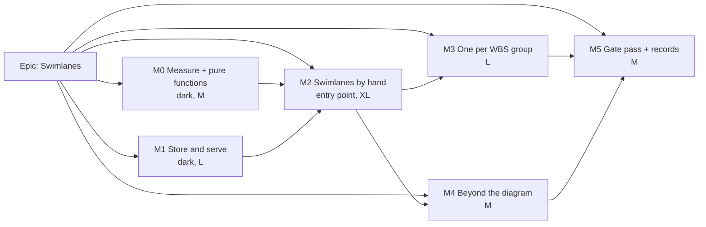

# Implementation Plan: Labelled swimlanes on the TSLD diagram

- **Feature spec:** [`./feature-spec.md`](./feature-spec.md). Schema:
  [`./schema-design.md`](./schema-design.md). Frontend review:
  [`./ui-architecture.md`](./ui-architecture.md).
- **Status:** Approved — by the product owner, 2026-10-22: SQ-1 to SQ-6 with their defaults, SQ-7 **yes** (M1-T1b is in scope)
- **Owner:** James Ewbank (product owner). The builder agent builds it, one milestone at a time
  (CLAUDE.md §19.14).

## Breakdown

### Epic

**Swimlanes**: labelled horizontal swimlanes on the TSLD diagram. They can be turned on and off,
and activities are assigned to them, by hand or from the WBS. Roadmap theme: diagram authoring.

### Ground rules for every milestone

- **No `VITE_` flag** (ADR-0088 D1). Rollback is the commit boundary. The `swimlanes` lens stays
  at `enabled: false` (`tsld-toolbar-items.tsx:217`) until M2-T11. Releases auto-deploy to the
  owner's host, so each earlier task says why nobody can reach it.
- **Nothing requires the owner to test, measure or check anything on their server or devices.**
  - Every measurement runs in node or CI, against seeded or fixture plans and databases.
  - Every picture is rendered by the harness and committed.
  - An ADR-0128 probe sitting is never a gate.
  - SQ-6 asks the owner to _look at_ two committed pictures. Without an answer, the default
    stands.
- **The schema is the database-architect's, and is `schema-design.md`** (CLAUDE.md §19.3). Any
  change to it goes back to that agent. Re-run it if it fails; never proceed without it.
- **Keyboard contracts are reviewed before release** (ADR-0111). This covers the gutter
  composite and the grouped listbox.
- **Pre-push:**
  - `pnpm prepush`;
  - `scripts/e2e-local.sh api` when `apps/api` changes;
  - `scripts/e2e-local.sh web:swimlanes` when the suite changes.

---

### Milestone M0: Measure, and the shared pure functions (shippable, dark)

**Outcome:** nothing visible. The pure functions exist and are proven. Partitioned Arrange's cost
is known before it is wired (ADR-0113, ADR-0142).
**Entry point:** `Ships dark: pure functions and a node script. Nothing in the web or API imports
them until M1-T3 and M2-T1.`
**Journey:** none (no surface).

#### Feature: pure functions

> **Description:**
>
> - In `@repo/layout`: `deriveSwimlaneLanes` (placement, plus the stale-row collision rule), the
>   ancestor walk `wbsBasisOf` (shared by the server and the web, `schema-design.md` §4 Q3), and
>   an optional `partition` on `packLanes` and `nearestFreeRow`/`rowOccupancy`.
> - In `features/tsld/render`: `projectSwimlanes` (display lanes plus swimlane extents),
>   following ui-architecture C8.
>
> **Complexity:** M
> **Dependencies:** none
> **Risks:** a shared packer change alters Tidy, Re-layout or import. **Mitigation:** a
> byte-identity parity suite over every existing `pack-lanes`, `nearest-free-row` and
> `pack-around` case, plus the importer's spec, with the partition absent. Verify it red first
> by mutating the absent branch (ADR-0110).
> **Testing requirements:** determinism and input-order independence; a property test that no
> overlap appears, including over stale rows (SC-4); the collision rule (later `updatedAt` wins,
> then id); that the hint ignores predecessors in other swimlanes; depth and level cases for
> `wbsBasisOf`; parity.

##### Task M0-T1: `deriveSwimlaneLanes` + `wbsBasisOf` (one PR)

- **Complexity:** M
- **Dependencies:** none
- **Risks:** the materialise-on-write contract needs to know which members were derived. The
  result carries `derived: id[]` per swimlane, and a test asserts it.
- **Testing:** as above.
- **Development steps:**
  1. Add `packages/layout/src/swimlanes.ts` and export it from `index.ts`.
  2. Add the docblock stating the window in which an unplaced member can be re-placed.

##### Task M0-T2: the optional partition (one PR)

- **Complexity:** S
- **Dependencies:** M0-T1
- **Risks:** a parity regression. Mitigated by the red-first parity suite.
- **Testing:** parity; per-swimlane packing; the hint.
- **Development steps:**
  1. Thread the parameter through.
  2. Add the parity cases.

##### Task M0-T3: `projectSwimlanes` in `features/tsld/render` (one PR)

- **Complexity:** S
- **Dependencies:** M0-T1
- **Risks:** a display lane leaks into a write. The function returns only a read model, and the
  write side has its own inverse in M2-T4.
- **Testing:** unit tests (contiguity, "No swimlane" last and hidden when empty, an empty manual
  swimlane at one lane, band-lifted summaries excluded).
- **Development steps:**
  1. Write the pure function.
  2. Write its tests.
- **Dark because:** nothing imports it until M2-T1.

#### Feature: the Arrange cost, measured in node

> **Description:** extend the optimise harness that produced the figures in
> `optimise-layout.ts:84-103` with a partitioned mode. Run it on
> `plan:reference-netpoint-power-plant` split by system, on `fixture-p6-torture-v1` and on
> `scale-500`, and also measure the hint-by-display-lane alternative.
> **Complexity:** M
> **Dependencies:** M0-T2
> **Risks:** the partition is slower than ADR-0203's accepted wait. **Mitigation:** any change to
> the limits goes to the owner with both numbers and both pictures (the ADR-0203 D3 precedent).
> **Testing requirements:** the harness is deterministic. Its output goes to
> `docs/specs/swimlanes/m0-reading.md` together with the rendered pictures.

##### Task M0-T4: measure partitioned Tidy and Re-layout (one PR)

- **Complexity:** M
- **Dependencies:** M0-T2
- **Risks:** node figures bound the algorithm, not the owner's hardware (#75), as
  `optimise-layout.ts:101-102` already says.
- **Testing:** two runs give identical counts.
- **Development steps:**
  1. Add the partition flag.
  2. Commit the reading and the pictures.
  3. State whether the limits in spec §4.5 stand.

---

### Milestone M1: Store and serve swimlanes (shippable, dark)

**Outcome:** the API stores and serves swimlanes, plan sources, membership and a lane per basis.
Cascades, restore, expiry, import compensation and the organisation export all include them. No
web code reads them yet.
**Entry point:** `Ships dark: new routes and fields that nothing in the web calls until M2-T1.
The web's strict schemas accept the new fields first (M1-T4).`
**Journey:** none (no UI). The gates are Supertest e2e, the structural censuses and a seed run.

#### Feature: schema (as designed)

> **Description:** land `schema-design.md` §3 and §8 exactly. That is two tables, one activity
> column, two plan columns, two enums and one expand-only migration, with the hand-edited raw
> SQL listed in its §8.1.
> **Complexity:** M
> **Dependencies:** none (it can run in parallel with M0)
> **Risks:**
>
> - The migration is checksummed on landing. **Mitigation:** it is expand-only with no backfill
>   (§8.4), and any deviation from the design goes back to the database-architect.
> - The `NULLS NOT DISTINCT` index looks like drift. **Mitigation:** declare it as a plain
>   `@@unique`, as §8.2 probed, so `prisma:check-drift` stays empty.
> - Non-ASCII case folding on Alpine is unmeasured. **Mitigation:** an e2e test asserts É/é on
>   CI's `postgres:17-alpine`. If it fails, switch the index to an ICU collation before landing
>   (§4 Q2).
>
> **Testing requirements:** the migration runs on a pristine database and on a seeded one. The
> §8.3 measurements are recorded in the migration header:
>
> 1. duration on the seeded catalogue and on the 2,000-activity fixture;
> 2. expiry of a 2,000-activity plan with 100 swimlanes and about 4,000 lane rows, with and
>    without each FK index;
> 3. lane-row versus history-row delete cost, which sets `LANE_ROWS_PER_ACTIVITY`;
> 4. É/é on CI.
>
> All of these run locally or in CI, never on the owner's host.

##### Task M1-T1: migration, models and every site the schema forces (one PR)

- **Description:** every file in `schema-design.md` §9 "must change in M1":
  - the expiry runner order and lane counting, the census literal, and `budgetCharge`
    (§6.1, §4 Q6);
  - the cascade stamps and `restoreBatch`;
  - import compensation (§6.2);
  - the organisation export at format 2.1, with two files and three columns, plus
    `ORGANISATION_EXPORT_FORMAT.md` (§7);
  - three `NOT_INPUT` entries;
  - `ActivityPatch` and `PlanPatch`;
  - the `@repo/types` unions;
  - `docs/DATABASE.md` (the index register and two new rules);
  - the CLAUDE.md counts (`check:counts`).
- **Complexity:** L
- **Dependencies:** none
- **Risks:** as above. Each structural gate named in §9 fails until its site changes, so missing
  a site is a red build rather than a silent gap.
- **Testing:** migration tests; the expiry, census and preview specs; an e2e test for import
  compensation; the export census and format-doc spec; the soft-delete gate (`schema-design.md`
  §9, unchanged and self-deriving).
- **Development steps:**
  1. Generate with `--create-only`.
  2. Hand-edit the raw SQL.
  3. Take the four measurements.
  4. Change every §9 site.
  5. Add a changeset (api minor).

##### Task M1-T1b, only if SQ-7 = yes: baselines freeze swimlanes (one PR)

- **Description:** the database-architect designs the follow-on described in `schema-design.md`
  §4 Q7: correlation columns on `baseline_activities` and a level discriminator on `baselines`.
  Capture copies them, and removed-work ghosts can then be drawn.
- **Complexity:** M
- **Dependencies:** M1-T1
- **Risks:** a second migration. **Mitigation:** it is additive, and it is the architect's design.
- **Testing:** baseline capture specs; a revision-ghost unit test.
- **Development steps:**
  1. Brief the agent.
  2. Land the migration.
  3. Wire capture and ghosts.

#### Feature: the swimlane routes, plan fields and activity fields

> **Description:**
>
> - A `swimlanes` module. Its shape follows `modules/clients`, and its plan-scoped cascades follow
>   `modules/notes` (ADR-0057).
> - The plan PATCH gains the source and level.
> - Activity create and update gain `swimlaneId`.
> - The positions batch gains an optional `swimlane: { swimlaneId?, laneIndex }` with **no
>   basis**. The server derives the basis through `wbsBasisOf`.
> - Activity responses gain `swimlaneLanes[]`, loaded per page (spec §4.12, `schema-design.md`
>   §9).
>
> **Complexity:** L
> **Dependencies:** M1-T1, M0-T1
> **Risks:**
>
> - **IDOR.** Mitigated twice: the composite FK enforces it in the database, and the service
>   answers 404 first.
> - **The relaxed positions DTO breaks a client.** Mitigated: every existing body stays valid,
>   checked by a DTO validation spec with both shapes.
> - **Deadlock.** Mitigated by the lock order in `schema-design.md` §5: activities in id order,
>   then `FOR SHARE` on swimlanes; reorder in id order; create and restore under the plan lock.
>   A concurrency e2e test covers it.
> - **An `include: { swimlane: true }` returns a deleted swimlane as live.** Forbidden
>   (`schema-design.md` §9). The plan's swimlane list is read separately.
>
> **Testing requirements:**
>
> - e2e for every route, covering each role, the pen (423), an org-scope 404, a stale version or
>   a duplicate name (409), the limit and a wrong source (422), and a restore under a deleted
>   plan (`PARENT_DELETED`);
> - the per-basis upsert, including the round trip "switch source and back gives the same rows";
> - activity restore onto a deleted swimlane is **admitted** (schema D7);
> - audit rows for delete and restore, and the audit-coverage census;
> - `activity-row-lock.structural.spec.ts`;
> - the history coverage spec.

##### Task M1-T2: `swimlanes` module, with CRUD, reorder and restore (one PR)

- **Complexity:** M
- **Dependencies:** M1-T1
- **Risks:** as above.
- **Testing:** e2e and unit tests; the audit census.
- **Development steps:**
  1. Write the module.
  2. Map `23505` to `409`.
  3. Update `docs/API.md`.
  4. Add a changeset.

##### Task M1-T3: plan fields, activity fields, the positions extension and history (one PR)

- **Complexity:** M
- **Dependencies:** M1-T2, M0-T1
- **Risks:** the history recorder's coalescing changes. **Mitigation:** the existing recorder
  specs must pass unedited.
- **Testing:** as above.
- **Development steps:**
  1. Write the DTOs.
  2. Derive the basis server-side.
  3. Take the `FOR SHARE` locks, then upsert.
  4. Update history.
  5. Update `docs/API.md`.
  6. Add a changeset.

##### Task M1-T4: the web schemas accept the new fields (one PR)

- **Description:** add the new nullable fields to the strict Zod schemas (ADR-0156 D9's reason)
  **in the same release as M1-T3, or earlier**. The PR says which.
- **Complexity:** S
- **Dependencies:** none, but it must not land after M1-T3's release.
- **Risks:** a browser one release behind fails to parse the response. Mitigated by the release
  order above.
- **Testing:** schema tests with the fields present and absent.
- **Development steps:**
  1. Update the Zod schemas and `@repo/types`.
- **Corrected at build, 2026-10-23.** No web Zod schema parses a plan or an activity response: the
  client reads both through `apiFetch<PlanSummary>` / `apiFetch<ActivitySummary>`, a type and not a
  parse (`grep -rn "\.parse(\|safeParse(" apps/web/src`, outside tests, finds only the interchange
  report, the import commit result and form fields). The strict parse ADR-0156 D9 describes is the
  interchange **report**, which M1 does not touch. So a browser one release behind cannot fail on
  the new fields, and the task reduced to `@repo/types` (which M1-T3 had to land: the history
  vocabulary is keyed to `ActivitySummary`) plus what that forced in the web: fixtures, the clone
  census's two `withheld` rows, the guest widening's defaults and the history label. The tests
  added here pin those seams.

#### Feature: the seed catalogue and the playbook (ADR-0066)

##### Task M1-T5: seed plans and `docs/TEST_PLAYBOOK.md` rows (one PR)

- **Description:** two plans, `plan:capability-swimlanes` (by hand) and
  `plan:capability-swimlanes-wbs` (the same activities, source WBS at level 1). Each has:
  - three swimlanes whose names wrap;
  - one unassigned activity;
  - one cross-swimlane link;
  - a pair that overlaps once moved into one swimlane;
  - an É-named swimlane, for the case rule.

  Each playbook row's Correct and Wrong columns are read back from the seeded plan, not written
  from the spec.

- **Complexity:** S
- **Dependencies:** M1-T3
- **Risks:** a wrong Correct column. Mitigated by reading every value back.
- **Testing:** the seed run; `check:playbook`.
- **Development steps:**
  1. Extend `packages/seed`.
  2. Seed the plans.
  3. Write the rows.

---

### Milestone M2: Swimlanes by hand, on the diagram (the first user-facing milestone)

**Outcome:** a Planner sets up hand-made swimlanes, assigns activities, moves and arranges them
within swimlanes, and turns the view on and off without losing anything. Viewers see them.
Export and print carry them, and the minimap names them.
**Entry point:** `Plan workspace ▸ View ▾ ▸ Structure` holds two controls:

- the **"Swimlanes"** lens checkbox, with shut reasons;
- the **"Set up swimlanes…" / "Swimlanes…"** button.

Both become reachable in **M2-T11**, the last task. T1–T10 cannot be reached before it, because
the lens is `enabled: false`, so no scene input is built and the gutter width is 0.
**Journey:** `apps/web/e2e-swimlanes/swimlanes-by-hand.spec.ts`, in the new
`playwright.swimlanes.config.ts`, which joins the shards (ADR-0138) and the prepush roster
(ADR-0160). The journey:

1. opens `plan:capability-swimlanes` and takes the pen;
2. opens `View ▾`, **expands `Structure`**, and presses **Set up swimlanes…** (not the checkbox,
   ui-architecture C2);
3. creates "Mechanical";
4. selects two bars and uses **Move to swimlane…**, picking Mechanical and pressing Move;
5. asserts both are in the "Mechanical" listbox group;
6. presses `Alt+↓` and asserts "lane 2 of Mechanical";
7. clears the checkbox and asserts that every option's lane equals its pre-journey `laneIndex`,
   read from the API (SC-1);
8. checks the box again and asserts the same lanes inside the swimlane;
9. presses Undo twice and asserts the assignment is reversed;
10. asserts the create popover opens at the click point with the gutter expanded;
11. runs axe with swimlanes on.

#### Feature: the projection and the composition in the workspace

> **Description:**
>
> - The host (`use-plan-workspace-model.ts`) composes a neutral `SwimlaneInput`.
> - `deriveDiagramSource` is extracted, and both the screen (`TsldPanel.tsx:1213-1239`) and the
>   export (`use-diagram-image.ts:166-171`) call it.
> - Display lanes are swapped in at one seam (ui-architecture C6, C7, C8).
>
> **Complexity:** L
> **Dependencies:** M0, M1
> **Risks:** something reads the stored lane where it needs the display lane. **Mitigation:** the
> seam is stated, so the census covers only the host and the write-side hooks. A structural test
> forbids any `features/tsld/render` file or `TsldCanvas.tsx` import from naming the swimlanes
> feature.
> **Testing requirements:**
>
> - the off-path golden paint is byte-identical (SC-3);
> - the narrowed census;
> - memoisation: a counting test proves it runs once per data change, never per frame;
> - no swimlane-free first paint while the list loads (ADR-0202).

##### Task M2-T1: hooks, manual membership, `SwimlaneInput` and `deriveDiagramSource` (one PR)

- **Complexity:** M
- **Dependencies:** M0-T3, M1-T4
- **Risks:** stale caches. Mitigated by the plan-content invalidation map and
  `delete-invalidations.structural.test.ts`.
- **Testing:** unit tests; the census; a parity test that the screen and the export call one
  function.
- **Development steps:**
  1. Write the hooks.
  2. Write membership.
  3. Extract the function.
  4. Rewire both call sites.
- **Dark because:** the scene input is built only while the lens is checked, and the lens is not
  offered.

##### Task M2-T2: the lens toggle, the boundary rule and the optional ground (one PR)

- **Description:**
  - a `LensToggle` with `{ id: 'swimlanes', group: 'structure', enabled: false }` and its reasons,
    in this order: no diagram, loading, nothing set up (C1);
  - the shown state as `override ?? (source !== 'NONE')` in `useTsldCanvasUiState`, reset on
    plan switch (C11);
  - a solid rule at each swimlane boundary, painted in the ground and grid pass beneath the links,
    using alias tokens `--canvas-swimlane-rule` and its paper twin (C5);
  - the optional `--canvas-band` ground, behind SQ-6's default, with month bands hidden while it
    shows;
  - committed rule-only and rule-plus-ground pictures of the reference plan, with the count of
    link runs that coincide with a boundary.
- **Complexity:** M
- **Dependencies:** M2-T1
- **Risks:**
  - The scene-key gate refuses the new key until the export composes it. **Mitigation:** do
    M2-T7 in the same PR, or add a `KNOWN_GAPS` entry naming M2-T7 and delete it there. That is
    ADR-0200's precedent, verified red.
  - Paint cost. **Mitigation:** a counting stub that shows O(swimlanes in view).
- **Testing:** golden paint on and off; the counting stub; the contrast sweeps, which the alias
  tokens inherit; the legend census key.
- **Development steps:**
  1. Write the lens.
  2. Add the tokens and record them in `docs/DESIGN_SYSTEM.md`.
  3. Write the rule and ground pass.
  4. Render and commit the pictures.
- **Dark because:** `enabled: false`.

##### Task M2-T3: the gutter as a left reservation (one PR)

- **Description:**
  - `TsldCanvas` takes `gutterWidthPx`, where 0 means parity;
  - `measure()` subtracts it;
  - `sceneOrigin(wbsBandHeightPx, gutterWidthPx)` replaces `sceneTopOffset` at every call site,
    including the popover's x (C3);
  - the rAF loop writes the sticky label positions from `viewRef`;
  - DOM label text comes from `swimlaneGutterModel`, a pure function in `features/tsld/render`
    (C4);
  - two fixed widths. Below a measured container width the gutter is withdrawn and its control
    shaded with a reason, in the `minimapRoom` form (C12);
  - `useDevicePref` is extracted first, and the minimap and legend preferences migrate to it
    (C11).
- **Complexity:** L
- **Dependencies:** M2-T1
- **Risks:** an offset leaks into an anchor, which is ADR-0063 §5's failure. **Mitigation:**
  regression tests on the popover, the cursor readout and the drag ghosts, each with the gutter
  open, closed and collapsed. Per-frame cost goes to the performance-reviewer.
- **Testing:** the anchor tests; `swimlaneGutterModel` unit tests; `useDevicePref` tests; the
  room-threshold test.
- **Development steps:**
  1. Extract `useDevicePref`.
  2. Write `sceneOrigin` and migrate its call sites.
  3. Add the reservation.
  4. Write the gutter model.
  5. Write the DOM labels.
  6. Measure the threshold.
- **Dark because:** `gutterWidthPx` stays 0 while the lens is unchecked.

#### Feature: editing inside swimlanes

> **Description:** lane gestures, nudges, plural moves and create all map display lanes back to
> (swimlane, lane in swimlane). `laneRange` clamps a drag while it is in progress. Auto-resolve
> runs in both layouts. Arrange is partitioned.
> **Complexity:** XL
> **Dependencies:** M2-T1 to M2-T3
> **Risks:**
>
> - A lane drag writes `laneIndex` while swimlanes are shown, which would break SC-1.
>   **Mitigation:** a unit test per gesture, plus journey step 7.
> - Auto-resolve misses a command. **Mitigation:** `use-auto-resolve.census.structural.test.ts`.
>
> **Testing requirements:** per-gesture and per-nudge tests, including the boundary sentences;
> auto-resolve across both layouts; Arrange parity and partition tests.

##### Task M2-T4: lane moves, create and `laneRange` (one PR)

- **Description:**
  - a vertical drag within a swimlane, or across one by hand;
  - `laneRange` clamps while dragging, which the WBS source uses in M3 (C6);
  - `Alt+↑/↓`, which grows the swimlane at the bottom and refuses at the top ("top lane of X");
  - plural moves stay within their own swimlanes;
  - create inside a swimlane;
  - a moved bar returns to its remembered lane if that lane is free, otherwise the nearest free
    lane;
  - writes materialise unplaced members.
- **Complexity:** L
- **Dependencies:** M2-T1
- **Risks:** as for the feature.
- **Testing:** gesture-machine and TsldPanel editing tests; the announcements.
- **Development steps:**
  1. Write the inverse mapping on the host's write path.
  2. Wire each gesture.
  3. Add `laneRange`.
  4. Add the copy.
- **Dark because:** the lens is not offered.

##### Task M2-T5: auto-resolve in both layouts (one PR)

- **Complexity:** M
- **Dependencies:** M2-T4
- **Risks:** a move in the hidden layout surprises the planner. **Mitigation:** the dock sentence
  names which picture moved.
- **Testing:** use-auto-resolve tests; the census.
- **Development steps:**
  1. Snapshot both layouts.
  2. Send one batch.
  3. Write the copy.
- **Dark because:** it runs only when the source is not `NONE`, and nobody can set one yet.

##### Task M2-T6: partitioned Tidy and Re-layout (one PR)

- **Complexity:** L
- **Dependencies:** M0-T4, M2-T4
- **Risks:** parity, and cost. Mitigated by the FC-R8 suite with the partition absent, and by M0's
  verdict.
- **Testing:** the optimise-layout, relayout-starts, worker protocol and ArrangeDialog tests.
- **Development steps:**
  1. Restrict the search moves to the partition.
  2. Add the per-swimlane starts.
  3. Add the dialog line.
- **Dark because:** the partition is passed only while the lens is checked.

#### Feature: everywhere the diagram goes

##### Task M2-T7: export and print, with the gutter mirror and the chrome roster (one PR)

- **Description:**
  - the composer paints the rules, the optional ground, and a gutter mirror drawn from
    `swimlaneGutterModel`;
  - paper re-resolves the alias tokens;
  - names that do not fit are counted in the legend;
  - **the chrome roster:** a `data-chrome` attribute and `EXPORT_CHROME_INPUTS` beside the layer
    roster (`scene-parity.structural.test.ts:246-271`), covering the ruler and the gutter. This
    closes the gap SC-5 named (C4).
- **Complexity:** M
- **Dependencies:** M2-T2, M2-T3
- **Risks:** the new roster is a shared gate. **Mitigation:** verify it red, by removing the
  gutter's composition (ADR-0110), and give it a floor and a staleness check in both directions,
  as ADR-0200 D2 does.
- **Testing:** `render-export-image` and `PrintSurface` tests; the roster gate red then green;
  the paper sweep.
- **Development steps:**
  1. Add the mirror.
  2. Add the roster.
  3. Run the red check.
- **Dark because:** composition is gated on the scene input.

##### Task M2-T8: the minimap readout and the ghosts (one PR)

- **Description:**
  - the minimap readout names the swimlanes in view;
  - the minimap draws **no grounds**, and boundary ticks only if they pass `MINIMAP_GROUNDS`
    (C13);
  - a removed-work ghost is counted and not drawn while swimlanes are shown, unless SQ-7 is
    "yes".
- **Complexity:** S
- **Dependencies:** M2-T1
- **Risks:** the structural test bans `LANE_HEIGHT` in the minimap. **Mitigation:** the
  allocation stays in lanes.
- **Testing:** the minimap tests; a ghost unit test.
- **Development steps:**
  1. Write the readout copy.
  2. Add the ghost rule.
- **Dark because:** it is gated on the scene input.

#### Feature: setup, management, assignment, undo, accessibility, and the entry point

##### Task M2-T9: the gutter composite, the menus, and the setup and manage dialogs (one PR)

- **Description:**
  - the gutter as a vertical `role="toolbar"` on `rovingIndexFor` (not the `Toolbar`
    component), with focus panning to the swimlane (C9);
  - the APG `Menu` per label;
  - the **Set up swimlanes… / Swimlanes…** button beside the lens and in the corner cell (C2);
  - pen shading with reasons;
  - the setup dialog (by hand only; the WBS option arrives in M3);
  - the manage dialog;
  - the delete confirmation;
  - the **accessibility-reviewer and component-reviewer on this PR** (ADR-0111).
- **Complexity:** L
- **Dependencies:** M2-T3
- **Risks:** the keyboard contract. Mitigated by the review before merge.
- **Testing:** component and a11y unit tests; the reviewers' findings folded in.
- **Development steps:**
  1. Build the composite.
  2. Build the dialogs.
  3. Run the reviews.
  4. Fold in the findings.
- **Dark because:** the gutter is unmounted while its width is 0, and the button lives in the
  lens's section, which is not offered.
- **As built (decisions the build took, each with its reason):**
  - **The gutter is the buttons.** Each label is the toolbar's button (`aria-label` from
    `swimlaneGutterText`), and the visible text inside is `aria-hidden`; there is no second copy for
    assistive technology. A swimlane panned out of view is _parked_ (zero height, transparent), never
    `display: none`, because a button that is not rendered cannot take focus and focus is how an
    off-screen swimlane is brought into view (`laneToReveal`, then the minimap's `centerOnWorld`).
  - **Opening the menu is Enter, Space or a press; ArrowDown is the roving key.** In a vertical toolbar
    the APG's "ArrowDown opens" cannot hold, so the menu opens on activation and on the context-menu
    gesture. "No swimlane" has no menu.
  - **Collapsed strip is 44 px** (was 40), so each label is a full target under `pointer: coarse`
    (ADR-0118 D2). In it only the expand control fits the corner cell as a full target; the
    **Swimlanes…** command is reached from `View ▾ ▸ Structure` there. The full name is the accessible
    name, a `name-echo` tooltip on focus, and the menu's `aria-label`; a tap on "No swimlane", which has
    no menu, shows the tooltip.
  - **Label sizing relies on the accessible name**, not on deriving the line height from rendered text:
    the visible text clamps to `maxLines` (px), and the full name never depends on it.
  - **The wheel over the gutter does nothing, deliberately.** The canvas's wheel is a zoom about the time
    axis, and the gutter has none. The lane axis pans by dragging the ground, the minimap, and focus.
  - **The pen sentence is `scheduleRefusal`'s** ("Start editing to set up swimlanes." / "Request control
    to …" when a peer holds the pen), not the spec's "Take the pen to set up swimlanes.": the house helper
    names a control the reader actually has (`pen-reason.ts`).
  - **Setup does two writes, swimlanes then the source,** and retries only the source if the second
    fails. Undo takes back the swimlanes (one step) and leaves the source at `MANUAL`, because the plan's
    source is a plan setting and plan settings stay outside undo (`coverage.ts`).
  - **The legend sits right of the gutter on read** (`leftInsetPx`); the minimap and zoom cluster are
    anchored to the right edge and cannot meet it.

##### Task M2-T10: assignment, undo, the grouped listbox and the copy test (one PR)

- **Description:**
  - **Move to swimlane…** as a `SelectField` popover on the selection bar. The editor field and
    later the table use the same control (C10).
  - Undo commands with ADR-0176 checks. An assignment onto a deleted swimlane is set aside.
  - **The grouped listbox:** a `role="group"` per swimlane, in swimlane order. The count invariant
    holds, and `onListKeyDown` follows the rendered order (C9). The accessibility-reviewer
    re-runs on it (ADR-0111).
  - The announcement text.
  - The structural copy test: no bare "lane" for a swimlane.
- **Complexity:** L
- **Dependencies:** M2-T4, M2-T9
- **Risks:** a regression in listbox keyboard order. **Mitigation:** its own test, plus the
  review. The editor field and command are hidden while the source is `NONE`.
- **Testing:** selection-actions, editor, undo, listbox order and count tests.
- **Development steps:**
  1. Write the popover.
  2. Write the field.
  3. Write the undo commands.
  4. Group the listbox.
  5. Add the tests.
- **Dark because:** the controls are hidden while the source is `NONE`, and nothing can set it.

##### Task M2-T11: the entry point and the journey (one PR)

- **Description:** the lens becomes `enabled: true`. Add the journey above and a changeset (web
  minor).
- **Complexity:** M
- **Dependencies:** M2-T1 to M2-T10
- **Risks:** this is when the feature reaches the owner's host. **Mitigation:** the journey runs
  locally before pushing, and the M2 gate runs before merge.
- **Testing:** the journey; the updated View-popover tests.
- **Development steps:**
  1. Flip `enabled`.
  2. Add the journey.
  3. Add the changeset.
  4. Run the gate.

**M2 gate (before M2-T11 merges):** the accessibility-, component-, ux- and performance-reviewer
on the combined UI diff. Blocking findings are folded in, as in ADR-0063 §10.

---

### Milestone M3: One swimlane per WBS group

**Outcome:** a Planner chooses "One per WBS group at level N", and the swimlanes follow the WBS
live.
**Entry point:** the second option in the setup dialog, and the source choice in the manage
dialog. Both are reached from the **Swimlanes…** button in `View ▾ ▸ Structure` or in the
gutter's corner cell.
**Journey:** `e2e-swimlanes/swimlanes-by-wbs.spec.ts`. It:

1. sets up from the WBS;
2. asserts one swimlane per summary;
3. renames a summary and asserts the label follows;
4. moves an activity's Breakdown and asserts it now sits in the new group with no overlap;
5. asserts that a drag stops at the swimlane edge (SQ-5);
6. switches to by-hand and back, and asserts the lanes return unchanged with no write in between;
7. runs axe.

#### Feature: WBS membership and change handling

> **Description:**
>
> - Membership at level N, in `features/wbs/model`, on `wbsBasisOf`.
> - A suggested level.
> - One helper that every parents write calls. It writes the mover's lane for its new basis,
>   remembered if free, otherwise nearest.
> - Create inside a swimlane files under its summary (SQ-5).
> - The read-only editor field, with its reason.
> - `laneRange` set for the WBS source.
>
> **Complexity:** L
> **Dependencies:** M2
> **Risks:**
>
> - A parents caller skips the helper. **Mitigation:** a census of `updateParents` callers.
> - A summary is drawn twice while the band is on. **Mitigation:** the projection excludes the
>   summaries lifted into the band, with a test.
>
> **Testing requirements:** membership tests covering depth, levels, dissolve, delete and
> restore, and the band; helper tests; the journey.

##### Task M3-T1: membership, the setup option and the source switch (one PR)

- **Complexity:** M
- **Dependencies:** M2
- **Testing:** unit and dialog tests.
- **Development steps:**
  1. Write membership.
  2. Add the dialog option.
  3. Add the undoable source switch.

##### Task M3-T2: change handling, filing on create, `laneRange`, and the journey (one PR)

- **Complexity:** M
- **Dependencies:** M3-T1
- **Testing:** helper tests; the journey.
- **Development steps:**
  1. Write the helper.
  2. Wire the callers.
  3. Add filing on create.
  4. Add the clamp.
  5. Add the journey.
  6. Add a changeset.

---

### Milestone M4: Beyond the diagram

**Outcome:**

- assignment from the Activities table and the Gantt;
- guests see swimlanes (if SQ-4 is "yes");
- a SchedulePoint XER round trip keeps swimlanes.

(The organisation export already shipped in M1.)
**Entry point:**

- the "Swimlane" column in the Activities table and the Gantt;
- the guest view's View controls;
- import's existing "restore layout" option.

**Journey:** `e2e-swimlanes/swimlanes-elsewhere.spec.ts`. It:

1. assigns from a Gantt cell and asserts the result on the diagram;
2. bulk-assigns from the table;
3. opens a share link and asserts the guest listbox groups (SQ-4);
4. exports an XER and imports it into a second project, then asserts the swimlanes and lanes by
   activity code.

The interchange part can run in the existing `interchange` suite.

#### Feature: the table and Gantt columns

##### Task M4-T1: the Activities table column and the bulk bar (one PR)

- **Complexity:** M
- **Dependencies:** M2-T10
- **Risks:** a native `disabled` on the bar. **Mitigation:** `aria-disabled` with a reason
  (ADR-0063 §10.2).
- **Testing:** table and bulk-bar tests.
- **Development steps:**
  1. Add the column.
  2. Add the bar, using the same `SelectField`.
  3. Add a changeset.

##### Task M4-T2: the Gantt column (one PR)

- **Complexity:** M
- **Dependencies:** M4-T1
- **Risks:** the per-cell write scope (ADR-0095), and the read-only reason under the WBS source
  (ADR-0204's Gantt cell).
- **Testing:** GanttPanel editing tests.
- **Development steps:**
  1. Register the column.
  2. Add the cell editor.
  3. Add a changeset.

#### Feature: the guest view (only if SQ-4 = yes)

##### Task M4-T3: the guest DTO, the guest toggle and the ADR-0051 amendment (one PR)

- **Description:** widen `SCHEDULE_READ` by the swimlane list and each activity's **derived**
  membership and lane. It is never widened by `parentId`.
- **Complexity:** M
- **Dependencies:** M2-T11. M1-T4's schema-first rule applies.
- **Risks:** over-disclosure. **Mitigation:** add the exact list to `guest-dto.spec.ts`, and run
  the security-reviewer.
- **Testing:** share e2e; the guest DTO specs; the guest listbox groups.
- **Development steps:**
  1. Update the DTO.
  2. Update the adapter.
  3. Add the `TsldViewControls` item.
  4. Write the ADR amendment.
  5. Add changesets.

#### Feature: the XER layout fields

##### Task M4-T4: the XER reader, in release N (one PR)

- **Description:** the labels in `xer-layout-fields.ts`, the decoder, and import mapping that
  creates swimlanes by name. Names are deduped case-insensitively before insert
  (`schema-design.md` §9), packed within each swimlane through the partition, bounded, and
  counted in the report.
- **Complexity:** M
- **Dependencies:** M1-T3, M0-T2
- **Risks:** hostile names. **Mitigation:** the `xer-layout-fields.ts:17-19` rules, and
  `ck_swimlanes_name_shape` as a backstop.
- **Testing:** known-label, near-miss, unknown-version and bounds cases;
  `layout-interchange.e2e-spec.ts`.
- **Development steps:**
  1. Add the labels.
  2. Write the decoder.
  3. Write the mapping.
  4. Add the report counts.
  5. Add a changeset.

##### Task M4-T5: the XER writer, in release N+1 (one PR)

- **Complexity:** S
- **Dependencies:** M4-T4 released. The PR cites that release's tag (ADR-0156 D9).
- **Testing:** the round-trip e2e.
- **Development steps:**
  1. Write the encoder.
  2. Add a changeset.

---

### Milestone M5: Gate pass and records

**Outcome:** the epic is reviewed and recorded, and the open questions in the brief and ADR-0026
are answered.
**Entry point:** none new.
**Journey:** the three journeys from M2 to M4, run together.

##### Task M5-T1: combined review, the ADR and the docs (one PR)

- **Description:**
  - the accessibility-, component-, ux-, performance-, api-, security- and
    backend-performance-reviewer on the combined diff, with findings folded in;
  - the new ADR (Parts A and B, spec §4.14) Accepted, with one line in CLAUDE.md §16;
  - amendment lines on the affected ADRs;
  - answers to `PROJECT_BRIEF.md:283` and ADR-0026 `:566`;
  - `docs/BACKLOG.md`: close the swimlanes item and add the P6 activity-codes follow-on;
  - `docs/TECH_DEBT.md`: the ADR-0026 §8 slips and the activity-create plan-lock race
    (`schema-design.md` §5);
  - the spec status set to `Accepted — shipped (ADR-NNNN)`;
  - the hand-off (CLAUDE.md §19.14).
- **Complexity:** M
- **Dependencies:** M2 to M4
- **Testing:** all suites; `check:counts`, `check:adr-coverage`, `check:playbook`,
  `check:spec-status`.
- **Development steps:**
  1. Run the reviews.
  2. Fold in the findings.
  3. Write the records.
  4. Add the changeset.

## Sequencing & slices

1. **M0 and M1-T1 run in parallel.** Both are dark.
2. **M1 runs T1 to T5.** M1-T4 ships no later than the release that first sends the new fields.
   If SQ-7 is "yes", M1-T1b follows M1-T1.
3. **M2 runs T1 to T10 dark**, each releasable on its own. **M2-T11 is the entry point**, and the
   M2 gate runs before it merges.
4. **M3 and M4 follow M2**, in either order. M4-T4 and M4-T5 ship in two separate releases.
5. **M5 runs last.**

Every slice keeps `main` releasable, and there is no flag.

**Sizes:** M0 **M**, M1 **L** (larger than the first draft: the expiry, compensation and export
sites are forced into it), M2 **XL**, M3 **L**, M4 **M** (the organisation export moved to M1),
M5 **M**. Overall **L–XL**, against the backlog's `M`–`L`. The difference comes from the lane per
basis, the partitioned Arrange, the left reservation and the parity gates.

## Definition of Done (per task)

Each PR meets the Feature Completion Criteria in [`docs/PROCESS.md`](../../PROCESS.md).
"Tests" means `pnpm prepush` was **run**, plus the e2e halves named in the ground rules.

How each success criterion is proved:

- **SC-1:** M2 journey step 7; the projection unit test; the gesture tests, which assert no
  `laneIndex` write.
- **SC-2:** the `schedule-input-fields.ts` classification (a compile error otherwise); the
  engine-select spec, unchanged.
- **SC-3:** the golden paint log with the lens unchecked and `gutterWidthPx = 0`.
- **SC-4:** the property test, including stale rows; the auto-resolve tests.
- **SC-5:** one `deriveDiagramSource` and one `swimlaneGutterModel`; the layer and scene-key
  gates; the new chrome roster (M2-T7), verified red.
- **SC-6:** the partition parity suites (M0-T2, M2-T6).
- **SC-7:** `m0-reading.md`; the counting stub; the M1 migration header measurements.
- **SC-8:** the grouped listbox count and order tests; the gutter a11y tests; axe in all three
  journeys; the ADR-0111 review records (M2-T9, M2-T10).

## Risks & assumptions (rollup)

- **A consumer reads the stored lane instead of the display lane.**
  - Likelihood medium; impact high.
  - Mitigation: one stated seam (C6), the narrowed census, and the structural import ban.
- **`sceneOrigin` misses a call site, so the popover is offset.**
  - Likelihood medium; impact high.
  - Mitigation: every call site moves in one PR, plus anchor tests in three gutter states.
- **Partitioned Re-layout is too slow.**
  - Likelihood medium; impact medium.
  - Mitigation: measured in M0. The owner decides any change to the limits (ADR-0203 D3).
- **The grouped listbox breaks the arrow-key order.**
  - Likelihood medium; impact medium.
  - Mitigation: its own test, plus the ADR-0111 review.
- **The new chrome roster is vacuous.**
  - Likelihood low; impact medium.
  - Mitigation: verify it red (ADR-0110), with a floor and staleness checks in both directions.
- **Plan expiry leaves rows behind.** Retention is armed on the owner's host.
  - Likelihood low; impact high.
  - Mitigation: the DMMF census fails the build (`schema-design.md` §4 Q6), plus expiry e2e.
- **The lane-row expiry budget is mis-set.**
  - Likelihood low; impact medium.
  - Mitigation: `LANE_ROWS_PER_ACTIVITY` is measured in M1 (§8.3).
- **Non-ASCII names fold differently on Alpine.**
  - Likelihood medium; impact low.
  - Mitigation: an e2e test on CI's image, with ICU collation as the fallback (§4 Q2).
- **A browser one release behind meets the new fields.**
  - Likelihood medium; impact high.
  - Mitigation: M1-T4 lands first, and the XER reader ships before the writer.
- **An unplaced member is re-placed before it materialises.**
  - Likelihood low; impact low.
  - Mitigation: materialise on every write, plus the collision rule. This is stated in ADR A4.
- **The guest scope over-discloses (SQ-4).**
  - Likelihood low; impact medium.
  - Mitigation: derived membership only, the forbidden-field spec, and the security-reviewer.
- **The owner changes a default (SQ-1 to SQ-7).**
  - Likelihood medium; impact medium.
  - Each SQ names what the other answer costs and which task it touches.
