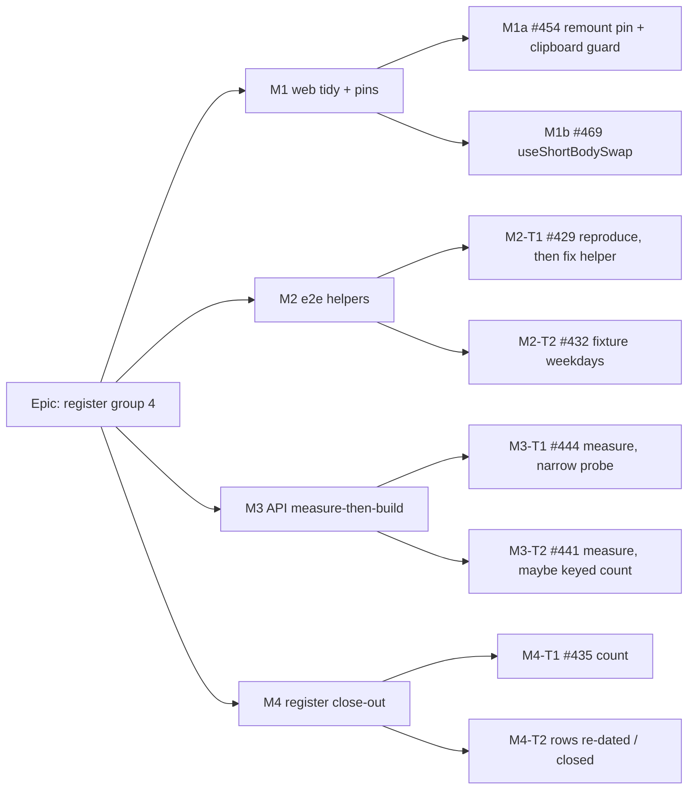

# Implementation Plan: Tidy, tests and measured performance — register group 4

- **Feature spec:** [`./spec.md`](./spec.md) (Draft, awaiting the product owner's approval)
- **Status:** Draft
- **Owner:** James Ewbank (product owner); built by the **builder** agent, reviewed per milestone

## Breakdown

### Epic

**Register group 4: tidying, tests and measured performance.** This closes or corrects ten carried-over
register rows without adding surface, schema, CI time or a flag. Roadmap theme: quality of existing
surfaces.

**Every milestone below ships dark**: `Ships dark: no user-facing capability. Each milestone is a test,
refactor, measurement or register change, so there is no entry point to name (ADR-0081 §1).`
No milestone claims user-facing capability, so ADR-0081 §2's journey requirement does not attach. The
journeys run under M1b, M2-T1 and M2-T2 are **existing** journeys run as proof of no regression.

**Out of scope, on their triggers:** #481, #443, #419 (spec §0). #454 bullet 3 is deferred (spec §1).

**Standing constraints for every task:**

- No schema/index/migration. If any task finds one necessary, it **stops** and goes to the
  database-architect agent (CLAUDE.md §19.3).
- No new Playwright config, CI step, or added suite wall time (ADR-0138; #491 is already over).
- `pnpm prepush`, plus `scripts/e2e-local.sh api` when `apps/api` is touched, plus the named local
  journey runs. Run journeys serially on an isolated stack (`docs/HANDOFF.md:105-111`).
- Stage explicit paths. Commit after every green slice.

---

### Milestone M1: web tidy and pins (two PRs, independent)

**Outcome:** a lost per-plan key fails a unit test. The different-plan paste refusal is tested for real.
The short-body swap reads as one hook.
**Entry point:** `Ships dark: test and refactor only.`

#### Feature M1a: #454, pin the remount and settle the clipboard guards

> **Description:** a unit pin for `plan-detail.tsx:41`'s key, CQ-3's guard decision, and the misnamed test.
> **Complexity:** S
> **Dependencies:** CQ-3 answered (the default is assumed below).
> **Risks:** the gating test's fixed `useParams` mock (`plan-detail.gating.test.tsx:66`) is shared by every
> case. Making it mutable could leak between tests. Mitigation: a `let` reset in `beforeEach`, or a second
> `describe` with its own `vi.mock` factory.
> **Testing requirements:** unit only. Red evidence against removing the key (ADR-0110).

##### Task M1a-T1: the remount pin (one PR with T2)

- **Description:** in `plan-detail.gating.test.tsx`, render `PlanDetailScreen` at `p1` and re-render with
  params at `p2`. Assert a fresh workspace mount, using a mount counter in a mocked `PlanWorkspace`'s
  mount effect or a fresh model identity. Do not use a timer.
- **Complexity:** S
- **Dependencies:** none
- **Risks:** a pin that passes for the wrong reason, for example a re-render that happens to reset state.
  Mitigation: the test must count **mounts**, not renders, and must be shown failing with the key removed.
- **Testing:** the new case, run once red (key removed locally, not committed) and once green. Paste both
  outputs in the PR body.
- **Development steps:**
  1. Make the `useParams` mock steerable for this case only.
  2. Write the case. Remove `key={…}` locally and confirm red. Restore it and confirm green.
  3. No docs beyond the PR body.

##### Task M1a-T2: guards and the misnamed test (CQ-3 default)

- **Description:** delete the plan-switch effect at `use-plan-workspace-model.ts:474-476` and correct its
  comment (`:470-472`): the lifetime now comes from the remount, and that still mirrors ADR-0048. Keep the
  `contents.planId !== planId` check (`:2574-2580`). Rewrite `copy-paste.test.ts:410-425` to use **one**
  `renderHook` with `initialProps` and `rerender({ planId: 'p2' })`, so the same instance sees the old
  clipboard and the refusal sentence is asserted. Keep a second case for the existing "fresh hook =
  empty clipboard" assertion under an honest name.
- **Complexity:** S
- **Dependencies:** T1 (so the key is pinned before the effect that duplicated it goes)
- **Risks:** without the key **and** without the effect, a clipboard would survive a plan switch. The
  check refuses the paste, so this is safe, and T1 now fails on the missing key.
- **Testing:** `vitest run src/components/layout/workspace src/routes`.
- **Development steps:**
  1. Delete the effect and fix the comment.
  2. Rewrite the test as two honestly named cases.
  3. `pnpm prepush`. Run `scripts/e2e-local.sh web:workspace-chrome` (holds `plan-switch.spec.ts`) once, as
     the real-product check that nothing changed.

#### Feature M1b: #469, extract `useShortBodySwap`

> **Description:** a pure move of the swap state into a hook, with the boundary from spec §4.4.
> **Complexity:** M (small diff, but render-phase state moves across a boundary in a 2,839-line file)
> **Dependencies:** none. Not combined with M1a in one PR.
> **Risks:** see tasks.
> **Testing requirements:** the existing four `describe` blocks unchanged, the structural test, two
> journeys.

##### Task M1b-T1: the extraction

- **Description:** create `apps/web/src/components/layout/workspace/use-short-body-swap.ts` holding the
  pieces listed in spec §4.4, and replace them in `plan-workspace-toolbar.tsx`. `withDiagram`,
  `closeAllDocks`, `expandPanel`, `dockSqueezed` and its disarm stay where they are. Move the block
  comments (`:750-756`, `:766-771`, `:787-793`, `:997-1000`, `:1005-1007`) with the code they explain.
- **Complexity:** M
- **Dependencies:** none
- **Risks:**
  - Render-phase `setState` (`:759`, `:773-778`) accidentally turned into an effect. This brings back the
    one-frame lag the comment at `:753-754` forbids. Mitigation: the component-reviewer checks specifically
    for this, and the `:657` suite's measurement cases cover it.
  - Hook order changes if the call is placed below a conditional. Mitigation: call the hook where the
    first moved line stood.
  - `check:counts` fails on the new file. Mitigation: update the `CLAUDE.md` banner's web-source-file count
    in the same commit.
- **Testing:**
  - `vitest run src/components/layout/workspace src/features/tsld/toolbar` with
    `plan-workspace-toolbar.test.tsx` **unchanged except imports**.
  - `canvas-directed-commands.structural.test.tsx` green.
  - Locally: `scripts/e2e-local.sh web:workspace-chrome` (includes `activities-panel-scroll.spec.ts`) and
    `web:workspace-fit` (includes `command-surface.spec.ts`), serially.
  - A dedicated hook test file is optional. If one is added, it also moves the banner count.
- **Development steps:**
  1. Write the hook with named inputs and outputs (spec §4.4).
  2. Replace the inline code with the hook call. Delete the moved lines.
  3. Confirm the test file diff is imports only.
  4. Update the `CLAUDE.md` banner count. Run `pnpm prepush`, then the two journeys.
  5. **component-reviewer** reviews the diff as a pure move. An accessibility review is not required by
     §19.13, because no key or focus destination changes. Say so in the PR.

---

### Milestone M2: e2e helpers (one PR, test-only)

**Outcome:** the combobox helper cannot return before its save settles, and the eight-hour fixture is
Monday to Friday.
**Entry point:** `Ships dark: test-only.`

#### Feature M2: #429 and #432

> **Description:** two test-code fixes, verified locally against the real product.
> **Complexity:** S
> **Dependencies:** none
> **Risks:** see tasks.
> **Testing requirements:** local runs of the base suite (Chromium **and** Firefox for `schedule.spec.ts`,
> since #435 showed Firefox-only behaviour in this suite), `gantt-editing`, `resource-view` and
> `assignment-lag`.

##### Task M2-T1: #429, reproduce, then fix the helper

- **Description:** spec §4.5. The reproduction is the gate (SC-4).
- **Complexity:** S
- **Dependencies:** none
- **Risks:**
  - The reproduction never fails. **Then stop**: record "not reproduced with an N ms PATCH delay over 20
    runs" on #429 and leave the helper alone (ADR-0142).
  - `toBeEnabled` on a picker that is never disabled is a no-op, which is the intended behaviour.
  - Longer helper time per call. Bounded by the save round trip. Within the suite's noise and not a
    structural addition (ADR-0138).
- **Testing:**
  - A throwaway local spec with `page.route('**/plans/*', …)` delaying the PATCH response. Not committed.
    Its red and green outputs go in the PR body.
  - `scripts/e2e-local.sh web` (base suite).
  - `web:resource-view` and `web:assignment-lag`, the other callers.
- **Development steps:**
  1. Reproduce on the current helper (red).
  2. Fold open, assert and click into one `toPass` with short inner timeouts. Add `toBeEnabled()` before
     the value assertion.
  3. Re-run the reproduction (green), then the four suites.
  4. Update the helper's docblock (`combobox.ts:43-44`) to say why the click is inside the retry.

##### Task M2-T2: #432, the weekdays

- **Description:** `grid-edit.spec.ts:74` sends `[0, 1, 2, 3, 4]`. Fix the comment at `:66` and correct
  `calendar-support.ts:10-12`.
- **Complexity:** S
- **Dependencies:** none (same PR as T1)
- **Risks:** a date the three journeys read could shift by a day. Reading the code: none of the three
  reads a date (`:287-291`, `:313-317`, `:342-344` read minutes or before/after). The run confirms it.
- **Testing:** `scripts/e2e-local.sh web:gantt-editing` (at least the three tests at `:266`, `:294` and
  `:320`).
- **Development steps:**
  1. Edit the array and both comments.
  2. Run the suite.
  3. No changeset: there is no user-visible change.

---

### Milestone M3: API, measure then build (two PRs; CQ-1)

**Outcome:** #444 and #441 each end in a recorded measurement, plus code only where the measurement
earns it.
**Entry point:** `Ships dark: no contract or behaviour change; latency only.`

#### Feature M3-T1: #444, narrow the batch probe

> **Description:** spec §4.8.
> **Complexity:** S
> **Dependencies:** CQ-1
> **Risks:** see task.
> **Testing requirements:** unit, the statement-count e2e, the harness before and after.

##### Task M3-T1

- **Description:** measure first. Add a long-history arm to
  `apps/api/test/measure/activity-history-batch.measure.ts`: before the timed delete, give each survivor
  a latest entry with a multi-KB `changes` document, within the 32 KB CHECK. Run the harness on the current
  code, then narrow the probe, then run it again.
- **Complexity:** S
- **Dependencies:** none
- **Risks:**
  - A later `planRecord` change starts reading `latest.changes` for a batch and silently sees null.
    Mitigation: the throwing-getter unit test in spec §4.8.
  - The tenant read is dropped by an over-eager column trim. Mitigation: `organizationId` comes from the
    activity row (`a.organization_id`), not from the entry, so keep the outer select intact. A short
    **security-reviewer** pass checks this.
  - **The saving is inside the noise.** Then the code is **not** shipped. #444 closes on the record, with
    the figures added to ADR-0174 as the row asks.
- **Testing:**
  - `activity-history.diff` unit (the new throwing-getter case).
  - `apps/api/test/activity-history-statements.e2e-spec.ts` (count unchanged).
  - `scripts/e2e-local.sh api`.
  - The harness: before and after, both arms, `MEASURE_ITER` ≥ 8, interleaved as the harness already does.
- **Development steps:**
  1. Add the long-history arm. Take the **before** reading. Save it as
     `docs/specs/tidy-and-tests-sweep/m3-measurement.md` §1.
  2. Narrow the `LATERAL` and the outer select for batches. Adjust `ProbeRow` / `toLatest` typing.
  3. Take the **after** reading. Apply the ship rule (saving > spread of the before repeats).
  4. If shipped: record the figure in `docs/adr/0174-*.md` Consequences, and add a patch changeset for `api`.
  5. **backend-performance-reviewer** reviews the measurement and the diff.

#### Feature M3-T2: #441, measure the baseline count; build only if earned

> **Description:** spec §4.7.
> **Complexity:** S (measurement); S if the remedy is built
> **Dependencies:** CQ-1
> **Risks:** see task.
> **Testing requirements:** a measurement record. If built: repository unit tests, the baselines e2e, and
> ADR-0172's soft-delete scan (part of `pnpm test`).

##### Task M3-T2

- **Description:** on a disposable local database, seed about 300 baselines × about 1,700 snapshot rows
  (about 500,000) across several organisations. Capture the SQL Prisma emits for `findManyActiveByPlan`
  (query log). Record `EXPLAIN (ANALYZE, BUFFERS)` for one plan's first page.
  **Default decision bar:** build only if the grouped side aggregates beyond the page's baselines **and**
  the read is over 20 ms of database time at that size. The owner may set a different bar.
- **Complexity:** S
- **Dependencies:** none
- **Risks:**
  - **The plan points at an index**, for example heap fetches for `deleted_at`. **Stop.** The
    database-architect agent designs it (§19.3). Nothing is hand-written.
  - The keyed count adds a statement, so it costs more on small installs. That is why the bar exists.
    Measure both shapes at a small size (about 5,000 rows) as well, and record both.
  - Prisma's emitted SQL differs from what the row describes. Record what it actually emits. The row's
    description becomes a citation of that output.
- **Testing (if built):**
  - `baseline.repository.spec.ts` updated: the two reads now assert the `groupBy` / `count` with
    `deletedAt: null`, and zero ids issues no count.
  - `scripts/e2e-local.sh api` for the baselines e2e.
  - ADR-0172's soft-delete scan, via `pnpm test` inside prepush.
- **Development steps:**
  1. Seed, log the SQL, record the `EXPLAIN` at both sizes in `m3-measurement.md` §2.
  2. Apply the bar. If not met: stop, and the row closes on the record (M4).
  3. If met: replace `_count` in both reads (spec §4.7), re-measure, record.
  4. **backend-performance-reviewer** reviews. If built, add a patch changeset for `api`.

---

### Milestone M4: register close-out (one docs PR, last)

**Outcome:** `docs/TECH_DEBT.md` says what is true after M1-M3.
**Entry point:** `Ships dark: documentation.`

#### Feature M4

> **Description:** close the rows that closed, re-date and correct the ones that stay, and count #435.
> **Complexity:** S
> **Dependencies:** M1-M3 merged or decided. M4-T1 needs CI read access.
> **Risks:** register numbering collides with another open branch (`HANDOFF.md:125-127`). Mitigation:
> rebase onto the latest `origin/main` immediately before opening, and re-run `check:debt-status`.
> **Testing requirements:** `pnpm prepush` (`check:debt-status`, `check:counts`, `check:spec-status`).

##### Task M4-T1: #435's count

- **Description:** list the `ci.yml` runs after `37345810798` on `main` and PRs, keeping only runs that
  executed tests. Cancelled runs and Version Packages runs count neither way, as the row already rules.
  Apply CQ-2's criterion. Read the web-shard logs of any red run, filtering for `RATE_LIMITED` / `429` and
  the onboarding-heading and `/sign-in` waits. Use `get_job_logs` through a read-only agent
  (`HANDOFF.md:148-150`). Never `list_workflow_runs`.
- **Complexity:** S
- **Dependencies:** CI access
- **Risks:** misreading a superseded or stale run. Mitigation: CLAUDE.md §19.9's dedupe rule, applied
  per run.
- **Testing:** n/a. Record the run ids in the row.
- **Development steps:** count, then close (delete the row and add 435 to "Closed numbers") or record the
  new count.

##### Task M4-T2: every other row

- **Description:** for each of the ten rows, apply the outcome:
  - **Closed:** #454 bullets 1-2, #469, #429 (if fixed), #432, #444 (built, or closed on its measurement),
    #441 (closed on its record, or built). Delete each and add it to the ledger.
  - **Stays, corrected and re-dated:**
    - #454 bullet 3, rewritten as its own short row with the trigger "the next field added to
      `PlanSummary`" and the 26 / 16 count.
    - #481: the fourth sibling, the behavioural difference with file:line, and that the
      `selection-actions.tsx` meant is the `plan-actions` one.
    - #443: unchanged triggers, with a note that this sweep did not fire them.
    - #419: the ADR-0186 note, and that an owner reading needs a probe scene and its own spec.
    - #429 (if not reproduced): the reproduction attempt and the fact that traces expire after 7 days.
  - **Spec header:** move `spec.md` to `Accepted — shipped …` only if an ADR cites it. None is planned, so
    the header moves to the vocabulary token that fits once the work is done (`check:spec-status`).
- **Complexity:** S
- **Dependencies:** M4-T1
- **Development steps:** edit, prepush, PR.

---

## Sequencing & slices

1. **M1a** (#454) and **M2** (#429 + #432) first. Smallest, test-only, highest confidence. Either order.
2. **M1b** (#469). Separate PR so the pure-move diff reviews cleanly.
3. **M3-T1** (#444), then **M3-T2** (#441). Each is measurement-first, and either can end with no code.
   Skipped entirely if CQ-1 says leave.
4. **M4** last.

Every slice keeps `main` releasable. **No feature flags** (ADR-0088 D1). The rollback is the commit
boundary. Model routing: the builder (Sonnet) implements, reviewers are Sonnet, and the session can drop
to Sonnet once this plan is approved (CLAUDE.md §19.14).

## Definition of Done (per task)

Each task's PR must satisfy the Feature Completion Criteria in [`docs/PROCESS.md`](../../PROCESS.md):
code, tests, docs, security, performance, accessibility, Docker build, CI, changelog, and version impact.
Specifically here:

- `pnpm prepush` run and reported.
- The named local journeys or `api` e2e run.
- Red evidence pasted where a task promises it (M1a-T1, M2-T1).
- Measurement records committed under `docs/specs/tidy-and-tests-sweep/` before any M3 code.
- CI read per §19.9 before merge.

## Risks & assumptions (rollup)

| Risk / assumption                                                                               | Likelihood  | Impact | Mitigation                                                                                     |
| ----------------------------------------------------------------------------------------------- | ----------- | ------ | ---------------------------------------------------------------------------------------------- |
| §0's findings came from reading only (no shell). A line reference may have drifted before build | med         | low    | Each task re-reads its cited lines first. A changed fact is recorded rather than worked around |
| #469 render-phase state lags a frame after the move                                             | low         | med    | Component-reviewer check, `:657` suite, two journeys                                           |
| #429 cannot be reproduced on demand                                                             | med         | low    | Helper left alone; row records the attempt (ADR-0142)                                          |
| #444 saving is noise                                                                            | med         | low    | Not shipped; row closed on the figures                                                         |
| #441 needs an index                                                                             | low         | med    | Stop; database-architect (§19.3)                                                               |
| #441 keyed count is slower on small installs                                                    | med         | low    | Measured at two sizes; decision bar                                                            |
| #435 cannot be counted without CI access                                                        | high (here) | low    | M4-T1 assigned to a session with GitHub tools                                                  |
| A new web file breaks `check:counts`                                                            | high        | low    | Banner count updated in the same commit                                                        |
| Treating this sweep as #443's or #419's trigger                                                 | low         | low    | Spec §0 says explicitly that it is not                                                         |
