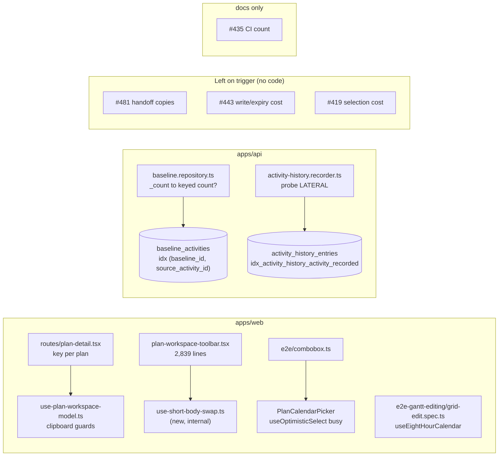
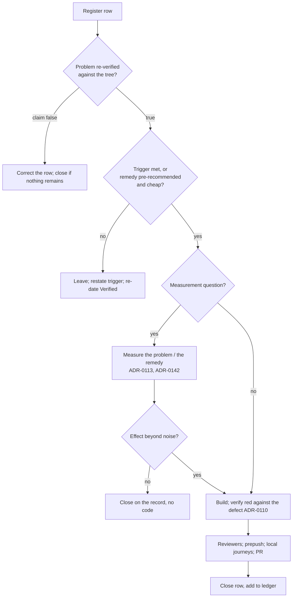

# Feature Spec: Tidy, tests and measured performance — register group 4

- **Status:** Draft — awaiting the product owner's approval before any implementation.
- **Author(s):** Claude Code (feature-analyst), for James Ewbank (product owner)
- **Date:** 2026-10-11
- **Tracking issue / epic:** `docs/TECH_DEBT.md` #419, #429, #432, #435, #441, #443, #444, #454, #469, #481
  (register rows, not GitHub issues); `docs/HANDOFF.md:82-84` lists all ten as carried over.
- **Roadmap link:** none (quality of existing surfaces)
- **Related ADR(s):** ADR-0113 (measure the problem), ADR-0142 (measure the remedy before building it),
  ADR-0128 (a canvas reading belongs on the owner's machine), ADR-0138 (shard budget), ADR-0165 (windowed
  table), ADR-0110 (a gate is verified against the defect it names), ADR-0111 (keyboard/focus contract
  reviewed before release), ADR-0105 (why this is a spec), ADR-0172 (soft-delete filter stated at the
  query), ADR-0174 (activity history), ADR-0088 D1 (no flag), ADR-0081 (entry point or declared dark).
  **No new ADR.**

> **Why a spec at all (ADR-0105).** Most of the ten rows are tidying or trigger-gated and need no spec on
> their own. Two things push the group over the line: #481's remedy changes a shared hook's public
> contract (`components/ui/use-container-unmount-handoff.ts`), and #441's remedy, if built, changes an API
> read's query shape. Writing one spec for the group also stops ten rows being re-argued one at a time.
>
> **What this spec does NOT do.** No schema change, index or migration is proposed. No new Playwright
> config or CI step, and **no added Playwright time**: ADR-0138's 2,372 s re-open trigger is already
> passed (2,393 s, `docs/TECH_DEBT.md` #491). No feature flag (ADR-0088 D1). Nothing here imports the CPM
> engine, so `computeSchedule` is untouched and the recalculation parity gate holds by construction. No
> new write, so the pen (ADR-0028) is not involved. No role gains or loses anything.

---

## 0. What was checked, and what the register got wrong

Re-read on 2026-10-11 against the working tree (CLAUDE.md §19.11, "the brief is not evidence").
**Method, stated plainly:** this environment had file reads and search only, no shell. Nothing was run:
no test, no `EXPLAIN`, no CI query, no `git log` (the clone is shallow and has no history). Every
"verified" below is a read of a named file and line. Where a claim needs a run, the row says so.

| Row  | Register's claim                                                                                                     | What is true on 2026-10-11                                                                                                                                                                                                                                                                                                                                                                                                                                                                                                                                                                                                                                                                       | Recommendation                                                       |
| ---- | -------------------------------------------------------------------------------------------------------------------- | ---------------------------------------------------------------------------------------------------------------------------------------------------------------------------------------------------------------------------------------------------------------------------------------------------------------------------------------------------------------------------------------------------------------------------------------------------------------------------------------------------------------------------------------------------------------------------------------------------------------------------------------------------------------------------------------------------- | -------------------------------------------------------------------- |
| #454 | Only `plan-switch.spec.ts` pins the per-plan key; two redundant guards remain; ~15 fixtures carry the field by hand | **True, and one thing is worse.** Key at `routes/plan-detail.tsx:41`. The journey's wait is `waitForTimeout(250)` inside a six-pass loop (`e2e-workspace-chrome/plan-switch.spec.ts:85-92`). `plan-detail.gating.test.tsx:66` mocks `useParams` to a fixed `p1`, so no unit test can change the plan. Guards at `use-plan-workspace-model.ts:473-476` (effect) and `:2574-2580` (refusal branch). **New finding:** the unit test named "refuses a clipboard from a different plan rather than translating it" (`use-plan-workspace-model.copy-paste.test.ts:410-425`) asserts `'Nothing has been copied yet.'`, not the refusal sentence. Its own comment says so (`:422-423`). The refusal branch has **no** test that reaches it. Fixture count: `editedSinceCalculated: false` appears **26 times in 16 test files**, not about fifteen. | **Build** bullets 1-2 and fix the misnamed test. **Defer** bullet 3 on a sharper trigger. |
| #469 | ~110 lines of swap state share **one input** (`bodyHeight`) and one output; trigger is the file passing 2,800 lines | **The trigger is met.** `plan-workspace-toolbar.tsx` ends at line **2839** (read to EOF). **The "one input" claim is wrong.** The swap code also reads `collapsed`, `setCollapsed`, `setInteracted` (`:796-797`), `canvasUi.mode` / `setMode` (`:773-775`), `anyRightDockActive` (`:994`, `:1002`) and `closeAllDocks` (`:994`). `withDiagram` (`:828-852`) serves **two** causes: the swap **and** the dock squeeze (`:838`). So it is not swap state, and moving it into a hook named for the swap would misname it. The tests the row names exist: `describe('the short-body swap')` at `plan-workspace-toolbar.test.tsx:657`, plus `:882`, `:1039` and `:1232`. | **Build**, with a narrower boundary than the row proposes (§4.4). |
| #481 | Three hand-written copies of the ADR-0135 container hand-off; only the cluster uses the hook                        | **True, and the copies differ in behaviour, not just in shape.** The hook is imported only by `diagram-viewport-cluster.tsx:43`, and its own docblock says so (`use-container-unmount-handoff.ts:5-11`). `HistoryResultStrip.tsx:97-101` **clears** its flag on any blur with `relatedTarget === null`, because `contains(null)` is false. The hook re-reads that case one frame later (`:96-103`). The selection bar's comment says that case must still count as "had focus" (`features/plan-actions/selection-actions.tsx:1190-1195`). Whether the difference is visible in a real browser is **not established**, and jsdom cannot answer it (ADR-0111). **There is also a fourth sibling:** `use-withdrawn-column-handoff.ts:5-25`, for a container that is hidden, not unmounted. The row names `selection-actions.tsx`, but two files have that name; the one meant is `features/plan-actions/`. | **Leave on its trigger.** Correct the row's facts. |
| #432 | The fixture sends weekdays `[1..5]` against a Monday-0 DTO, so the calendar works Tuesday to Saturday              | **True.** `e2e-gantt-editing/grid-edit.spec.ts:66` says "Mon-Fri" and `:74` sends `[1, 2, 3, 4, 5]`. The DTO says `0 = Monday … 6 = Sunday` (`calendar-shift.dto.ts:38`). **Three** journeys use the fixture, not two (`:273`, `:301`, `:327`). The third is the Escape test, which compares before and after and is not affected. `calendar-support.ts:8-12` already documents the trap and avoids it, so the next journey author has been warned. The fix also makes that note out of date. | **Build** (two lines plus the note), bundled with #429. |
| #429 | The option is shown, then the popup closes before the click; next step is to move the click inside `toPass` and confirm against a trace first | **The helper is as described** (`e2e/combobox.ts:45-51`; the test calls it twice at `schedule.spec.ts:165-166`). **New finding, from reading the code:** the helper's last assertion, `toHaveValue(optionName)` (`combobox.ts:54`), passes on the **optimistic** value. `use-optimistic-select.ts:46-47` sets `displayed = optimistic ?? serverValue` and stays `busy` until the refetch lands. So the first call returns while its own save is still running. That supports the row's hypothesis but does not prove it. **"Confirm against a trace first" cannot be done:** traces are kept `on-first-retry` (`playwright.config.ts:16`) and uploaded with `retention-days: 7` (`ci.yml:1169-1176`). Both sightings (2026-10-01 and 2026-10-03) are older than seven days. | **Build**, gated on reproducing the failure on demand (§4.5). |
| #435 | Exit is 10 consecutive green CI runs; count was 6 of 10 on 2026-10-05                                               | **Could not be re-counted here** (no CI access from this environment). Changesets show at least #838 through #916 merged since (`apps/web/CHANGELOG.md:3-208`), so the four runs still needed have very likely happened. `docs/HANDOFF.md:14-15` records #915 green on all 10 checks at its merged head. One retried-then-passed test, `plan-switch.spec.ts:109`, was fixed in #915 and recorded under this row (`HANDOFF.md:135-137`). That is the same kind of event the 2026-10-05 entry decided does not reset the count. | **Close by count.** Docs only, and needs somebody with CI access (§4.6). |
| #441 | `_count` compiles to a grouped subquery over all of `baseline_activities`; the only plan read was on an empty table | **Code as described:** `_count` with `deletedAt: null` in both reads (`baseline.repository.ts:835`, `:951`). The list is `take: limit + 1` (`baselines.service.ts:86-89`). An index that would serve a keyed count **already exists**: `@@index([baselineId, sourceActivityId])` (`schema.prisma:2463`). **The point the row leaves out:** a grouped subquery over the whole table costs in proportion to **every organisation's** baselines, not this plan's. So one tenant's list latency grows with the size of the whole install. Plan shape at size is still **not measured**. | **Measure** (M0, valid in the container, §4.7). Then close the row or build the keyed count. |
| #444 | The batch probe reads each activity's whole latest entry when it needs only the timestamp                          | **True.** The `LATERAL` is `SELECT *` (`activity-history.recorder.ts:552-557`) and the outer select takes `e.changes` (`:546`). A batch is never joinable (`activity-history.diff.ts:334-341`, `!write.isBatch`), and `latest.changes` is only read behind `joinable &&` (`:344`, `:348-349`), so a batch never uses the document. The database-architect recommended the change "regardless" (`docs/specs/activity-change-history/implementation-plan.md:571`) and noted the harness's survivors had almost no history, so the cost was under-measured (`:549-552`). The harness exists: `apps/api/test/measure/activity-history-batch.measure.ts`. | **Build, if a measurement shows a saving** (ADR-0142, §4.8).        |
| #443 | Write and expiry costs were measured only on a shared 4-vCPU container; trigger-based                             | **Unchanged.** None of its three triggers has fired: no slow-save report, no write-path performance pass, and H-1 `examined` has not been read at ≥ 100,000. The next count is due on or after 2026-11-01 (`HANDOFF.md:63-64`). **This sweep is not a "performance pass on the write paths".** #444 changes the batch probe and is measured on its own harness. Counting it as #443's trigger would be using one row to unlock another. | **Leave on its trigger.**                                            |
| #419 | Selecting an activity costs ~220-300 ms at 2,000 activities, container only                                        | **Unchanged as evidence** (`docs/specs/activities-panel-scale/m3-measurement.md:30-31`, `:39-41`, `:53-56`). There is still no reading on real hardware. The owner's probe panel has no scene for selection: the scenes are `canvas-draw`, `revision-diff` and `scale-scene` (`apps/web/src/features/perf-probe/scenes/`). **One possible trigger to note:** ADR-0186 added per-selection work to the selection bar and recorded its cost as "negligible" **without measuring** (`docs/specs/conflict-reason-on-object/feature-spec.md:311`). That work is four O(1) predicates on one activity, so this spec judges it does **not** fire "the next epic touching canvas selection". | **Leave on its trigger.** Getting an owner reading needs its own spec. |

**Net:** five rows are worth doing (#454, #469, #429, #432, #444), and #444 only if its measurement says
so. One row needs a measurement before anything else (#441), and one needs a count (#435). Three stay as
they are with corrected facts (#481, #443, #419). One part of #454 is deferred.

---

## 1. Business understanding

### Problem

This is not one problem. It is ten open register rows that have been carried from hand-off to hand-off
(`HANDOFF.md:82-84`) and have three things in common:

1. **Tests that pin less than they appear to.** A unit test whose name says it proves a refusal that it
   never reaches (#454). A route key that only a time-based journey protects (#454). A fixture whose
   comment says Monday to Friday while the data says Tuesday to Saturday (#432).
2. **A CI flake with a known shape and no trace.** The trace that could confirm the cause has expired
   (#429).
3. **Performance rows that each ask a measurement question before a building question.** Three of them
   say "measure first" and "trigger-based" in their own text (#441, #443, #419). One has a recommended
   remedy that was never measured on the case that matters (#444).

Who feels it today: the next engineer, or agent, who trusts one of these tests or rows. A planner feels
none of it. That is why most of this is low priority, and why "leave on its trigger" is a legitimate
outcome rather than a failure to act.

### Users

- **Engineers and agents** working on the plan workspace, the Gantt journeys, the e2e helpers and the
  history and baseline modules.
- **No product role is affected.** Org Admin, Planner, Contributor, Viewer and External Guest see no
  change. The two API rows (#441, #444) change latency only, on reads and writes that already exist with
  unchanged authorisation.

### Primary use cases

1. A refactor that drops the per-plan key fails a unit test at once, not a CI shard later (#454).
2. A reader of `plan-workspace-toolbar.tsx` finds the short-body swap in one named hook (#469).
3. The combobox helper cannot report a pick as done while its save is still running (#429).
4. A journey that reads a date on the eight-hour fixture reads a Monday-to-Friday calendar (#432).
5. Each performance row is either closed on a measurement, built on a measurement, or left with its
   trigger restated correctly (#441, #444, #443, #419).

### Expected outcomes

At most five small pull requests and a register update. Of the ten rows, between three and six close
(the range depends on #441's and #444's measurements and #435's count). The rest are re-verified and
dated with their errors corrected.

### Success criteria

- **SC-1** Removing `key={…}` from `plan-detail.tsx:41` makes a **unit** test fail. This must be shown red
  against that removal before merge (ADR-0110).
- **SC-2** A unit test reaches the different-plan refusal branch and asserts
  `'That copy came from a different plan.'`. Alternatively, if the owner chooses to delete both guards, the
  misnamed test is renamed to what it does assert.
- **SC-3** `plan-workspace-toolbar.tsx` no longer holds the swap's hysteresis state, tool put-away or
  focus tracking. Every case in `plan-workspace-toolbar.test.tsx` `:657`, `:882`, `:1039` and `:1232`
  passes unchanged. `canvas-directed-commands.structural.test.tsx` passes. The `workspace-chrome` and
  `workspace-fit` journeys pass locally.
- **SC-4** A local run that delays the plan PATCH response reproduces #429's failure mode with the
  current helper and passes with the new one. If the failure cannot be reproduced on demand, the helper
  is **not** changed, and the row records the attempt.
- **SC-5** `useEightHourCalendar` sends `[0, 1, 2, 3, 4]`. The three `gantt-editing` journeys that bind it
  pass locally. `calendar-support.ts:10-12` no longer describes the old fixture.
- **SC-6** #441 has a recorded `EXPLAIN (ANALYZE, BUFFERS)` of the list read at about 500,000 snapshot rows.
  The row is then either closed on that record, or replaced by a keyed count that is measured faster and
  issues no unfiltered read (ADR-0172).
- **SC-7** #444 has a before-and-after reading on the M2-T5 harness, including a long-history arm. The
  narrowing ships only if the saving is larger than the run-to-run spread. The statement count pinned by
  `apps/api/test/activity-history-statements.e2e-spec.ts` does not change.
- **SC-8** No pull request in this sweep adds Playwright wall time, a Playwright config or a CI step.

### Open questions

**Critical** (they change scope):

- **CQ-1 — the API half.** Do #441 (measure, then possibly build) and #444 (measure, then possibly build)
  belong in this sweep, or stay on their triggers? **Default: include both.** Each is a bounded local
  measurement whose result can close the row. #441 also has an install-wide scaling property (§0) that a
  symptom report would only reveal late.
- **CQ-2 — #435's exit criterion.** Read strictly ("10 consecutive runs with every web shard green") or
  as the 2026-10-05 entry already applied it ("10 consecutive runs with no web-shard failure from the
  causes this row names: a 429, an onboarding-heading timeout, or a `/sign-in` redirect timeout")?
  **Default: the second.** It is how the count has been kept so far. Under the strict reading, any PR's
  own red test would reset a count about a different cause.
- **CQ-3 — #454's guards.** Delete the plan-switch effect and keep the different-plan check, so the check
  becomes reachable and tested (**default**). Or delete both and rename the test. Or keep both and rename
  the test.

**Defaulted** (stated so work is not blocked):

- #454 bullet 3 (a shared `PlanSummary` fixture builder) is **deferred**. The new trigger is "the next
  field added to `PlanSummary`". Migrating 16 test files changes no behaviour, and CLAUDE.md §2 warns
  against drive-by churn. The builder pays off on the next field, not before.
- #469's extracted hook saves about 70-90 lines. The file will sit near 2,750 lines and will cross 2,800
  again within an epic or two. The register row should say so rather than imply the file has been fixed.
- No changeset for the web milestones, which change no user-visible behaviour. The API milestones get a
  patch changeset only if they ship code (performance with no contract change).

---

## 2. Functional requirements

### User stories & acceptance criteria

> **US-1 (#454)** — As an engineer refactoring the plan route, I want a unit test to fail if the per-plan
> remount is lost, so that the #451 defect cannot come back unnoticed.
>
> - **Given** `PlanDetailScreen` rendered for plan `p1` **when** the route params change to `p2` **then** the
>   workspace model is mounted afresh, observed through a mount counter or a fresh hook instance and not by
>   timing.
> - **Given** the `key` removed from `plan-detail.tsx:41` **then** that test fails (red evidence recorded in
>   the PR).
> - **Given** the default for CQ-3 **when** the hook re-renders with the same instance and a new `planId`
>   (`renderHook` with `rerender`) after a copy **then** paste announces `'That copy came from a different
>   plan.'`.

> **US-2 (#469)** — As an engineer reading the plan workspace toolbar, I want the short-body swap in one
> hook, so that its state and its focus rule can be read and changed in one place.
>
> - **Given** the extraction **then** every existing case in the four `describe` blocks named in SC-3 passes
>   with **no edit to the test file** other than imports.
> - **Given** the extraction **then** `withDiagram`, `closeAllDocks`, `expandPanel` and the dock-squeeze
>   disarm (`:783-785`) stay in the toolbar and consume the hook's output (§4.4).

> **US-3 (#429)** — As an engineer reading CI, I want the combobox helper to return only after its save
> has settled, so that two back-to-back picks cannot race.
>
> - **Given** a delayed PATCH (Playwright `page.route` holding the response about 1.5 s) **when** the base
>   suite's calendar test runs with the old helper **then** it fails with the "not stable / not visible"
>   shape, and **with the new helper** it passes.
> - The helper's open-assert-click sequence retries as one unit, and the helper waits for the field to be
>   enabled before returning.

> **US-4 (#432)** — As an engineer writing a Gantt journey, I want the eight-hour fixture to be the week it
> says it is.
>
> - **Given** the fixture **then** it sends weekdays `[0, 1, 2, 3, 4]` with a comment that says why (`0 =
>   Monday`, `calendar-shift.dto.ts:38`), and `calendar-support.ts`'s note is updated in the same change.

> **US-5 (#441)** — As the operator of an install with many baselines, I want a plan's baseline list to
> cost what that plan holds.
>
> - **Given** about 500,000 `baseline_activities` rows across about 300 baselines **when** one plan's list
>   page is read **then** the plan and timings are recorded. **If** the grouped side scans the whole table
>   and the read is over 20 ms of database time at that size, build the keyed count. **Otherwise** close
>   the row on the record.

> **US-6 (#444)** — As a planner deleting a large summary, I want history recording not to decode 2,000
> history documents it never uses.
>
> - **Given** the M2-T5 harness with a **long-history arm** (each survivor's latest entry carries a
>   multi-KB `changes`) **when** measured before and after **then** the narrowing ships only if the
>   in-process probe time falls by more than the spread of the before-arm's repeats.

### Workflows

Each milestone in the plan is a short workflow ending in one of three outcomes: **build**, **close on
evidence**, or **leave with a corrected row**. See the user flow in §4.

### Edge cases

- **#454:** the gating test's fixed `useParams` mock (`:66`) must become mutable for one case without
  changing the others.
- **#469:** `wasShort` and `toolPutAway` are adjusted **during render** (`:757-759`, `:772-778`). Inside a
  custom hook this is still the same component's render-phase update, which React allows. The hook must
  not move them into an effect, because the comment at `:753-754` explains that a one-frame lag is the
  defect.
- **#469:** the focus-tracking layout effect (`:1016-1020`) must still run before paint. The hook keeps it
  a `useLayoutEffect`.
- **#429:** three other suites call the helper (`e2e-resource-view/support.ts`,
  `e2e-assignment-lag/assignment-lag.spec.ts`, and the base suite). Some of their pickers may never be
  disabled. "Wait until enabled" must therefore be a wait that passes immediately for an enabled field.
- **#444:** the single-object path **does** merge and must keep reading `changes`. Only the batch path
  narrows.
- **#441:** a list page of zero baselines must issue no count query at all. A keyed `groupBy` over an empty
  `in` list is wasted work.

### Permissions

**Unchanged.** No endpoint, guard or role check is touched. #441's keyed count runs inside the same
service method, after the same org and plan scoping (`baselines.service.ts:86`). #444's probe still reads
`organization_id` from the activity row and never from the request (`activity-history.recorder.ts:511-514`,
R5). The narrowing must keep that column.

### Validation rules

None new.

### Error scenarios

| Scenario                                                    | Detection                                         | Result                                                     | Status |
| ----------------------------------------------------------- | ------------------------------------------------- | ---------------------------------------------------------- | ------ |
| #429 reproduction cannot be made deterministic              | M2-T1 finds no failure after 20 delayed runs      | Helper unchanged; row records the attempt and stays open   | n/a    |
| #444 saving is inside the noise                             | M3-T1 before/after spread                         | Code not shipped; row closed on the measurement (ADR-0142) | n/a    |
| #441 plan is already page-restricted, or cheap at 500k      | M3-T2 `EXPLAIN`                                   | Row closed on the record; no code                          | n/a    |
| #441 measurement suggests an index                          | M3-T2                                             | **Stop; database-architect** (CLAUDE.md §19.3)             | n/a    |
| #435 count shows a named-cause recurrence                   | M4-T1 log read                                    | Count resets; row stays open with the run id               | n/a    |

---

## 3. Technical analysis

| Area           | Impact     | Notes                                                                                                                                                                                                            |
| -------------- | ---------- | ---------------------------------------------------------------------------------------------------------------------------------------------------------------------------------------------------------------- |
| Frontend       | low        | One new internal hook (`use-short-body-swap.ts`), a code move inside `plan-workspace-toolbar.tsx`, one effect deleted from `use-plan-workspace-model.ts`. No component's public props change.                                |
| Backend        | low        | #444: one SQL statement's column list. #441 (only if built): `_count` replaced by a keyed `groupBy` / `count` in `baseline.repository.ts`.                                                                       |
| Database       | **none**   | No schema, index or migration. The keyed count would use the existing `@@index([baselineId, sourceActivityId])` (`schema.prisma:2463`). **Any index the measurement suggests goes to database-architect first (§19.3).** |
| API            | none       | No contract change. `activityCount` keeps its meaning (live snapshot rows).                                                                                                                                      |
| Security       | none (checked) | Tenant read in the probe preserved (R5). The keyed count is scoped to ids already returned by an org- and plan-scoped query.                                                                                   |
| Performance    | low / positive | #444 is expected to save 5-15 ms, more on long histories (unmeasured). #441 is unknown until M3-T2. No new client cost.                                                                                       |
| Infrastructure | none       | No CI step, config, image or env change. **No added Playwright time** (ADR-0138, #491).                                                                                                                          |
| Observability  | none       |                                                                                                                                                                                                                  |
| Testing        | medium     | New unit cases (#454). Behaviour-preserving refactor proven by existing suites (#469). A deliberate red reproduction (#429). Local journey runs (#429, #432, #469). Measurement records (#441, #444).            |

### Dependencies

- **Local Postgres and the isolated-stack recipe** (`HANDOFF.md:105-111`) for M2 and M3.
- **CI read access** for M4-T1 (#435's count). This environment does not have it.
- **`pnpm check:counts`**: #469 adds at least one web source file (the hook, and its test if one is
  added). Each moves the `CLAUDE.md` banner's web-source-file count (currently 1628), which must be updated
  in the same pull request (`HANDOFF.md:142-143`).
- **`check:debt-status`** and the register's "Closed numbers" ledger for every row that closes (M4).
- No ordering between milestones. Each is independent and keeps `main` releasable.

---

## 4. Solution design

### 4.1 Architecture overview

Nothing new is added to the architecture. The diagram shows where each row lands and what each
disposition depends on.



### 4.2 Data flow — #444, the one runtime path that changes

```mermaid
sequenceDiagram
  participant S as Service (delete/restore)
  participant R as ActivityHistoryRecorder
  participant DB as Postgres
  S->>R: recordKnockOn / record(batch)
  R->>DB: acquireActivityHistoryLocks (exclusive)
  R->>DB: probe: unnest(ids) JOIN activities JOIN plans<br/>LATERAL latest entry
  Note over R,DB: today: SELECT * incl. changes (up to 32 KB each)<br/>after: id, actor, scope, first/last_recorded_at,<br/>edit_count, batch_id; changes = NULL when batch
  DB-->>R: one row per activity (+ names on row 1)
  R->>R: planRecord(...) batch is never joinable,<br/>so changes is never read
  R->>DB: flush (multi-row insert)
```

Statement count is unchanged: lock, probe, write. `activity-history-statements.e2e-spec.ts` pins it.

### 4.3 User flow — the disposition of each row

There is no end-user flow. This is the engineer's flow that every milestone follows.



### 4.4 Component changes

**#469: `useShortBodySwap`**, at `apps/web/src/components/layout/workspace/use-short-body-swap.ts`, beside
`use-activity-panel-prefs.ts` as the row asks. The boundary is narrower than the row proposes, because
§0 found the row's "one input" claim wrong.

- **Moves into the hook:** `wasShort` / `short` / `swapped` (`:757-760`); `toolPutAway` and its put-away
  (`:772-778`); `collapseQuietly` and `panelBoxRef` (`:794-798`); the "a dock opening collapses the
  panel" layout effect (`:1001-1003`); focus tracking (`focusInHiddenRef`, `collapseButtonRef`,
  `trackFocusIn` / `trackFocusOut` and the layout effect, `:1008-1020`).
- **Inputs (named, not hidden):** `bodyHeight`, `collapsed`, `setCollapsed`, `setInteracted`, `canvasUi`
  (`mode`, `setMode`), `anyRightDockActive`.
- **Output:** `{ swapped, toolPutAway, collapseQuietly, panelBoxRef, collapseButtonRef, trackFocusIn,
  trackFocusOut }`.
- **Stays in the toolbar:** `dockSqueezed` and its disarm (`:744-748`, `:783-785`); `closeAllDocks`
  (`:820-827`); `withDiagram` (`:828-852`), which serves both causes; `expandPanel` (`:993-996`);
  `canvasRowTooShort` (`:764`). They consume the hook's `swapped` and `collapseQuietly`.
- **Why not move `withDiagram`:** it is the combinator for "the diagram is not reachable" from **either**
  cause. A hook named for the swap that also owned the dock rule would be the misnaming §0 warns about.
  If a later change wants one hook for both, the right name is something like `useDiagramReach`. That is
  a separate decision and not this row's.
- **Contract change:** none. This is an internal hook in the workspace folder, not a `components/ui`
  primitive. No keys and no focus destinations change, so ADR-0111's before-release review is **not**
  triggered. The component-reviewer still checks that the diff is a pure move.

**#454:** no component change. One `useEffect` is deleted from `use-plan-workspace-model.ts` (`:474-476`),
along with its now-wrong comment (`:471-472`), under CQ-3's default.

**#481:** none (left on its trigger).

### 4.5 E2E helper changes (#429, #432)

**#429, `e2e/combobox.ts`:**

1. One `toPass` block opens with `ArrowDown`, asserts the listbox visible (short timeout), and clicks the
   option (short timeout). A popup that closes between "visible" and the click is re-opened rather than
   waited on for 30 s.
2. After the click, wait for the field to be **enabled** (`toBeEnabled`), then assert the value. "Enabled"
   is the signal that `useOptimisticSelect` has seen the server value (`use-optimistic-select.ts:44-46`).
   An optimistic value alone is not.
3. **Verification gate (SC-4).** Before changing the helper, a throwaway local spec (not committed) routes
   `PATCH …/plans/*` with a 1.5 s delay and runs the calendar test about 20 times on the **current**
   helper. If it never shows the failure, the cause is not what the code suggests: stop, record it on the
   row, change nothing.

**#432, `e2e-gantt-editing/grid-edit.spec.ts`:** send `[0, 1, 2, 3, 4]`, fix the comment at `:66`, and in
the same change correct `calendar-support.ts:10-12`, whose parenthetical describes the bug being fixed.
Leave `bindMonFriCalendar` alone: it is a different fixture with a different purpose (a mask, not shifts).

### 4.6 Register changes (#435 and every row)

`docs/TECH_DEBT.md` is **not** edited by this spec. The plan's last milestone does it: closes rows that
closed, re-dates `Verified:` on rows that stay, and records §0's corrections:

- #469: the "one input" sentence.
- #481: the fourth sibling and the behavioural difference.
- #432: three journeys, not two.
- #454: 26 occurrences in 16 files, and the misnamed test.
- #441: the install-wide scaling point.

**#435** needs someone with CI access to read the `ci.yml` runs after `37345810798` on `main` and PRs. Under
CQ-2's default, the row closes at 10 runs with no named-cause failure on a web shard. A named-cause
recurrence resets the count and is recorded with its run id.

### 4.7 Database changes

**None proposed.** #441's M0 measures the existing plan. If it leads to a code remedy:

- `findManyActiveByPlan`: read the page as today **without** `_count`, then one
  `baselineActivity.groupBy({ by: ['baselineId'], where: { baselineId: { in: pageIds }, deletedAt: null },
  _count: { _all: true } })`, skipped when `pageIds` is empty. Ids with no rows map to 0.
- `findActiveWithCountByIdInPlan`: a single `count({ where: { baselineId, deletedAt: null } })`.
- Both state their soft-delete filter at the query (ADR-0172; its scan runs inside `pnpm test`,
  `docs/adr/0172-*.md:92`).
- **Statement count rises by one** for each read (two instead of one). Measure that against the grouped
  subquery's cost at size. The trade is not free at small sizes, which is why M0 comes first.
- Served by `@@index([baselineId, sourceActivityId])` (`schema.prisma:2463`). If `EXPLAIN` shows heap
  fetches for `deleted_at` dominating, **that is an index question and goes to the database-architect
  agent (CLAUDE.md §19.3), not to the builder.**

**Measurement validity (ADR-0128).** ADR-0128 D1 refuses container figures for **canvas** readings,
because a software rasteriser moves the baseline. #441's question is mainly **plan shape**: does the
grouped side aggregate the whole table, or only the page? That question does not depend on the display.
Absolute milliseconds from the container are reported as indicative, with the machine named, and the
verdict is taken on plan shape plus the order of magnitude.

### 4.8 API changes

None. `activityCount` and the probe's outputs keep their meaning.

**#444 design:**

- Give the `LATERAL` an explicit column list: `id, actor_user_id, scope, first_recorded_at,
  last_recorded_at, edit_count, batch_id`, plus `changes` only when the write is not a batch. A batch
  passes `NULL::jsonb AS changes`. Two template variants, or a boolean parameter in a `CASE`, so a batch
  never detoasts the document.
- `toLatest` and `LatestEntry` must not pretend an empty document is the real one. Either type `changes`
  as absent for a batch, or add a unit test in which `planRecord` is given a batch write and a `latest`
  whose `changes` getter throws. The test proves the document is never read. That turns this spec's
  reading of `activity-history.diff.ts:334-349` into a test.
- Keep the `soft-delete: any-state` justification comment (`recorder.ts:523`) and the tenant read.

### 4.9 Implementation approach & alternatives

**Chosen:** one spec, five optional slices, each independently mergeable, each ending in build, close or
leave. Measurement comes before building wherever the row asks a cost question (ADR-0113, ADR-0142).

**Alternatives considered:**

| Alternative                                                       | Why not                                                                                                                                                                         |
| ----------------------------------------------------------------- | ------------------------------------------------------------------------------------------------------------------------------------------------------------------------------- |
| Build all ten rows' "Next" lines as written                       | Three rows say "trigger-based" in their own text. #481's "Next" changes a shared focus hook with no defect observed. #419 needs a reading on the owner's hardware, which no container can supply (ADR-0128). That would be inventing work. |
| Do #481 now, as the "tidying" it looks like                       | It changes a `components/ui` hook's public contract and where focus lands for two components. That requires an ADR-0111 review and a real-browser check, for duplication that has caused no defect. The behavioural difference found in §0 is a reason to look **when** one of the copies next changes, not before. |
| Move `withDiagram` into the #469 hook, as the row says            | It serves the dock squeeze as well as the swap (`:838`). Moving it misnames the hook, or makes the hook own dock logic.                                                          |
| Apply #429's helper change without reproducing it                 | The only evidence is a reading of the code, and the traces have expired. Shipping a change to a shared helper on an unconfirmed cause is the pattern ADR-0142 records three times. |
| Shorten `plan-switch.spec.ts`'s six 250 ms waits once the unit pin exists | The journey is the ADR-0081 proof that the real product does not count a plan switch as an edit. The unit pin adds earlier detection; it does not replace the journey. Changing journey timing is also outside this group. |
| Add a perf-probe "selection" scene so the owner can read #419     | It adds a scene to the staff probe panel. That is new surface and needs its own spec under ADR-0105. Offered as a follow-up, not folded in.                                                       |

**Risks:** see the plan's rollup. The main ones are #469's render-phase state moving across a hook
boundary (mitigated by the four existing suites and two journeys), and #441's remedy costing more than it
saves at small sizes (mitigated by M0).

**Recommended specialised agents during build:**

- **component-reviewer** for M1b (#469 pure-move check).
- **test-engineer** for M1a, M2-T1 and M2-T2.
- **backend-performance-reviewer** for M3-T1 and M3-T2.
- **security-reviewer** for M3-T1, briefly: the probe's tenant read.
- **database-architect** only if M3-T2 points at an index. Then it is mandatory.
- **api-reviewer** is not needed, because there is no contract change.

## 5. Links

- Implementation plan: [`./implementation-plan.md`](./implementation-plan.md)
- Evidence read: `docs/specs/activities-panel-scale/m3-measurement.md`,
  `docs/specs/activity-change-history/implementation-plan.md` (M2-T5), `docs/HANDOFF.md`.
- Related docs this change will update: `docs/TECH_DEBT.md` (the ten rows, plus the "Closed numbers"
  ledger), `CLAUDE.md` banner web-source-file count (#469), `docs/adr/0174-*.md` (#444's figure, as the row
  asks), `calendar-support.ts` comment (#432).
