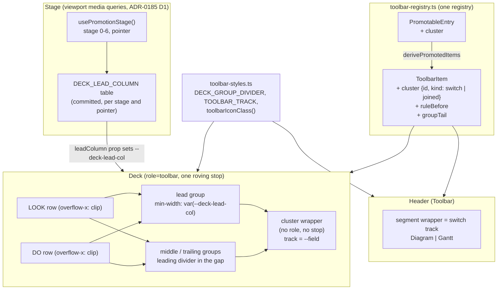
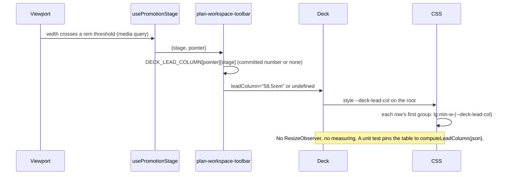
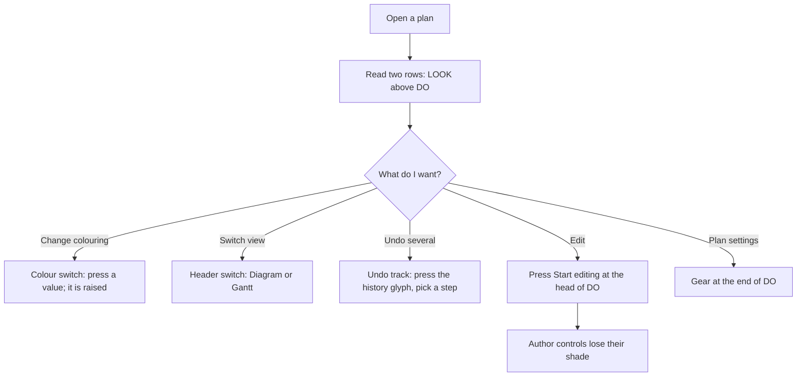

# Feature Spec: The toolbar as a grid: dividers, switches and shared columns

- **Status:** Approved — 2026-10-12 by the product owner ("approve, go with your recommendations"): CQ-1 (a) keep a quieter search outline that clears 3:1; CQ-2 (a) drop the dashed locked outline; CQ-3 (a) a promoted command wins over the shared column
- **Author(s):** feature-analyst, for the product owner (james)
- **Date:** 2026-10-12
- **Tracking issue / epic:** none yet
- **Roadmap link:** UI consistency (follows the toolbar redesign, ADR-0185)
- **Related ADR(s):** amends ADR-0185 (D3 for Baseline overlay; D8 V1, V2, V3's hollow Author pill, and V4). Builds
  on ADR-0119, ADR-0133, ADR-0118/0183, ADR-0117, ADR-0111, ADR-0097 and ADR-0088 D1. **A new ADR is filed when
  this is approved.** Provisionally ADR-0189, "A shape on the toolbar is a control". Outline in §4.9. It is not
  written here.
- **Inputs:** the owner's screenshot `before-1912.png`; the mock-up `mockup.html`, plate "Recommended: Dividers,
  switches and columns" (owner, 2026-10-12: "go with your pick"); the UX review of 2026-10-12.

> **How to read this.** The owner is not a front-end specialist, so each rule says in plain words what you will see.
> The code references are there for the builder. Every figure that began as an estimate was replaced at M0 (2026-10-12)
> by a reading and is marked **(measured, M0)**; the record is [`m0-measurement.md`](m0-measurement.md), whose §0 says
> what it contradicts here. If M0 contradicts a premise the work stops and asks (the ADR-0185 precedent), and it does:
> see the column, §4.5.

> **Owner decisions after M0 (2026-10-12).** M0 fired two stop rules and the owner answered both:
>
> 1. **The shared column is dropped.** It fits only at 2160 px and wider (3 of 12 pointer-stage cells), and both of
>    the owner's screens are 1912 wide. Requirement 3 (shared columns), §4.2, §4.5, the `leadColumn` prop, every
>    column success criterion and milestone **M4** are withdrawn. They stay below as history; they are not built.
> 2. **The gear and the D-4 inset rules apply from 79 rem (1264 px) up only.** Below that, the gear stays after
>    Earned value and the Author group has no extra rules, so at 1024 fine every row keeps today's line count in
>    every state, Link armed included (DO has 5.2 px free there; the gear costs 12 px and the rules 24 px, measured,
>    M0). "Move gear on big only" was the owner's answer; the rules follow it because they break the same floor.

---

## 1. Business understanding

### Problem

At 1912 × ~1000 with editing on, the owner said the toolbar "looks awful". Asked why, they named **messy grouping**
and **stray bits**. They said it is **not** too many words and **not** too many rows.

I re-checked each cause against the code (CLAUDE.md §19, "re-verify the PROBLEM statement"). Every one is still
true. One figure in the brief was slightly wrong, and it is corrected below.

**Messy grouping: three box styles compete, and the main one is nearly invisible.**

| Claim                                                            | Verified in code                                                                                                                                                                                                | Verdict                  |
| ---------------------------------------------------------------- | --------------------------------------------------------------------------------------------------------------------------------------------------------------------------------------------------------------- | ------------------------ |
| Every deck group already has a pill backing                      | `DECK_GROUP_PILL`, `toolbar-styles.ts:166-167`, applied to every group at `Deck.tsx:449`                                                                                                                        | True                     |
| The pill is too faint to read                                    | `m6-measurement.md:189`: pill **1.11:1** against the band, hairline **1.54:1** (measured, M0; the record rounds it to 1.53). The brief's "1.13:1" is the hover wash against the pill (`:185`), a different pair | True, figure corrected   |
| So some groups look boxed and some do not                        | Visible in `before-1912.png`: the Find pill reads as a box because the search field's outline sits inside it; View and Author barely show                                                                       | True                     |
| A second box: the search field's own outline                     | The field is the shared `Input` (`tsld-toolbar-items.tsx:1508-1526`). Its outline is `--chrome-input`, **4.39:1** on the band, 4.99:1 on its own fill (measured, M0; `globals.css:385-396`)                     | True                     |
| A third box: a ring round Export and Share… inside the Plan pill | `DECK_CLOSING_SECTION`, `toolbar-styles.ts:193-194`, applied to the `output` section at `Deck.tsx:491`. Ring 3.56:1 on a pill (measured, M0; `m6-measurement.md:184`)                                           | True. A box inside a box |

**Stray bits: each one does a job, but none of them looks like it.**

| What you see                    | What it is                                                                                                                    | Source                                                                                 |
| ------------------------------- | ----------------------------------------------------------------------------------------------------------------------------- | -------------------------------------------------------------------------------------- |
| An eye and a wrench at the left | Row marks for LOOK and DO, shown from 79 rem                                                                                  | `DECK_ROW_MARK`, `toolbar-styles.ts:202-203`; rendered `Deck.tsx:395-397`              |
| A small "Colour" word           | The caption over the promoted Colour set, `text-xs`, smaller than the buttons beside it                                       | `captionBefore`, `promotion-entries.tsx:147`; rendered `toolbar-promotion.tsx:181-206` |
| A lone ▾ between undo and redo  | **Recent edits**, a menu of undo steps. Its only glyph is a chevron                                                           | `undo-history`, `tsld-toolbar-items.tsx:2588-2597`; the chevron at `:2522`             |
| A ± with no word                | **Baseline overlay**, icon-only by owner decision 2026-10-10                                                                  | `tsld-toolbar-items.tsx:359-371` (`Diff` glyph, `labelVisibility: 'never'`)            |
| "Add: Start milestone"          | A promoted Add kind. "Add:" repeats the Add button beside it                                                                  | `promotion-entries.tsx:272`                                                            |
| A gear after Earned value…      | **Settings…** (plan settings), icon-only by owner decision 2026-10-10. It sorts after Earned value, so it reads as part of it | `calendar` item, `tsld-toolbar-items.tsx:3412-3429`, `order: 3` in `object`            |

**Why now.** ADR-0185 just finished re-placing every tool. That work was about _where_ things go. This is the
first pass on _how the bar reads_ as a whole.

### Users

| Role                | Effect                                                                                                     |
| ------------------- | ---------------------------------------------------------------------------------------------------------- |
| Planner / Org Admin | The main audience. Same commands, same places, a calmer bar                                                |
| Contributor, Viewer | Same picture. Authoring stays shaded with its reason (ADR-0082)                                            |
| External Guest      | **Not affected.** The share route has its own bar (`features/share/`). Only the plan page mounts this deck |

No permission, write path or scheduling input changes. The pen (ADR-0028) is untouched. `computeSchedule` is not
reached, so the recalc parity gate is not engaged.

### Primary use cases

1. Glance at the bar and see its groups without reading every word.
2. See at once which Colour mode, and which view (Diagram or Gantt), is chosen.
3. Find undo, redo and the list of recent edits as one thing.
4. Read the two rows as one toolbar, not two unrelated lists.

### User journey (after the epic, 1912 wide, editing on)

- **LOOK row:** Go to today ▾, View ▾ │ Colour [Criticality | Total float | WBS group] │ Late-start overlay,
  Feasible window, Baseline ┃ Search, Filter ▾, Critical only, Next conflict … ┃ Legend, resource view, comments.
- **DO row:** **Stop editing** │ Add ▾, Start milestone, Link ▾, Select, Arrange, Apply levelled dates… │ [Undo |
  Redo | Recent edits] … ┃ Analysis ▾, Health check, Compare revisions, Earned value… │ Export ▾, Share… │ ⚙.
- `┃` is a full-height group divider. `│` is the short inset rule inside a group. `[ … ]` is a recessed track.
- The LOOK row's first divider (View ┃ Find) lines up with the end of the DO row's first group (Author). Both
  right-hand groups end on the same right edge.

### Expected outcomes

- No decorative boxes. Every shape on the bar is something you press.
- The chosen Colour mode and view look like a physical switch.
- Every stray bit is explained by a word, a glyph or its position.
- The two rows share a column on screens 1280 px and wider.
- Nothing is lost. Same commands, same rows, same keyboard, same names for assistive technology.

### Success criteria

Each criterion says how it is proven. "Journey" means a Playwright case in an **existing** suite; no new config or CI
step is added (`docs/TECH_DEBT.md` #491). Cells are 1024 × 600, the six promotion-stage cells (1280 × 800,
1440 × 900, 1600 × 900, 1912 × 1080, 2160 × 1200, 2560 × 1440) and 1646 × 1097, on both pointers.

| ID    | Criterion                                                                                                                                                                                                                                                                                                                                                                                                                                                                                                                          | Proven by                                                                                                                                                                                  |
| ----- | ---------------------------------------------------------------------------------------------------------------------------------------------------------------------------------------------------------------------------------------------------------------------------------------------------------------------------------------------------------------------------------------------------------------------------------------------------------------------------------------------------------------------------------- | ------------------------------------------------------------------------------------------------------------------------------------------------------------------------------------------ |
| SC-1  | **No group box.** No deck group paints a fill, a border or an outline. `DECK_GROUP_PILL`, `DECK_GROUP_PILL_LOCKED` (subject to CQ-2), `DECK_CLOSING_SECTION` and `DECK_ROW_MARK` are deleted                                                                                                                                                                                                                                                                                                                                       | `deck-seams.structural.test.tsx` rewritten to refuse them; a grep test that none is exported                                                                                               |
| SC-2  | **Groups are split by a divider.** Between two groups on one line there is exactly one 1 px divider, the full height of the controls. Sections inside a group keep the short inset rule (`TOOLBAR_INSET_RULE`). The divider is the stronger of the two marks                                                                                                                                                                                                                                                                       | `Deck.test.tsx`; contrast pairs P1 and P2 (§4.6); journey reads each divider's height against its row                                                                                      |
| SC-3  | **No divider at the start or end of a line**, in any state: conflict read-out, peer's pen, shaded, Gantt view. This includes touch at 1024, which wraps to up to 4 lines (ADR-0185 OD-2). This is the old leading-seam defect, which the pill was chosen to prevent                                                                                                                                                                                                                                                                | New journey case in `command-surface.spec.ts`, **verified red** by removing the line-start clip (ADR-0110)                                                                                 |
| SC-4  | **Groups sit further apart than sections.** From 79 rem up, the gap between groups is at least twice the gap between sections. Below 79 rem the gap stays 8 px, so the floor keeps its reserve                                                                                                                                                                                                                                                                                                                                     | Journey reads rects at every cell                                                                                                                                                          |
| SC-5  | **A choice of one looks like a switch.** The Colour set and Diagram \| Gantt sit in a recessed track. Exactly one member is raised (the `selected` fill and underline). The raised fill clears **3:1 against the track** (asserted). The track against the band is **reported, not asserted** (§4.6 says why it cannot reach 3:1)                                                                                                                                                                                                  | Contrast pairs P3 to P6; unit tests on `Deck` and `Toolbar`; journey; a new case in the forced-colours suite (the raised member stays distinguishable)                                     |
| SC-6  | **Joined units.** Undo, Redo and Recent edits sit in one track, in that order. The Link "Type" set sits in a track when it is promoted. Split buttons keep their caret divider                                                                                                                                                                                                                                                                                                                                                     | `tsld-toolbar-undo-redo.test.tsx`; `Deck.test.tsx`                                                                                                                                         |
| SC-7  | **No new tab stop, no new role, no smaller target.** A track is a plain wrapper with no `role` and no name. The roving walk visits the same number of stops. Every member keeps `--control-h` height, and 44 × 44 on touch                                                                                                                                                                                                                                                                                                         | Structural test on the wrapper; `command-surface.spec.ts` roving-walk, 24 × 24 and 44 × 44 cases, unchanged                                                                                |
| SC-8  | **The search field is recessed.** Its fill is the recessed tone. Its boundary is decided by CQ-1 (default: a quieter outline that still clears 3:1)                                                                                                                                                                                                                                                                                                                                                                                | Contrast pair P7; journey                                                                                                                                                                  |
| SC-9  | **Shared columns (1280 px and up).** At each stage where the column is set, the LOOK row's first group and the DO row's first group are the same width (±1 px), so the LOOK row's first divider sits at the DO row's column edge. Both trailing groups end within 1 px of the trailing inset (today's US-5 case, kept)                                                                                                                                                                                                             | Journey at the six stage cells and 1646, both pointers, base and worst states; a unit test pins the committed column table to `computeLeadColumn(json)` (§4.5)                             |
| SC-10 | **A column never costs a line.** At every cell and state, each row has the same number of lines with the column as without it. Where the column would not fit, it is not set at that stage                                                                                                                                                                                                                                                                                                                                         | Journey: the LINES gate (`command-surface.spec.ts:617`) passes unchanged; plus a direct with/without comparison at each stage cell                                                         |
| SC-11 | **Icons are one step quieter than labels.** At rest, an icon beside a visible label takes `--muted-foreground` (7.98:1 on the band). An icon **with no visible label is the label**, so it keeps `--foreground`. In any other state (open, selected, armed, the pen) the icon takes the label's ink. Shaded controls are unchanged                                                                                                                                                                                                 | Unit tests on the one icon helper; a structural test that every trigger uses it (the `toolbar-label.structural.test.ts` precedent)                                                         |
| SC-12 | **The pen is the only saturated thing at rest.** With the pen held and nothing armed, no deck control's ink or fill has OKLCH chroma above 0.06 except the pen. Armed tools and the focus ring are states, and keep their amber                                                                                                                                                                                                                                                                                                    | Journey at 1912 × 1080 reading computed colours                                                                                                                                            |
| SC-13 | **Stray bits cleared** (each is one assertion): (a) no row mark; (b) the Colour caption is the label size, muted, next to its track; names stay "Colour by: X"; (c) Baseline overlay shows **Baseline** from 79 rem, icon-only below, name "Baseline overlay"; (d) Recent edits wears a history glyph inside the undo track; (e) "Start milestone" and "Finish milestone" without "Add:", names keep "Add: …"; (f) Settings… is the last control on the DO row, after an inset rule; (g) no ring on Export or Share…; (h) "…" kept | Unit and structural tests; `command-surface.spec.ts` label-in-name sweep (`:1675`) and the "icon-only" case (`:1323`, now three items); `ellipsis-convention.structural.test.ts` unchanged |
| SC-14 | **ADR-0185's guarantees still hold.** Two lines at 1024 fine in every state; touch ≤ 4 at 1024; `BAND_MAX_PX` 145; one header line from 1024; the free-space rule (SC-17) and the ladder checks (SC-18) re-run against re-taken widths; the scroll line below 1024 still scrolls with no stray divider                                                                                                                                                                                                                             | The existing `command-surface`, `promotion`, `narrow-shell` and `toolbar` suites, with re-taken `promotion-widths.{fine,coarse}.json`                                                      |
| SC-15 | **The owner signs it off from photographs.** Before and after at 1024 × 600, 1280 × 800, 1646 × 1097 and 1912 × 1080, both pointers, pen held, pen not held, conflict, peer's pen                                                                                                                                                                                                                                                                                                                                                  | A measurement record with the photo set. Sign-off is recorded in the ADR, not claimed by the record                                                                                        |

### Open questions

**Critical. These change the design. Each has a recommended default.**

- **CQ-1. Can the search field lose its outline line?** The mock-up draws it with no border. WCAG 1.4.11 says
  "Text inputs that have no border and are differentiated only by a background color must have a 3:1 contrast
  ratio" (W3C Understanding 1.4.11, read 2026-10-12). A recess darker than the navy band **cannot** reach 3:1: the
  band's luminance is 0.0157, so even pure black is only 1.31:1 against it (measured, M0, §4.6). The field
  has no visible label (`aria-label` only, `tsld-toolbar-items.tsx:1509`), and the code already records that "this
  outline is the ONLY thing that says a text field is there" (`globals.css:389-391`).
  - **(a) Recommended:** keep a recessed fill **and** an outline, toned down from 4.39:1 to 3.03:1 (measured, M0). Calmer
    than today, still compliant.
  - (b) Drop the outline and add a visible word ("Find") before the field. A label can identify the field, but it
    costs 32 px (the word "Find" is 28.1 px in the deck's label font, plus the 4 px control gap; measured, M0), which LOOK at 1024 with a conflict (20.7 px free, measured, M0) does not have.
  - Not offered: dropping the outline with nothing in its place. It fails 1.4.11.
- **CQ-2. What says "locked" on the Author group when you are not editing?** Today the Author pill goes hollow and
  dashed (`DECK_GROUP_PILL_LOCKED`, ADR-0185 V3). With no boxes, that outline has nothing to sit on.
  - **(a) Recommended:** drop it. The quiet shaded ink, the pen leading the row with "Start editing", and the
    shaded reason each control gives by keyboard still say it. A box that means "locked" would be the only
    non-control shape left.
  - (b) Keep a dashed outline round the Author group in that state only.
- **CQ-3. If, at some width, the shared column and a promoted command cannot both fit, which wins?**
  - **(a) Recommended:** the command wins. The column is simply not set at that width. Your free-space rule
    (ADR-0185 D1, SC-17) came first, and alignment is a nicety.
  - (b) Alignment wins. The ladder reserves room for the column, so that width may lose one promoted command.
    SC-17's "≤ 15 % empty" then needs a stated exception.

**Defaults taken (reviewers or the owner may overturn):**

- **D-1. Baseline shows its word from 79 rem (1264 px) up, and stays icon-only below.** The LOOK row at 1024 has
  28.7 px to spare with a conflict showing (`m6-measurement.md:78`; 28.6 px of live gap and 20.7 px of free width,
  measured, M0). The word costs 57.2 px (measured, M0), so showing it there
  would wrap the row and break the two-line floor. This uses the existing `'roomy'` rule. M0 shows touch at
  1280 wraps with a conflict (measured, M0; `m0-measurement.md` §5), so **it falls back to `'roomy-fine'`** (word on a
  mouse only), the rule Apply levelled
  dates… already uses (`tsld-toolbar-items.tsx:3260`). **This records the owner's 2026-10-12 reversal of the
  2026-10-10 icon-only decision.**
- **D-2. "Finish milestone" drops "Add:" too.** It is the same kind of entry (`promotion-entries.tsx:265-285`), and
  one rule is easier to read than two.
- **D-3. The Link "Type" set gets a track, but not the raised style.** Its members are tool kinds that arm the Link
  tool (`activeKind: 'armed'`). When none is armed, none is chosen, so nothing is raised. An armed member keeps the
  armed look (amber ink and underline).
- **D-4. An inset rule follows the pen, and another comes before the undo track.** Both are in the mock-up. The
  first supports ADR-0133 (the pen leads what it unlocks).
- **D-5. The quieter icon applies to the band only:** the deck and the header's toolbars. The selection bar in the
  foot row and the diagram-corner cluster keep today's ink. Extending it is a follow-up row.
- **D-6. Plan stays one group.** The mock-up draws a full-height divider between Analysis… and Export. In the code
  those are two sections of one group (`Deck.tsx:129`), so they get the inset rule. Group names for assistive
  technology are unchanged.
- **D-7. Controls inside a track keep their full height.** The mock-up shrinks them to 30 px. That would break the
  36 / 44 px control heights (ADR-0118, ADR-0183) and lower the touch target. The raised fill is drawn inside the
  member's box instead.
- **D-8. The raised fill is the existing `selected` fill (`--secondary`), not the mock-up's colour.** The mock-up's
  `oklch(0.47 0.07 264)` is 2.65:1 against the track (measured, M0), under 3:1. `--secondary` is 3.59:1 (measured, M0).
- **D-9. On the DO row there is no divider at the column edge.** That matches the mock-up. The next group on DO
  (Plan) trails at the right edge, so there is no neighbour to divide from. The column shows on DO as the end of
  the Author group. Where Author is the narrower of the two first groups, the edge is unmarked on DO. The
  photographs will show whether that matters.
- **D-10. No feature flag** (ADR-0088 D1). The rollback is reverting the commit. Every milestone names its entry
  point and lands with a journey (ADR-0081).
- **D-11. `docs/TECH_DEBT.md` #493 fires.** Its trigger is "the next change to the chrome band", and this epic is
  one. It is folded in as its own task at close-out (plan M5-T3). It gives the band a landmark and runs axe's
  `region` rule on a plan page.

---

## 2. Functional requirements

### User stories & acceptance criteria

> **US-1. Groups without boxes.** As a planner, I want the toolbar's groups split by lines and space rather than
> faint boxes, so that I can see the groups at a glance.
>
> - **Given** any plan at any width ≥ 1024, **when** the deck renders, **then** no group has a fill or an outline,
>   and adjacent groups on a line are split by one full-height 1 px divider.
> - **Given** a row that wraps (touch at 1024), **when** a group starts a new line, **then** no divider shows at the
>   start or the end of that line.
> - **Given** a width of 79 rem or more, **then** the gap between groups is at least twice the gap between sections.
> - **Given** a group with several sections, **then** the sections keep the short inset rule, which is quieter
>   than the divider.

> **US-2. Choices that look like switches.** As a planner, I want the Colour choice and the Diagram | Gantt choice
> to look like one switch with the chosen option raised, so that I can see what is chosen without reading.
>
> - **Given** the Colour set is on the bar, **then** its three buttons sit in one recessed track and exactly one is
>   raised. The "Colour" caption is the label size, muted, and sits right before the track.
> - **Given** the header, **then** Diagram | Gantt sits in the same kind of track.
> - **Given** forced-colours mode, **then** the chosen member is still distinguishable (a system-colour outline or
>   border), not only by a background that the mode removes.
> - Every member keeps its name ("Colour by: Total float"), its `aria-pressed`, and its place in the roving order.

> **US-3. One undo unit.** As a planner, I want Undo, Redo and Recent edits together, so that the ▾ stops looking
> like a stray.
>
> - **Given** the DO row, **then** Undo, Redo and Recent edits sit in one track in that order. Recent edits shows a
>   history glyph instead of a chevron.
> - Each keeps its own name, its own shaded reason and its own roving stop. Arrow keys now visit Redo before Recent
>   edits, because that is the order on screen (WCAG 1.3.2, 2.4.3).

> **US-4. Stray bits cleared.** As a planner, I want every mark on the bar to be explained by a word or its
> position.
>
> - No eye or wrench row marks.
> - Baseline overlay reads **Baseline** from 79 rem (D-1).
> - "Start milestone" and "Finish milestone" show without "Add:". Screen readers still hear "Add: Start milestone".
> - Settings… is the last control on the DO row, after an inset rule, still a gear with its tooltip.
> - Export and Share… have no ring.
> - Every command that opens a dialog keeps its "…".

> **US-5. Two rows, one grid.** As a planner on a laptop or monitor, I want the two rows to share a column, so that
> the bar reads as one toolbar.
>
> - **Given** a width at a promotion stage (1280 px or more) where the column is set, **then** the first group on
>   each row is the same width, so the LOOK row's first divider sits at the DO row's column edge.
> - **Given** any width, **then** both trailing groups end on the same right edge.
> - **Given** 1024 to 1279 px, or a stage where the column would not fit (CQ-3), **then** there is no column and
>   the rows look as they do today, apart from US-1 to US-4.

> **US-6. Quieter icons.** As a planner, I want the words to lead and the pen to be the only bright thing.
>
> - An icon beside a word is one step quieter than the word. An icon on its own keeps full ink.
> - At rest, the pen is the only saturated (amber) control. An armed tool and the focus ring keep their amber,
>   because those are states.

### Accessibility acceptance criteria (journeys)

1. The roving walk laps every command with the **same number of stops** as before, at 1024, 1440 and 1912.
2. No track has a `role` or an accessible name. The group names (View, Find, Panels, Author, Plan) are unchanged.
3. Label-in-name (2.5.3) holds for every visible label, including "Baseline", "Start milestone" and the Colour
   values (`command-surface.spec.ts:1675`).
4. Focus is visible on a track member, raised or not, at fine and coarse.
5. Forced colours: the chosen Colour member and the chosen view are distinguishable.
6. At text-only 200 % (the `Page.setFontSizes` cells ADR-0185 uses), every control is hit-testable and no divider
   starts a line.

### Edge cases

| Case                                                        | Expected                                                                                                                                                                                     |
| ----------------------------------------------------------- | -------------------------------------------------------------------------------------------------------------------------------------------------------------------------------------------- |
| Touch at 1024 (up to 4 lines, OD-2)                         | Groups wrap. No divider at a line's start or end                                                                                                                                             |
| Below 1024 (the scrolling line, ADR-0185 D5)                | Dividers, tracks and quiet icons apply. **No column.** The seam between the two rows stays                                                                                                   |
| Colour set not promoted (narrower than its stage)           | No track on LOOK. The choice is in View ▾ as today                                                                                                                                           |
| Share… not promoted                                         | Settings… follows Export, after the inset rule                                                                                                                                               |
| Pen not held                                                | Author controls shaded with reasons (CQ-2 decides the outline)                                                                                                                               |
| Pen held by a peer                                          | As today, plus CQ-2                                                                                                                                                                          |
| Add armed ("Adding: Start milestone")                       | The Add label is longer. **Measured, M0:** DO already wraps to two lines in this state at most stage cells, and the widest state is 898 to 1,621 px wide, so the column cannot use it (§4.5) |
| Link armed (`Linking · FS`)                                 | **Measured, M0:** DO has 5.2 px free at 1024 fine. The gear move alone (+12 px) wraps it, which is plan stop rule M0-T2 item 1 (`m0-measurement.md` §4)                                      |
| A lead group wider than the column (a state M0 did not see) | The column is a **minimum**, never a fixed width. The group grows and the divider on that row moves right. Nothing clips                                                                     |
| Gantt view                                                  | Same deck, so same treatment. There is no separate Gantt toolbar (verified: nothing in `features/gantt/` imports the toolbar primitives)                                                     |
| Forced colours                                              | Dividers and track fills may disappear; groups keep their names. The chosen member keeps a system-colour mark                                                                                |

### Permissions

No change. Every control keeps its gate: the pen (ADR-0028), `canShare`, `canWriteNotes`, `canInterchangeExport`,
`model.canWrite`. Nothing here is a write. Nothing is structural, so the pen lease is not involved.

### Validation rules / error scenarios

There is no input and no API. Failures are build failures: a group box, a divider at a line start, a track with a
role, a lost stop, a shrunk target, a column that costs a line, or a contrast pair under its floor.

---

## 3. Technical analysis

| Area                     | Impact | Notes                                                                                                                                                                                                                      |
| ------------------------ | ------ | -------------------------------------------------------------------------------------------------------------------------------------------------------------------------------------------------------------------------- |
| Frontend                 | high   | Shared primitives: `Deck`, `Toolbar`, `toolbar-styles.ts`, `toolbar-registry.ts`, `toolbar-promotion.tsx`. Feature: `tsld-toolbar-items.tsx`, `promotion-entries.tsx`, `promotion-ladder.ts`, `plan-workspace-toolbar.tsx` |
| Backend / Database / API | none   | No schema, so the database-architect is not needed                                                                                                                                                                         |
| Security                 | none   | No gate moves                                                                                                                                                                                                              |
| Performance              | low    | CSS and class changes. One inline custom property on the deck root. CSS bundle is 17.48 of 18.00 KiB (`m6-measurement.md` §7); the deleted classes offset most of what is added                                            |
| Infrastructure           | none   | No new Playwright config, no new CI step (#491). The M0 harness uses the existing non-CI `playwright.measure-toolbar.config.ts`                                                                                            |
| Testing                  | high   | Unit, structural, contrast pairs, journeys in `e2e-workspace-fit`, `e2e-toolbar`, `e2e-promotion`, `e2e-narrow-shell`, `e2e-forced-colors`                                                                                 |

### ADR-0105 triggers this fires

- **A shared primitive's public contract.** `ToolbarItem` and `PromotableEntry` gain fields; `Deck` gains a prop and
  a rendering rule; `Toolbar` paints its segment wrapper as a track; four exported constants in `toolbar-styles.ts`
  are deleted and new ones added.
- **A journey.** New cases in existing suites (no new config).
- No schema. No new entry point (the deck is already reachable on every plan).

### Keyboard and focus (CLAUDE.md §19.13, ADR-0111)

**No primitive changes which keys it claims.** There are no new tab stops, no role changes and no new key handlers.
Two things do touch focus:

1. **Order:** Redo now comes before Recent edits, because the screen order changes. The roving model follows DOM
   order (`Deck.tsx:227-232`), so this is a registry `order` change, not a key change.
2. **The focus ring's surroundings:** a focused member inside a track sits on a darker fill.

Neither is strictly an ADR-0111 trigger. **I recommend running accessibility-reviewer and component-reviewer before
M2 ships anyway.** That milestone adds wrappers inside the roving container, and both reviews are cheap compared
with a released focus defect (#189, #192).

### The Surface device sheet

`docs/specs/gantt-coarse-pointer/device-checklist.md` must change in the same PR when "the Gantt's targets" change.
**Target sizes do not change** (D-7, SC-7). But the gap between Undo, Redo and Recent edits drops from 4 px to about
1 px. A finger meets something different there, so **M2 adds one item**: in tablet posture, tap Undo, Redo and Recent
edits ten times each and count misses. It adds the same for the three Colour options.

### Dependencies

- `promotion-widths.{fine,coarse}.json` and `promotion-ladder.ts` must be **re-taken in the same PR** as any change
  to a promoted control's width or a row's free width. Otherwise the SC-18 (a) journey fails CI (its tolerance is
  2 px). This affects M1 (wider gaps), M2 (caption size, tracks), M3 (labels) and M4 (columns).
- `History` is exported by the installed `lucide-react` 1.49.0 (checked 2026-10-12: `"History" in require("lucide-react")` is `true`) and is not yet used in
  the app. M3 registers it in `scripts/dependency-claims.json` if a docblock asserts it.

---

## 4. Solution design

### 4.1 Architecture overview

The shell stays plan-unaware (ADR-0029). The deck stays TSLD-agnostic: it knows clusters, rules and a lead column,
never an item id.

### 4.2 Data flow: how the column width reaches the screen

### 4.3 User flow

### 4.4 The rules, one by one

**R1. Group dividers, not boxes.**

- One constant, `DECK_GROUP_DIVIDER`: a 1 px pseudo-element, full control height, placed in the gap **before** a
  group (`-left-` half the gap). Ink: `--muted-foreground` at 40 % (2.43:1 on the band, measured, M0; P1).
- Which groups draw it: every group except the first on its row. (On DO that is only Plan. See D-9.)
- **No divider at a line start (SC-3).** Each row gets `overflow-x: clip`. Every wrapped line starts at the row's
  left content edge, so a divider sitting in the gap before the first group on any line falls outside the clip and
  is not painted. This generalises the pill's argument ("a container has no leading edge to misplace") to dividers.
  - `clip`, not `hidden`: it makes no scroll container, so `deckScrolls` (`Deck.tsx:168-170`) and
    `scrollIntoView` below 1024 are unaffected, and `overflow-y` stays visible (the Filter badge sits at
    `-top-2.5`).
  - Menus, popover panels and tooltips are portalled (`menu.tsx:244`, `use-popover-panel.tsx:184`,
    `tooltip.tsx:433`), so the clip cannot cut them.
  - Below 1024 the seam between the two rows (`Deck.tsx:456-458`) is a pseudo-element outside the row's box, so the
    clip would hide it. It moves to a `max-lg:border-l` on the second row wrapper, which is painted.
- **No divider at a line end.** Dividers are only ever leading, so a group that ends a line draws nothing after it.
- **Spacing:** group gap 8 px below 79 rem (today's `gap-2`, `Deck.tsx:385`), 24 px (`gap-6`) from 79 rem. M0
  confirms the floor's reserve is untouched.
- Sections keep `TOOLBAR_INSET_RULE` (`toolbar-styles.ts:135-136`, `--border`, 1.54:1, measured, M0; `m6-measurement.md` recorded 1.53:1 from the same tokens). The divider is the
  stronger mark, so a group boundary outranks a section boundary (P2 asserts the order).

**R2. Only operable units have a shape.**

- New registry field `cluster?: { id: string; kind: 'switch' | 'joined' }`. Consecutive items in one section that
  share a `cluster.id` render inside one wrapper. The wrapper is a `` with **no role, no name, no tabindex**.
  The items keep `data-toolbar-focusable`, so the roving walk is unchanged (`Deck.tsx:227-232`).
- `PromotableEntry` gains `cluster`, and `derivePromotedItems` passes it through (`toolbar-promotion.tsx:207-241`).
  `defineToolbar` refuses a cluster that is not contiguous or that spans sections.
- **Track:** `TOOLBAR_TRACK` is `rounded-md bg-field` with a 1 px inner gap. In the chrome scope `--field` is
  `--chrome-field` (`globals.css:394`), already the recessed tone. **No new colour token.**
- **Raised member (`switch` only):** the existing `selected` state, `bg-secondary` plus the 2 px underline
  (`toolbar-styles.ts:331-332`). The fill is drawn inset 2 px inside the member's own box, so the member keeps its
  full `--control-h` height (D-7). The underline stays because a background change alone "would not pass Use of
  Color" (W3C Understanding 1.4.11, read 2026-10-12).
- **Forced colours:** the raised member gets a `forced-colors:` border in a system colour, since the mode drops
  backgrounds and box shadows (`m6-measurement.md:266` records the shadow being dropped).
- **Header:** `Toolbar` paints its segment wrapper (`Toolbar.tsx:408-418`) with `TOOLBAR_TRACK`. Only one consumer
  passes `segmentLabels` (`plan-workspace-toolbar.tsx:2330`), so only Diagram | Gantt changes.
- **Uses:** Colour set (`switch`), Diagram | Gantt (`switch`, via the segment), Link Type set (`joined`, D-3), Undo,
  Redo and Recent edits (`joined`). Split buttons keep `toolbarSplitCaretVariants` (`toolbar-styles.ts:205-210`).
- **Search field:** fill stays `--field`. Outline per CQ-1.

**R3. Stray bits.**

| Bit                      | Change                                                                                                                                                                            | Where                                                 |
| ------------------------ | --------------------------------------------------------------------------------------------------------------------------------------------------------------------------------- | ----------------------------------------------------- |
| Row marks                | Deleted with `DECK_ROW_MARK` and the `Eye`/`Wrench` imports                                                                                                                       | `Deck.tsx:1`, `:387-397`; `toolbar-styles.ts:196-203` |
| Colour caption           | `text-sm` (the label size) in `--muted-foreground`, gap 4 px to the track. Stays `aria-hidden`. Applies to every `captionBefore` (Colour, Link "Type")                            | `toolbar-promotion.tsx:196-204`                       |
| Baseline overlay         | Visible label **Baseline** through a `visibleLabel`, `labelVisibility: 'roomy'` (D-1). The lens promotion record gains `visibleLabel`                                             | `tsld-toolbar-items.tsx:359-371`                      |
| Recent edits             | Glyph `History` replaces `ChevronDown`. `order` swaps with Redo (Undo 8, Redo 9, Recent edits 10). All three get `cluster: { id: 'history', kind: 'joined' }`                     | `tsld-toolbar-items.tsx:2522`, `:2571-2612`           |
| Start / Finish milestone | `visibleLabel` "Start milestone" / "Finish milestone". Names unchanged. `defineToolbar` already refuses a visible label not contained in the name (`toolbar-registry.ts:217-224`) | `promotion-entries.tsx:265-285`                       |
| Settings… gear           | New field `groupTail?: true`: the item renders after every section of its deck group, as its own section behind an inset rule. Taxonomy group stays `object`                      | `tsld-toolbar-items.tsx:3412-3429`                    |
| Rules in Author          | New field `ruleBefore?: true` on Add (after the pen) and on Undo (before the track), D-4                                                                                          | `tsld-toolbar-items.tsx:3119`, `:2574`                |
| Export/Share ring        | Deleted with `DECK_CLOSING_SECTION`                                                                                                                                               | `toolbar-styles.ts:178-194`; `Deck.tsx:489-491`       |
| "…"                      | Unchanged                                                                                                                                                                         | `ellipsis-convention.structural.test.ts`              |

`groupTail` and `ruleBefore` are declared on the item rather than special-cased by id in `Deck`, for the reason
`toolbar-registry.ts:201-202` gives: item-specific knowledge must not live in the primitive. The alternative for the
gear, moving it to the `output` group, was rejected because `output` means "deliverables a plan leaves as"
(`toolbar-registry.ts:26-31`) and settings are not one.

**R4. Quieter icons (SC-11).** One helper, `toolbarIconClass(labelState, state)` in `toolbar-styles.ts`, beside
`toolbarLabelClass`:

- `rest` with a visible label: `text-muted-foreground`;
- `rest` icon-only (`'hidden'`, or `'roomy'` below the container): inherit (`--foreground`). The `'roomy'` case needs
  the container variant (`@max-roomy/deck:text-foreground`), because the label comes and goes in CSS;
- `open`, `selected`, `armed`, `primary`: inherit the label's ink;
- shaded: unchanged (already muted, `toolbar-styles.ts:374-376`).

`ToolbarButton` (`ToolbarButton.tsx:210-214`), `ToolbarPopover`, `ToolbarSplitButton` and every custom `render`
trigger call it. A structural test refuses an icon wrapper that does not. Scope is the band (D-5): `Deck` and the
header toolbars pass `quietIcons`; the selection bar and the diagram-corner cluster do not.

**R5. The pen stays the only saturated control at rest.** Nothing new is amber. `primary` and `armed` are unchanged
(`toolbar-styles.ts:328-351`, ADR-0133).

### 4.5 Shared columns, within ADR-0185's "stages, never measurement"

ADR-0185 D1(b) says layout comes from viewport stages read once by `usePromotionStage`, and nothing measures its own
content. The column follows the same rule.

- **What is shared:** the width of the **first group on each row** (View on LOOK, Author on DO). The column is a
  `min-width`, never a `width`. The narrower group gets empty space at its end, and that space comes out of its
  row's free gap (the space before the `ml-auto` trailing group).
- **Where the number comes from:** a committed table `DECK_LEAD_COLUMN[pointer][stage]` in the TSLD toolbar module,
  each entry a rem value or `none`. It is derived offline by a pure function, `computeLeadColumn(widths)`, from the
  committed JSON. A unit test pins the table to the function's output. That is the SC-18 (c) precedent
  (`toolbar-promotion.tsx:276-317`).
- **What the JSON must add:** today `promotion-widths.*.json` holds ladder entries and free widths only (read
  2026-10-12, `promotion-widths.fine.json:1-60`). M0 adds, per pointer, per stage and per row, the **lead group's
  base width in its widest state**: pen held or not, Add armed with its longest label, Link armed, peer's pen.
  - The lead group's width at a stage is its base width plus the promoted entries that land in it. On LOOK those
    come from View (L2 to L5). On DO they come from Add and Link (P2, P3, P5).
- **The rule `computeLeadColumn` applies, per pointer and stage:**
  1. `column = max(LOOK lead, DO lead)`, both in the widest state.
  2. `pad = column − narrower lead`.
  3. The narrower row's room is its worst-state free width **after** promotion, less the 2 px `safetyPx`
     (`promotion-widths.fine.json:6`).
  4. If `pad ≤ room`, set the column. Otherwise set `none` at that stage (CQ-3 default: commands win).
  5. Stage 0 (1024 to 1279 px) is always `none`.
  6. Promotion is computed first and the column second, so there is no circular dependency.
- **How it reaches the screen:** `plan-workspace-toolbar.tsx` already has the stage. It passes `leadColumn` to
  `Deck`. `Deck` sets `--deck-lead-col` on its root, and the first group of each row takes
  `lg:min-w-(--deck-lead-col)`. When unset, `min-width` falls back to `auto`. `lg:` keeps the scroll line below 1024
  untouched.
- **Rejected: CSS-only media rules in `globals.css`.** It would state the stage thresholds a second time, in another
  language, beside `PROMOTION_STAGES` (`lib/breakpoints.ts:66-73`). Rejected too: a `ResizeObserver`, which is the
  defect class ADR-0109 D1 deleted.
- **If a lead group is wider than the column** (a state M0 did not see), it simply grows. The divider on that row
  moves right by the overage, and nothing clips. SC-10 guards that a row never wraps because of the column.
- **Trailing edge:** both trailing groups already end on the right inset (`ml-auto`, R4 of ADR-0185;
  `command-surface.spec.ts:1510`). Kept.

**M0 must measure this** at 1024, 1280, 1440, 1600, 1646, 1912, 2160 and 2560, fine and coarse, base and worst
states, and say at which stages the column fits. From the 2026-10-10 readings (`m6-measurement.md` §1), DO's free gap
is small at some stages (14.5 px fine at 1440; 15.4 coarse at 1912). If View is the wider lead there, the column will
not fit at those stages and CQ-3 applies. If Author is the wider lead (it looks wider in `before-1912.png`), the pad
lands on LOOK, which has room (153 px fine at 1440 with a conflict).

**Measured, M0 (`m0-measurement.md` §0 and §2): the premise fails.** Author is the wider lead at every stage, on both
pointers, by far more than LOOK has room for (fine 1440: Author 770 px against View 438, a pad of 334 px against 143 px
of room; the 153 px is the live gap, the room the rule uses is the free width less 2 px). On today's tree the literal
rule fits at **no** stage on either pointer; with every M1 to M3 change on and the ladder re-derived it fits at fine
2160 only (literal), or at fine 2160, fine 2560 and coarse 2160 (strict, armed states left out). CQ-3 (a) therefore
sets `none` at nine of twelve pointer-stage cells. This is plan stop rule M0-T2 item 3, and the work stops for the
owner. Add armed ("Adding Finish milestone", no colon) wraps DO today at five of six fine and all six coarse stage cells,
so it cannot set the column either.

### 4.6 Contrast (the pairs `token-contrast.test.ts` gains)

All in the chrome scope. They join the `describe` at `token-contrast.test.ts:604` ("the command deck's state
ladder…"). The readings are M0's (measured, M0): OKLCH → linear sRGB → WCAG luminance, resolved by the same
`resolve` / `fillOf` the gate uses. The test computes them again as assertions.

| Pair | What                                                           | Reading (measured, M0)                                              | Gate                                                                                                                                                                                                                                                                         |
| ---- | -------------------------------------------------------------- | ------------------------------------------------------------------- | ---------------------------------------------------------------------------------------------------------------------------------------------------------------------------------------------------------------------------------------------------------------------------- |
| P1   | Group divider (`--muted-foreground` at 40 %) on `--background` | 2.43:1                                                              | **Asserted ≥ 2:1, as a design floor.** A separator is not a control or a state, so 1.4.11 does not bind it. The floor keeps it visible, which is the owner's complaint about today's 1.53:1 hairline                                                                         |
| P2   | Divider ratio against the section rule's (`--border`, 1.54:1)  | divider higher (2.43:1 against 1.54:1)                              | **Asserted:** the group mark outranks the section mark                                                                                                                                                                                                                       |
| P3   | Raised member (`--secondary`) on the track (`--field`)         | 3.59:1                                                              | **Asserted ≥ 3:1** (1.4.11: it identifies the selected state)                                                                                                                                                                                                                |
| P4   | Member label (`--foreground`) on `--field`                     | 17.40:1                                                             | **Asserted ≥ 4.5:1**                                                                                                                                                                                                                                                         |
| P5   | Focus ring (`--ring`) on `--field`                             | 8.99:1                                                              | **Asserted ≥ 3:1**. On a raised member the ring meets `--secondary` at 2.51:1, the same geometry as a focused selected control on the band today (reported at `token-contrast.test.ts:647-653`). No regression; the accessibility reviewer confirms                          |
| P6   | Track (`--field`) on the band (`--background`)                 | 1.14:1                                                              | **Reported, not asserted.** The band's luminance is 0.0157, so no darker fill can exceed 1.31:1. The track is not the state indicator: the members are text buttons, which "do not need a boundary" (Understanding 1.4.11), and the state is carried by P3 and the underline |
| P7   | Search outline on the band and on `--field` (CQ-1 (a))         | 3.03:1 on the band, 3.44:1 on `--field`, at `oklch(0.530 0.02 264)` | **Asserted ≥ 3:1** on both. Replaces today's 4.39 / 4.99 pairs (`globals.css:392-393`)                                                                                                                                                                                       |

Unchanged and still asserted: muted ink on the band (7.98:1), which is now also the resting icon ink; the
`selected` underline on its fill (`token-contrast.test.ts:637-645`).

### 4.7 Component changes and consumers

| Component                                                                | Change                                                                                                                                                            | Contract (ADR-0105) |
| ------------------------------------------------------------------------ | ----------------------------------------------------------------------------------------------------------------------------------------------------------------- | ------------------- |
| `toolbar-registry.ts` (+ test)                                           | `cluster`, `ruleBefore`, `groupTail` on `ToolbarItem`; `defineToolbar` checks (contiguous cluster, one section, `groupTail` not in a segment)                     | yes                 |
| `toolbar-promotion.tsx` (+ test)                                         | `PromotableEntry.cluster`, passed through; caption at `text-sm`                                                                                                   | yes                 |
| `toolbar-styles.ts` (+ test)                                             | Delete `DECK_GROUP_PILL`, `DECK_GROUP_PILL_LOCKED` (CQ-2), `DECK_CLOSING_SECTION`, `DECK_ROW_MARK`. Add `DECK_GROUP_DIVIDER`, `TOOLBAR_TRACK`, `toolbarIconClass` | yes                 |
| `Deck.tsx` (+ `Deck.test.tsx`, `deck-seams.structural.test.tsx`)         | Dividers, row clip, wider gap from roomy, cluster wrappers, `ruleBefore`, `groupTail` section, `leadColumn` prop, row-seam move; docblocks corrected              | yes                 |
| `Toolbar.tsx` (+ test)                                                   | Segment wrapper painted as a track; `cluster` and `ruleBefore` honoured for parity                                                                                | yes                 |
| `ToolbarButton`, `ToolbarPopover`, `ToolbarSplitButton`, custom triggers | Call `toolbarIconClass`                                                                                                                                           | yes                 |
| `Input` consumer: the deck's search field                                | Outline per CQ-1                                                                                                                                                  | —                   |
| `tsld-toolbar-items.tsx`                                                 | Undo/Redo/Recent edits order, cluster, `History`; Baseline `visibleLabel` + `'roomy'`; gear `groupTail`; `ruleBefore` on Add and Undo; Colour `cluster`           | —                   |
| `promotion-entries.tsx`                                                  | Colour and Link `cluster`; milestone `visibleLabel`                                                                                                               | —                   |
| `promotion-ladder.ts`, `promotion-widths.{fine,coarse}.json`             | Re-taken per milestone; lead widths added                                                                                                                         | —                   |
| New `deck-lead-column.ts` (+ test)                                       | `computeLeadColumn`, `DECK_LEAD_COLUMN`                                                                                                                           | —                   |
| `plan-workspace-toolbar.tsx`                                             | Pass `leadColumn`; `quietIcons` on the header toolbars                                                                                                            | —                   |
| `styles/token-contrast.test.ts`                                          | P1 to P7                                                                                                                                                          | —                   |
| Journeys                                                                 | `command-surface.spec.ts`, `promotion.spec.ts`, `toolbar.spec.ts`, `narrow-shell.spec.ts`, `e2e-forced-colors/`                                                   | —                   |
| `device-checklist.md`                                                    | One item (M2)                                                                                                                                                     | —                   |

### 4.8 What does not change (out of scope)

- **No command is added, removed, renamed or re-gated.** Accessible names are unchanged, except the visible text of
  three items (Baseline, Start milestone, Finish milestone), which stays inside the name.
- **No row change.** LOOK and DO, declared (ADR-0133 D1). Same groups, same trailing groups.
- **No change to what promotes or its rank** (ADR-0185 D-n). The **stage** at which an entry promotes may move by
  one when its re-measured width changes. That is a mechanical result of `computePromotionStages`, and M0 lists the
  moves.
- **No below-1024 redesign.** The scrolling line inherits R1 to R4, and has no column.
- **No height change.** 36 / 44 px controls (ADR-0118, ADR-0183). `BAND_MAX_PX` stays 145.
- **Not touched:** the selection bar (foot row), the diagram-corner cluster, the identity row's two icon buttons,
  the organisation switcher, the account chip, every menu's contents, tooltips.
- **No separate Gantt toolbar exists**, so there is nothing else to leave alone. The Gantt view shows the same deck
  and inherits the change.
- **No new theme or colour tokens** (ADR-0097). Every fill is an existing semantic token.

### 4.9 ADR outline (filed at approval; not written here)

**ADR-0189 (provisional number): "A shape on the toolbar is a control".**

- **D1.** Groups are split by a full-height divider in the gap, never boxed. Each row clips at its own left edge,
  so no divider starts a line. **Amends ADR-0185 D8 V2** (the pill) and supersedes the pill's role in SC-12.
- **D2.** A choice of one is a recessed track with the chosen member raised. A joined unit shares a track. A track has
  no role and no stop. **Builds on ADR-0119** (it gives the segment a picture).
- **D3.** The two rows share a lead column, set per stage and pointer from a committed table, never measured. A column
  is a minimum, and is dropped at any stage where it would cost a line or a promoted command (CQ-3). **Extends ADR-0185
  D1(b)** to a second layout fact.
- **D4.** An icon is one step quieter than its label; an icon alone is the label. Scope: the band.
- **D5.** Stray bits: row marks removed (**amends D8 V1**); Export/Share ring removed (**amends D8 V4**); the Author
  lock outline per CQ-2 (**amends D8 V3**); Baseline overlay labelled from 79 rem (**amends D3**, and records the
  owner's 2026-10-12 reversal of 2026-10-10); Settings… closes the DO row.
- **Rejected:** clearer pills (option A, still five boxes); shaded tiles (option C, heaviest, contrast risk on dim
  screens); a `ResizeObserver` column; CSS-only stage rules; a borderless search field (1.4.11); 30 px controls inside
  tracks.
- **Not amended:** ADR-0109 D1 (nothing is hidden, and a column never forces a wrap); ADR-0133 (the pen leads and is
  the only amber slab); ADR-0118/0183 (heights).

## 5. Links

- Plan: [`implementation-plan.md`](implementation-plan.md)
- Mock-up: [`mockup.html`](mockup.html) (published at https://claude.ai/artifact/ST59BjxNkdv8bUuYrYh1pX)
- Before: [`before-1912.png`](before-1912.png)
- Previous epic: `docs/specs/toolbar-redesign/` (`feature-spec.md`, `m6-measurement.md`, `promotion-widths.*.json`)
- Docs updated at close-out: `DESIGN_SYSTEM.md` (the toolbar section: dividers, tracks, icon ink, the seam
  vocabulary), `UX_STANDARDS.md`, `COMPONENT_LIBRARY.md` (the new registry fields), `TECH_DEBT.md` (#491 re-measure,
  #493, a row for D-5's follow-up), `CLAUDE.md` §16 (one line) and §1 counts (`pnpm check:counts`), an amendment
  note on ADR-0185.
