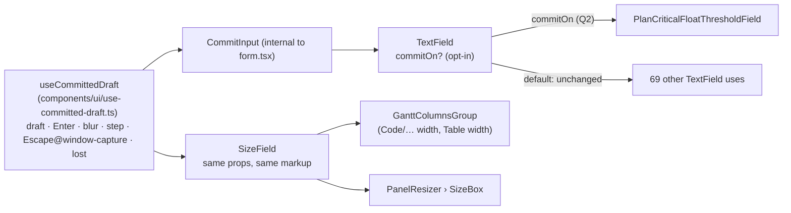
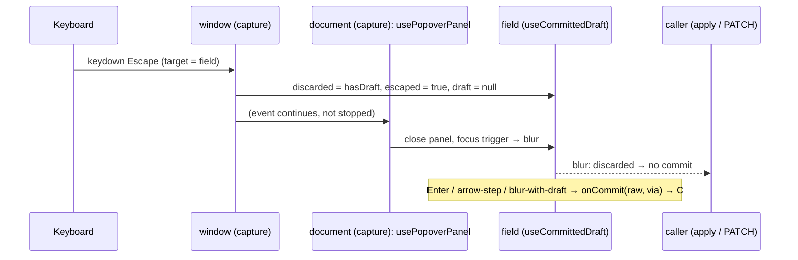
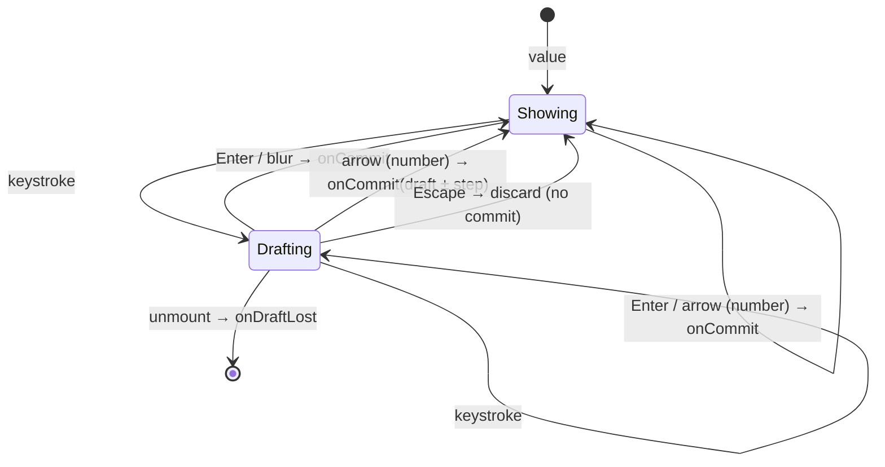

# Feature Spec: One draft-and-commit behaviour for typed fields (`TextField` commit mode)

- **Status:** Approved — by the product owner, 2026-10-26, with every default (Q1 share the behaviour, Q2 yes, Q3 a DECISIONS entry and an ADR-0188 amendment line)
- **Author(s):** feature-analyst (for the product owner)
- **Date:** 2026-10-26
- **Tracking issue / epic:** `docs/TECH_DEBT.md` #495
- **Roadmap link:** none (debt row; ADR-0105 trigger: a shared component's public contract changes)
- **Related ADR(s):** ADR-0173, ADR-0188 (D2), ADR-0083, ADR-0111, ADR-0105, ADR-0088 D1

## 1. Business understanding

### Problem

Two typed-input implementations in `apps/web/src/components/ui/` can drift apart:

- **`SizeField`** (`size-field.tsx:48-186`) keeps a draft between typing and committing
  (`useState<string | null>`, line 82), applies on **Enter** (line 169), **blur** (line 165) or an
  **arrow step** (lines 172-178), discards on **Escape** heard on `window` in the capture phase
  (lines 117-129), and announces a draft lost to unmount (lines 102-109).
- **`TextField`** (`form.tsx:79-131`) is a labelled `<Input>` that passes every prop through. It has
  no draft, no Escape handling and no applying step.

The row's own words (TECH_DEBT #495, line 9220): changing `TextField`'s contract was out of scope
when `SizeField` was extracted, and `SizeField` is not a pure extraction because Escape moved to a
`window` capture listener. A future fix to the commit behaviour has to be made twice, or is made once.

**This has already happened once, which is a new finding.** `PlanCriticalFloatThresholdField`
(`features/plans/components/PlanCriticalFloatThresholdField.tsx:66-139`) hand-rolls the same pattern
on top of `TextField`: a `useState<string | null>` draft (line 66), commit on blur (line 132) and on
Enter (lines 133-138). It has **no Escape discard**. It sits inside the **Schedule settings**
`Dialog` (`components/layout/workspace/plan-chrome-dialogs.tsx:126-151`, shown by default because
`FLOAT_CRITICAL_SETTINGS_ENABLED` is `flagDefaultOn`, `config/env.ts:207`). Whether Escape there
saves the typed threshold today depends on whether closing the native `<dialog>` blurs the field
before it unmounts. **That was not established by reading.** Milestone 2's first step measures it
red-first in a real browser.

**Brief correction (CLAUDE.md §19.11, "the brief is not evidence").** The brief and the row say
"ADR-0173 chose the separate field". ADR-0173's text never mentions `TextField`
(`grep TextField docs/adr/0173-*.md` finds nothing). The choice is recorded in `SizeField`'s
docblock (`size-field.tsx:35-37`) and in ADR-0188 D2 and its Consequences
(`docs/adr/0188-*.md:53-59, 120-123`). Nothing in the design depends on which ADR it was.

### Users

Every role that types into one of these fields. Today that means:

- **Any signed-in member** for `SizeField`. Divider and column widths are device preferences
  (ADR-0173 D1), not plan writes, so no role or pen gate applies.
- **Org Admin / Planner** for the threshold field. A Viewer, a Contributor without write, or an
  External Guest sees a `<dl>` instead (`PlanCriticalFloatThresholdField.tsx:106-113`).

### Primary use cases

1. A planner types a width, a size or a threshold and presses Enter or leaves the field. The value
   applies once and is never applied keystroke by keystroke.
2. A planner changes their mind and presses Escape. The draft is thrown away, even when the same
   Escape also closes the container.
3. A keyboard user steps a numeric size with ArrowUp/ArrowDown, and each step applies.

### User journeys

None of these change. That is the point: the same keys, the same results, in one implementation.
See §4 "User flow".

### Expected outcomes

- One implementation of the draft/commit keyboard contract, so a fix lands once.
- `TextField` can host that contract on request (`commitOn`) and is **unchanged for every existing
  caller** (70 `<TextField` occurrences across 35 files, `grep -c '<TextField\b' apps/web/src`).
- No visible change for `SizeField`. The one behaviour change is opt-in and named: if Q2 is
  answered yes, Escape in the threshold field discards the draft.

### Success criteria

- `size-field.test.tsx` (7 cases), `gantt-columns-group.test.tsx`, `panel-resizer.test.tsx` and
  `panel-resizer.structural.test.ts` pass **unedited**.
- `form.test.tsx` gains pins proving the default `TextField` renders and behaves exactly as now: per
  keystroke `onChange`, the caller's `onBlur`/`onKeyDown` reach the input, `register()`'s ref binds,
  and no `window` keydown listener is added.
- `e2e-gantt/column-widths.spec.ts`, `e2e-gantt/disclosure.spec.ts` and
  `e2e-workspace-fit/dividers.spec.ts` pass unedited.
- accessibility-reviewer and component-reviewer have executed the changed primitives before release
  (ADR-0111).

### Open questions

Critical questions are in the **Critical questions** section at the end of this spec. Defaults taken
without asking:

- The primitive carries **no user-facing copy** (COMPONENT_LIBRARY.md "Component API rules"). A lost
  draft is reported through a callback (`onDraftLost`), and `SizeField` keeps its own sentence.
- `commitOn` is fixed for the life of a field. Changing it remounts the input. No caller needs it to
  change.
- **No `VITE_*` flag** (ADR-0088 D1). The rollback is the commit boundary.

## 2. Functional requirements

### User stories & acceptance criteria

> **US-1**: As a planner typing a size, I want my draft held until I commit it, so that the first
> digit of `160` is not clamped to the 48 px minimum.
>
> - **Given** a commit-mode field showing `300` **when** I type `2`, then `250` **then** nothing
>   applies until Enter or blur, and then the value applies exactly once.
> - **Given** an untouched field **when** I press Enter **then** `onCommit` receives the shown value
>   (today's `SizeField` behaviour, `size-field.tsx:169-171`).

> **US-2**: As a planner, I want Escape to throw my draft away even when it also closes the box I am
> in.
>
> - **Given** a draft **and** a container that closes on Escape and moves focus in a `document`
>   capture listener **when** I press Escape **then** nothing commits, the field shows the committed
>   value, and the container still closes (the event is neither stopped nor prevented).
> - **Given** no draft **when** I press Escape and focus leaves **then** nothing commits.

> **US-3**: As a keyboard user on a numeric field, I want an arrow step to apply.
>
> - **Given** `type="number"` and a numeric `step` **when** I press ArrowUp **then**
>   `onCommit(String(from + step))` fires, where `from` is the typed draft if it is a usable number
>   and otherwise the committed value. ArrowDown subtracts.
> - **Given** a text-type commit field **then** the arrows are not handled. A text input does not own
>   the vertical arrows (`toolbar-keyboard.ts:80, 100`), so taking them would fight a host toolbar.

> **US-4**: As a reader of a shut field (ADR-0083), I want the field to stay read-only in commit
> mode.
>
> - **Given** a gated (`readOnly`) commit field **when** I press Enter or an arrow **then** nothing
>   commits. Today's `SizeField` has no gate, so this is new ground. Without the guard, the arrow
>   handler would apply a step to a read-only field, which breaks ADR-0083 D1.

> **US-5**: As a screen-reader user, I want to be told when a typed value was lost without being
> applied.
>
> - **Given** a draft that was not Escaped **when** the field unmounts (an outside press closed its
>   container) **then** `onDraftLost` is called once. `SizeField` passes its existing sentence
>   (`size-field.tsx:105`).

> **US-6**: As any existing `TextField` caller, I want nothing to change.
>
> - **Given** a `TextField` without `commitOn` **then** the rendered DOM, the props reaching
>   `<Input>`, the event handlers, ref forwarding and listener registration are identical to today.

### Workflows

The keyboard contract for `commitOn="enter-or-blur"`. Every row is lifted from `SizeField` today
unless it says **new**.

| Input                     | Behaviour                                                                                                                                                                                      | Source today                  |
| ------------------------- | ---------------------------------------------------------------------------------------------------------------------------------------------------------------------------------------------- | ----------------------------- |
| Keystroke                 | Updates the draft only. `onCommit` is not called. Clears the `discarded` and `escaped` marks.                                                                                                  | `size-field.tsx:159-163`      |
| Enter                     | `preventDefault()` (no form submit), then `onCommit(input.value, 'enter')`, whether or not there is a draft.                                                                                   | `:169-171`                    |
| Enter while IME composing | **New:** ignored. Number inputs do not compose, so `SizeField` cannot observe the difference.                                                                                                  | n/a                           |
| Blur                      | Commits only if a draft exists and was not discarded by Escape. Then clears `discarded`.                                                                                                       | `:164-167`                    |
| ArrowUp / ArrowDown       | Only when `type="number"` and `step` is a finite number: `preventDefault()`, then commit draft-or-value ± step.                                                                                | `:172-178`                    |
| Escape                    | Heard on **`window`, capture phase**, only when `event.target` is this input. Marks `discarded` if there is a draft, marks `escaped`, and clears the draft. **Not stopped and not prevented.** | `:117-129`                    |
| Unmount with a live draft | Calls `onDraftLost()` unless the draft was Escaped.                                                                                                                                            | `:102-109`                    |
| Shut (`readOnly` by gate) | **New:** Enter and the arrows do nothing. Escape and blur are already inert because no draft can exist.                                                                                        | n/a (`SizeField` has no gate) |

**Why Escape is on `window` capture.** Containers that close on Escape listen on `document` in the
capture phase and move focus straight away. They do this in `use-popover-panel.tsx:172`,
`menu.tsx:221`, `combobox.tsx:342` and `tooltip.tsx:397`. Moving focus blurs the field **before**
any React `onKeyDown` runs, so a `discarded` flag set from React arrives after the blur has already
committed. That is the defect ADR-0188 D2 found and fixed. Capture dispatch runs
`window` → `document` → … → target, so a `window` capture listener runs first whatever order the
listeners registered in. The regression test that proves it moves verbatim from
`size-field.test.tsx:102-118` into the hook's suite, and stays in `SizeField`'s suite too.

### Edge cases

- **Empty or non-numeric text on Enter.** The primitive passes the raw string through. Parsing,
  clamping and the "not changed" notice stay with the caller. `SizeField` keeps `limitedNotice`
  (`size-field.tsx:14-27`), and the threshold field keeps `parse` (`:153-162`).
- **Commit while a save is in flight.** That is the caller's concern. The threshold field gates
  itself with `gate={{ writable: !setOption.isPending }}` (line 125), so the shut-field rule (US-4)
  now also stops a second Enter during the save. Today a second Enter re-runs `commit()`, which
  re-parses and mutates again. That is a small, correct change, and it is named in the changeset if
  Q2 is yes.
- **Enter inside a `<form>`.** Commit mode prevents the default, so Enter commits and does not
  submit. That matches `SizeField` and the threshold field today (`:133-137`).
- **Several commit fields mounted together.** Each registers one `window` listener and filters on its
  own input. The Columns group mounts at most one per shown resizable column plus Table width. The
  cost per keydown is a comparison per field.
- **Host toolbar arrows.** A number input owns the vertical arrows (`OWNS_ALL_KEYS`,
  `toolbar-keyboard.ts:68-77`), so the step does not fight a toolbar. A text input does not, which is
  why US-3 restricts the step to `type="number"`.

### Permissions

No new permission. The fields write through their existing callbacks:

- device `localStorage` for widths (ADR-0173 D1);
- `useSetPlanScheduleOption` (a plan PATCH guarded server-side as today) for the threshold.

**Pen (ADR-0028):** no new write. The threshold PATCH is unchanged. **RBAC:** unchanged, and the
threshold field's `canEdit` branch is untouched.

### Validation rules

Unchanged and owned by callers. The primitive validates nothing.

### Error scenarios

| Scenario                                                 | Detection                 | User-facing result                             | Status |
| -------------------------------------------------------- | ------------------------- | ---------------------------------------------- | ------ |
| Escape pressed while a closing container blurs the field | `window` capture listener | draft discarded, container closes              | n/a    |
| Field unmounts holding a draft (outside press)           | unmount cleanup           | caller's polite announcement via `onDraftLost` | n/a    |
| Threshold save rejected                                  | existing `onError`        | unchanged: draft dropped, error announced      | 4xx    |

## 3. Technical analysis

| Area           | Impact | Notes                                                                                                                                                                                 |
| -------------- | ------ | ------------------------------------------------------------------------------------------------------------------------------------------------------------------------------------- |
| Frontend       | low    | New `components/ui/use-committed-draft.ts`. `TextField` gains an opt-in mode. `SizeField` is rebuilt on the hook with the same props and markup. Optionally one caller migrates (Q2). |
| Backend        | none   | —                                                                                                                                                                                     |
| Database       | none   | No schema change, so database-architect is not needed.                                                                                                                                |
| API            | none   | —                                                                                                                                                                                     |
| Security       | none   | No new input path. Values still go through the callers' parsers and the API's DTOs.                                                                                                   |
| Performance    | none   | One `window` listener per commit field, as `SizeField` has today.                                                                                                                     |
| Infrastructure | none   | No flag (ADR-0088 D1), no CI or Playwright config change.                                                                                                                             |
| Observability  | none   | —                                                                                                                                                                                     |
| Testing        | med    | Unit tests for the hook and both `TextField` modes. Existing suites act as the unchanged-behaviour oracle. One journey step if Q2 is yes. Pre-release reviews (ADR-0111).             |

**Recalc parity gate:** not touched. No scheduling input changes, and `computeSchedule` is not on
this path.

### Dependencies

None to land first. The hook is extracted from shipped code (`size-field.tsx`), so its tests are
written against observed behaviour rather than a new design.

## 4. Solution design

### Architecture overview



**Shape: one behaviour, two presentations (Q1).** `SizeField` lays out an inline row: a muted
`<label>`, a `w-24` input and a `px` suffix (`size-field.tsx:145-184`). `TextField` is a stacked
`Label` with hint, error and gate paragraphs (`form.tsx:97-129`). Making `SizeField` render through
`TextField` would mean adding a layout variant and a suffix slot to `TextField`, and swapping
`SizeField`'s label for `Label`, which is a visible change. The drift the row fears is in
**behaviour**, so the behaviour is what gets shared.

**The default path is literally untouched.** `TextField` chooses its control as
`commitOn ? <CommitInput …/> : <Input …/>`. `CommitInput` is a small internal component that calls
the hook and forwards a merged ref. Because the hook lives in a separate component, the default
branch calls no extra hook, registers no listener and renders the same JSX as today. A conditional
hook call would not do this, and would break the rules of hooks.

**Typed contract (discriminated union).** This makes commit mode impossible to half-configure, and
keeps it apart from `register()`, which is uncontrolled and per-keystroke:

```ts
type TextFieldProps = TextFieldBaseProps &
  (
    | { commitOn?: undefined } // today's contract, byte-identical
    | {
        commitOn: 'enter-or-blur';
        value: string; // the committed value shown when there is no draft
        onCommit: (raw: string, via: 'enter' | 'blur' | 'step') => void;
        onDraftLost?: () => void;
        onChange?: never; // a draft is internal; per-keystroke writes are the default mode's job
        defaultValue?: never;
      }
  );
```

The `gate` stays the last word on `readOnly` in both modes (`form.tsx:107-113`), and the hook reads
the resolved `shut` for US-4.

### Data flow



### User flow



### Database changes

None.

### API changes

None.

### Component changes

| File                                                            | Change                                                                                                                                                                                                                    |
| --------------------------------------------------------------- | ------------------------------------------------------------------------------------------------------------------------------------------------------------------------------------------------------------------------- |
| `components/ui/use-committed-draft.ts` (new)                    | The contract in §2 "Workflows". It takes `{ value, onCommit, step?, type?, shut?, onDraftLost?, inputRef }` and returns the input props.                                                                                  |
| `components/ui/use-committed-draft.test.tsx` (new)              | One test per row of the contract table, including the moved Escape-before-blur regression.                                                                                                                                |
| `components/ui/form.tsx`                                        | `TextFieldProps` becomes the union above. Adds internal `CommitInput`. The docblock states both modes and why `register()` cannot drive commit mode.                                                                      |
| `components/ui/size-field.tsx`                                  | Drops its private draft, ref and listener code (lines 81-129, 159-179) and calls the hook. Props, markup, `limitedNotice`, `useSizeNotice` and the lost-draft sentence are unchanged. The docblock at 35-37 is rewritten. |
| `features/plans/components/PlanCriticalFloatThresholdField.tsx` | **Only if Q2 is yes.** Uses `commitOn="enter-or-blur"`. Its own draft state and Enter handler go; `parse`/`announce` stay in `onCommit`.                                                                                  |

**SizeField callers** (`gantt-columns-group.tsx:69, 90`; `panel-resizer.tsx:317`) need **no edit**
under this design, because `SizeField`'s props do not change. The alternative of deleting
`SizeField` and calling `TextField` directly would copy `limitedNotice`, the `px` suffix and the
inline layout into three call sites. That is drift by another route, and this spec rejects it.

### Implementation approach & alternatives

**Chosen:** extract the shipped behaviour into one hook, put `SizeField` on it first (a pure
refactor with an unchanged oracle), then expose it through `TextField`'s opt-in `commitOn` with one
real consumer.

**Why `TextField` needs a consumer in the same change.** `form.tsx:148-163` records that a
`renderControl` escape hatch shipped with no consumer and no test, could not do its job, and was
removed the same day. A `commitOn` mode with no caller would repeat that. The threshold field is the
only existing `TextField` caller that already hand-rolls draft and commit, so it is the honest first
consumer (Q2). If Q2 is no, `TextField` is **not** changed in this epic. The hook still ends the
drift between `SizeField` and any future commit field, and the ADR-0105 trigger no longer applies.

**Alternatives:**

1. **Close #495 as "accepted, two fields".** Cost: none now. Trade-off: the Escape-before-blur fix
   stays private to `SizeField`, and the threshold field keeps a third copy of the pattern without
   it. The row's trigger ("a third typed **numeric** field, or a fix that has to be made in both")
   has not fired in the letter, because the threshold field accepts `5d` text. It has fired in
   substance. Reasonable if the owner prefers zero churn on a stable surface.
2. **`SizeField` renders through `TextField`** (one field rather than one behaviour). This adds
   `layout="inline"` and `suffix` to `TextField`'s contract and changes `SizeField`'s label styling.
   It is more contract for no behavioural gain (Q1).
3. **Put the Escape handler in React `onKeyDownCapture`.** Rejected. React's capture phase runs from
   the root container, which is **after** `document`/`window` native capture listeners, so the blur
   still wins. That is the defect ADR-0188 D2 fixed.

**ADR:** none new by default. This applies ADR-0188 D2's mechanism to a second primitive and does
not set new architecture. It is recorded in `docs/DECISIONS.md` with a dated amendment line under
ADR-0188 Consequences pointing at this spec (Q3).

### Critical questions

1. **Q1: Share the behaviour, or share the field?** **Default: the behaviour.** One hook, consumed
   by `TextField`'s commit mode and by `SizeField`, with `SizeField`'s props and markup unchanged.
   The alternative makes `SizeField` a `TextField` with new `layout` and `suffix` props, and changes
   its label's look.
2. **Q2: Does `PlanCriticalFloatThresholdField` adopt `commitOn` in this epic?** **Default: yes.**
   It is the only caller already hand-rolling the pattern, and a contract with no consumer is what
   `form.tsx:148-163` warns against. Its cost is the one intended behaviour change: Escape discards
   a typed threshold, and a second Enter during a save is inert. If the answer is no, `TextField` is
   left alone and only the hook ships.
3. **Q3: ADR or decision log?** **Default: a `docs/DECISIONS.md` entry plus a dated amendment line
   on ADR-0188**, because this extends an existing decision rather than making a new one. Say if you
   want a standalone ADR for "a typed field commits on Enter, blur or step, and Escape is heard on
   `window` capture".

## 5. Links

- Implementation plan: [`./implementation-plan.md`](./implementation-plan.md)
- Docs updated by this change: `docs/COMPONENT_LIBRARY.md` ("Primitives: `PanelResizer` and
  `SizeField`", line 772-775: "Use it for any typed pixel size rather than `TextField`" becomes the
  shared-hook rule, plus a `TextField` commit-mode entry); `docs/TECH_DEBT.md` #495 (closed with the
  commits); `docs/DECISIONS.md`; ADR-0188 amendment line.
