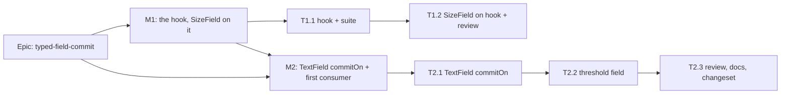

# Implementation Plan: One draft-and-commit behaviour for typed fields

- **Feature spec:** [feature-spec.md](./feature-spec.md)
- **Status:** Draft — awaiting product-owner approval
- **Owner:** web

## Breakdown

### Epic

**typed-field-commit** closes `docs/TECH_DEBT.md` #495 by giving the draft/commit keyboard contract
one implementation (design-system debt).

**Flag:** none (ADR-0088 D1). The rollback is the commit boundary, and each milestone is one or two
PRs.

### Milestone 1: The shared hook, and `SizeField` on it (no visible change)

**Outcome:** nothing a planner can see changes. The keyboard contract lives in one hook.
**Entry point:** the existing ones, unchanged: `View ▾` › Columns › "Code width" (and its siblings,
plus "Table width") in the Gantt; a press on any `PanelResizer` divider, which opens "Set <size>".
**Journey:** the existing `e2e-gantt/column-widths.spec.ts` (Enter at lines 95-116, ArrowUp at
170-174, Escape at 129/206), `e2e-gantt/disclosure.spec.ts:44-49` and
`e2e-workspace-fit/dividers.spec.ts` (Enter at 106-124, Escape-discards at 133-138) run
**unedited**. They are the oracle.

#### Feature: `useCommittedDraft`

> **Description:** Extract `SizeField`'s draft, commit, step, Escape and lost-draft logic into
> `components/ui/use-committed-draft.ts`. The spec §2 "Workflows" table is its contract.
> **Complexity:** S
> **Dependencies:** none
> **Risks:** A subtle ordering change (`draftRef` sync, `discarded` clearing) breaks Escape.
> Mitigation: the extraction is line-for-line, and `size-field.test.tsx` runs unedited as the oracle.
> **Testing requirements:** unit (hook suite plus the unchanged `SizeField` suite); the three
> journeys above.

##### Task 1.1: The hook and its suite (one PR with 1.2)

- **Description:** New hook. It takes `{ value: string; onCommit(raw, via); step?: number; type?:
string; shut?: boolean; onDraftLost?(); inputRef }` and returns `{ value, onChange, onBlur,
onKeyDown }` for the input.
- **Complexity:** S
- **Dependencies:** none
- **Risks:** The React Compiler rejects setState-in-effect. Mitigation: keep `SizeField`'s existing
  ref/effect shape, which already passes lint.
- **Testing:** `use-committed-draft.test.tsx`, with one `it` per contract row:
  - keystrokes do not commit;
  - Enter commits with or without a draft;
  - blur commits only with a draft;
  - the arrows step and apply for `type="number"` only;
  - text-type arrows are untouched;
  - Escape with a draft and a document-capture blurrer does not commit (moved from
    `size-field.test.tsx:102-118`);
  - Escape untouched does nothing;
  - unmount with a draft calls `onDraftLost`, and does not after an Escape;
  - **new:** shut means Enter and the arrows do not commit;
  - **new:** Enter while `isComposing` does not commit.
- **Development steps:**
  1. Write the suite against `SizeField`'s observed behaviour first.
  2. Move the logic from `size-field.tsx:81-129, 159-179` into the hook.
  3. Write a docblock that carries the window-capture reasoning (spec §2), so it lives in one place.

##### Task 1.2: `SizeField` on the hook, and the pre-release review

- **Description:** `SizeField` calls the hook. Its props, markup, `limitedNotice`, `useSizeNotice`
  and lost-draft sentence are unchanged. The docblock at `size-field.tsx:35-37` ("A field of its own
  rather than `TextField`…") is rewritten to say the behaviour is shared.
- **Complexity:** S
- **Dependencies:** Task 1.1
- **Risks:** None user-visible if the oracle suites pass. Mitigation: no suite edits are allowed in
  this PR. If one needs editing, stop: the refactor changed behaviour.
- **Testing:** `size-field.test.tsx`, `gantt-columns-group.test.tsx`, `panel-resizer.test.tsx` and
  `panel-resizer.structural.test.ts` all pass unedited. Run `pnpm prepush`, then
  `scripts/e2e-local.sh web:gantt web:workspace-fit`.
- **Development steps:**
  1. Swap the internals.
  2. Run the gates above.
  3. Run **accessibility-reviewer** and **component-reviewer** on the hook and `SizeField`, executing
     them (ADR-0111: a `*Field` keyboard contract, re-housed).
  4. Add a changeset: `@repo/web` patch, "internal: SizeField's commit behaviour moved to a shared
     hook; no behaviour change".

### Milestone 2: `TextField` commit mode, with its first consumer

**This milestone exists only if Q2 is yes.** If Q2 is no, skip to Task 2.3's docs and close #495 on
M1.

**Outcome:** In Schedule settings › Critical path & float, a planner who types a threshold and
presses Escape no longer has it saved (red-first, see Task 2.2). Enter and blur behave as today.
**Entry point:** the plan workspace's "Schedule settings" dialog
(`plan-chrome-dialogs.tsx:126-151`) › "Critical float threshold".
**Journey:** a new step in `apps/web/e2e/schedule.spec.ts`, which already opens "Schedule settings"
(lines 145-173). The step types a threshold, presses Escape, reopens the dialog, and asserts the
stored value is unchanged. Then it types, presses Enter, and asserts it saved.

#### Feature: `commitOn` on `TextField`

> **Description:** `TextFieldProps` becomes the discriminated union in spec §4. An internal
> `CommitInput` calls the hook. The default branch keeps the same JSX.
> **Complexity:** S
> **Dependencies:** Milestone 1
> **Risks:** A default-mode caller changes behaviour (70 uses, 35 files). Mitigation: the default
> branch renders the existing `<Input>` expression unedited, `form.test.tsx` pins it (below), and the
> base, activity-editor and auth journeys exercise it.
> **Testing requirements:** unit (`form.test.tsx`); type-level `@ts-expect-error` cases; e2e as
> below.

##### Task 2.1: `TextField` gains `commitOn`

- **Description:**
  - Add the union type and `CommitInput`, with a merged ref so a host can still focus the field.
  - Pass the resolved `shut` to the hook.
  - The docblock states both modes and why `register()` cannot drive commit mode.
- **Complexity:** S
- **Dependencies:** M1
- **Risks:** `exactOptionalPropertyTypes`-style friction on the union. Mitigation: model it on the
  existing `GatedFieldProps` pattern in `form.tsx:35-45`.
- **Testing:** `form.test.tsx` adds:
  - **default mode** (US-6):
    - `onChange` fires per keystroke;
    - the caller's `onBlur` and `onKeyDown` reach the input;
    - a `register()`-style ref binds the `<input>`;
    - `window.addEventListener` is never called with `keydown`;
    - the gate still forces `readOnly` after the caller's props;
  - **commit mode:**
    - label and description wiring are unchanged;
    - Enter, blur and Escape follow the contract;
    - a gated commit field does not commit on Enter.
  - **Type-level:** commit mode without `onCommit`, and commit mode with `onChange`, are both
    errors.
- **Development steps:**
  1. Write the type and the tests.
  2. Implement.
  3. Run `pnpm prepush`.

##### Task 2.2: The threshold field adopts it

- **Description:** `PlanCriticalFloatThresholdField` uses `commitOn="enter-or-blur"`, `value={text}`
  and `onCommit={commit}`. Its own `draft` state becomes the hook's, and its Enter handler goes.
  `parse`, `announce`, the gate and the error branch stay.
- **Complexity:** S
- **Dependencies:** Task 2.1
- **Risks:**
  - The "a late calendar must not overwrite what was typed" guarantee (test at `.test.tsx:186`)
    depends on draft-wins-over-display. The hook keeps it: `value` is only shown when there is no
    draft. Mitigation: that test runs unedited.
  - The threshold field clears its draft on `onSuccess`/`onError` (lines 93, 99). The hook clears it
    at commit, so the text shown during a save becomes the committed `value` rather than the draft.
    It reads the same unless the spelling differs (`120m` against `2h`). **Check this and record
    what it shows.**
- **Testing:**
  1. **Red first, in a browser:** add the `schedule.spec.ts` Escape step and run it against `main`.
     Record whether Escape saves today; this settles the spec's open "not established" claim.
  2. Make the change, then confirm the step and all 13 existing cases in
     `PlanCriticalFloatThresholdField.test.tsx` pass.
  3. Add a unit case: Escape discards.
- **Development steps:**
  1. Write the red-first step.
  2. Migrate the field.
  3. Run `pnpm prepush`, then `scripts/e2e-local.sh web web:activity-editor` (the base suite
     carries `schedule.spec.ts` and the auth forms, and activity-editor exercises the densest
     `TextField` callers).

##### Task 2.3: Review, docs, changeset

- **Description:** Run the pre-release review and bring the docs into step.
- **Complexity:** S
- **Dependencies:** Task 2.2
- **Risks:** A reviewer finds a browser-only focus defect, as with ADR-0111's #189/#192. Mitigation:
  that is the point of reviewing before release, and the fix lands in the same PR.
- **Testing:** the reviewers' executed findings. All gates above re-run green.
- **Development steps:**
  1. Run **accessibility-reviewer** and **component-reviewer** on `TextField` in both modes and on
     the threshold field, executing them in a browser (ADR-0111).
  2. Update `docs/COMPONENT_LIBRARY.md`:
     - lines 772-775: `SizeField` "rather than `TextField`" becomes "built on
       `useCommittedDraft`";
     - add a `TextField` `commitOn` entry with the contract table.
  3. Close `docs/TECH_DEBT.md` #495, citing the commits.
  4. Add a `docs/DECISIONS.md` entry and a dated amendment line under ADR-0188 Consequences (or a
     new ADR, if Q3 asks for one, with its one line in CLAUDE.md §16).
  5. Add a changeset: `@repo/web` **patch**, "Schedule settings: Escape in Critical float threshold
     now discards a typed value instead of saving it".

## Sequencing & slices

| Step | What ships                   | State of `main`                                                                                |
| ---- | ---------------------------- | ---------------------------------------------------------------------------------------------- |
| 1    | **M1** (T1.1 + T1.2), one PR | Releasable: a pure refactor with unedited oracles.                                             |
| 2    | **M2** (T2.1–T2.3), one PR   | `TextField`'s mode never lands without its consumer and its journey step (`form.tsx:148-163`). |

If Q2 is no, the epic is M1 plus the docs half of T2.3.

**Version impact:** `@repo/web` patch for each PR. No API, schema or type-package change, so
`@repo/types` and `@repo/api` are not bumped.

## Definition of Done (per task)

Each task meets the Feature Completion Criteria in [`docs/PROCESS.md`](../../PROCESS.md), with these
specifics:

- `pnpm prepush` has been **run**, plus the `scripts/e2e-local.sh` targets named in each task.
- ADR-0111 reviews are done before merge, because a merged changeset auto-releases to the owner's
  host (ADR-0047).
- CI is read per CLAUDE.md §19.9.

Nothing here needs the owner to test on a device. Every behaviour is driven in Playwright or jsdom.

## Risks & assumptions (rollup)

| Risk / assumption                                                  | Likelihood | Impact | Mitigation                                                                                                                                     |
| ------------------------------------------------------------------ | ---------- | ------ | ---------------------------------------------------------------------------------------------------------------------------------------------- |
| Refactor alters `SizeField` timing (Escape vs blur)                | low        | med    | Line-for-line move. The verified-red regression case runs in both suites. Three journeys run unedited.                                         |
| A default-mode `TextField` caller changes                          | low        | high   | The default branch renders the existing `<Input>` unedited and calls no new hook. Explicit pins, plus base, activity-editor and auth journeys. |
| Threshold field: shown text during a save differs (`2h` vs `120m`) | med        | low    | Check in T2.2 and record. Accept if it only canonicalises earlier.                                                                             |
| Escape's current effect in the threshold dialog is unknown         | —          | —      | T2.2 measures it red-first. If Escape already discards there, the changeset says "no behaviour change" and the step stays as a pin.            |
| A jsdom-only proof misses a real-browser focus order               | med        | med    | ADR-0111 reviewers execute the component, and the journeys run in Chromium.                                                                    |
| `commitOn` lands with no consumer if Q2 is no                      | —          | —      | M2 is then not built. The plan forbids shipping the mode alone.                                                                                |
