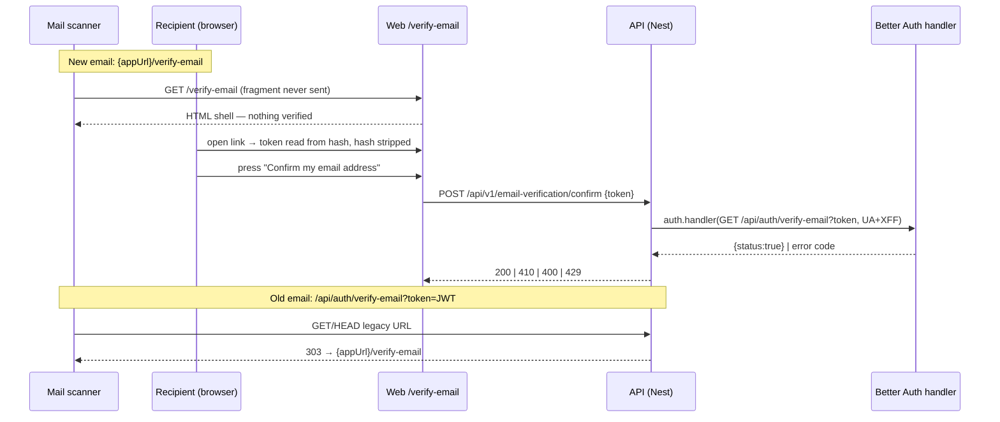

# Feature Spec: The verification link confirms on a press, not on a fetch

- **Status:** Approved — by the product owner, 2026-10-20, with both defaults (Q1: no sign-in on Confirm)
- **Author(s):** feature-analyst
- **Date:** 2026-10-20
- **Tracking:** `docs/TECH_DEBT.md` #88 (verification half only)
- **Related ADR(s):** ADR-0074 (verification, the reset page+POST shape), ADR-0072/0073 (audit),
  ADR-0077 (public screens), ADR-0081 (entry point + journey), ADR-0088 D1 (no flag), ADR-0132.

**Out of scope, by brief and by evidence:** the invitation link (already needs a press,
`AcceptInvitationCard.tsx:243-256`, #88's 2026-08-08 note) and the password-reset link (its
redirect does not consume the token, #88 "Extended 2026-08-05").

## 1. Problem (re-verified 2026-10-20 at `4275e0d`)

- The emailed URL is composed by Better Auth, not by us: the send seam receives `url` and passes it
  through (`apps/api/src/common/auth/better-auth.ts:258-259`). Better Auth builds it as
  `${baseURL}/verify-email?token=…&callbackURL=…` (claim **C1**), and `/verify-email` is a **GET**
  endpoint that verifies on arrival (**C2**). The web screen confirms it: "The emailed link points at
  Better Auth's own `GET /verify-email` handler, which verifies the token server-side and then
  redirects here" (`apps/web/src/routes/verify-email.tsx:13-16`).
- So any client that GETs the link verifies the address. #88's production log shows Safe Links
  prefetching with `HEAD` (404, harmless by luck, `docs/TECH_DEBT.md:1340-1347`); a `GET`-prefetching
  scanner would verify on the recipient's behalf.
- Armed by `AUTH_REQUIRE_EMAIL_VERIFICATION`, whose live value is the `/staff` health badge
  (`docs/TECH_DEBT.md:1390-1394`), not anything in the repository.

**Users:** anyone signing up (no org role yet — this precedes membership). **Outcome:** only a person
pressing a button on our page verifies an address; a fetch of any emailed link, old or new, does not.

## 2. Functional requirements

**Story.** As a new user, I open the link in my email, see a page, press **Confirm**, and am told
my address is confirmed — and a mail scanner that opened the same link first changed nothing.

### 2.1 States and copy (route `/verify-email`, new `#token=` arrival)

The page never decodes the JWT. Expiry, validity and "already verified" are known only from the
press's answer (decoding client-side would duplicate Better Auth's rules and read a credential we
should not reason about — the same stance as `reset-password.tsx:49-52`).

| State                                | Heading                        | Body / controls                                                                                                                                                                                                                                                                   |
| ------------------------------------ | ------------------------------ | --------------------------------------------------------------------------------------------------------------------------------------------------------------------------------------------------------------------------------------------------------------------------------- |
| Arrived with token, before press     | **Confirm your email address** | "Press the button to finish setting up your SchedulePoint account." Button **Confirm my email address**. Nothing happens on load.                                                                                                                                                 |
| …and signed in (any account)         | same                           | Adds: "You're signed in as {session email}. Confirming this link won't change who is signed in." (We cannot know the link's address without decoding; the sentence is true whoever it belongs to.)                                                                                |
| Pressing                             | same                           | Button label **Confirming…**, pending treatment as `ResetPasswordForm`'s submit.                                                                                                                                                                                                  |
| Success (incl. already verified)     | **Email address confirmed**    | Alert (`purpose="event"`, `tone="success"`, focused): "Your email address is confirmed. You can sign in now." Link button **Sign in** (signed out) / **Continue** to `/` (signed in).                                                                                             |
| (a) Expired (`410`)                  | **That link has expired**      | "Confirmation links work for an hour. Send yourself a new one — it replaces any earlier link." `ResendVerificationButton` + "Already confirmed? Sign in".                                                                                                                         |
| (b) Already used / already verified  | —                              | **Indistinguishable from success, by the library**: the token is a stateless JWT and a verified address takes the success branch (**C4**, already registered as `email-verification.mjs:285-286`). The success copy ("is confirmed") is true in both cases, so no separate state. |
| (c) Signed in as a different account | —                              | Verifies the **token's** address; the session is untouched because `autoSignInAfterVerification` is not configured (grep: no match in `apps/api/src`; **C5**; observed in `apps/web/e2e-staff/staff.spec.ts:494-497`). Copy is the "signed in" row above, then success.           |
| (d) Malformed token (`400`)          | **That link did not work**     | Existing copy, reused verbatim (`verify-email.tsx:88`) + resend + sign-in link.                                                                                                                                                                                                   |
| (d) No token at all                  | **Verify your email**          | Existing waiting state (`verify-email.tsx:83-99`) — a bookmark or reload after the token was stripped.                                                                                                                                                                            |
| Network / 5xx                        | unchanged                      | Alert (`event`, `danger`): "We couldn't confirm your address just now. Try again in a moment." Button stays.                                                                                                                                                                      |
| `429`                                | unchanged                      | Alert: "Too many attempts. Wait a minute, then try again." Button stays.                                                                                                                                                                                                          |

Unknown user (deleted account, **C3** `USER_NOT_FOUND`) maps to (d) — the distinction is not
actionable and the server should not narrate account existence.

### 2.2 Permissions & validation

- `POST` is `@Public()`: the person verifying usually has no session (`sign-up.mjs` withholds one
  under enforcement, `use-session.ts:238-240`). The token is the authority, as on the reset POST.
- Body DTO: `token` — string, non-empty, `MaxLength(2048)`; anything else `400` via the standard
  validation envelope. No pen, no org scope (pre-membership), no roles beyond "anyone with the token".

## 3. Technical analysis

- **Better Auth has no POST variant** (**C2**: `createAuthEndpoint("/verify-email", { method: "GET" })`).
  So the API needs its own POST, which must reuse Better Auth's verifier rather than re-implement JWT
  checks.
- **How the POST invokes it.** Recommended: call the instance's public `auth.handler(request)` with a
  synthetic `GET {baseURL}/api/auth/verify-email?token=…` **carrying the original request's
  `user-agent` and `x-forwarded-for`** (**C6**). Two reasons over `auth.api.verifyEmail({ query })`:
  `afterEmailVerification(user, ctx.request)` is our audit seam (`better-auth.ts:266-270`) and
  `requestEvidence` reads `request?.headers` — a server-side `auth.api` call has no `ctx.request`, so
  the `auth.email_verified` row would lose its IP and user agent (**C5**); and Better Auth's own rate
  limiter keys on those headers. No `callbackURL` is sent, so errors come back as an API error with
  the code (**C3**) instead of a redirect — which is what we map.
- **Mapping:** `200 {status:true}` → `200 { data: { verified: true } }`; `TOKEN_EXPIRED` → `410`
  `VERIFICATION_LINK_EXPIRED`; `INVALID_TOKEN` / `USER_NOT_FOUND` → `400` `VERIFICATION_LINK_INVALID`;
  `429` passes through; anything else → `500`, logged with context.
- **The internal call bypasses Express**, so the legacy-route shadow (§4.2) does not block it.
- **Expiry is 1 hour** (default `expiresIn = 3600`, registered `email-verification.mjs:13-19`; no
  `emailVerification.expiresIn` configured). The copy says "an hour" on that basis.
- **Recalc parity / pen / multi-tenancy:** not touched — no scheduling input, no plan write, no org data.
- **Mount point:** `app-setup.ts:103-106` registers Better Auth with `.all(/^\/api\/auth(?:\/|$)/, …)`;
  a `.get('/api/auth/verify-email', …)` registered on the same Express instance **before** it wins
  (Express routes match in registration order). `.get` also answers `HEAD`.

## 4. Solution design

### 4.1 New emails stop pointing at Better Auth's route

The send seam composes our own URL from the `token` Better Auth passes alongside `url` (**C1**):
`${appUrl}/verify-email#token=${encodeURIComponent(token)}`. `createAuth` gains a `verifyPageUrl`
option (factory stays a pure function of its options, `better-auth.ts:50-53`), wired from
`config.appUrl` (`app-config.service.ts:127-129`, the same origin invitations use,
`invitations.service.ts:117`). **Fragment, not query** — the `share` link's precedent
(`share.service.ts:113`, `routes/share.tsx:22`): a fragment is never sent to the server, so neither
nginx nor the API logs it, and browsers never put it in a `Referer`. The page still strips it on
arrival (`history` replace, as `reset-password.tsx:44-47`) so it does not persist in history.

### 4.2 The old GET route is shadowed, not left acting — recommendation

Emails already in inboxes carry the old shape for up to an hour, and a scanner may hit them, so
leaving Better Auth's GET live keeps the hazard for exactly the people mid-sign-up at deploy.
**Recommended:** a small handler on `GET /api/auth/verify-email` (before the Better Auth mount)
that never verifies and answers `303` to `${appUrl}/verify-email#token=<token>` (or
`/verify-email?error=INVALID_TOKEN` when the token is missing), with `Cache-Control: no-store` and
`Referrer-Policy: no-referrer`. The old link then lands on the same Confirm page. The token was
already in that request line, so the redirect adds no exposure the old link did not have; moving
it into a fragment means the onward hop does not repeat it. Rejected: (i) leave it live — keeps
the defect; (ii) answer `410` — strands every in-flight email; (iii) a Better Auth `hooks.before`
short-circuit — depends on unregistered hook semantics for a GET the library owns, where our own
route is a plain Express fact.

### 4.3 Components & changes

- **API:** `EmailVerificationController` + service in `common/auth/` (thin controller, `@Public()`,
  `@Throttle({ default: { ttl: 60_000, limit: 10 } })`, OpenAPI documented); legacy-GET handler in
  `app-setup.ts`; send seam URL in `better-auth.ts`/`auth.module.ts`. No schema change.
- **Web:** `/verify-email` gains the token arrival (`VerifyEmailScreen` + a `useConfirmEmail`
  mutation in `features/auth/api`); `validateSearch` unchanged (the token is in the hash, not
  search). The `?verified=1` branch stays for bookmarks. `VERIFIED_CALLBACK_URL`
  (`use-session.ts:220`) stops having an effect on the emailed link; removed in M2 with its docblock.
- **Public screens (ADR-0077):** inside `AuthShell`, no new tokens or one-off styles.
- **Accessibility:** heading is the page's `h1` from `AuthShell`; the result is announced by moving
  focus to the outcome `Alert` with `useOutcomeFocus` (as `reset-password.tsx:35,82`), not by an
  extra live region. The Confirm button is never shaded for a reason, so ADR-0082/0083 do not bite;
  while pending it keeps the existing submit-pending behaviour. Errors keep focus on the alert and
  the button remains reachable to retry.
- **Sign-in after verification:** unchanged — no session is issued (see §6 Q1).

### 4.4 Security, audit, rate limits

- Audit: `auth.email_verified` still fires once, from the same seam, now **only on a press** — which
  makes the row mean what it says (a human confirmed). Evidence preserved by forwarding UA/XFF (§3).
  No new audit event for refused links (not in ADR-0073's set; an expired link is not an attack).
- Rate limiting: Nest throttle on the POST (10/min/IP) plus Better Auth's production limiter on the
  inner call (`better-auth.ts:279-283`). The JWT is HS256-signed, so the limit bounds cost, not guessing.
- CSRF: the POST is unauthenticated and changes nothing without a valid token, so a forged
  cross-site POST needs the token it would be stealing; CORS allow-list applies as everywhere.
- Residual risk, stated: a sandbox that renders the page **and clicks buttons** defeats any
  interstitial. Nothing auto-submits on load, which is the property this spec can promise.

### 4.5 ADR-0105 triggers and ADR

Triggers hit: the emailed link's **user-facing entry point** changes and a **Playwright suite**
changes — so this spec is mandatory (that is why it exists). No schema change (no database-architect
run). **No ADR proposed:** page + POST is ADR-0074's own reset shape, and shadowing one library
route is contained to one handler with no new cross-cutting pattern. Record the shadow route in
`docs/DECISIONS.md` and note it in ADR-0074's verification section. Owner may ask for an ADR instead.

### 4.6 Dependency claims to register (`scripts/dependency-claims.json`)

Read from the published `better-auth@1.7.10` (`dist/api/routes/email-verification.mjs` via unpkg);
M0 re-read them against the installed package and registered the corrected ranges.

| Id  | Claim                                                                                                                                                          | Approx. lines              |
| --- | -------------------------------------------------------------------------------------------------------------------------------------------------------------- | -------------------------- |
| C1  | `sendVerificationEmail({ user, url, token }, ctx.request)`; ``url = `${baseURL}/verify-email?token=${token}&callbackURL=${callbackURL}` ``                     | 31-36 (re-read in M0)      |
| C2  | `createAuthEndpoint("/verify-email", { method: "GET", … })` — no POST variant                                                                                  | 126-127 (M0)               |
| C3  | `JWTExpired` → `TOKEN_EXPIRED`, else `INVALID_TOKEN`; no user → `USER_NOT_FOUND`; without `callbackURL` errors throw `APIError` (`UNAUTHORIZED`) with the code | 173-182, 189 (M0)          |
| C4  | already verified → success (registered as `email-verification.mjs:285-286` → `287-288`)                                                                        | 287-288                    |
| C5  | `afterEmailVerification(updatedUser, ctx.request)`; session created only under `autoSignInAfterVerification`                                                   | 294-298 (M0)               |
| C6  | `betterAuth()` returns a `handler(request: Request) => Promise<Response>`                                                                                      | `auth/base.mjs:29-51` (M0) |

## 5. Testing

- **API Supertest** — new `apps/api/test/email-verification-confirm.e2e-spec.ts`, shaped like
  `password-reset.e2e-spec.ts:38-53` (capturing `MailService`): emailed URL is
  `{appUrl}/verify-email#token=…`; **`GET` and `HEAD` of the legacy URL return 303 and leave
  `emailVerified=false`** (the scanner case); POST with the token → 200, `emailVerified=true`, one
  `auth.email_verified` row with the forwarded user agent; second POST → 200; expired (`vi`
  fake `Date` +2 h) → 410 `VERIFICATION_LINK_EXPIRED`; garbage → 400; empty body → 400 envelope.
- **Playwright** — `apps/web/e2e-account/verification.spec.ts` under
  `playwright.account-verify.config.ts` (API with `AUTH_REQUIRE_EMAIL_VERIFICATION=true`, SMTP sink;
  no `VITE_` flag involved). New test: `request.get` of the emailed URL **and** of the legacy shape,
  then sign-in still says "Confirm your email address first"; open the link, press Confirm, see
  "Email address confirmed", sign in succeeds; axe clean on both states. Malformed: `#token=garbage`
  → press → "That link did not work". Expired stays at the API tier (a browser cannot age a JWT
  without a server clock hook). The two existing tests (`:88-90`, `:118-120`, `:154-156`) gain the
  press; their `sink.waitFor(…, /\/verify-email\?/)` regexes become `/\/verify-email#/`.
- **Other followers of the link** that must press: `e2e-staff/staff.spec.ts:488-492`,
  `apps/web/scripts/shoot.mjs:159`. `e2e-public/support.ts:80-90` gains the pre-press state.
- **Unit:** `verify-email.test.tsx` for every §2.1 row; `smtp-mail.service.spec.ts` URL shape;
  `better-auth.spec.ts` for the seam composing from `token`.
- Pre-push: `pnpm prepush`, `scripts/e2e-local.sh api`, `scripts/e2e-local.sh web:account-verify`.

## 6. Questions for the owner

1. **Should pressing Confirm also sign the person in?** Default **no** (unchanged). Turning on
   `autoSignInAfterVerification` makes the emailed link a sign-in credential for whoever holds it —
   a forwarded or shared mailbox would sign that reader in. The success page's **Sign in** button
   costs one password entry.

Defaults taken without asking: fragment-borne token; legacy GET redirected (303) to the page; no
address shown on the page (would need a server-side token preview); no flag (ADR-0088 D1); no ADR;
throttle 10/min/IP; changeset **minor** for `@repo/api` and `@repo/web` (user-visible, pre-1.0).

---

# Implementation plan (Epic: #88 verification interstitial)

Each milestone keeps `main` releasable; nothing links to the new page until M2.

**M0 — Verify and register claims** (S). Install deps, re-read C1–C6 in
`node_modules/better-auth`, correct line numbers here, add entries to
`scripts/dependency-claims.json`, `pnpm check:claims`. Confirm the synthetic-`Request` call reaches
`afterEmailVerification` with headers (spike test, deleted after). Risk: C6 differs → fall back to
`auth.api.verifyEmail({ query, headers, asResponse: true })` and re-assess audit evidence.

**M1 — Additive API + page state** (M; deps M0). Inert: no email points at it yet.

- T1 API: DTO, `EmailVerificationController`/service, error mapping, throttle, OpenAPI, `docs/API.md`.
  Tests: Supertest POST cases.
- T2 Web: `useConfirmEmail`; `VerifyEmailScreen` token arrival (capture from hash, strip, Confirm,
  outcomes, focus); unit tests for every §2.1 row; `public-screens` landmark/reflow entry.
- Review: api-reviewer, security-reviewer; component + accessibility + ux reviewers.

**M2 — Switch the link and shadow the old route** (M; deps M1). The entry point (ADR-0081).

- T1 Send seam composes `verifyPageUrl#token=…`; remove `VERIFIED_CALLBACK_URL` plumbing.
- T2 Legacy `GET /api/auth/verify-email` handler in `app-setup.ts` (303, `no-store`, `no-referrer`).
- T3 Supertest: emailed URL shape; GET/HEAD legacy leaves `emailVerified=false`; expired → 410.
- T4 Playwright: scanner test + updated existing tests; staff spec; `shoot.mjs`.
- T5 Docs: #88 row → resolved for verification (invite already safe, reset out of scope),
  `docs/DECISIONS.md` entry, ADR-0074 note, `verify-email.tsx` docblock; changeset (api + web minor).
- Risk: deploy order across images — api and web release together; if web lags, the new link lands
  on an older web build with no token handling. Mitigation: M1's web half ships first (it is inert).
- Review: security-reviewer, devops-reviewer (none needed unless compose changes), test-engineer.
