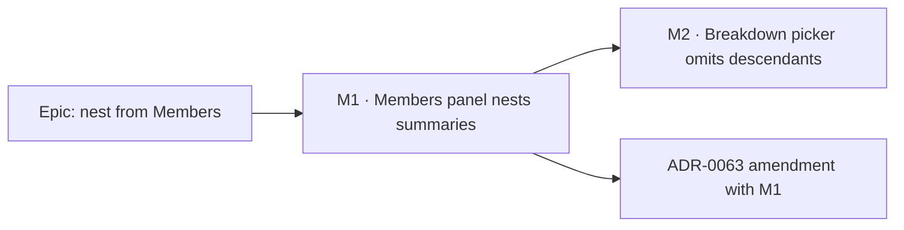

# Implementation Plan: Nest a WBS summary from the Members panel

- **Feature spec:** [`./spec.md`](./spec.md)
- **Status:** Approved — by the product owner, 2026-10-17, with the spec; M1 and M2 built on `work/wbs-nest-members`
- **Owner:** product owner (approver); builder agent (implementation)

## Breakdown

### Epic

**Nest a WBS summary from the Members panel** — the `docs/BACKLOG.md` WBS follow-on, with the cycle
feedback it asked for.

No schema change, no API change, **no `VITE_` flag** (ADR-0088 D1). Every task is built and proven
in a container: `pnpm prepush`, `scripts/e2e-local.sh api`, `scripts/e2e-local.sh web:wbs`.

---

### Milestone M1: the Members panel nests summaries, and explains the ones it cannot

**Outcome:** from a summary's Members panel a planner ticks other summaries to nest them; summaries
that contain this one are listed shaded with "Can't be filed here — “S” is already inside it."
**Entry point:** Plan workspace → select a WBS summary → **Edit** → **Members** tab (also the
activities-table row menu → **Members**).
**Journey:** `apps/web/e2e-wbs/wbs.spec.ts` — new step after the existing dissolve section (spec
§4.9): nest `Piling` under `Structure` from `Structure`'s panel, confirm via the API, then assert
`Structure` is shaded with its reason in `Piling`'s panel and Space does not tick it. Verified red
against the shipped panel.

#### Feature: the tree predicate

> **Description:** one pure module both pickers use to answer "may this go under that?".
> **Complexity:** S
> **Dependencies:** none
> **Risks:** drift from the server's walk → SC-2 property test with a resulting-tree oracle.
> **Testing requirements:** `wbs-tree.test.ts`, including the generated-forest property.

##### Task M1-T1 — `features/wbs/model/wbs-tree.ts`

- **Description:** `ancestorIds`, `subtreeSizes`, `wouldCloseLoop`, each `seen`-guarded and using the
  orphan rule `wbs-groups.ts` already uses.
- **Complexity:** S · **Dependencies:** none
- **Risks:** a second copy of `wbs-groups.ts`'s private `subtreeCount` → extract it here and have
  `wbsBandGroups` call it, behaviour unchanged (its tests stay green unedited).
- **Testing:** depth 0/1/3 ancestors, orphan, malformed cycle terminates, sizes, the SC-2 property.
- **Development steps:**
  1. Write the module and tests.
  2. Move `subtreeCount` here; `wbs-groups.ts` imports it.
  3. Verify the property red against a predicate that forgets one ancestor level.

#### Feature: the panel

> **Description:** summaries listed, ancestors shaded, subtree notes, two-count status, pen gate on
> the ADR-0083 mechanism, `PARENT_CYCLE` mapped.
> **Complexity:** M
> **Dependencies:** M1-T1
> **Risks:** spec R-1/R-2.
> **Testing requirements:** component suite + journey + accessibility review.

##### Task M1-T2 — list, shade, explain

- **Description:** widen `candidates` (`ActivityMembersPanel.tsx:104-113`) to summaries; render
  ancestor rows with the per-row reason on `CheckboxField`'s gate mechanism (`form.tsx:317-331`);
  "Moves with its N activities" on summary rows; status line with the unavailable count; rewrite the
  stale docblock at `:99-103`.
- **Complexity:** M · **Dependencies:** M1-T1
- **Risks:** row layout changes if rows move to `CheckboxField` → component-reviewer decides between
  rendering through it and adopting its two props (spec §4.4); the visual result is screenshot-checked.
- **Testing:** `ActivityMembersPanel.test.tsx` — every US-1/US-2 criterion; existing cases unedited.
- **Development steps:**
  1. Copy reviewed by ux-reviewer (spec §4.7).
  2. Implement; run the component suite.
  3. Update the `bulkParentChanges` docblock (spec §4.6) — no logic change.

##### Task M1-T3 — pen gate on one mechanism (spec CQ-3)

- **Description:** replace `disabled={!gate.writable}` with the ADR-0083 D1 shape; the pen reason is
  rendered once via `FieldGateProvider` (ADR-0083 D4) rather than only on the save bar.
- **Complexity:** S · **Dependencies:** M1-T2
- **Risks:** keyboard behaviour change for readers without the pen → journey asserts the rows are
  focusable and inert; accessibility-reviewer runs before release.
- **Testing:** component case — no pen, Tab reaches a row, Space does not toggle, reason linked.

##### Task M1-T4 — refusal sentence and refetch

- **Description:** on `ApiFetchError` 409 with `details.reason === 'PARENT_CYCLE'`, show the US-4
  sentence and invalidate the plan's activities query; other errors unchanged. Subtree-aware dirty
  sentence.
- **Complexity:** S · **Dependencies:** M1-T2
- **Testing:** component cases for the mapping, the refetch call, and both dirty-sentence forms.

##### Task M1-T5 — API contract pin

- **Description:** `apps/api/test/` case: `PATCH …/activities/parents` filing a summary under its own
  descendant → 409, `details.reason === 'PARENT_CYCLE'`, nothing written (read back). No product
  code change.
- **Complexity:** S · **Dependencies:** none
- **Testing:** `scripts/e2e-local.sh api`; verified red by temporarily skipping `assertNoParentCycles`
  in a local run.

##### Task M1-T6 — journey, ADR amendment, docs

- **Description:** the journey step; ADR-0063 Amendment section and its CLAUDE.md §16 line;
  `docs/BACKLOG.md` row marked done; `docs/DECISIONS.md` entry for the shade-vs-omit tree-picker
  rule; web changeset (minor — new capability).
- **Complexity:** S · **Dependencies:** M1-T2…T5
- **Testing:** `scripts/e2e-local.sh web:wbs`; `pnpm prepush` (adr-coverage, counts).

---

### Milestone M2: the Breakdown picker stops offering a summary's own contents (spec CQ-2)

**Outcome:** editing a summary, "Parent WBS summary" no longer offers summaries inside it, and says so.
**Entry point:** select a WBS summary → **Edit** → **General** → **Breakdown** → **Parent WBS summary**.
**Journey:** extend the same e2e-wbs step: open `Structure`'s editor (with `Piling` inside it) and
assert the parent picker has no `Piling` option and shows the hint clause.

##### Task M2-T1 — `parentOptions` via `wbs-tree.ts`

- **Description:** `ActivityEditorSession.tsx:372-374` excludes the edited activity's descendant
  summaries when it is a summary; `ActivityBreakdownField` appends the hint clause when any were
  excluded. `ActivityCreateDialog` is unchanged (a new activity has no descendants).
- **Complexity:** S · **Dependencies:** M1-T1
- **Risks:** a stored parent that is now a descendant (impossible in a valid tree) would hit the
  "Unavailable" honest option (`ActivityBreakdownField.tsx:79-81`) — that path already exists.
- **Testing:** `ActivityBreakdownField.test.tsx` + `ActivityEditorDialog.round-trips.test.tsx` cases;
  journey step above.
- **Development steps:** 1. implement; 2. tests; 3. web changeset (patch — defect fix).

## Sequencing & slices

M1-T1 → M1-T2 → M1-T3/T4 (parallel) → M1-T6; M1-T5 any time. M2 after M1-T1. `main` stays
releasable after every task: until M1-T2 lands the panel is unchanged; M2 is independent of the
panel.

## Definition of Done (per task)

Each task's PR satisfies the Feature Completion Criteria in [`docs/PROCESS.md`](../../PROCESS.md),
with `pnpm prepush` and the relevant `scripts/e2e-local.sh` targets **run**.

**Agents to involve:** ux-reviewer (copy, M1-T2); component-reviewer (row rendering choice, M1-T2);
accessibility-reviewer (shaded checkbox and pen-gate change in a real browser, M1-T2/T3 — CLAUDE.md
§19.13's lesson applies even though no primitive's contract changes); test-engineer (the property
test, M1-T1); api-reviewer (M1-T5 contract pin). No database-architect: no schema change.

## Risks & assumptions (rollup)

| Risk / assumption                                                            | Likelihood | Impact | Mitigation                                        |
| ---------------------------------------------------------------------------- | ---------- | ------ | ------------------------------------------------- |
| Planner moves more than intended by ticking a summary                        | med        | med    | subtree note on the row and in the dirty sentence |
| `aria-disabled` checkbox behaves differently in a real browser than in jsdom | med        | med    | journey + accessibility-reviewer execute it       |
| Client and server cycle rules drift                                          | low        | low    | property test with oracle; server authoritative   |
| Two surfaces (panel, table bulk assign) treat summaries differently          | high       | low    | stated as a choice (CQ-4); debt row if kept       |
| Undo into a changed tree                                                     | low        | low    | existing ADR-0176 set-aside                       |
