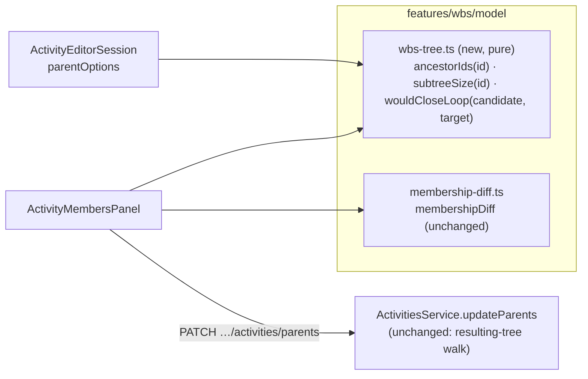
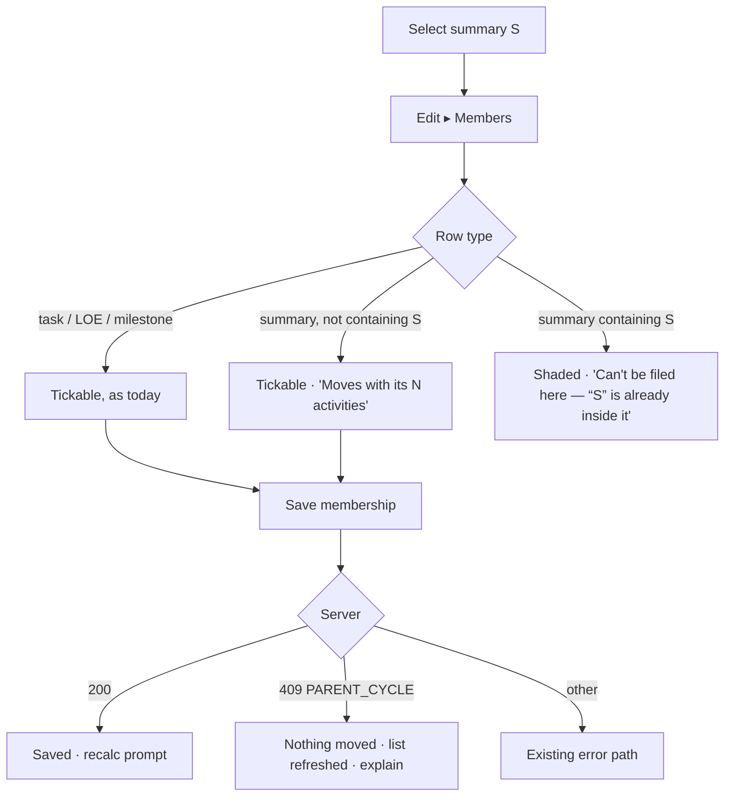

# Feature Spec: Nest a WBS summary from the Members panel

- **Status:** Approved — by the product owner, 2026-10-17, with the recommended defaults (CQ-1: ancestors shaded with a visible reason; CQ-2: fix the Breakdown picker as M2)
- **Author(s):** feature-analyst (for the product owner)
- **Date:** 2026-10-17
- **Tracking issue / epic:** `docs/BACKLOG.md` "WBS follow-ons (ADR-0063)" — _Nest a summary from the
  Members panel_
- **Roadmap link:** WBS follow-ons
- **Related ADR(s):** ADR-0021, ADR-0038 (a)/(d), ADR-0063 (spec C-1b), ADR-0082 §3, ADR-0083 D1/D4,
  ADR-0028 (pen), ADR-0176 (undo set-aside); **amends ADR-0063's C-1b default** (§4.8)

> **Scope in one sentence.** A summary's Members panel lists other summaries too, so a planner can
> build a nested breakdown from the parent; the summaries that would make the tree circular — the
> ones that already contain this summary — are shown, shaded, and say why.

---

> **Amendment 2026-10-17 (build review).** Three changes to the design as approved, none to behaviour:
>
> 1. **`CheckboxField`'s public contract widens.** `label` goes from `string` to `ReactNode` (additive:
>    every existing caller passes a string and renders identically). §4.4 left "render each row through
>    `CheckboxField` or adopt its two props" to the build; the build review chose the primitive, because
>    a second copy of the gate mechanism is how two checklists come to shade differently. A row's name,
>    code and notes are the label content, so the accessible name is unchanged. The hover-row chrome of
>    the first build is dropped rather than added to the primitive as a one-off.
> 2. **A refetch merges; it does not reset.** The mutation invalidates the plan's activities even when
>    the server refuses, so resetting to the server's membership would wipe the planner's ticks at the
>    moment US-4 tells them to "check it and save again". Their unsaved ticks and un-ticks are carried
>    onto the new membership, minus a row that is now an ancestor or has left the plan.
> 3. **Copy** (§4.7 and US-2/US-4): the reason reads "is already inside it", and the refusal is two
>    sentences; both use one verb for the move. `nestingRefusal` became the boolean `wouldCloseLoop`,
>    since nothing branched on its two reasons.
>
> The shaded state is not dimmed, by design of `CheckboxField`'s gate, and the lock sits at the row's far
> end; both are primitive-wide and are not changed here.

## 1. Business understanding

### Problem

The Members panel (`apps/web/src/features/wbs/components/ActivityMembersPanel.tsx`) files work under
a summary in one checklist and one save. It deliberately refuses to list summaries (`:99-107`), so
building `Structure ▸ Substructure ▸ Piling` means opening each child summary's own editor and
choosing its parent one at a time — the exact chore the panel was built to remove for ordinary work.

`docs/BACKLOG.md:326-329` records why it was left out: _"a checklist that can restructure the tree
needs cycle feedback a checklist cannot express well"_, and asks for a design for that feedback
"rather than … simply widening the list".

**The problem statement was re-verified, and it is narrower than the backlog row reads** (CLAUDE.md
§19.11):

| Claim                                                                                                                                                                               | Evidence                                                                                                                                                                                                                                       | Holds?                                                                                                                              |
| ----------------------------------------------------------------------------------------------------------------------------------------------------------------------------------- | ---------------------------------------------------------------------------------------------------------------------------------------------------------------------------------------------------------------------------------------------- | ----------------------------------------------------------------------------------------------------------------------------------- |
| Widening the list could corrupt the tree                                                                                                                                            | `ActivitiesService.updateParents` overlays the batch on the plan's current tree and walks the **result** under the plan advisory lock (`apps/api/src/modules/activities/activities.service.ts:1134-1166`, `assertNoParentCycles` `:1271-1286`) | **No.** The server already refuses any batch that would close a cycle: `409 PARENT_CYCLE`, "That would create a WBS cycle."         |
| The panel's own docblock: offering summaries "would make it possible to build the hierarchy two ways with only one of them checked for cycles" (`ActivityMembersPanel.tsx:100-103`) | Both paths are checked server-side: the single-row path by `assertValidParent` (`activities.service.ts:232-266`), the batch by the resulting-tree walk                                                                                         | **No — stale.** Neither path is unchecked; what is missing is **client** feedback on both                                           |
| The child-side picker gives cycle feedback                                                                                                                                          | `ActivityEditorSession.tsx:372-374` offers every summary except the one being edited — **including its own descendants**; `ActivityBreakdownField.tsx` has no cycle wording                                                                    | **No — new finding.** Editing summary S and choosing a summary inside S is offered, then refused by the server with the raw message |
| The web maps `PARENT_CYCLE` to anything                                                                                                                                             | No `PARENT_CYCLE` reference in `apps/web/src`; the panel prints `err.message` (`ActivityMembersPanel.tsx:143`); undo replay reads it as `changed` (`features/undo-redo/replay.ts:198-208`)                                                     | Confirmed — the server's sentence reaches the reader unmapped                                                                       |

So the real problem is a **feedback** problem, not an integrity one: the tree is safe today, and the
risk of widening the list is a planner ticking a row that will be refused — failing every other row
in an all-or-nothing batch — with a one-line message that does not say which row or why.

### Users

| Role                | Capability                                                                                       |
| ------------------- | ------------------------------------------------------------------------------------------------ |
| Planner, Org Admin  | Nest and un-nest summaries from the parent's Members panel (holds `activity:update` and the pen) |
| Contributor, Viewer | See the same list, every row shaded with the pen/role reason — reading membership is a read      |
| External Guest      | No editor; unaffected                                                                            |

### Primary use cases

1. From `Structure`'s Members panel, tick `Substructure` and `Superstructure`; save once; both
   summaries (with everything inside them) are now under `Structure`.
2. Un-tick a nested summary to lift it, with its contents, to the top level.
3. Open `Piling`'s Members panel and see `Structure` and `Substructure` listed but shaded with
   "Can't be filed here — Piling is already inside it", so the absence of a tick is explained rather than
   mysterious.

### User journeys

See §4.3. The panel is reached as today: select a summary → **Edit** → **Members** tab (or the row
menu's **Members**).

### Expected outcomes

- A breakdown several levels deep is built from the top, in as many saves as there are parents.
- A planner is never offered a tick the server will refuse; if the plan changed underneath them and
  the server refuses anyway, they are told which kind of change happened and nothing is half-written.

### Success criteria

- **SC-1** On a plan with `Structure ▸ Substructure ▸ Piling`, `Piling`'s panel lists `Structure` and
  `Substructure` shaded with a reason, and pressing Space or clicking on either changes nothing — in
  a real browser (jsdom cannot prove a cancelled `click` on a checkbox; ADR-0083 §3).
- **SC-2** No batch the panel sends from a fresh list is refused with `PARENT_CYCLE` — asserted by a
  pure-function property over every candidate in a generated tree.
- **SC-3** The panel's existing guarantees are unchanged: minimal diff, all-or-nothing, the checked
  set survives filtering (the e2e-wbs journey's existing assertions stay green unedited).

### Open questions

See §6.

## 2. Functional requirements

### User stories & acceptance criteria

> **US-1** — As a **Planner**, I want to file another summary under this one from the Members panel,
> so that I can build a nested breakdown from the parent.
>
> - **Given** summary S's Members panel **then** the list offers every plan activity except S itself,
>   **including** summaries.
> - **Given** a summary T that is not S and does not contain S **when** I tick it and save **then** T
>   is filed directly under S and **everything inside T moves with it** (a re-parent is one row,
>   ADR-0038).
> - **Given** a ticked summary T with a subtree of N activities **then** the row says "Moves with its
>   N activities" before I save, and the save bar's sentence counts them ("2 will move, with 14
>   activities inside them").
> - **Given** T is currently under another summary **then** the existing "in {parent}" note shows, as
>   it does for a task (`:215-223`).

> **US-2** — As a **Planner**, I want the summaries that would make the breakdown circular to be
> visible but refused, with a reason, so that I understand why I cannot tick them.
>
> - **Given** summary A contains S at any depth (A is an ancestor of S) **then** A's row is listed,
>   **shaded**, carries the visible reason "Can't be filed here — “{S}” is already inside it", and the
>   checkbox is `aria-disabled` with the reason linked by `aria-describedby`.
> - **Given** I click A's row, its label, or press Space on its checkbox **then** nothing changes
>   (ADR-0083 D1: `aria-disabled` + `preventDefault()` on `click`).
> - **Given** a search that matches A **then** A appears (shaded) — it is never hidden from a search,
>   so "No activity matches" is never false.
> - **Given** the result count **then** it reads "N activities · K can't be filed here · M in this
>   summary" when K > 0, and exactly today's sentence when K = 0 (the ADR-0082 amendment's "two
>   counts" rule).

> **US-3** — As a **Planner**, I want to lift a nested summary back to the top level by un-ticking it.
>
> - **Given** member summary T **when** I un-tick and save **then** T and its contents go to the top
>   level (existing un-tick semantics, `membership-diff.ts:56-58`).

> **US-4** — As a **Planner**, if the plan changed after I opened the list and the server refuses my
> save as a cycle, I want to be told what happened and see the corrected list.
>
> - **Given** the server answers `409 PARENT_CYCLE` **then** nothing has moved, the panel shows
>   "Nothing was moved. The breakdown changed while you were working, and a summary you ticked now
>   contains “{S}”. The list has been refreshed; check it and save again.", and the
>   activities query is refetched so the shading is recomputed.
> - **Given** any other error **then** the existing message path is unchanged.

> **US-5** — As a **Planner** editing a summary's own Breakdown, I want the parent picker not to
> offer the summaries inside it (CQ-2).
>
> - **Given** I edit summary S **then** "Parent WBS summary" omits S and every summary inside S, and
>   its hint gains "Summaries inside this one aren't listed — a summary can't be filed under its own
>   contents." (A native `<select>` option cannot carry a reason, so it is omitted — ADR-0083 D1's
>   `<select>` exception, and the `ResourceFormDialog.tsx:152-156` precedent for the resource tree.)

> **US-6** — As a **Contributor/Viewer**, I want to read membership, summaries included.
>
> - **Given** no pen or no write permission **then** every row is shaded with the panel's one gate
>   reason (rendered once, ADR-0083 D4), and remains focusable.

### Workflows

1. Open S's Members. The panel derives, from the already-loaded plan activities: S's ancestor set
   (walk `parentId` up from S), and each summary candidate's subtree size.
2. Rows render in plan order (unchanged). Ancestor rows are shaded with their reason.
3. Ticking/un-ticking updates the checked set (unchanged state model).
4. Save sends `membershipDiff` (unchanged function — it already includes any row in `byId` that
   changed, summaries included) through `PATCH …/plans/:planId/activities/parents`.
5. Success: unchanged (baseline advances, announcement, undo record, "Recalculate to update the
   summary's dates").
6. `409 PARENT_CYCLE`: US-4.

### Edge cases

| Case                                                                            | Expected                                                                                                                    |
| ------------------------------------------------------------------------------- | --------------------------------------------------------------------------------------------------------------------------- |
| Tick a summary that sits deeper **inside** S                                    | Allowed — it moves up to be a direct member; its old parent loses it (the "in {parent}" note warned)                        |
| Tick summary T and T's own child X                                              | Allowed — both become direct members; X leaves T                                                                            |
| An ancestor's `parentId` names a row not loaded (orphan)                        | The walk stops there (the `wbs-groups.ts:233-245` orphan rule); the server remains the backstop                             |
| A malformed cycle already in the data                                           | The walk carries a `seen` guard and terminates (render-path code must not hang, `wbs-groups.ts:219-221`)                    |
| Pen lost mid-edit                                                               | Existing behaviour: every row shades, Save shades with the pen reason; checked state is kept (ADR-0108 D5 posture)          |
| A peer re-parents while the list is open                                        | Pen makes this a hand-off case only; server refuses with `PARENT_CYCLE` (US-4) or the version check (existing 409 sentence) |
| Deep nesting past the band's render cap (depth 2, `tsld/render/wbs-band.ts:20`) | Allowed; deeper summaries stay in the scene as today (`isWithinBandDepth`). No new cap is introduced                        |
| Undo of a nesting save after the tree changed                                   | Replay refuses server-side and sets the step aside as `changed` (`replay.ts:198-208`, ADR-0176) — unchanged                 |
| Plan with one summary only                                                      | No summary candidates; list is today's                                                                                      |

### Permissions

`PATCH …/activities/parents` already requires `activity:update` on the resolved organisation, an
active plan, and **the pen** (`activities.service.ts:1120-1124`). It is a **structural** write
(ADR-0028; `docs/API.md:1676-1681`). No change. The panel's gate is the editor's existing
`ScopeGate` (ADR-0060 §6).

### Validation rules

Client-side, a pure predicate: a candidate C may be filed under S iff `C !== S` and C is not in
S's ancestor set. Server-side, unchanged: `SELF_PARENT` 422, `PARENT_NOT_SUMMARY` 422,
`PARENT_CYCLE` 409 against the resulting tree, version 409.

### Error scenarios

| Scenario                                  | Detection                             | User-facing result                     | Status             |
| ----------------------------------------- | ------------------------------------- | -------------------------------------- | ------------------ |
| Ancestor ticked                           | client predicate — impossible to tick | shaded row + reason                    | —                  |
| Tree changed underneath; batch now cyclic | server resulting-tree walk            | US-4 sentence + refetch                | 409 `PARENT_CYCLE` |
| A row's version moved                     | count shortfall (`:1178-1184`)        | existing "This plan changed…" sentence | 409                |
| No pen                                    | `assertHoldsPen`                      | existing pen gate                      | 423                |

## 3. Technical analysis

| Area           | Impact | Notes                                                                                                      |
| -------------- | ------ | ---------------------------------------------------------------------------------------------------------- |
| Frontend       | med    | `ActivityMembersPanel`, a new pure module in `features/wbs/model/`, `ActivityEditorSession` parent options |
| Backend        | none   | the server already validates the resulting tree                                                            |
| Database       | none   | no schema change                                                                                           |
| API            | none   | contract unchanged; one new API e2e case pins the `PARENT_CYCLE` reason the client now branches on         |
| Security       | low    | no new write; same pen + permission + org scope                                                            |
| Performance    | low    | O(depth) ancestor walk + O(n) subtree sizes over ≤ ~2,000 loaded rows, memoised per `planActivities`       |
| Infrastructure | none   |                                                                                                            |
| Observability  | none   | the existing `activity.reparented` audit row covers summary moves (`:1229-1245`)                           |
| Testing        | med    | pure unit (property), component, API e2e, one journey extension                                            |

### Dependencies

- None to land first. Shares `features/wbs/model/` with the band and Gantt row model; the new
  helpers must not change `wbs-groups.ts`'s behaviour.
- **Container-only:** proven with `pnpm prepush`, `scripts/e2e-local.sh api` and
  `scripts/e2e-local.sh web:wbs`. No host step, no hardware.

## 4. Solution design

### 4.1 Architecture overview



One pure module answers "may this go under that?" for both pickers, so the two cannot come to
disagree — the defect the panel's stale docblock was worried about, now addressed by sharing the
client predicate rather than by excluding a row type.

### 4.2 Data flow

```mermaid
sequenceDiagram
  participant U as Planner
  participant P as Members panel
  participant M as wbs-tree.ts
  participant S as API updateParents
  U->>P: open S's Members
  P->>M: ancestorIds(S), subtreeSize(each summary)
  M-->>P: {A1, A2} · sizes
  P-->>U: A1, A2 shaded + reason; T tickable "Moves with its 12 activities"
  U->>P: tick T, Save
  P->>S: { parents: [{ id: T, parentId: S, version }] }
  alt resulting tree acyclic
    S-->>P: 200 items
    P-->>U: "Membership of “S” saved."
  else tree changed underneath
    S-->>P: 409 PARENT_CYCLE
    P->>P: refetch activities
    P-->>U: US-4 sentence
  end
```

### 4.3 User flow



### 4.4 The feedback design — shade, hide, or refuse late

| Option                                                    | Verdict         | Why                                                                                                                                                                                                                                                                                                                                                                                                                                                                                                                                                  |
| --------------------------------------------------------- | --------------- | ---------------------------------------------------------------------------------------------------------------------------------------------------------------------------------------------------------------------------------------------------------------------------------------------------------------------------------------------------------------------------------------------------------------------------------------------------------------------------------------------------------------------------------------------------- |
| **A. Show the ancestors, shaded, with a visible reason**  | **Recommended** | The panel is a searchable checklist. A planner looking for `Structure` from inside `Piling` who finds nothing reads it as a bug, and the search sentence "No activity matches your search" would be **false**. ADR-0082 §3 omits only what "does not apply to this object"; an ancestor applies — it is an activity in this plan the reader can name — and is shut by the current shape of the tree, which the reader can change elsewhere. The ancestor set is the depth of S (typically 1–3 rows), so shading costs almost nothing in list length. |
| B. Hide the ancestors                                     | Rejected        | Cheapest, and it is what the resource picker does — but that is a `<select>`, where ADR-0083 D1 says an option cannot carry a reason. A checklist row can. Hiding also makes the search count lie (above).                                                                                                                                                                                                                                                                                                                                           |
| C. List everything, let the server refuse                 | Rejected        | One bad tick fails every other row in the all-or-nothing batch with a sentence that names no row — the exact failure the backlog row was afraid of.                                                                                                                                                                                                                                                                                                                                                                                                  |
| D. Allow it, and re-parent S out of the way automatically | Rejected        | A tick that silently restructures a different branch is a write the planner did not make.                                                                                                                                                                                                                                                                                                                                                                                                                                                            |

**Mechanism (ADR-0083 D1):** a checkbox's only operation is changing its value, so a shaded one is
`aria-disabled="true"` with `preventDefault()` on `click` — which covers pointer **and** Space — and
stays in the tab order. That is exactly what `CheckboxField` already implements for a field with its
own gate (`apps/web/src/components/ui/form.tsx:317-331`, `ownReason` rendered and linked). The rows
reuse that mechanism rather than hand-rolling a second one; whether by rendering each row through
`CheckboxField` (with its `gate` prop carrying the per-row reason) or by the panel adopting the same
two props on its existing `<input>` is a build-time call for the component-reviewer — **not** a
change to `CheckboxField`'s contract (so ADR-0111's pre-release review is not triggered; the
accessibility-reviewer still runs on the panel).

**The reason is visible text, not `sr-only`.** Unlike a menu item (ADR-0082 amendment), a checklist
row has room, and a sighted keyboard user needs to know why the box will not tick.

**And the pen gate moves to the same mechanism (CQ-3).** Today the panel uses native `disabled` for
the pen (`ActivityMembersPanel.tsx:206-209`), which removes every row from the tab order — the ADR-0083
D2 case native `disabled` is not for. One list using two shading mechanisms for two reasons would be
the inconsistency this design exists to remove. The pen reason is rendered **once** for the group
(ADR-0083 D4, `FieldGateProvider`); the ancestor reason is per row.

### 4.5 The server response

**No server change is proposed.** The resulting-tree walk is already the right check, already under
the plan lock, already all-or-nothing. Two things are considered and declined:

- **Name the offending rows in `details`.** Useful only if the client could have sent a cycle from a
  fresh list, which SC-2 says it cannot. The remaining path is a tree that changed underneath, where
  the right remedy is to refetch and recompute the shading, not to name rows from a stale list.
- **Reword "That would create a WBS cycle."** Clients branch on `details.reason`, not the message
  (`docs/API.md:1755-1761`); the web owns the reader's sentence (US-4).

One API e2e case is added anyway: a batch filing a summary under its own descendant over HTTP is
`409` with `details.reason === 'PARENT_CYCLE'` and writes nothing. Today that reason is pinned only
by a service-level race test (`apps/api/test/wbs-reparent-race.e2e-spec.ts:224-228`), and the client
is about to depend on it.

### 4.6 Component changes

| Where                                                              | Change                                                                                                                                                                                                                                                           |
| ------------------------------------------------------------------ | ---------------------------------------------------------------------------------------------------------------------------------------------------------------------------------------------------------------------------------------------------------------- |
| `features/wbs/model/wbs-tree.ts` (**new**, pure)                   | `ancestorIds(id, byId)`, `subtreeSizes(byId)`, `wouldCloseLoop(candidateId, targetId, ancestors)` → boolean. `seen`-guarded walks                                                                                                                                |
| `features/wbs/components/ActivityMembersPanel.tsx`                 | Summaries listed; ancestor rows shaded with reason; "Moves with its N activities"; two-count status line; subtree-aware dirty sentence; pen gate via the ADR-0083 mechanism; `PARENT_CYCLE` mapping + refetch. Docblock at `:99-103` rewritten (it is stale, §1) |
| `features/wbs/model/membership-diff.ts`                            | **No logic change.** `membershipDiff` already sends any changed row. The `bulkParentChanges` docblock's C-1b paragraph is updated to say the table's bulk assign still excludes summaries **by choice** (CQ-4), not because the server cannot cope               |
| `features/activities/components/ActivityEditorSession.tsx`         | `parentOptions` also excludes the edited summary's descendants, via `wbs-tree.ts` (CQ-2)                                                                                                                                                                         |
| `features/activities/components/fields/ActivityBreakdownField.tsx` | One hint clause when any summary was excluded for being inside this one                                                                                                                                                                                          |

No new primitive, no token, no one-off style: the shaded row uses `CheckboxField`'s existing
treatment and lock glyph.

### 4.7 Copy

| Where                        | Text                                                                                                                                                                |
| ---------------------------- | ------------------------------------------------------------------------------------------------------------------------------------------------------------------- |
| Shaded row reason            | Can't be filed here — “{S}” is already inside it.                                                                                                                   |
| Summary row note             | Moves with its {N} activities. (1: "Moves with its 1 activity." 0: no note)                                                                                         |
| Status line, K > 0           | {n} activities · {K} can't be filed here · {m} in this summary (search: "{n} activities match your search · …")                                                     |
| Dirty sentence, subtrees > 0 | {c} will move, with {N} activities inside them. Saved together — the whole change lands or none of it does.                                                         |
| `PARENT_CYCLE`               | Nothing was moved. The breakdown changed while you were working, and a summary you ticked now contains “{S}”. The list has been refreshed; check it and save again. |
| Breakdown hint clause        | Summaries inside this one aren't listed — a summary can't be filed under its own contents.                                                                          |

Copy goes to ux-reviewer before build; curly apostrophes per the existing strings.

### 4.8 ADR impact

ADR-0063's spec chose C-1b = "no" as an M1 default. This reverses that default and records a
reusable rule — **in a tree picker, a candidate that would close a cycle is shown and shaded with a
reason in a checklist, and omitted from a `<select>`**. Recommended form: an **"Amendment" section
in ADR-0063** (the in-place shape ADR-0082 used on 2026-10-16) plus its CLAUDE.md §16 line updated to
"(Accepted; C-1b amended …)". A new ADR is not needed unless the owner wants the picker rule to stand
alone (CQ-5).

### 4.9 Testing

- **Unit (pure):** `wbs-tree.test.ts` — ancestors at depth 0/1/3; orphan stops; malformed cycle
  terminates; subtree sizes; and the **SC-2 property**: over generated forests, for every target S and
  every candidate C the predicate permits, applying `{C → S}` to the forest yields a forest (the same
  walk the server runs, re-implemented in the test only as an oracle).
- **Component:** `ActivityMembersPanel.test.tsx` — summaries listed; ancestor row `aria-disabled`,
  reason visible and linked; a click does not toggle; subtree note; two-count status; dirty sentence;
  `PARENT_CYCLE` mapping triggers a refetch; pen-gated rows stay focusable. Existing cases unchanged.
- **API e2e:** §4.5's case, real Postgres.
- **Journey (ADR-0081):** `apps/web/e2e-wbs/wbs.spec.ts` gains a step: seed `Structure`, `Piling`;
  open `Structure`'s Members, tick `Piling`, save; read `Piling.parentId` from the **API**; open
  `Piling`'s Members; `Structure`'s row is shaded with the reason; press Space on it; the save bar
  stays clean. Verified red against the shipped panel (the row is absent, so the first assertion
  fails by not finding it).
- **a11y:** axe on the open panel inside the journey; accessibility-reviewer executes the shaded
  checkbox in a real browser (jsdom cannot show a cancelled activation — §19.13's lesson).

## 5. Risks

| #   | Risk                                                                                                                | Mitigation                                                                                               |
| --- | ------------------------------------------------------------------------------------------------------------------- | -------------------------------------------------------------------------------------------------------- |
| R-1 | A planner ticks a big summary not realising its contents move                                                       | "Moves with its N activities" on the row and in the dirty sentence, before save                          |
| R-2 | Changing the pen gate from `disabled` to `aria-disabled` alters keyboard behaviour for every reader without the pen | It is ADR-0083 D1's rule; journey asserts focusability; accessibility-reviewer before release            |
| R-3 | The client's ancestor walk and the server's walk drift                                                              | The SC-2 property test uses a resulting-tree oracle; the server remains authoritative                    |
| R-4 | The undo record for a nesting save replays into a changed tree                                                      | Server refuses, ADR-0176 sets aside as `changed` — existing behaviour, a component test pins it          |
| R-5 | The table's bulk assign still excludes summaries — two surfaces, two rules                                          | CQ-4; the docblock states it is a choice, and a `docs/TECH_DEBT.md` row records it if the owner keeps it |

## 6. Open questions

**Critical**

- **CQ-1 — Ancestors: shade with a reason, or hide?** _Recommended:_ **shade, with a visible
  reason** (§4.4 A). Hiding is simpler and makes the search count false.
- **CQ-2 — Fix the child-side Breakdown picker in the same epic?** _Recommended:_ **yes**, as M2.
  It is the same predicate, it is a live defect found while specifying this (§1), and leaving it means
  the parent side explains a cycle while the child side still offers one.

**Non-critical (defaults stated)**

- **CQ-3 — Move the panel's pen gate from native `disabled` to the ADR-0083 mechanism.** Default:
  yes, in M1, because one list must not use two mechanisms.
- **CQ-4 — The activities table's bulk assign.** Default: unchanged — summaries keep no selection
  checkbox there (`e2e-wbs/wbs.spec.ts:73-74`). A target `<select>` cannot shade a reason per row,
  and nesting from a selection is a different question.
- **CQ-5 — ADR form.** Default: an Amendment section in ADR-0063, not a new ADR.
- **CQ-6 — Feature flag.** Default: **none** (ADR-0088 D1). Rollback is the commit boundary.

## 7. Links

- Implementation plan: [`./implementation-plan.md`](./implementation-plan.md)
- Docs this change updates: ADR-0063 (Amendment), CLAUDE.md §16 line for ADR-0063, `docs/BACKLOG.md`
  (mark the row done), `docs/DECISIONS.md` (the shade-vs-omit rule for tree pickers).
