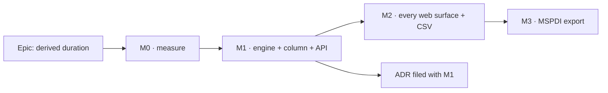

# Implementation Plan: A derived-span activity states its own duration

- **Feature spec:** [`./spec.md`](./spec.md)
- **Status:** Draft — produced with the spec; nothing is built until the product owner approves both
- **Owner:** product owner (approver); builder agent (implementation)

## Breakdown

### Epic

**A derived-span activity states its own duration** — closes `docs/TECH_DEBT.md` #375's open half
and the unrecorded LOE half; WBS follow-ons theme.

Every milestone is built and proven in a container: `pnpm prepush`, `scripts/e2e-local.sh api`,
`scripts/e2e-local.sh web:wbs`. No milestone needs real hardware, an operator or the deployed host.

**No `VITE_` flag** (ADR-0088 D1, spec CQ-6). Each milestone is its own commit boundary.

---

### Milestone M0: measure before building (ADR-0113 / ADR-0142)

**Outcome:** the spec's three unverified premises are either confirmed or the spec is corrected
before code changes.
**Entry point:** `Ships dark: measurement only, no product change.`
**Journey:** none (no product change).

#### Feature: premise checks

> **Description:** read-and-run checks, written to `docs/specs/wbs-summary-duration/m0-measurement.md`.
> **Complexity:** S
> **Dependencies:** none
> **Risks:** a premise is false → the spec is amended before M1, not worked around in code.
> **Testing requirements:** each finding names the command or file:line that established it.

##### Task M0-T1 — conformance comparison shape

- **Description:** confirm the ADR-0034 harness compares named fields (so an added optional result
  field cannot fail it) by reading `apps/api/src/modules/schedule/conformance/adapter.ts` and
  running the conformance suite with a throwaway extra field on LOE/summary results.
- **Complexity:** S · **Dependencies:** none
- **Risks:** it deep-equals → M1 must route the field around it; record which.
- **Testing:** the run's output, quoted.
- **Development steps:** 1. read; 2. local throwaway edit, run, revert; 3. record.

##### Task M0-T2 — the problem, on the seeded plan

- **Description:** seed `plan:capability-types-and-wbs`; record what `W1`, `G1`, `G2` show today in
  the activities table, Gantt grid, Gantt print, centre item, Tier-1 sentence and CSV. Confirms the
  LOE `0 d` finding in the product, not only in a unit test, and whether `GanttPrintSurface` reads
  `grid-columns.ts`.
- **Complexity:** S · **Dependencies:** none
- **Testing:** screenshots / text captured in a container browser.
- **Development steps:** 1. `schedulepoint-seed`; 2. read each surface; 3. record.

##### Task M0-T3 — the placed-child rollup (spec R-3)

- **Description:** on a summary with one child placed later than logic, compare the summary's drawn
  span to the child's. If the child draws outside, file a new `docs/TECH_DEBT.md` row; do not fix.
- **Complexity:** S · **Dependencies:** none
- **Testing:** an API read of both rows' `visualEffective*` after a recalc.

---

### Milestone M1: the engine writes it and the API returns it

**Outcome:** after a recalculation, every activity read carries `derivedDurationMinutes` /
`derivedDurationDays` for summaries and LOEs; nothing on screen changes yet.
**Entry point:** `Ships dark: the API field exists and no web surface reads it until M2 (same release train).`
**Journey:** none in M1; the API e2e case is the gate. M2 owes the journey.

#### Feature: engine output

> **Description:** compute the derived duration in `computeSchedule`'s results loop for LOE and
> summary results only.
> **Complexity:** M
> **Dependencies:** M0-T1
> **Risks:** the parity gate → the field is absent for every other type (`externalDriven` shape);
> `compute.spec.ts` and `compute.visual.spec.ts` are not edited.
> **Testing requirements:** new `engine/compute.derived-duration.spec.ts`.

##### Task M1-T1 — `EngineResult.derivedDurationMinutes`

- **Description:** add the optional field to the engine result type; set it in the results loop
  from `cal.workingTimeBetween(esInst, efInst)` for a summary with children and an LOE without
  `loeNoSpan`.
- **Complexity:** S · **Dependencies:** M0-T1
- **Risks:** off-by-boundary on a finish rolled backward (`compute.ts:626-628`) → cases with a
  child finishing at a non-working boundary.
- **Testing:** cases — summary over two children on Mon–Fri (whole days); a sub-day span on an
  08:00–16:00 calendar; a 7-day child under a Mon–Fri summary (counted on the summary's calendar);
  a summary with its own calendar; nested summaries; empty summary → absent; LOE with span; LOE
  `loeNoSpan` → absent; a plan with neither type → `results` deep-equal to the same call before the
  change (the parity case); and the agreement case — for an unplaced summary and LOE the derived
  duration in days equals the drawn span's working-day length.
- **Development steps:**
  1. Add the field to the result type with a docblock stating when it is absent.
  2. Compute it beside `pointLike` (`compute.ts:780`), reusing `cal` already in scope.
  3. Write the new spec file; verify each case red against a stub returning `undefined`.

#### Feature: persistence — **database-architect first**

> **Description:** one nullable engine-owned column and its write.
> **Complexity:** S
> **Dependencies:** M1-T1; **the database-architect agent's design** (CLAUDE.md §19.3 — re-run it if
> it returns nothing; never proceed without it)
> **Risks:** R-1/R-2 of the spec.
> **Testing requirements:** repository unit (argument position) + API e2e (real Postgres read-back).

##### Task M1-T2 — schema design via database-architect

- **Description:** brief the agent with spec §4.6; record its design (column, CHECK or not,
  migration name) in `docs/specs/wbs-summary-duration/schema-design.md`.
- **Complexity:** S · **Dependencies:** M1-T1
- **Testing:** none (design artefact).

##### Task M1-T3 — migration + `writeResults`

- **Description:** the migration the architect designed; `writeResults` appends
  `derived_duration_minutes` as the 25th `unnest` argument (after `self_over_allocated`) in all
  three lists; the docblock's "twenty-three" becomes "twenty-four".
- **Complexity:** S · **Dependencies:** M1-T2
- **Risks:** an all-null `int[]` array on a plan with no summary/LOE → Prisma serialises it untyped;
  `::int[]` is the existing cast for `visual_drift_days` and resolves an all-null array (verify in
  the e2e on a plan with neither type).
- **Testing:** `schedule.repository.day-factor.spec.ts` gains a position assertion for argument 25;
  API e2e `test/derived-duration.e2e-spec.ts`: recalc `plan:capability-types-and-wbs`-shaped data,
  read the column back for W1/G1/G2 and null elsewhere; a plan with no summary/LOE recalculates
  cleanly. Verify red by deleting the `SET` line.
- **Development steps:** 1. migration; 2. Prisma model + comment; 3. `writeResults`; 4. tests; 5. `pnpm prepush` + `scripts/e2e-local.sh api`.

#### Feature: API contract

##### Task M1-T4 — DTOs, types, guest allowlist

- **Description:** `ActivityResponseDto.from` maps both fields (`minutesToDays` with the row's
  `dayFactorMinutes`); `@repo/types` `ActivitySummary` gains them; `GuestActivityDto` gains them
  and `guest-dto.spec.ts`'s allowlist names them; OpenAPI descriptions; `docs/API.md`.
- **Complexity:** S · **Dependencies:** M1-T3
- **Risks:** the guest allowlist is a deliberate field list → the test fails until named, which is
  the point.
- **Testing:** DTO unit (null for other types, rounding on an 8-hour factor), guest DTO allowlist.
- **Development steps:** 1. DTOs; 2. types; 3. OpenAPI; 4. `docs/API.md`; 5. changeset (`api`
  minor, `@repo/types`).

##### Task M1-T5 — the ADR

- **Description:** file the ADR outlined in spec §4.9 with its CLAUDE.md §16 line in the same commit.
- **Complexity:** S · **Dependencies:** M1-T1
- **Testing:** `pnpm check:adr-coverage` (inside `pnpm prepush`).

---

### Milestone M2: every web surface states it

**Outcome:** a planner, viewer or guest sees `47 d` (or `46d 4h`) for a summary or LOE in the
activities table, Gantt grid and print, canvas centre item, Tier-1 sentence and editor; the CSV
carries it.
**Entry point:** Plan workspace → **Activities** panel → the summary's **Duration** cell; the
**Gantt** view's **Duration** column; select the summary on the canvas (centre item under the bar).
**Journey:** `apps/web/e2e-wbs/wbs.spec.ts` — after the existing "group … recalculate" step, assert
`Substructure`'s Duration cell reads a figure (not `—`) equal to the value the API returns for it,
and that the Gantt Duration cell for the same row reads the same. Verified red against M1 alone.

#### Feature: the one Duration cell

> **Description:** `formatDurationCell` reads the derived fields for the two types.
> **Complexity:** S
> **Dependencies:** M1-T4
> **Risks:** R-5 — tests pinning `—` → restated with their reasons.
> **Testing requirements:** `duration-readout.sub-day.test.ts`, `duration-column.test.ts`,
> `ActivitiesTable.test.tsx` restated; new cases for null → `—`, whole days, sub-day.

##### Task M2-T1 — `formatDurationCell` and its two hosts

- **Description:** widen the input type to include the two fields; summary/LOE branch; rewrite the
  docblocks in `duration-field.ts`, `grid-columns.ts:70-89` and `ActivitiesTable.tsx:69-76`, which
  currently explain why the figure is withheld.
- **Complexity:** S · **Dependencies:** M1-T4
- **Testing:** as above, each verified red.
- **Development steps:** 1. function; 2. docblocks; 3. tests; 4. check any sort-by-duration key uses
  the same value (read `row-model.ts` and the table's sort).

##### Task M2-T2 — canvas centre item and Tier-1 sentence

- **Description:** `centreItemText` summary → duration only; LOE → derived duration + float;
  `describeActivity` duration clause from the derived figure. The guest canvas follows through
  `guest-api.ts`'s adapter.
- **Complexity:** S · **Dependencies:** M1-T4
- **Risks:** `paint.centre-item.test.ts` and `a11y.test.ts` pin "withheld" → restate.
- **Testing:** `a11y.test.ts`, `paint.centre-item.test.ts`, guest adapter test.

##### Task M2-T3 — editor sentence

- **Description:** host resolves the figure and start/finish and passes them to
  `ActivityWorkFields` (ADR-0089 D2b); append "Currently N working days, {start} to {finish}." when
  present.
- **Complexity:** S · **Dependencies:** M1-T4
- **Testing:** `ActivityWorkFields.test.tsx` — present, absent (null), and both types.

##### Task M2-T4 — CSV

- **Description:** `export-csv.ts` `Duration (days)` uses the derived days for the two types,
  blank when null.
- **Complexity:** S · **Dependencies:** M1-T4
- **Testing:** `export-csv.test.ts` summary + LOE rows.

##### Task M2-T5 — journey, playbook, debt register

- **Description:** the journey step above; `docs/TEST_PLAYBOOK.md`'s types-and-WBS row states the
  derived duration and what wrong looks like (`—` after a recalc, or `0 d` for an LOE); close #375's
  open half in `docs/TECH_DEBT.md`; web changeset (minor).
- **Complexity:** S · **Dependencies:** M2-T1…T4
- **Testing:** `scripts/e2e-local.sh web:wbs`; `pnpm check:playbook`.

---

### Milestone M3: MSPDI carries it (separable — spec CQ-3)

**Outcome:** an MS Project export states a summary's and an LOE's derived duration in `<Duration>`.
**Entry point:** Plan → **Export** → **Microsoft Project (MSPDI)**.
**Journey:** API e2e only (the export is a file); the existing export journey is not extended.

##### Task M3-T1 — canonical model + emitter

- **Description:** the export mapper passes `derivedDurationMinutes` into the canonical activity
  (additive optional field in `packages/interchange`); `mspdi-emit.ts` uses it for summary and LOE
  when present, the stored value otherwise. The LOE drop finding's wording changes from "with its
  duration" to "with its derived duration".
- **Complexity:** M · **Dependencies:** M1-T4
- **Risks:** re-import round-trip — the importer reads `<Duration>` only for a task
  (`mspdi-adapter.ts:451-454`), so a summary's value is ignored on the way back; an LOE re-imports
  as a task with that duration, which is the existing documented loss, now with the right number.
- **Testing:** `mspdi-export.spec.ts` (summary + LOE durations), round-trip spec unchanged-green;
  API e2e export of the seeded plan.

## Sequencing & slices

M0 → M1 → M2 (one release train; M1 alone is invisible and harmless) → M3 (optional, independent).
`main` is releasable after every task: the column is nullable and unread until M2.

## Definition of Done (per task)

Each task's PR satisfies the Feature Completion Criteria in [`docs/PROCESS.md`](../../PROCESS.md):
code, tests, docs, security review, performance, accessibility, Docker build, CI, changelog, version
impact — with `pnpm prepush` and the relevant `scripts/e2e-local.sh` targets **run**.

**Agents to involve:** database-architect (M1-T2, mandatory); api-reviewer + security-reviewer
(M1-T4, the guest allowlist); backend-performance-reviewer (M1-T3, the batch statement);
accessibility-reviewer (M2-T2, Tier-1 sentence); component-reviewer (M2-T1/T3); test-engineer
(M1-T1 case design).

## Risks & assumptions (rollup)

| Risk / assumption                                                               | Likelihood | Impact   | Mitigation                                                    |
| ------------------------------------------------------------------------------- | ---------- | -------- | ------------------------------------------------------------- |
| Conformance harness deep-equals results                                         | low        | med      | M0-T1 measures before M1                                      |
| `writeResults` argument renumbering                                             | med        | med      | append last; position assertion                               |
| A missing `SET` entry passes unit tests                                         | med        | high     | real-Postgres read-back, verified red                         |
| Placed children draw outside their summary (R-3)                                | med        | low here | measured in M0-T3, filed separately                           |
| Planners see `—` until they recalculate                                         | high       | low      | today's behaviour; CQ-5 offers a boot recalc                  |
| Children on other calendars counted on the summary's calendar surprise a reader | low        | low      | stated in the ADR and the editor sentence says "working days" |
