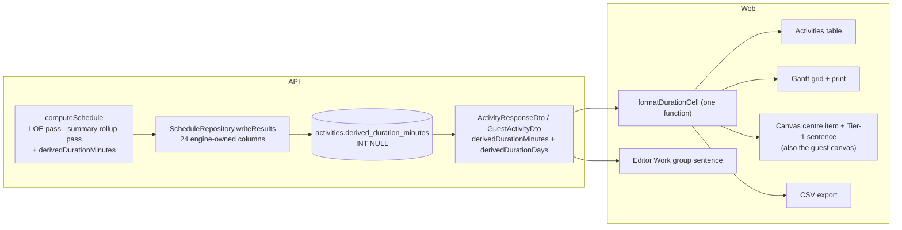
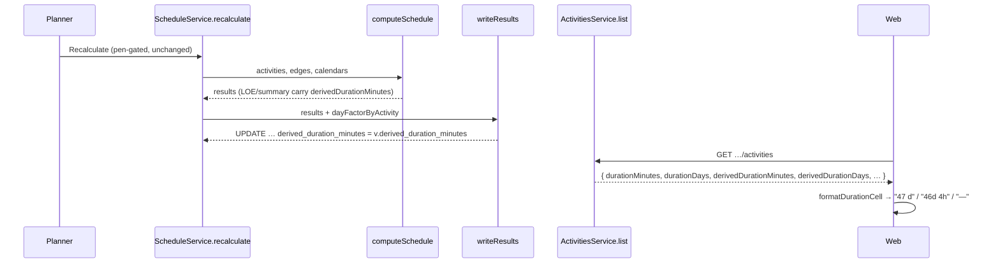
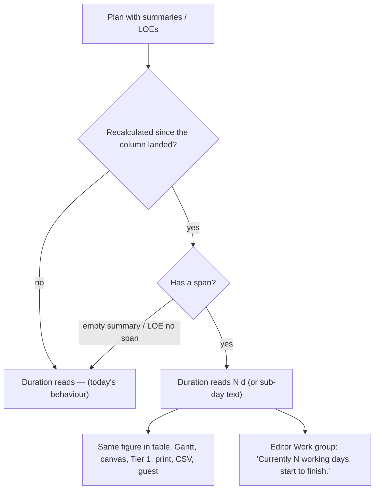

# Feature Spec: A derived-span activity states its own duration

- **Status:** Draft — awaiting the product owner's approval before implementation
- **Author(s):** feature-analyst (for the product owner)
- **Date:** 2026-10-17
- **Tracking issue / epic:** closes the open half of `docs/TECH_DEBT.md` #375
- **Roadmap link:** WBS follow-ons (`docs/BACKLOG.md` "WBS follow-ons (ADR-0063)")
- **Related ADR(s):** ADR-0035 §21/§24, ADR-0036 §7, ADR-0037 §4, ADR-0038, ADR-0063, ADR-0068 §4,
  ADR-0070, ADR-0089 D2b, ADR-0148 D3; **a new ADR is required** (outline in §4.9)

> **Scope in one sentence.** After a recalculation, a `WBS_SUMMARY` — and, on the evidence in §1, a
> `LEVEL_OF_EFFORT` — shows the working time its engine-derived span covers, in every place a
> duration is shown, instead of `—` (summary) or a false `0 d` (LOE).

---

## 1. Business understanding

### Problem

A planner reading a WBS summary in the activities table or the Gantt grid sees `—` in the Duration
column. That was a deliberate, honest stop-gap: the stored duration of a summary is its creation
input (`0` from the XER importer) and is never written back, so printing it said `0 d` beside an
eleven-month bar (`docs/TECH_DEBT.md` #375, closed half). The row says the open half plainly: _"The
rolled-up span in working days needs the engine to write it and stays unbuilt."_

**The problem statement was re-verified against the code, not inherited from #375** (CLAUDE.md
§19.11, "re-verify a spec's PROBLEM statement"). What was read:

| Claim                                                   | Evidence                                                                                                                                                                                                                                                                                                                                                                                                                      | Holds?                                                       |
| ------------------------------------------------------- | ----------------------------------------------------------------------------------------------------------------------------------------------------------------------------------------------------------------------------------------------------------------------------------------------------------------------------------------------------------------------------------------------------------------------------- | ------------------------------------------------------------ |
| A summary reads `—` in both tables                      | `apps/web/src/features/activities/model/duration-field.ts:127-139` (`formatDurationCell`); its two callers `features/gantt/layout/grid-columns.ts:90` and `features/activities/components/ActivitiesTable.tsx:77-79`                                                                                                                                                                                                         | Yes                                                          |
| The canvas centre item is withheld for a summary        | `features/tsld/render/a11y.ts:100-113` (`centreItemText` returns `null` for `summary`)                                                                                                                                                                                                                                                                                                                                       | Yes                                                          |
| The engine already rolls up the summary's instants      | `apps/api/src/modules/schedule/engine/compute.ts:572-634` — deepest-first over direct children, rolled onto `calendarOf(summary)` at `:606`, `:626-628`                                                                                                                                                                                                                                                                        | Yes                                                          |
| Nothing persists a duration for the rollup              | `apps/api/src/modules/schedule/schedule.repository.ts:926-988` — the 23 engine-owned columns written by `writeResults`; none is a duration                                                                                                                                                                                                                                                                                     | Yes                                                          |
| **An LOE has the same defect, unreported**              | `isDurationDerivedType` stores `0` for LOE as for a summary (`features/activities/schemas/activity-schemas.ts:53-61`); `formatDurationCell` treats LOE as an ordinary type, and its own test **asserts** `LEVEL_OF_EFFORT` reads `0 d` (`features/activities/model/duration-readout.sub-day.test.ts:54-57`); `centreItemText` therefore prints `0d · …d float left` under an LOE bar spanning its hammock (`a11y.ts:109-112`) | **Yes — new finding**                                        |
| The spoken Tier-1 sentence omits the duration for both  | `a11y.ts:130-133` — the clause appears only when `durationDays > 0`, which is never true for a summary or an LOE                                                                                                                                                                                                                                                                                                              | Yes                                                          |
| The CSV export prints the stored `0`                    | `features/tsld/export/export-csv.ts:104` — `Duration (days)` is `String(a.durationDays)` for every type                                                                                                                                                                                                                                                                                                                       | Yes — #375's fix did not reach it                            |
| MSPDI writes a summary and an LOE with `Duration` 0     | `packages/interchange/src/mspdi-emit.ts:458-477` — `minutesToIsoDuration(activity.durationMinutes)` for every task, the LOE explicitly "written as an ordinary task with its duration"                                                                                                                                                                                                                                         | Yes                                                          |
| XER writes no duration for a summary at all             | `packages/interchange/src/xer-emit.ts:352-366` — a `PROJWBS` row carries id, parent, code and name only                                                                                                                                                                                                                                                                                                                      | Yes — nothing to fix there for summaries                     |

So the defect is wider than #375 recorded: **the LOE half was never noticed** because #375 was
framed around summaries, and #375's own fix reached two of the five places a summary's duration is
shown.

### Users

| Role (ADR-0012/0016)        | Need                                                                                       |
| --------------------------- | ------------------------------------------------------------------------------------------ |
| Planner, Org Admin          | Read how long a phase or a hammock lasts without opening its children or counting days     |
| Contributor, Viewer         | The same, read-only                                                                        |
| External Guest (ADR-0051)   | The same figure on the shared plan — the guest canvas renders the centre item (`share/guest-api.ts:163-191`) |
| A reader of an export       | A CSV / MS Project file whose duration column does not state `0` for an eleven-month phase |

### Primary use cases

1. Scan the activities table or Gantt grid and compare phase lengths (`Substructure 47 d`,
   `Frame 112 d`).
2. Read an LOE's (site supervision, crane hire hammock) duration where the plan states it.
3. Hear the duration of a summary or LOE in the canvas's Tier-1 sentence (ADR-0026 D7).
4. Export a CSV for a client report without hand-correcting every summary row.

### User journeys

A planner files work under `Substructure`, presses Recalculate, and the summary's Duration cell
changes from `—` to `47 d`. They move a child later, recalculate, and it reads `52 d`. They open the
summary's editor: the Work group's explanation now ends "Currently 47 working days, 2 Mar to
5 May." See §4.3.

### Expected outcomes

- No surface prints a false `0` for a summary or an LOE; none prints `—` for one that has a span.
- The figure is the engine's, computed once, so the activities table, Gantt, canvas, guest view,
  print and CSV cannot disagree about it.

### Success criteria

- **SC-1** On `plan:capability-types-and-wbs` (`docs/TEST_PLAYBOOK.md` "Activity types and the
  WBS"), after one recalculation, `W1`, `G1` and `G2` each report a non-null derived duration equal
  to the engine's working time between their rolled-up start and finish on their own calendar, and
  every other activity reports `null`.
- **SC-2** The ADR-0034 conformance matrix and `compute.spec.ts` (the Pass-1 golden suite) are green
  **with no edit to either file** (the ADR-0148 D2 acceptance shape).
- **SC-3** The activities table, the Gantt Duration column, the canvas centre item and the Tier-1
  sentence show the same figure for the same activity, asserted by one journey in a real browser.
- **SC-4** A plan that has never been recalculated since the column landed reads exactly as today
  (`—` for a summary) — no invented figure.

### Open questions

See §6. Critical ones are marked.

## 2. Functional requirements

### User stories & acceptance criteria

> **US-1** — As a **Planner**, I want a WBS summary's Duration to show the working time its
> rolled-up span covers, so that I can compare phases without counting days.
>
> - **Given** a summary whose children span 2 Mar–5 May on a Mon–Fri calendar with no exceptions
>   **when** the plan is recalculated **then** its Duration cell reads `47 d` in the activities table
>   and the Gantt grid.
> - **Given** the span is not a whole number of working days and sub-day authoring is available
>   (`canAuthorSubDay`, ADR-0070) **then** it reads in the sub-day grammar (`46d 4h`), exactly as a
>   task's stored duration would (`formatDurationRead`, `duration-field.ts:95-108`).
> - **Given** a summary with **no** children **then** it reads `—` (it has no span; the engine
>   collapses it to the data date, `compute.ts:610-613`).
> - **Given** a plan last recalculated before this ships **then** a summary reads `—` until the next
>   recalculation (SC-4).

> **US-2** — As a **Planner**, I want a Level-of-Effort activity to show the duration of its
> derived span, so that a hammock does not read `0 d` like a milestone.
>
> - **Given** an LOE spanning an SS predecessor's start to an FF successor's finish **then** its
>   Duration cell, centre item and Tier-1 sentence state that span's working time.
> - **Given** an LOE with no resolvable span (`loeNoSpan`, ADR-0035 §21 N12) **then** it reads `—`,
>   never the fallback's zero length — the fallback is a defined placement, not a measurement.

> **US-3** — As any reader (Viewer, Contributor, Guest), I want the canvas centre item and the
> spoken sentence to carry the same figure as the table.
>
> - **Given** a summary **then** its centre item reads `47d` with **no float clause** (a summary's
>   float is 0 by convention, `compute.ts:742-748`; "0d float left" would be a convention presented
>   as a measurement).
> - **Given** an LOE **then** its centre item reads `47d` and keeps its float clause as today.
> - **Given** keyboard navigation to either **then** Tier 1 includes ", 47 working days".

> **US-4** — As a **Planner**, I want the activity editor to tell me the current derived duration,
> so that the explanation of why there is no Duration field is not also a dead end.
>
> - **Given** a summary or an LOE with a computed span **then** the Work group's existing paragraph
>   (`fields/ActivityWorkFields.tsx:97-115`) ends with "Currently N working days, {start} to
>   {finish}." — plain text, no field (there is nothing to edit).
> - **Given** no computed span **then** the paragraph is unchanged.

> **US-5** — As a **Planner**, I want exports to carry the figure.
>
> - **Given** a CSV export **then** `Duration (days)` for a summary or LOE is its derived duration
>   in days, or blank when there is none (the column's existing convention for an uncalculated
>   engine value, `export-csv.ts:53`).
> - **Given** an MSPDI export **then** a summary's and an LOE's `<Duration>` is the derived duration
>   (default — critical question CQ-3).
> - **Given** an XER export **then** nothing changes: `PROJWBS` has no duration field and P6 owns
>   LOE durations on schedule (CQ-3).

### Workflows

1. Recalculate (existing, pen-gated, unchanged). The engine computes the derived duration in the
   same pass that rolls up the span and writes it in the same `writeResults` batch.
2. Any read of activities (`GET …/plans/:planId/activities`, item reads, the guest share read)
   returns it beside the stored duration.
3. The web formats it through the one Duration cell function; every surface reads it there.

### Edge cases

| Case                                                              | Expected                                                                                                                                         |
| ----------------------------------------------------------------- | ------------------------------------------------------------------------------------------------------------------------------------------------ |
| Empty summary                                                     | `null` → `—`                                                                                                                                     |
| LOE with `loeNoSpan`                                              | `null` → `—`                                                                                                                                     |
| Children on a 7-day calendar, summary on Mon–Fri                  | Counted on the **summary's** calendar — weekend days the children work are not counted. Stated in the ADR; it is the engine's own rollup calendar |
| Summary with its own calendar set                                 | That calendar (`ownCalendarId` → plan), the one the engine rolls onto (`compute.ts:606`) and the one the day factor decorates with (`day-factor.ts:58-61`) |
| Plan with no calendar                                             | All-minutes calendar; days = minutes / 1440 (`DEFAULT_HOURS_PER_DAY_MINUTES`), as for every other duration                                       |
| Nested summaries                                                  | Each states its own span; a parent's is not the sum of its children's (overlap)                                                                  |
| Branch with completed work before the data date                   | The span runs from the frozen actual start; working time across it is counted on the absolute-instant axis (ADR-0037)                             |
| Membership changed, not yet recalculated                          | Stale, exactly as the summary's dates are — the plan's existing "edited since calculated" signal covers both (`scheduleInputsChangedAt`)            |
| A child placed later than logic (ADR-0148)                        | See risk R-3: the rollup reads children's Pass-1 dates; this spec does not change which span is rolled up, only states its length                |
| Milestone, task, resource-dependent                               | `null`; their cell is unchanged                                                                                                                  |

### Permissions

Read-only data. Whoever may read an activity (`activity:read`, org-scoped, ADR-0012) reads the
field; the guest DTO's allowlist gains it (ADR-0051 — it is schedule, not analysis, so it belongs on
the guest side of `guest-activity.dto.ts:29`'s line). The value is written only by recalculation,
which is already pen-gated and permissioned. **No new write path, no new permission, not a
structural write.** Never accepted from a DTO (ADR-0022).

### Validation rules

None at the boundary (no input). Engine invariant: `derivedDurationMinutes ≥ 0` when present.

### Error scenarios

| Scenario                              | Detection                     | Result                              | Status |
| ------------------------------------- | ----------------------------- | ----------------------------------- | ------ |
| Plan not recalculated since migration | column `NULL`                 | `—`                                 | 200    |
| Write count shortfall in `writeResults` | existing check (`schedule.repository.ts:993-997`) | recalc fails loud, nothing half-written | 500 (existing) |

## 3. Technical analysis

| Area           | Impact | Notes                                                                                                                                           |
| -------------- | ------ | ----------------------------------------------------------------------------------------------------------------------------------------------- |
| Frontend       | med    | `formatDurationCell`, `centreItemText`, `describeActivity`, `ActivityWorkFields`, `export-csv.ts`, guest adapter; restate five regression tests |
| Backend        | med    | engine result field; `writeResults` 24th column; response + guest DTO mapping                                                                   |
| Database       | low    | **one nullable column** — through database-architect (CLAUDE.md §19.3)                                                                          |
| API            | low    | two additive response fields; OpenAPI + `docs/API.md`                                                                                            |
| Security       | low    | read-only; guest allowlist test must name the new fields                                                                                          |
| Performance    | low    | one `workingTimeBetween` per summary/LOE per recalc (O(summaries)); one extra `int[]` in an existing statement; no read-side cost                |
| Infrastructure | none   | migration rides the self-migrating image (ADR-0018)                                                                                              |
| Observability  | none   |                                                                                                                                                 |
| Testing        | med    | engine unit, repository unit, API e2e (real Postgres), web unit, one journey                                                                     |

### Dependencies

- None to land first. Touches the schedule write path, so it must not collide with an in-flight
  `writeResults` change (position-pinned arguments, `schedule.repository.ts:890-896`).
- **Container-only:** everything here builds and is proven with `pnpm prepush`,
  `scripts/e2e-local.sh api` and `scripts/e2e-local.sh web:wbs` against the containerised Postgres
  the script brings up. No hardware measurement, no operator step, no host-only configuration.

## 4. Solution design

### 4.1 Architecture overview



### 4.2 Data flow



### 4.3 User flow



### 4.4 The design decision — where the number is computed

| Option                                                                                          | Verdict         | Why                                                                                                                                                                                                                                                                                                                                                                                                              |
| ----------------------------------------------------------------------------------------------- | --------------- | ---------------------------------------------------------------------------------------------------------------------------------------------------------------------------------------------------------------------------------------------------------------------------------------------------------------------------------------------------------------------------------------------------------------- |
| **A. Engine computes it in the rollup pass; persisted with the other schedule results**         | **Recommended** | The engine is the only place holding the span as **instants** and the calendar it was rolled onto (`compute.ts:606-633`). Persisted columns are `@db.Date` (`schema.prisma:1271-1274`), so anything downstream sees only day-granular dates. Precedent: `remaining_float` is persisted precisely because "minutes are persisted for NEITHER input, so anything downstream … can only ever produce the wrong form" (`schedule.repository.ts:872-874`, ADR-0148 D3). |
| B. Derived at read time on the server from `earlyStart`/`earlyFinish`                            | Rejected        | Day-granular inputs (sub-day spans lost — ADR-0070); needs the full calendar (shifts + exceptions) loaded on every list read, an N+1 against `withDayFactors`' one-lookup design (`activities.service.ts:145-198`); and a second implementation of working-time arithmetic outside the engine, which is the ADR-0065 one-implementation argument.                                                             |
| C. Derived in the client from the rolled-up dates                                               | Rejected        | All of B's problems, plus the client would need every calendar's exception list, and the canvas, Gantt and guest view would each compute it — the drift `lib/bar-dates.ts:12-17` exists to prevent.                                                                                                                                                                                                              |
| D. Write the derived value into `duration_minutes` itself                                       | Rejected        | `duration_minutes` is planner input (ADR-0022: engine output is never an input column); writing it from a recalc would touch an input the next recalc reads, change the XER/MSPDI round-trip, enter activity history and break the optimistic-lock invisibility of a recalc (`schema.prisma:1276-1282`).                                                                                                            |

### 4.5 The computation

In the results loop of `computeSchedule`, for an activity whose type is `WBS_SUMMARY` or
`LEVEL_OF_EFFORT`:

```text
derivedDurationMinutes =
  (summary with no children) or (LOE with loeNoSpan)  → absent (null at the column)
  otherwise → cal.workingTimeBetween(instant(esInst), instant(efInst))   // cal = calendarOf(activity)
```

- **Which span:** the Pass-1 derived span (`esInst`/`efInst`), which is also the length both
  bases draw — the placed basis reuses it (`vSpanOwn = efOwn − esOwn`, `compute.ts:825-826`) and an
  unplaced summary is drawn on Pass 1 outright (`drawnOnPass1`, `compute.ts:923`). A unit case
  asserts the derived duration agrees with the drawn span's working-day length for an unplaced
  summary and LOE, so a future change to either cannot pass silently.
- **Which calendar:** the activity's own, falling back to the plan's — `calendarOf(activity)`, the
  calendar the rollup is rolled onto (`compute.ts:606`, `:537`) and the one
  `schedulingCalendarId` resolves for a non-resource-dependent type (`day-factor.ts:58-61`). So the
  minutes and the day factor that converts them are on **one** calendar (CQ-2).
- **Units:** working **minutes** in the engine and the column (the `leveling_delay_minutes`
  precedent, `schedule.repository.ts:911`); days at the API boundary with the same
  `minutesToDays(minutes, dayFactorMinutes)` every other duration uses (`day-factor.ts:203-207`).
  The web prints whole days when the value is whole and the sub-day grammar otherwise, through
  `formatDurationRead` unchanged.

**Parity.** The field is set **only** on an LOE or summary result and is absent from every other
result — the `externalDriven` shape at `compute.ts:945`. A plan with neither type therefore gets a
byte-identical `results` array; the Pass-1 golden suite and `compute.visual.spec.ts` are not edited;
new cases live in a new spec file. The conformance harness compares named fields through its
adapter (`apps/api/src/modules/schedule/conformance/adapter.ts`) — **M0 verifies this rather than
this spec asserting it**, because the fixture does contain summaries and LOEs (`type_wbs_summary`,
`type_loe` in `packages/engine-conformance/src/coverage.ts:49-52`).

### 4.6 Database changes — **must go through database-architect** (CLAUDE.md §19.3)

Stated need, **not** a migration:

- **Candidate column:** `activities.derived_duration_minutes INTEGER NULL`, no default, Prisma
  `derivedDurationMinutes Int? @map("derived_duration_minutes")`, placed with the engine-owned
  columns and documented in the same style (engine-owned, written only by `writeResults`, never
  from a DTO, never touching `version`/`updated_at`/`updated_by`).
- **Backfill:** none. `NULL` reads as "not calculated", which renders `—` — today's behaviour (SC-4).
- **Index:** none — read within the plan-scoped activity load, never filtered or sorted in SQL.
- **For the architect to decide:** whether a `CHECK (derived_duration_minutes IS NULL OR
  derived_duration_minutes >= 0)` is warranted (the float columns carry none; `remaining_float` is
  signed by design, this one is not); and whether a type-consistency CHECK (non-null only for the
  two types) is worth its cost on a type change (it would fail a recalculation-free type change from
  `WBS_SUMMARY` to `TASK` unless the write path clears it — probably **not** worth it; the reader
  ignores the field for other types anyway).
- **Baseline snapshots (ADR-0025) are out of scope** — `baseline_activities` gains nothing.

### 4.7 API changes

Additive response fields on every activity read (`ActivityResponseDto`), the activity summary type
(`@repo/types` `ActivitySummary`) and the guest DTO (`GuestActivityDto`):

| Field                    | Type             | Meaning                                                                                                              |
| ------------------------ | ---------------- | -------------------------------------------------------------------------------------------------------------------- |
| `derivedDurationMinutes` | `number \| null` | Engine-owned. Working minutes across a WBS summary's or LOE's derived span on its own calendar. `null` for every other type, for an empty summary, for an LOE with no span, and before the first recalculation that wrote it. |
| `derivedDurationDays`    | `number \| null` | The same, rounded to whole days on the activity's day factor — lossy, as `durationDays` is beside `durationMinutes`.   |

No endpoint, status code or request shape changes. `docs/API.md` and the OpenAPI descriptions
updated. Pre-1.0 additive: minor bump for `api` and `web`.

### 4.8 Component changes

| Where                                                     | Change                                                                                                                                                         |
| --------------------------------------------------------- | -------------------------------------------------------------------------------------------------------------------------------------------------------------- |
| `features/activities/model/duration-field.ts`             | `formatDurationCell` reads `derivedDurationMinutes`/`Days` for `WBS_SUMMARY` and `LEVEL_OF_EFFORT`, `—` when null; milestones unchanged. Its docblock and #375's are rewritten |
| `features/tsld/render/a11y.ts`                            | `centreItemText`: summary → duration only; LOE → derived duration + float clause. `describeActivity`: the duration clause uses the derived figure for both types |
| `features/activities/components/fields/ActivityWorkFields.tsx` | One sentence appended to the existing summary/LOE paragraphs; the figure arrives as a host-resolved prop (ADR-0089 D2b)                                     |
| `features/tsld/export/export-csv.ts`                      | `Duration (days)` uses the derived days for the two types, blank when null                                                                                     |
| `features/share/guest-api.ts`                             | Adapter passes the two fields through                                                                                                                          |
| Gantt print                                               | Expected to follow `grid-columns.ts` for free — **M0 confirms** `GanttPrintSurface` reads that column rather than its own                                      |

No new component, no new token, no new style. Loading / empty / error states are the existing
table's; the only new state is "no span", which is the existing `—`.

### 4.9 ADR required — outline

**ADR-NNNN — "A derived span states its own length, and the engine is what measures it."**
Next free number at filing; one line in CLAUDE.md §16 in the same commit (`check:adr-coverage`).

- **Context:** #375's open half; the LOE finding; persisted dates are day-granular.
- **Decision 1:** a WBS summary's and an LOE's duration is engine output, persisted as working
  minutes on the activity's own calendar, null where there is no span. Amends ADR-0035 §21/§24 by
  adding an output; changes no date.
- **Decision 2:** it is never written into `duration_minutes` (ADR-0022).
- **Decision 3:** every surface reads it through `formatDurationCell` or the DTO, never re-derives it.
- **Decision 4:** the export rule (CQ-3's answer).
- **Consequences:** parity argument (§4.5); stale until recalculated; children on other calendars
  are counted on the summary's.

### 4.10 Alternatives considered (beyond §4.4)

- **Plan calendar always.** Simpler to explain, and the same answer for the common case (a summary
  that inherits). Rejected as the default because the engine rolls the summary's boundaries onto its
  own calendar, so the plan calendar would measure a span the engine did not produce — CQ-2.
- **Hours-only display (`376h`).** Rejected: every other duration in the product reads in days with
  the sub-day grammar only when needed (ADR-0070 M4).
- **Count each child's working time and sum.** Rejected: overlapping children double-count, and a
  phase's duration is its span, which is what P6 and MS Project show for a summary row.

## 5. Risks

| #   | Risk                                                                                                                                                                                                                                                                                                                                                                                     | Mitigation                                                                                                                         |
| --- | ---------------------------------------------------------------------------------------------------------------------------------------------------------------------------------------------------------------------------------------------------------------------------------------------------------------------------------------------------------------------------------------- | ---------------------------------------------------------------------------------------------------------------------------------- |
| R-1 | `writeResults` arguments are pinned by position (`schedule.repository.day-factor.spec.ts:190-192`)                                                                                                                                                                                                                                                                                         | Append as the 25th `unnest` argument, after `self_over_allocated`; one order across `SET`, `unnest`, `AS v(…)`                        |
| R-2 | A mocked `$executeRaw` cannot see a missing `SET` entry (`schedule.repository.ts:883-888`)                                                                                                                                                                                                                                                                                                  | API e2e against real Postgres reads the column back after a recalc; verified red by deleting the `SET` line                          |
| R-3 | **Observed by reading, not measured:** the rollup reads children's **Pass-1** instants (`compute.ts:617-621`) while children are drawn on the placed basis (`lib/bar-dates.ts:54-56`), so a child placed later than logic may draw outside its summary's bar. This spec states the length of whatever span the summary has; it does not change the rollup | M0-T3 measures it on a seeded plan. If true, it is filed as its own `docs/TECH_DEBT.md` row and **not** folded in here (CQ-4)          |
| R-4 | Plans not recalculated since the release show `—`                                                                                                                                                                                                                                                                                                                                         | That is today's behaviour; a one-off boot recalculation (the ADR-0155/0161 precedent) is offered as CQ-5, default **no**           |
| R-5 | Five regression tests pin the `—`/`0 d` behaviour (`#375`'s list)                                                                                                                                                                                                                                                                                                                          | Restated deliberately, each with its reason, not bent to fit (the ADR-0082 posture-change convention)                              |

## 6. Open questions

**Critical**

- **CQ-1 — Level-of-effort in scope?** _Recommended:_ **yes.** Same defect (verified at
  `duration-readout.sub-day.test.ts:54-57`), same engine pass already holding the span, same column.
  Leaving it out ships `—` for a summary and `0 d` for a hammock on the same screen.
- **CQ-2 — Which calendar counts the working days?** _Recommended:_ **the activity's own, falling
  back to the plan's** — the calendar the engine rolls the span onto and the day factor already
  converts on. For a summary that inherits (the default) this is the plan calendar anyway.
- **CQ-3 — Exports.** _Recommended:_ CSV **yes** (M2); MSPDI **yes** for summary and LOE (M3,
  separable, round-trip-safe on our side because the importer reads `<Duration>` only for a task,
  `mspdi-adapter.ts:451-454`); XER **unchanged** (no PROJWBS duration field; P6 recomputes LOE).

**Non-critical (defaults stated)**

- **CQ-4 — The placed-child rollup (R-3).** Default: measure in M0, file separately if real.
- **CQ-5 — Boot recalculation to fill the column.** Default: no; `—` until the planner next
  recalculates, which is today's state.
- **CQ-6 — Feature flag.** Default: **none**, per ADR-0088 D1 — a published image carries every
  flag at its default, so a flag would be a second code path rather than a rollback. The rollback
  is the commit boundary; the column is additive and nullable.

## 7. Links

- Implementation plan: [`./plan.md`](./plan.md)
- Docs this change updates: `docs/API.md`, `docs/TECH_DEBT.md` #375 (close the open half),
  `docs/TEST_PLAYBOOK.md` (the `plan:capability-types-and-wbs` row gains the derived duration),
  `docs/DATABASE.md` if the architect adds a constraint, the new ADR + CLAUDE.md §16 line.
